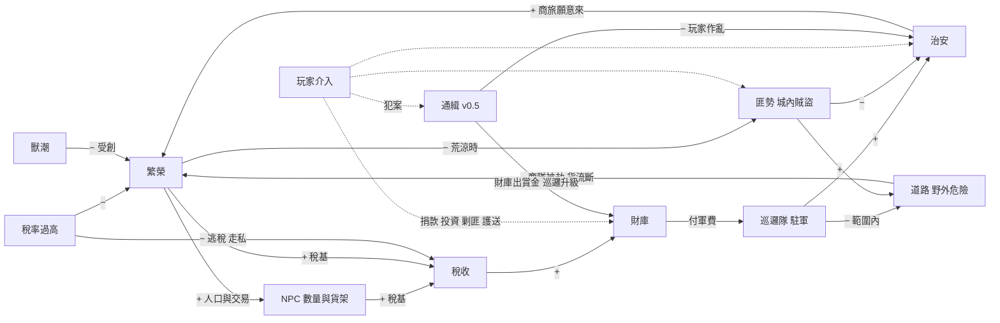
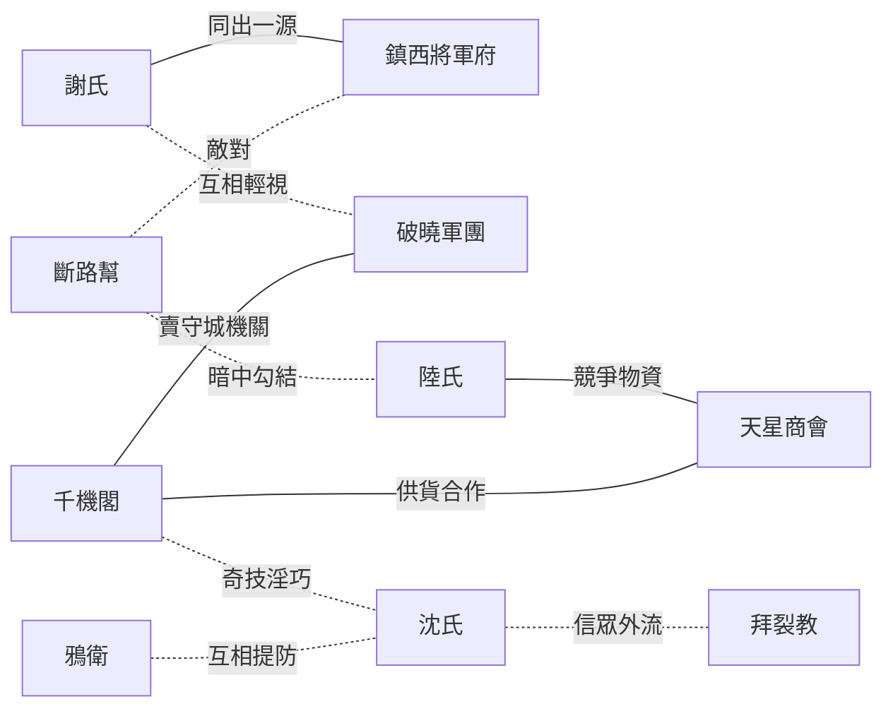

> ⚠️ **已作廢／已被取代**：已由 design/living-world-v0.2.md 取代（2026-11-28）。本檔只留作歷史對照，不再修改。

# 《山海錄》提案：讓世界活起來 v0.1

> 狀態：**提案，待 mumi 拍板**。未改分冊正文，未派工。
> 日期 2026-11-28｜提案人：遊戲製作人｜基準：[v0.3 分冊](../../design/gdd-v0.3-sections/index.md)（`Shiroyashatw/shanhailu` `dd3843b`）
> 相關分冊：[02 世界觀與勢力](../../design/gdd-v0.3-sections/02-worldview-factions.md)、[03 世界地圖](../../design/gdd-v0.3-sections/03-world-map.md)、[05 城鎮與 NPC](../../design/gdd-v0.3-sections/05-towns-npcs.md)、[09 經濟](../../design/gdd-v0.3-sections/09-economy-recipes.md)、[10 委託與世界事件](../../design/gdd-v0.3-sections/10-quests-rumors-events.md)、[13 路線圖與待拍板](../../design/gdd-v0.3-sections/13-roadmap-open-questions.md)
> 標記：**〔既有〕** 來自 v0.3 或舊世界觀｜**〔提議〕** 本案新增｜⚠️ 數字暫定，待數值模擬。
> 出入清單 A-01～A-07 mumi 尚未決定，本案不依賴、不引用成定案。

---

## 0. 結論（先看這裡）

1. **做法**：給每座城鎮 4 個會變的數字：**繁榮、財庫、治安、駐軍**，每天結算一次，互相牽動，形成「繁榮 → 稅 → 財庫 → 巡邏 → 治安 → 繁榮」的主循環。NPC 數量、道路危險、盜匪、通緝都讀這幾個數字，不另開系統。
2. **不是全新系統**：v0.3 已有 `world.hurt`（城鎮受創）、獸潮、劫匪旅途事件、委託板、聲望，本案是把它們接到同一組數字上。
3. **MVP 只做 2 座鎮**（灰窯鎮、渡陰關）：繁榮／財庫／治安／巡邏、交易稅、路人走動、1 個盜匪團、資助巡邏與剿匪、城況簡報。不做通緝、不加新勢力。
4. **通緝放 MVP 之後第一期（v0.5）**，因為它要靠巡邏和治安才有意義；MVP 先留欄位。
5. **三大世族：舊設定找不到名字。** 舊世界觀 `世界觀.md` 與 v0.3 只有一句「當年護民的人，三年後成了軍閥與世族」，見聞〈軍閥與世族〉也只寫鎮西將軍。**所有世族名字都是本案暫名**，請 mumi 確認是否有原案。
6. **勢力 +5**（三大世族、千機閣、斷路幫），分兩批開，現有 5 個勢力一個都不取代。
7. **大城放第二區域**，不塞進灰窯原（15 個地點的尺度裝不下）。大城用「分坊」呈現，每坊同屏人數與現在城鎮一樣。
8. 拍板題共 10 題（第 9 節），每題附建議。

---

## 1. 系統循環

### 1.1 變數（每座城鎮一組，〔提議〕）

| 變數 | 範圍 | 意義 | MVP 起手值 ⚠️ |
| --- | --- | --- | --- |
| 繁榮 P | 15–100 | 人氣與貨流。決定路人數、稅基、貨架 | 灰窯 50／渡陰 45 |
| 財庫 T | 0–∞ 兩 | 稅收進、軍費與維護出 | 200／300 |
| 治安 O | 0–100 | 城內犯案與被劫機率的反向 | 55／60 |
| 駐軍 G | 0–3 檔 | 0 無、1 自衛隊、2 巡邏隊、3 駐軍 | 1／2 |
| 匪勢 B | 0–100 | 周邊盜匪壓力（區域值，不屬於單一城） | 30 |
| 路段危險 R | 係數 | 每條路的遇險率修正，乘在現有 4%／22%／30% 上 | ×1 |

「繁榮」對玩家顯示為 5 檔文字（荒涼／冷清／平常／熱鬧／繁華），點開才看數字。底線 15：村鎮不會歸零消失。

### 1.2 循環圖

### 1.3 正向循環（滾雪球，要壓住）

| 循環 | 路徑 | 結果 |
| --- | --- | --- |
| R1 稅養兵 | 繁榮 ↑ → 稅收 ↑ → 財庫 ↑ → 巡邏 ↑ → 治安 ↑ → 繁榮 ↑ | 良性，但會越滾越大 |
| R2 人氣 | 繁榮 ↑ → 路人 ↑ → 交易 ↑ → 稅收 ↑ | 同上 |
| R3 路網 | 駐軍 ↑ → 道路危險 ↓ → 商隊安全 → 貨流 ↑ → 繁榮 ↑ | 同上 |

### 1.4 負向循環（死亡螺旋，要擋住）

| 循環 | 路徑 | 結果 |
| --- | --- | --- |
| D1 欠餉 | 繁榮 ↓ → 稅 ↓ → 財庫空 → 欠餉降檔 → 治安 ↓ → 匪勢 ↑ → 危險 ↑ → 繁榮 ↓ | 荒涼化 |
| D2 重稅 | 稅率 ↑ → 逃稅與走私 ↑、繁榮 ↓ → 稅基 ↓ | 稅收反而少 |
| D3 受創 | 獸潮未擊退 → 繁榮 ↓ → D1 | 一次事件拖垮 |

### 1.5 防失控（每條都要有，MVP 就做）

| 風險 | 作法 |
| --- | --- |
| 繁榮滾到頂 | 繁榮有承載上限（鎮 80，投資建設可 +10，最高 95）；超過 70 後每日增幅減半 |
| 財庫囤錢 | 財庫超過 3 倍月支出時，多出的部分「上繳」（鎮西將軍府抽走，呼應〔既有〕告示「過路貨物十抽其二」）；也讓上繳成為之後的事件鉤子 |
| 越大越貴 | 軍費隨檔位非線性（1 檔 15／2 檔 40／3 檔 90 兩 ⚠️ 每日），駐軍檔位不能無限堆 |
| 治安太好 | 治安 > 80 時，獸潮與盜匪「目標權重」上升：越繁榮越招事（自然拉回） |
| 死亡螺旋 | ① 繁榮底線 15 ② 每日變化上限 ±3 ③ 每日向基準值回歸 10% ④ 欠餉不直接歸零，只降一檔 ⑤ 財庫見底時觸發「求援」事件：破曉軍團或天星商會出手，但要換聲望或抽成（把救濟變成玩家可見的選擇） |
| 玩家把世界玩壞 | 玩家的損害（劫商隊、擾民）走同一組數字，會被「回歸」與「求援」吸收一部分；不設永久荒廢的城 |
| 看不懂 | 每日「城況簡報」（第 8 節點子 A）把變化寫成一行，玩家看得到因果 |

> 全部係數 ⚠️ 暫定。MVP 驗收要求純 AI 跑 200 個 seed × 120 天，確認不單向發散（見第 7 節）。

### 1.6 跟 v0.3 既有系統怎麼接

| 既有系統 | 怎麼接（MVP 起） |
| --- | --- |
| 獸潮〔既有：目標灰窯鎮／渡陰關，受創 2 天〕 | 擊退 → 繁榮 +、治安 +；未擊退 → 繁榮 −、既有「貨架剩一半、客棧 ×2」照舊。駐軍 ≥ 2 檔時受創縮為 1 天；繁榮越高越常成為目標 |
| 委託 | 治安低 → 板上出「剿匪」「護送」；繁榮高 → 送貨單變多、酬勞略升。破曉軍團聲望 20 的 +15% 照舊 |
| 傳聞 | 新增題材「匪巢」「商隊出事」。「有人盤踞」這個真相對應到一個實際存在的盜匪團，不再只是隨機抽 |
| 聲望 | 〔既有〕只增不減，本案不改。新行為（資助巡邏、剿匪、護送）給破曉軍團／天星商會聲望；通緝用「凍結門檻好處」，不扣聲望（見 3.3、第 4 題） |
| 勢力 | 鎮西將軍府當「治所」收上繳與管轄；現有 5 個勢力的功能保持不變 |
| 旅途事件〔既有〕劫匪買路錢 15 兩 | 出現機率乘上路段危險 R；買路錢隨匪勢略升 |
| 城鎮受創欄位 `world.hurt` | 擴成 `world.towns[id] = {P,T,O,G}`，`newDay()` 逐日結算 |

---

## 2. 玩家怎麼介入

| 做法 | 怎麼做 | 代價 | 回報 | 對世界 | 期別 |
| --- | --- | --- | --- | --- | --- |
| 繳稅 | 買賣自動扣成交額 5%（⚠️），畫面顯示一行 | 小額，每筆都扣 | 無（這是基準） | 進財庫 | MVP |
| 資助巡邏 | 在鎮公所／傷兵帳捐銀兩給財庫指定用途 | 100 兩約撐 2–4 天一檔軍費 | 治安 +、該鎮口碑／破曉聲望 | O ↑、R ↓ | MVP |
| 投資建設 | 巡邏所、市集擴建、糧倉、城牆（各 3 級，100–600 兩 ⚠️） | 大額、投了不退；鎮被毀則建設受損 | 該鎮折扣、稅收分紅（每 7 天分 10%，有上限）、聲望 | 治安／繁榮上限／獸潮減傷 | MVP 只做「巡邏所」一項；其餘 v0.5 |
| 剿匪 | 接委託或追傳聞到盜匪據點（地城式） | 戰鬥風險、耗時、可能中埋伏 | 賞金、破曉聲望、掉落、匪勢 − | B ↓、R ↓ | MVP（1 個盜匪團） |
| 護送 | 接商隊或行人，沿官道／野徑走 | 時間、中途遇襲、貨損要賠 | 酬勞、天星或破曉聲望 | 貨流 ↑、繁榮 ↑ | v0.5（要有商隊） |
| 逃稅／走私 | 向行商、撿骨師、斷路幫交易免稅；過關不報貨 | 價差差（約 ×0.85）、被查獲要罰、違禁品沒收、通緝值 + | 省稅、買得到禁售品 | 稅收 ↓ | v0.5 |
| 當盜賊 | 扒竊、劫道（第 3 節） | 通緝、聲望門檻凍結、賞金獵人 | 錢與贓物、斷路幫門路 | O ↓、B ↑、貨流 ↓ | v0.5 |
| 賄賂／疏通 | 花錢或賣人情給守衛、勢力 | 貴，且留下把柄 | 消通緝、過關 | 財庫 +（賄款） | v0.5 |
| 捐糧／運糧 | 冬季或獸潮後運糧入鎮 | 時間、貨款 | 繁榮 +、口碑 | P ↑ | 之後 |

原則：**每個介入都能被看見結果**（城況簡報、鎮名旁的繁榮字樣、路人變多）；玩家完全不介入，世界也要自己走得下去（靠回歸與求援）。

---

## 3. 通緝與犯罪系統（〔提議〕，v0.5；承接 GDD 第十一節預留的「偷竊與通緝」）

### 3.1 管轄與通緝值

- **管轄**：通緝跟著「治所」走，不是全世界一個。〔提議〕灰窯鎮、驛站、渡陰關歸鎮西將軍府；破曉營自治；撿骨師營地、鴉巢無管轄。（v0.3 只有驛站牆上的將軍令，其餘歸屬是本案新設，需 mumi 確認。）
- **通緝值 W**：0–100，每個管轄各一個。MVP 先把欄位 `wanted: {}` 與每鎮的 `jurisdiction` 寫進存檔，不做介面。
- **目擊才加值**：犯案要被發現才計。城內看巡邏與路人；野外看「有沒有活口」（劫道留活口＝報案）。治安越高、駐軍越強，被目擊機率越高。

### 3.2 犯罪種類

| 罪 | 做法 | 通緝值 | 懸賞 ⚠️ | 回報 |
| --- | --- | --- | --- | --- |
| 偷竊 | 扒路人、摸店（身法檢定，失敗被抓） | +5～10 | 小 | 少量銀兩、雜物 |
| 走私 | 過關或進城帶違禁品（軍牌、神骨碎片等）被盤查查出 | +10～15 | 小 | 價差 |
| 劫道 | 在路上劫行商、商隊 | +20 | 中 | 貨與銀兩，貨流 ↓ |
| 傷人 | 城內動手打居民、守衛 | +15～30 | 中 | 無 |
| 殺良 | 殺有名字的 NPC 或守衛 | +40 | 大 | 無，還有劇情後果 |
| 通邪 | 公開和拜裂教往來（被管轄方認定） | +15 | 中 | 教派門路 |

懸賞金額 = W 的函數（W 20 → 約 40 兩、50 → 約 250、80 → 約 640 ⚠️），由當地**財庫**支付：財庫窮的鎮出不起賞，追捕就弱。

### 3.3 通緝分檔與追捕

| 檔 | W | 城鎮出入 | 服務與價格 | 追捕 |
| --- | --- | --- | --- | --- |
| 0 清白 | 0 | 自由 | 正常 | 無 |
| 1 嫌疑 | 1–19 | 守衛盤查（查行囊，可說服或賄賂） | 正常 | 巡邏偶爾攔路 |
| 2 通緝 | 20–49 | 關卡要補「罰金」才讓進（賞金的 20%） | 商號加價 10%、客棧拒住 | 巡邏隊主動盤查、官道有攔檢 |
| 3 重犯 | 50–79 | 城門拒入，只能走偏門或翻牆（潛入檢定） | 官方服務全拒；只剩行商、撿骨師、斷路幫 | **賞金獵人**上路（3–4 個有名字的獵人，強度高於同區敵人，機率隨懸賞與該鎮財庫升高）；可談判、收買或擊退 |
| 4 死刑 | 80+ | 守軍見面即捕 | 全拒 | 被捕進牢，**不直接格殺**（建議，見第 7 題）；拒捕才入戰 |

勢力聲望的影響：通緝 ≥ 2 檔時，**該管轄所屬勢力的門檻好處暫停**（例：將軍府管轄下，不影響破曉軍團與天星商會；但向天星商會犯案，天星門檻好處暫停）。**不扣聲望數字**，沿用「聲望只增不減」，通緝解除後好處恢復。

### 3.4 跟治安、駐軍、繁榮連動

| 連動 | 說明 |
| --- | --- |
| 治安低、巡邏少 | 犯案容易得手、被目擊少，但油水也少；城內賊盜 NPC 會偷玩家（反向體驗） |
| 駐軍高 | 目擊機率高、追捕強、通緝值衰減慢 |
| 繁榮高 | 貨多、偷劫回報大；消息傳得快，通緝會擴散到相鄰管轄 |
| 玩家作亂 | 玩家犯案讓該鎮治安 ↓、劫商隊讓貨流 ↓，等於親手把鎮玩荒（再靠回歸與求援兜住） |
| 賞金 | 從財庫出；抓到玩家罰金回財庫；用世界裡的錢解釋通緝，不憑空生出 |
| 斷路幫（新勢力） | 治安 ↓ 時勢力上升，銷贓、帶路；反過來是通緝玩家的避風港 |

### 3.5 怎麼消除通緝

| 方式 | 條件與代價 | 效果 |
| --- | --- | --- |
| 繳罰金 | 通緝 ≤ 2 檔、進得了城；到鎮公所付賞金 50% | W 歸 0 |
| 坐牢 | 被捕或自首；沒收贓物與部分行囊、耗 N 天（飽食疲累照常流逝） | W 降到 10 以下；不花錢但最耗時間 |
| 以功抵過 | 完成剿匪、護送委託 | 每張 W −10 |
| 找勢力疏通 | 破曉軍團（聲望 ≥ 10，降 1 檔）、天星商會（花錢買路條，聲望 25 半價）、鴉衛（拿見聞換，可洗掉擴散到別管轄的部分） | 各有條件，不能全包 |
| 躲 | 離開管轄，每天 W −2（留在管轄內 −1） | 只能慢慢等 |
| 殺賞金獵人 | 不能降 W，只會再加 | — |

### 3.6 玩家當賞金獵人（反向玩法，之後再說）

通緝榜上除了玩家，也有 NPC 逃犯；玩家可接榜抓人換賞金。工作量小，等通緝基礎穩定後再加。

---

## 4. 聚落規模分級

### 4.1 分級表（〔提議〕分級；既有地點對應如下）

| 級 | 既有地點 | 建築 | 模擬居民 | 同屏路人（上限） | 武力 | 功能差異 |
| --- | --- | --- | --- | --- | --- | --- |
| 村／營地 | 撿骨師營地（營地）；新增：礦屯、藥林村 | 1–4 | 8–20 | 6 | 自衛 0–2 人 | 單一專門功能、傳聞少、無委託板 |
| 驛站 | 官道驛站 | 1–3 | 流動 5–12 | 5 | 哨 0–2 人 | 歇腳、行商、情報、可設關卡 |
| 鎮 | 灰窯鎮、渡陰關 | 6–8 | 30–60 | 10 | 巡邏 2–6 人＋駐軍 0–10 | 完整服務、委託板、客棧、稅與治安循環 |
| 據點／關寨 | 破曉營、渡陰關（兼） | 4–6 | 40–80（多為兵） | 10 | 駐軍 20–60 | 軍事服務、關稅、通緝盤查 |
| 大城 | 新增（第二區域） | 12–20，分 3–4 坊 | 150–400（抽象） | 每坊 ≤ 8 活動 NPC＋背景人群 | 巡邏 10–20＋駐軍 50–200 | 拍賣與錢莊、多勢力分號、監牢、賞金榜、投資大項 |

NPC 數量 = 〔命名 NPC（既有 26 人，固定）〕＋〔匿名居民，隨繁榮增減〕。灰窯鎮路人上限 10：繁榮 20 → 約 2 人、50 → 約 5 人、80 → 約 8 人。

### 4.2 大城怎麼放進 1280×720 三欄

- **不新增欄、不改 240／796／220。** 中欄（796）從「城鎮平面圖」變成兩層：
  1. **城總覽圖**：一張示意圖，分 3–4 個「坊」（例：官署坊、市坊、軍營坊、貧民碼頭坊），每坊上方一個小標籤顯示繁榮與治安字樣。
  2. **坊平面圖**：點坊進入，規格等同現在的城鎮平面圖（≤ 6–8 棟建築、同屏活動 NPC ≤ 8）。
- 人群用**背景剪影**（不可點、不吃效能），只有可互動的 NPC 才是實體。
- 城況（繁榮、治安、財庫、駐軍）放在中欄上緣一行狀態列，詳情用中欄彈窗，不佔左右欄。
- 左欄勢力清單照舊可捲動；大城的分號多，靠它承載。
- 切坊最多 1 次點擊，上方有麵包屑「大城 › 市坊」。

### 4.3 村與驛站的功能分工（避免只是縮小版的鎮）

| 級 | 讓玩家來的理由 |
| --- | --- |
| 村 | 一種專長（例：礦屯收礦價高、藥林村賣草藥）；是匪與獸潮最先打到的地方 |
| 驛站 | 行商、消息、路況；商隊歇腳；MVP 不模擬，只吃道路危險 |
| 鎮 | 全功能 |
| 大城 | 唯一能買賣大宗、辦疏通、接世族委託的地方 |

---

## 5. 勢力擴充

### 5.1 三大世族：舊設定查證

- 查過 `docs/世界觀.md`（2026-11-06 定案、11-09 更新）、v0.1／v0.2／v0.3 企劃書、見聞錄 25 條：**只有「軍閥與世族」這一個詞**，沒有三個世族的名字、地盤、特色。
- 下面的「謝氏、陸氏、沈氏」**完全是本案暫名**〔提議〕，用歷史上常見的門閥姓氏當占位，隨時可換。若 mumi 記得原案，以原案為準。

### 5.2 新增勢力（共 5 個，〔提議〕）

| 勢力 | 定位 | 玩法／技術特色 | 跟玩家怎麼互動 | 期別 |
| --- | --- | --- | --- | --- |
| **謝氏**（武門世族） | 世代將門，鎮西將軍府出自謝氏旁支（〔提議〕，把〔既有〕將軍府接上去） | 兵權：駐軍調度、雇護衛、比武 | 委託：護送、剿匪、清除邪教。聲望 10：關卡過路費減半；25：可雇護衛隊。敵對：殺謝氏兵、走私被抓 | v0.5（連將軍府一起開） |
| **陸氏**（糧運世族） | 掌糧倉、田莊、漕運，與天星商會爭物資 | 糧價、冬季存糧、饑荒 | 委託：運糧、護糧倉。聲望 10：冬季買得到平價糧；25：投資糧倉有折扣。敵對：劫糧、囤糧 | 之後 |
| **沈氏**（祀醫世族） | 掌祠廟、藥典、侵蝕研究；天裂後香點不著，信眾外流 | 解侵蝕、鑑定、廟與心魔線 | 委託：送藥、護祭、查邪教。聲望 10：侵蝕清除折扣；25：可解除高階侵蝕（傷兵帳做不到的那一段）。敵對：褻瀆祠廟、通邪 | 之後 |
| **千機閣**〔mumi 提議〕 | 機關匠人門派，中立收費，專精弩、陷阱、砲台 | 弩（戰鬥新行動）、陷阱（野營設陷降夜警、戰鬥前布置）、砲台（城防投資，獸潮擊退加速、駐軍更有效率） | 委託：試做機關、護送材料、清遺跡機關。聲望 10：野營設陷、買得到弩；25：訂製弩與陷阱；40：可為城鎮投資砲台。敵對：偷圖紙、拆機關 | v0.5 |
| **斷路幫**（地下勢力） | 盜匪聯盟，兼走私與銷贓 | 黑市、銷贓、帶路避巡邏、情報 | 委託：劫貨、走私（要付代價）。聲望 10：贓物可賣、帶路；20：疏通通緝（比天星便宜但留把柄）。敵對：剿匪、報官 | v0.5 |

說明：dpoe 的昇華職業也叫「千機」，山海錄是獨立專案；沿用名字是 mumi 的提議，本案照用。

### 5.3 勢力彼此的關係

實線＝合作或同源，虛線＝競爭、敵對或暗中往來。〔可選伏筆〕沈氏與鴉衛的互相提防可以呼應見聞〈七情〉「日日上廟的人發作最凶」，但那條暗線怎麼揭，由 mumi 決定。

### 5.4 跟現有 5 個勢力怎麼共存（分工不重疊）

| 面向 | 負責的勢力 |
| --- | --- |
| 民間武力 | 破曉軍團〔既有〕 |
| 統治與兵權 | 鎮西將軍府、謝氏 |
| 流通與錢 | 天星商會〔既有〕、陸氏（糧） |
| 情報 | 鴉衛〔既有〕 |
| 信仰與醫 | 沈氏（正統）、拜裂教〔既有〕（反面） |
| 技術 | 千機閣 |
| 地下 | 斷路幫 |

- 〔既有〕5 個勢力的功能、聲望門檻與好處**不改**。
- 聲望門檻沿用既有節奏（10／20／25）。
- 勢力欄〔既有〕已支援任意數量與捲動，10 個勢力不用改介面；用「發現勢力」機制（讀見聞才出現）控制一開始看到的數量。

### 5.5 開放順序建議

- **MVP：不新增勢力。** 只讓〔既有〕鎮西將軍府當治所。
- **v0.5：千機閣、斷路幫、謝氏（連同將軍府、拜裂教的「下一版開放」）。** 這三個直接餵治安、投資、通緝。
- **之後：陸氏、沈氏。** 它們要靠糧倉、祠廟、第二區域才有地方發揮。
- 三大世族在 v0.5 就先以「見聞＋勢力清單出現」露臉（低成本），讓玩家知道有三家，再慢慢開玩法。

---

## 6. NPC 移動

### 6.1 建議到哪一層

| 層 | 內容 | 評估 | 期別 |
| --- | --- | --- | --- |
| L0 靜態 | 現狀（路人固定站位，`SPOTS`） | — | 現況 |
| **L1 城內走動** | 路人與巡邏按時段（早／午／晚／夜）在 2–3 個點之間走；數量隨繁榮 | 低風險。位置用「時間的函數」算出，離屏不模擬、不存檔 | **MVP** |
| L2 巡邏路線 | 巡邏隊在街上繞圈，被目擊判定用得到 | 同 L1 | MVP（併入 L1） |
| L3 盜匪團 | 地圖上有據點與活動半徑，影響路段 R；先是**數值與據點**，不是會跑的實體 | 低 | MVP（1 團） |
| L4 行商隊 | 沿官道每天前進一段、地圖上有小圖示、可被劫或護送 | 中：要路網狀態與事件 | v0.5 |
| L5 逃犯、賞金獵人跑動 | 跟通緝一起 | 中 | v0.5 |
| L6 NPC 有自己的生活（家、工作、喜好） | 工程大、價值不確定 | 不建議現在做 | 之後再評估 |

### 6.2 效能與單屏

- 現況：vanilla JS＋Canvas、所有圖像程式繪製、`scenes_town.js` 的 `SPOTS` 是固定座標。走動只需要加「點到點移動＋2 影格擺動」。
- 同屏活動 NPC 上限：鎮 10、坊 8；超過用背景剪影。
- 世界每日結算：幾十個數字（2 鎮 × 5＋路段約 18），不是效能問題。
- 存檔增量：每鎮約 6 個數字、每盜匪團 2–3 個數字。
- **最大風險不是效能，是 1280×720 單屏的可讀性**：走動的人不能擋住建築的點擊區、不能蓋住命名 NPC。規則：路人走路徑只在街道層，建築點擊優先於人。
- 效能是估計，需要原型實測（MVP 驗收有條件）。

---

## 7. 分期

### MVP「活起來」（下一版，最小切面）

範圍：
1. **2 座鎮**（灰窯鎮、渡陰關）加繁榮／財庫／治安／駐軍，每日結算，含 1.5 的防失控五件套。
2. **交易稅**固定 5%，介面一行。
3. **路人走動（L1）**與**數量隨繁榮**；巡邏隊在街上走。
4. **道路危險**＝現有遇險率 × 治安修正。
5. **1 個盜匪團**（據點在野徑岔口一帶，〔提議〕；可追傳聞發現）：影響周邊路段、可剿滅、會重生。
6. **玩家介入**：資助巡邏、投資 1 項（巡邏所）、剿匪委託。
7. **獸潮連動**：擊退與否改變繁榮與治安；駐軍減免受創天數。
8. **城況簡報**：每天 1–3 行（日誌＋傳聞掛鉤）。
9. 存檔預留 `wanted`、`jurisdiction`、`faction` 欄位（不做介面）。

不做：通緝、新勢力、走私逃稅、行商隊實體、村／驛站模擬、大城、糧倉、口碑。

驗收（可量測）：
- 純 AI 跑 200 個 seed × 120 天：繁榮落在 20–90 的比例 ≥ 95%，不單向發散；沒有任何一鎮連續 30 天停在底線或上限。
- 玩家資助巡邏 100 兩，3 天內治安可見上升；不介入時世界自己有起伏。
- 灰窯鎮繁榮 20 與 80 時，路人數量差 ≥ 2 倍；同屏活動 NPC ≤ 10，不遮擋建築點擊區與命名 NPC。
- 原有 `node tests/e2e.js` 全過，舊功能不壞。
- 效能：10 個活動 NPC 同屏，不低於現況的影格表現（原型實測）。
- mumi 自己玩 20–30 分鐘，能說出「這鎮今天比昨天冷清／熱鬧，是因為什麼」（是否安排試玩由 mumi 決定）。

### v0.5「亂世」

範圍：
1. **通緝與犯罪**（第 3 節）：偷竊、走私、劫道、傷人 4 種罪；3 檔效果；賞金獵人；3 種消除方式。
2. **口碑**（點子 B）：鎮級、可增可減。
3. **新勢力**：千機閣、斷路幫、謝氏＋將軍府、拜裂教開放；世族三家露臉。
4. **走私與逃稅**、**護送**、**商隊實體（L4）**。
5. **村與驛站**進入模擬；投資擴到市集、糧倉、城牆、砲台。
6. **市集日與節慶**（點子 C）、**流民遷徙**（點子 D）。

驗收：
- 扒竊失敗被目擊 → W 上升；三檔各有一個肉眼可見的差異（盤查、拒入、賞金獵人）；三種消除管道各有 e2e 腳本走得通。
- 治安 80 與 20 的鎮，被目擊機率差 ≥ 2 倍。
- 120 天模擬，玩家全程當盜賊：全區繁榮不會同時 < 20（流民守恆與求援有效）。
- 每個新勢力至少有 1 張專屬委託與 2 個門檻好處，且和既有勢力的分工表不重疊。
- 商隊被劫 → 該鎮貨價與繁榮可見變化。

### v0.6 及之後

- 第二區域＋**第一座大城**（分坊呈現，同屏活動 NPC 每坊 ≤ 8、切坊 ≤ 1 次點擊）。
- 陸氏、沈氏；糧倉與饑荒（點子 E）；勢力邊境與地盤（點子 F）。
- 玩家當賞金獵人；L6 NPC 生活（再評估）。
- 馬車（〔既有〕GDD 預留，左欄已鎖定一格）。

---

## 8. 主動多提的 6 個點子（和 mumi 的 5 點並列）

| 點子 | 內容 | 跟繁榮、治安、勢力循環怎麼連動 | 建議 |
| --- | --- | --- | --- |
| **A 城況簡報與告示榜** | 每天 1–3 行世界變化（「渡陰關巡邏隊欠餉」「驛站來了三支商隊」）；告示榜貼賞金、徵兵、公告 | 把整個循環的因果寫成人話，玩家才感覺世界在動；同時是傳聞的來源 | **MVP**（成本最低、最能驗證「活起來」） |
| **B 口碑（鎮級）** | 每座鎮對玩家一個可增可減的好感，與勢力聲望分開 | 資助、剿匪、護送 +；犯案 −。口碑高：通緝衰減快、罰金折、有人通風報信。補上「聲望只增不減」裝不下的負面 | v0.5（隨通緝） |
| **C 市集日與節慶** | 每隔幾天有市集日（人多、價差小、稅收多）；節慶（窯神廟祭，香點不著本身是伏筆） | 要繁榮夠高才辦得起；人多也讓賊多、治安壓力大 | v0.5 |
| **D 流民遷徙（人口守恆）** | 獸潮、匪患、荒涼讓居民流向相鄰的鎮 | A 鎮人少、B 鎮人多但治安與糧價吃緊；**全區總人口守恆，是防死亡螺旋的底層機制** | v0.5（MVP 只有 2 鎮，先用底線與求援） |
| **E 糧倉與饑荒** | 每鎮糧存量；冬季〔既有：耗糧 ×1.25〕、獸潮、商隊被劫都會吃糧 | 糧低 → 繁榮 ↓、流民 ↑；運糧與陸氏有戲 | 之後（要商隊與陸氏） |
| **F 勢力地盤與邊境事件** | 每個地點有支配勢力，影響稅率、巡邏、通緝管轄；勢力之間會有拉鋸事件 | 把 5.3 的關係變成實際的世界變動，勢力不只是商店 | 之後（工程大，要第二區域） |

---

## 9. 待 mumi 拍板

| # | 問題 | 選項 | 建議與理由 |
| --- | --- | --- | --- |
| 1 | 三大世族 | a. mumi 提供原案　b. 用本案暫名（謝／陸／沈）　c. 先不命名，只開鎮西將軍府 | **a，若沒有就 b**。查不到舊設定；暫名可隨時換，且 v0.5 才開，不卡 MVP |
| 2 | MVP 切面 | a. 兩鎮活起來（本案）　b. 再加通緝精簡版　c. 一次全包 | **a**。先證明循環好玩，通緝要吃治安與巡邏；一起做會分不清問題在哪 |
| 3 | 稅制 | a. 固定 5% 自動扣　b. 各鎮／各治所稅率不同，玩家看得到　c. 玩家可當領主調稅 | **MVP 用 a，v0.5 升 b；c 不做**。c 會把遊戲變成經營模擬，偏離「沙盒人生」 |
| 4 | 聲望可不可以降 | a. 維持只增不減＋通緝「凍結好處」＋口碑　b. 開放勢力衝突、扣聲望（待拍板項 2） | **a**。不動既有規則就能表達犯罪後果；b 另案決定 |
| 5 | 玩家當盜賊走多遠 | a. 不做　b. 偷竊與劫道，有代價　c. 完整盜賊路線（入斷路幫、有據點） | **v0.5 做 b，c 之後**。b 才有通緝的理由；c 工程大 |
| 6 | 通緝範圍 | a. 全世界一個值　b. 按治所各自一個 | **b**。有勢力、有地盤，逃到別處才有意義；MVP 只佔一個欄位 |
| 7 | 通緝最高檔 | a. 守軍格殺，可能觸發永久死亡　b. 被捕入牢，拒捕才入戰 | **b**。有永久死亡的遊戲，一次犯案就丟角色太重；要刺激可留拒捕風險 |
| 8 | 大城放哪 | a. 灰窯原內擴　b. 第二區域　c. 先只在大陸圖上預告 | **b（v0.6）**，v0.5 在大陸圖預告。灰窯原 15 地點尺度裝不下 |
| 9 | 新勢力開放順序 | a. 千機閣先　b. 世族先　c. 斷路幫＋千機閣＋謝氏先 | **c**。這三個直接接治安、投資與通緝；陸氏、沈氏等區域與糧倉到位再開 |
| 10 | 路線圖調整 | a. 活世界 MVP 排在原 v0.4（同伴、老化、平衡）之前，通緝併入 v0.5，第二區域順延　b. 照原路線，活世界並行　c. 活世界延後 | **a**。同伴要世界有地方可招人；數值平衡第一輪可併進 MVP 的模擬。代價：第二區域與馬車順延 |

### 補充

- 城況用文字檔位還是數字（只影響介面）：建議**文字為主、點開看數字**（已寫入 1.1），不另開題。
- 離屏 NPC：建議用**無狀態時間表**（不存檔、零成本），已寫入第 6 節，不另開題。
- 本案不需要 mumi 先決定 A-01～A-07；若之後有決定，我再回頭對一次相關數字（傳聞取走率、負重懲罰等）。
