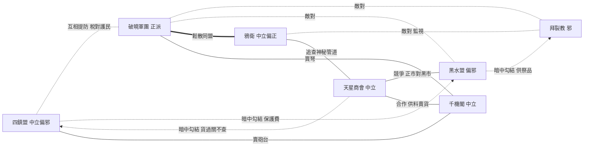
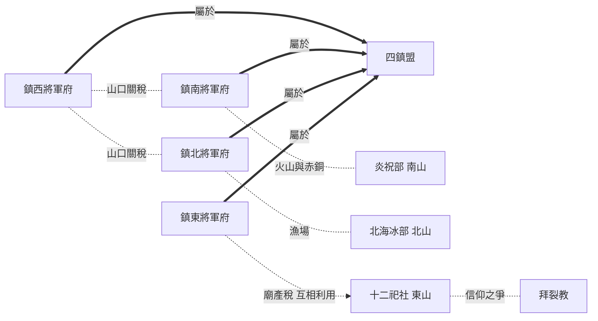
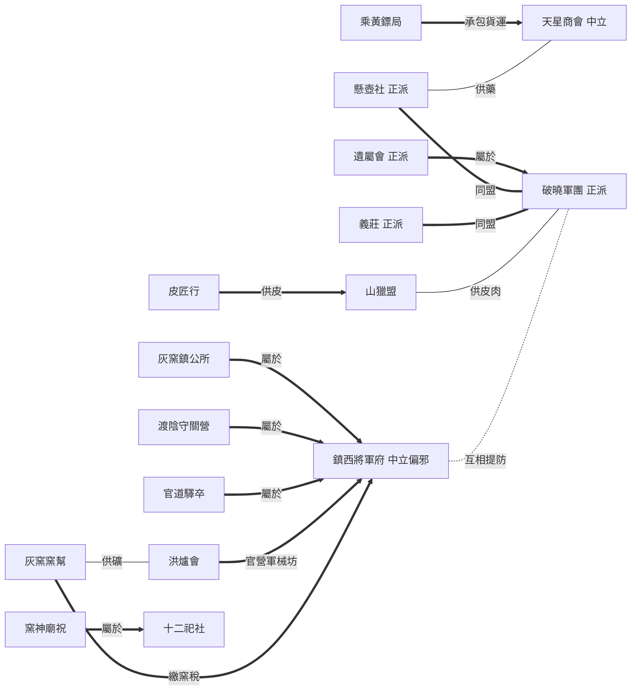
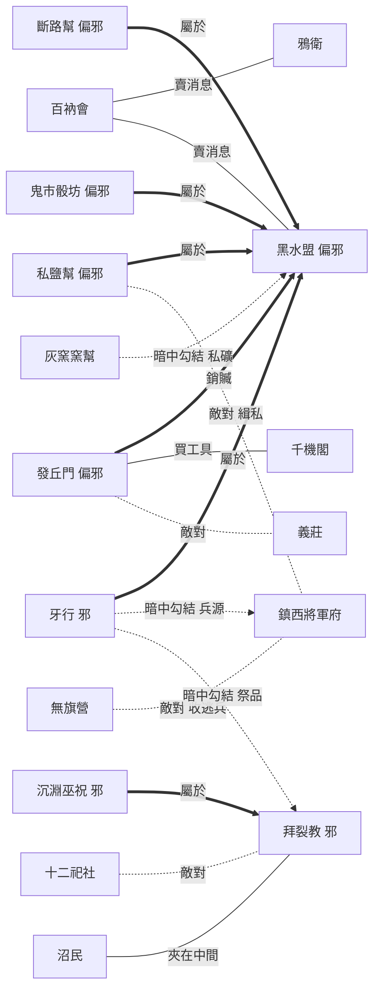

> ⚠️ **已作廢／已被取代**：已由 design/world-blueprint-v0.3.md（定稿）取代（2026-11-28）。本檔只留作歷史對照，不再修改。

# 《山海錄》世界藍圖 v0.1

> 狀態：**藍圖提案，待 mumi 認可**。只寫「這個世界長什麼樣、誰在哪裡、靠什麼活、有什麼規矩」。**不談分期、MVP、系統數值、實作**；那些是第二段，等藍圖認可後才寫。
> 日期 2026-11-28｜提案人：遊戲製作人｜基準：[v0.3 分冊](../../design/gdd-v0.3-sections/index.md)（`Shiroyashatw/shanhailu` `dd3843b`）＋ 舊世界觀 `dpoe-remaining-final-1126/docs/世界觀.md`
> 標記：**〔既有〕** 來自 v0.3 分冊或舊世界觀｜**〔提議〕** 本案新增｜**〔暫名〕** 名稱先用，之後交本地化編輯潤飾。本文所有新名字都是暫名。
> 用詞：一律用「祭祀」，不用「上香」。v0.3 分冊現有的「上香」「線香」字樣本案不改，之後由本地化統一。
> A-01～A-07 未決，維持原狀，藍圖不依賴、不引用成定案。
> 前版：`living-world-v0.1.md`、`living-world-v0.2.md` 保留當歷史。本藍圖取代 v0.2 的勢力與規矩部分；v0.2 的循環、介入、分期等不在這份處理。

---

## 0. 一句話

> **天裂後的大陸是一張被軍閥、商會、邪教、地下盟和無數小行當切碎的網。** 山海經給它骨架，灰窯原只是西山腳下的一小格。玩家能往來的對象很多，但每一個都有自己的地盤、營生和立場。

### 與 v0.2 勢力的對照（只列變動）

| 項目 | v0.2 | 本藍圖 |
| --- | --- | --- |
| 層級 | 大 7／小 14 | **大 7／中 13／小 25，共 45**，小勢力最多 |
| 軍閥 | 鎮西將軍府是大勢力 | 新增大勢力「四鎮盟」；鎮西將軍府降為其西鎮（中），另有鎮南／鎮北／鎮東（中） |
| 山域強權 | 無 | 南山炎祝部、北山北海冰部（中） |
| 宗教 | 十二香社（小） | 改名「十二祀社」（中，本山在東山） |
| 中層 | 無 | 乘黃鏢局、百衲會、無旗營、懸壺社、洪爐會、義莊升為中 |
| 新增小勢力 | — | 鎮公所、守關營、驛卒、酒肆行、說書行、皮匠行、遺屬會、窯神廟祝、岔口小祠、青霧藥農、沼民、鬼市骰坊，加南北東與海外各 6 個 |
| 道德 | 通緝為主、另有敵意軸 | **善惡值為主**，通緝是惡行後果之一（第 7 節） |
| 重罪 | 最高檔入牢 | 死刑（永久死亡）或押前線（第 7.5 節） |
| 黑市 | 散在各勢力 | 獨立成一條流通線（第 8 節） |

---

## 1. 大陸總覽：山海經為骨

### 1.1 骨架

以山海經「五藏山經（南西北東中）→ 海外 → 海內 → 大荒」為骨〔既有，舊世界觀 §7〕。山的名字與區塊名字全是暫名。

| 大區 | 山海經 | 舊世界觀的設定〔既有〕 | 本藍圖補的樣貌〔提議〕 | 十二裂口與神〔提議〕 |
| --- | --- | --- | --- | --- |
| **中山** | 中山經 | 天下之中；地層與冥門在此；十二神鎮守；撿骨師在地層出口 | 封閉。沒有任何勢力能進；地面上只有環繞的荒原與血霧 | 十二神鎮守的原位 |
| **南山** | 南山經 | 火與岩漿；祝融在南方 | 火山帶與赤銅礦；青丘（九尾狐）傳說在此；炎祝部與鎮南將軍府對峙 | 巳午未（蛇、馬、羊） |
| **西山** | 西山經 | 毒沼古墓；v0.3 的灰窯原在此；西方對應申酉戌〔既有，v0.3〕 | 見 1.2：東麓灰窯原（既有）、中段、深處崑崙丘（西王母、三青鳥所在） | 申酉戌（猴、雞、狗）；酉神裂口〔既有〕 |
| **北山** | 北山經 | 冰雪洞窟；北海神禺彊 | 凍原與冰窟；凍魚漁場；北海冰部與鎮北將軍府對峙 | 亥子丑（豬、鼠、牛） |
| **東山** | 東山經 | 廢棄廟宇；更多神的線索（v0.3 待拍板項 5） | 荒廢祠廟成群；祭祀的本山，十二祀社總壇在此；東山祭品坊供全大陸祭品 | 寅卯辰（虎、兔、龍） |
| **海內** | 海內四經 | 異國與異人 | 水路與渡口；黑水盟總壇「黑水渡」在此 | — |
| **海外** | 海外四經 | 奇肱國、三身國這類，人間勢力手伸不到 | 奇肱國是千機閣總閣（會造飛車的匠人）；其餘留白 | — |
| **大荒** | 大荒四經 | 四凶（饕餮、窮奇、檮杌、混沌）、燭龍 | 無人勢力；只有朝聖的拜裂教徒和傳說 | — |
| **裂縫外** | — | 留給最終章，誰劈開天空刻意留白〔既有〕 | 不寫 | — |

說明：十二生肖分到四山（每山三神）是本藍圖的提議，只有「西＝申酉戌」是 v0.3 既有。十二個裂口散在四山之間〔既有，舊世界觀 §7〕，所以每一山都有裂口與血霧，只是濃淡不同。

### 1.2 西山內部與灰窯原的位置

灰窯原＝**西山東麓**〔既有〕，是大陸最西邊人煙還能撐住的一格。往西是血霧濃的方向（酉神裂口），往東是官道與外面的世界（獸群也往東逃〔既有，見聞〈獸群東逃〉〕）。

| 西山的區段 | 樣貌 | 狀態 |
| --- | --- | --- |
| **灰窯原（東麓）** | 15 個地點、6 個聚落〔既有〕 | v0.3 已有 |
| 西山中段「瘴澤」〔暫名〕 | 毒沼古墓的主體；鎮西將軍府治所「鎮西城」（大城）在其邊緣 | 暫定 |
| 西山深處「崑崙丘」〔暫名〕 | 申戌裂口群；三危（三青鳥）；血霧最濃；破曉軍團最前線 | 暫定 |

---

## 2. 各區的歷史與現狀

### 2.1 全大陸共通的歷史〔既有〕

太平千年 → 天裂之夜 → 十二神墜落、血雨血霧 → 遠征軍全滅 → 逃難與護民 → 當年護民的人三年後成了軍閥各自割據。現在是天裂後第三年。

### 2.2 西山東麓（灰窯原）

| 區塊〔暫名〕 | 地點（v0.3 的 15 個） | 歷史與現狀 |
| --- | --- | --- |
| **官道帶** | 灰窯鎮、官道驛站、渡陰關、破曉營 | 灰窯鎮是礦窯小鎮，煤灰落在每片屋瓦上〔既有〕。渡陰關是邊關，牆外就是血霧起的方向〔既有〕。官道是這一格唯一「幾乎安全」的路〔既有〕，也是鎮西將軍府收「十抽其二」的地方〔既有，見聞〈軍閥與世族〉〕。破曉營的旗是三面舊旗縫成〔既有〕，靠收留亡國殘兵立足 |
| **野徑藥林** | 野徑岔口、青霧藥林、鴉巢（隱） | 官府手伸不到的地方。逃兵的蹤跡在岔口〔既有〕；鴉衛的暗樁藏在枯樹上〔既有〕；藥林靠採藥人與止血草撐著；劫匪也在這裡等人 |
| **窯礦坡** | 亂葬古窯、赤石廢礦 | 天裂那年死的人太多，灰窯鎮把舊窯當墳〔既有〕；廢礦有粗鐵、赤銅、玄石〔既有〕，礦脈是各方都想要的 |
| **腐沼塚地** | 腐骨沼、無名古塚（隱）、沉淵祭窟 | 沼底的骨頭比天裂更早〔既有〕；古塚的墓誌名字被鑿掉〔既有〕；祭窟的供桌是新木頭、火盆一直有人添炭〔既有〕 |
| **獸徑裂口** | 枯骨獸徑、撿骨師營地、酉神裂口 | 獸群沿獸徑往東逃〔既有〕；撿骨師在出口撿了三年骨頭，不屬於任何勢力〔既有，刻意留白〕；酉神裂口斷面第四層「像是砌過的」〔既有〕 |

### 2.3 其他區（暫定，只寫輪廓）

| 區塊〔暫名〕 | 所屬 | 歷史與現狀〔提議〕 |
| --- | --- | --- |
| 西山中段「瘴澤與鎮西城」 | 西山 | 遠征軍出發前的集結地之一；鎮西將軍當年開倉放糧〔既有，見聞〕，後來把糧倉變成了稅卡。瘴澤古墓比天裂更古老 |
| 西山深處「崑崙丘」 | 西山 | 傳說西王母之居，三青鳥使者所出；天裂後成了申、戌兩神墜落的血霧地帶，破曉軍團在此設最前線 |
| 南山「招搖與炎州」 | 南山 | 祝融後裔自稱火神遺族，守著火山與赤銅；鎮南將軍想收編礦。青丘傳說讓化形的狐商在此做買賣 |
| 北山「單狐與寒淵」 | 北山 | 禺彊所在的北海冰原；天星貨單上的「北山凍魚」〔既有〕就出在這裡；鎮北將軍與冰部爭漁場 |
| 東山「廢寺群」 | 東山 | 神廟一座接一座荒廢，十二祀社在此守著最後的祭祀傳統；天星貨單上的「東山線香」〔既有〕＝祭品 |
| 中山「冥門之上」 | 中山 | 不寫勢力。地層、冥門、十二神原位〔既有，暗線〕 |
| 海內「黑水渡」 | 海內 | 黑水盟的總壇；水路通往各山 |
| 海外「奇肱國」 | 海外 | 千機閣總閣，能造飛車（山海經〈海外西經〉） |
| 大荒 | 大荒 | 四凶與燭龍；無人勢力 |

大城（暫定）：每山一座「鎮城」＝該山軍閥治所（鎮西城、鎮南城、鎮北城、鎮東城）；中山無城。大城是一山的政治與商業中心，不是灰窯原要有的東西。

---

## 3. 勢力：大、中、小三層

**定義**
- **大勢力**：影響跨越多山、或牽動整片大陸；玩家無法獨自改變它。
- **中勢力**：一山之內的霸主，或跨山但單一行業的行會；通常有附庸的小勢力。
- **小勢力**：一個聚落、一個區塊、一種營生；玩家能直接往來、幫忙、得罪。小勢力最多，因為它們是玩家日常接觸的對象。

**立場**（五檔）：正派｜中立偏正｜中立｜偏邪｜邪。立場決定誰跟誰天然對立，不鎖玩家（見 7.3）。

**範圍**：領土型（有地盤）｜網絡型（有據點但不佔領土）｜無地域（沒有固定地盤，到處都有人，見第 4 節）。

### 3.1 大勢力（7）

| 勢力〔暫名〕 | 營生 | 立場 | 後台 | 範圍與地盤 | 來歷 |
| --- | --- | --- | --- | --- | --- |
| **四鎮盟** | 收稅、養兵、屯田（透過四座將軍府） | 中立偏邪 | 無；盟主空懸，名義聯盟 | 領土型。四山各一座將軍府 | 〔提議〕遠征軍之後「軍閥各自割據」〔既有〕的集合名：當年各鎮的護民將領互相承認，實際互不服 |
| **破曉軍團**〔既有〕 | 護民、清窟、接賞金；軍牌換糧 | 正派 | 無（亡國殘兵、傭兵、冒險者聯合） | 網絡型。各山據點，西山有破曉營 | 〔既有〕 |
| **天星商會**〔既有〕 | 壟斷流通、放貸、貨運 | 中立 | 無；神秘管道留白〔既有〕 | 無地域。各地有分號 | 〔既有〕天裂前就壟斷經濟 |
| **鴉衛**〔既有〕 | 買賣情報；查異象；經費來路不明 | 中立偏正 | 無 | 無地域。各地暗樁 | 〔既有〕；〔提議〕自稱「三青鳥」（西山經）使者之後 |
| **拜裂教**〔既有〕 | 供奉、血祭、賣「裂口賜福」 | 邪 | 無 | 網絡型。聖地是各裂口，西山是沉淵祭窟 | 〔既有〕不拜十二神，拜裂口 |
| **千機閣** | 賣弩與機關、承包城防、修遺跡機關 | 中立 | 無；誰付錢替誰做 | 網絡型。總閣在海外奇肱國，各山有分閣（西山：赤石廢礦旁） | mumi 提議；〔提議〕匠人一脈源自奇肱國（山海經：能為飛車） |
| **黑水盟** | 銷贓、黑市、地下錢莊、走私道；抽成 | 偏邪 | 無；暗中與將軍府、商會有往來 | 網絡型。總壇在海內黑水渡，各地鬼市 | 〔提議〕天裂前就有的地下暗流，官府失能後坐大；名取山海經「黑水」 |

### 3.2 中勢力（13）

| 勢力〔暫名〕 | 營生 | 立場 | 後台 | 範圍與地盤 |
| --- | --- | --- | --- | --- |
| **鎮西將軍府**〔既有〕 | 過路稅、關稅、屯田、緝私 | 中立偏邪 | 四鎮盟（西鎮） | 領土型。西山：灰窯鎮、驛站、渡陰關、官道；治所鎮西城 |
| 鎮南將軍府 | 同上；想收編赤銅礦 | 中立偏邪 | 四鎮盟 | 領土型。南山 |
| 鎮北將軍府 | 同上；爭凍魚漁場 | 中立偏邪 | 四鎮盟 | 領土型。北山 |
| 鎮東將軍府 | 同上；向祭祀社收「廟產稅」 | 中立偏邪 | 四鎮盟 | 領土型。東山 |
| **炎祝部** | 守火山、煉赤銅、冶火器 | 中立 | 無（祝融遺族） | 領土型。南山 |
| **北海冰部** | 捕凍魚、採冰、守冰窟 | 中立 | 無（禺彊遺族） | 領土型。北山 |
| **十二祀社** | 主持祭祀、修廟、記功過簿、賣祭品 | 中立偏正 | 無；與鎮東互相利用 | 網絡型。本山東山，各山有祠；舊稱十二香社 |
| **乘黃鏢局** | 押送貨物、護送行人 | 中立偏正 | 天星商會（承包貨運） | 無地域。以官道與各山驛路為線 |
| **百衲會** | 討飯、跑腿、賣消息 | 中立 | 無；兩頭賣 | 無地域。各城街頭 |
| **無旗營** | 傭兵、接賞金榜、收留逃兵 | 中立 | 無；與將軍府對立 | 無地域。流動，據點在野徑 |
| **懸壺社** | 採藥、煉藥、行醫 | 正派 | 無；與破曉同盟 | 網絡型。西山為主，各山有藥鋪 |
| **洪爐會** | 打鐵、鍛造、修裝 | 中立 | 鎮西將軍府（軍械坊官營） | 網絡型。西山為主 |
| **義莊** | 收屍、殮葬、送屍還鄉、防屍變 | 正派 | 無；與破曉同盟 | 網絡型。各山各城邊 |

〔提議〕鎮南／北／東將軍府、炎祝部、北海冰部、懸壺社與洪爐會在其他山的分布，皆暫定。

### 3.3 小勢力（25）

灰窯原 19 個：

| 勢力〔暫名〕 | 營生 | 立場 | 所屬或後台 | 地盤 |
| --- | --- | --- | --- | --- |
| 灰窯鎮公所 | 地方行政、委託板（周里正〔既有〕） | 中立 | 鎮西將軍府 | 灰窯鎮 |
| 渡陰守關營 | 關稅、盤查、守關樓（丁老七〔既有〕） | 中立偏邪 | 鎮西將軍府 | 渡陰關 |
| 官道驛卒 | 傳遞公文、驛站管理 | 中立 | 鎮西將軍府 | 官道驛站 |
| 酒肆行 | 客棧酒肆同業：傳聞與歇腳（柳三娘、老葛〔既有〕） | 中立 | 無；消息賣給百衲會 | 灰窯鎮、渡陰關 |
| 說書行 | 說書人與見聞傳播 | 中立偏正 | 無；與鴉衛有往來 | 灰窯鎮街頭 |
| 皮匠行 | 獸皮硝製、皮具 | 中立 | 山獵盟（供皮） | 灰窯鎮 |
| 遺屬會 | 遠征軍遺屬找人、找軍牌（難民婦人〔既有〕） | 正派 | 破曉軍團 | 渡陰關難民 |
| 窯神廟祝 | 守廟、祭祀（啞伯〔既有〕） | 中立偏正 | 十二祀社 | 灰窯鎮窯神廟 |
| 岔口小祠 | 野徑小廟祭祀（岔口山神小廟〔既有〕） | 中立偏正 | 十二祀社 | 野徑岔口 |
| 青霧藥農 | 採集與種藥 | 中立偏正 | 懸壺社 | 青霧藥林 |
| 灰窯窯幫 | 採礦、燒窯、私礦 | 中立 | 鎮西將軍府（繳窯稅）；暗通黑水盟 | 灰窯鎮、窯礦坡 |
| 山獵盟 | 獵異獸、賣皮丹 | 中立偏正 | 無；賣給破曉軍需 | 枯骨獸徑 |
| 沼民 | 沼地向導、撐船、捕沼蛭、採毒藤 | 中立 | 無；夾在拜裂教與祭祀社之間 | 腐骨沼 |
| 私鹽幫 | 販私鹽 | 偏邪 | 黑水盟 | 野徑、官道旁 |
| 斷路幫 | 劫道、收買路錢 | 偏邪 | 黑水盟 | 野徑岔口一帶 |
| 發丘門 | 盜墓、拆墓中機關 | 偏邪 | 黑水盟（銷贓）；向千機閣買工具 | 無名古塚、腐骨沼 |
| 牙行 | 販人（買賣難民） | 邪 | 黑水盟；暗通鎮西將軍府（兵源）、拜裂教（祭品） | 渡陰關 |
| 鬼市骰坊 | 賭坊、放高利貸 | 偏邪 | 黑水盟 | 渡陰關後巷 |
| 沉淵巫祝 | 巫術、血祭、替拜裂教主持 | 邪 | 拜裂教 | 沉淵祭窟 |

其他區 6 個（暫定）：

| 勢力〔暫名〕 | 營生 | 立場 | 所屬或後台 | 地盤 |
| --- | --- | --- | --- | --- |
| 青丘狐市 | 化形狐商，買賣奇物 | 中立 | 無 | 南山 |
| 赤銅坊 | 冶煉赤銅 | 中立 | 炎祝部 | 南山 |
| 凍魚行 | 捕魚、醃凍魚、供天星 | 中立 | 北海冰部 | 北山 |
| 寒淵祀者 | 祭北海神 | 中立 | 十二祀社 | 北山 |
| 東山祭品坊 | 製祭品（舊稱線香） | 中立偏正 | 十二祀社 | 東山 |
| 奇肱工坊 | 造飛車與機關 | 中立 | 千機閣 | 海外 |

撿骨師**不是**勢力：他不屬於任何一方，是刻意留白的個人〔既有〕。

---

## 4. 跨區勢力

| 類型 | 勢力 | 說明 |
| --- | --- | --- |
| **無地域**（到處都有人，沒有地盤） | 天星商會、鴉衛、乘黃鏢局、百衲會、無旗營 | 商會有分號、鴉衛有暗樁、鏢局靠線、乞兒在街頭、傭兵流動；它們不爭領土，爭的是「路」「消息」「人」 |
| **網絡型**（有據點、不佔領土） | 黑水盟、千機閣、拜裂教、破曉軍團、十二祀社、懸壺社、洪爐會、義莊 | 據點散在各山，地盤表裡只算「有人」，不算「掌控」 |
| **領土型** | 四鎮盟與四座將軍府、炎祝部、北海冰部；所有小勢力 | 邊界衝突主要出在這類之間 |

---

## 5. 地盤：區塊對勢力

「掌控」＝誰說了算；「有人」＝在此有據點或營生。

### 5.1 灰窯原五個區塊

| 區塊 | 掌控 | 大勢力有人 | 中勢力 | 小勢力（數量） | 邊界衝突 |
| --- | --- | --- | --- | --- | --- |
| **官道帶**（灰窯鎮、驛站、渡陰關、破曉營） | 鎮西將軍府（鎮、驛站、關）；破曉營自治 | 破曉、天星、黑水、鴉衛、四鎮盟 | 鎮西將軍府、洪爐會、懸壺社、十二祀社、義莊（＋跨區的乘黃、百衲、無旗營） | **10**：鎮公所、守關營、驛卒、酒肆行、說書行、皮匠行、遺屬會、窯神廟祝、牙行、鬼市骰坊 | ①渡陰關—破曉營官道段：將軍府稅卡 vs 破曉護民 ②渡陰關：守關營緝私 vs 黑水鬼市（互相默許） |
| **野徑藥林**（岔口、藥林、鴉巢） | 無（官府手伸不到） | 鴉衛、黑水 | 懸壺社（採藥）、無旗營（出沒） | **4**：青霧藥農、斷路幫、私鹽幫、岔口小祠 | ③藥農 vs 斷路幫（買路錢）④無旗營收逃兵 vs 將軍府 |
| **窯礦坡**（亂葬古窯、赤石廢礦） | 名義上將軍府（窯稅）；實際窯幫 | 千機閣（分閣）、黑水（收私礦） | 洪爐會（礦料）、義莊（古窯墳） | **1**：灰窯窯幫 | ⑤窯幫私礦 vs 將軍府窯稅 ⑥千機閣分閣 vs 窯幫（搶玄石） |
| **腐沼塚地**（腐骨沼、古塚、祭窟） | 拜裂教（祭窟）；沼地無主 | 拜裂教、黑水（收古物） | 義莊（沼骨） | **3**：沉淵巫祝、發丘門、沼民 | ⑦拜裂教 vs 十二祀社（祭窟與廟）⑧發丘門 vs 義莊（盜墓）；沼民夾在中間 |
| **獸徑裂口**（獸徑、撿骨師營地、酉神裂口） | 無（血霧） | 破曉（清窟）、鴉衛（赤鴉）、拜裂教（覬覦裂口） | 無 | **1**：山獵盟（＋撿骨師，個人） | ⑨破曉清窟 vs 拜裂教想入裂口 ⑩山獵盟 vs 獸潮 |

### 5.2 六個聚落

| 聚落 | 所在區塊 | 有人的勢力 |
| --- | --- | --- |
| 灰窯鎮 | 官道帶 | 鎮西將軍府、鎮公所、天星分號、洪爐會（石記鐵鋪）、懸壺社（回春藥鋪）、酒肆行、說書行、皮匠行、窯神廟祝、灰窯窯幫 |
| 官道驛站 | 官道帶 | 驛卒、天星行商、乘黃鏢局 |
| 渡陰關 | 官道帶 | 將軍府、守關營、天星關市、洪爐會（軍械坊）、懸壺社（藥攤）、遺屬會、酒肆行、破曉募兵處、黑水（鬼市）、牙行、鬼市骰坊 |
| 破曉營 | 官道帶 | 破曉軍團、懸壺社（傷兵帳） |
| 撿骨師營地 | 獸徑裂口 | 撿骨師（無派）；黑水與破曉各有人來收貨 |
| 鴉巢 | 野徑藥林 | 鴉衛 |

### 5.3 其他區塊（暫定）

| 區塊 | 掌控 | 大勢力有人 | 中勢力 | 小勢力 | 邊界衝突 |
| --- | --- | --- | --- | --- | --- |
| 西山中段「瘴澤與鎮西城」 | 鎮西將軍府（治所鎮西城） | 四鎮盟、天星、黑水、破曉 | 懸壺社總社、洪爐會、義莊 | 暫不列 | 向北與鎮北、向南與鎮南爭山口關稅 |
| 西山深處「崑崙丘」 | 無 | 破曉（最前線）、鴉衛（三危祖地）、拜裂教（裂口聖地） | — | — | 破曉 vs 拜裂教 |
| 南山「招搖與炎州」 | 炎祝部與鎮南將軍府分治 | 千機閣（分閣）、黑水 | 炎祝部、鎮南將軍府 | 青丘狐市、赤銅坊 | 火山與赤銅礦的歸屬 |
| 北山「單狐與寒淵」 | 北海冰部與鎮北將軍府分治 | 天星（收凍魚） | 北海冰部、鎮北將軍府 | 凍魚行、寒淵祀者 | 漁場與冰窟 |
| 東山「廢寺群」 | 十二祀社（廟）；鎮東將軍府（稅） | 拜裂教（滲透廢寺） | 十二祀社、鎮東將軍府 | 東山祭品坊 | 祭祀社 vs 拜裂教；鎮東收廟產稅 |
| 海內「黑水渡」 | 黑水盟 | 黑水盟（總壇）、天星 | — | — | 與天星爭水路 |
| 海外「奇肱國」 | 千機閣（總閣） | 千機閣 | — | 奇肱工坊 | 無 |

### 5.4 山與山之間的衝突

| 衝突 | 內容 |
| --- | --- |
| 四鎮盟名存實亡 | 鎮西／南／北／東將軍府互相不服，山口關稅與流民是主要摩擦 |
| 祭祀社 vs 拜裂教 | 全大陸的信仰之爭：一個守著不靈的祭祀，一個改拜裂口 |
| 軍閥 vs 山域強權 | 炎祝部、北海冰部都不認將軍府收編 |
| 商會 vs 黑水盟 | 正市對黑市，在水路與關市上互相擠壓，檯面下又互相借道 |
| 鴉衛追查商會 | 追查「神秘管道」是怎麼把貨送到的〔既有伏筆〕 |

---

## 6. 關係網與立場

圖例：`==>` 附庸（小→大）｜`===` 同盟｜`-.-` 敵對或互相提防｜`-.->` 暗中勾結｜`---` 合作或競爭（看標籤）。立場寫在名字後。

### 6.1 大勢力總圖

### 6.2 山域與軍閥

### 6.3 灰窯原：官府與民生

### 6.4 灰窯原：灰黑兩道

### 6.5 關係重點

1. **白道不乾淨**：將軍府放天星的貨過關不查（對上〔既有〕貨單「沒有寫經過哪一道關」）；也向黑水盟收保護費。
2. **最黑的一條線**：牙行把難民賣給拜裂教當祭品（對上〔既有〕「每個月抬一個人進洞」）；也賣人給將軍府當兵源。破曉、義莊、祭祀社、遺屬會在這件事上站同一邊。
3. **兩頭賣的中立**：千機閣賣砲台給軍閥、賣弩給破曉、賣工具給盜墓的；百衲會的消息同時賣給鴉衛和黑水。
4. **附庸牽連**：幫了附庸，宗主略有好感；得罪附庸，宗主也記一筆。
5. **破曉與軍閥不是一夥**：一個護民、一個收稅；被通緝時，破曉是最可能伸手的白道，但它也不收惡名昭彰的人（見 7.3）。

---

## 7. 世界規矩

只寫「這個世界怎麼看人、怎麼處置人」，不寫數值。

### 7.1 三套規矩

| 規矩 | 誰訂 | 管什麼 | 怎麼罰 |
| --- | --- | --- | --- |
| **善惡**（人心） | 沒人訂；所有人都在看 | 你做過的事，在別人眼裡是什麼人 | 不罰，只改變別人怎麼對你 |
| **法**（官府） | 將軍府（王法）、破曉軍團（軍規） | 偷、劫、殺、走私、通邪、販人 | 通緝、罰金、牢、勞役、死刑（7.4～7.5） |
| **規**（幫派） | 黑水盟（黑水規矩）、拜裂教（教規） | 黑吃黑、報官、叛教 | 追殺、沉江、獻祭 |

善惡是底，法與規是各方用來處置「做壞事的人」的手段。**通緝是法對惡行的反應**，不是善惡本身。

### 7.2 善惡值：怎麼看人

**五段**（暫名）：

| 段 | 世人怎麼稱呼 | 大意 |
| --- | --- | --- |
| 義名 | 大俠、恩人 | 做過許多好事，且為人所知 |
| 良善 | 好人、熱心人 | 幫過人，沒害過人 |
| 常人 | 客官 | 沒好沒壞，過日子 |
| 惡名 | 惡徒、不可靠的人 | 害過人，或常做不乾淨的事 |
| 兇名 | 煞星、殺人魔 | 殺良、販人、血祭的人 |

**怎麼增減**（只寫規則）：

- 行為、對象、輕重、有沒有人知道，四件事一起看。救一個無依的人比給乞兒一文錢重；殺一個守衛比打一個醉漢重。
- **惡行落得快，善行積得慢。** 一次殺良可以一口氣掉兩段；小善要日積月累，而且每天能累積的有限，不能靠刷小善洗白。
- **沒人看見的惡行也算，只是輕一半**：天知，地知，十二祀社的功過簿不知道，但你自己知道（影響祭祀處的對簿，見 7.3）。
- 向勢力的敵人出手，不等於作惡：殺斷路幫、剿匪是善；殺破曉的人是惡。善惡看的是「傷害了誰」，不是「得罪了誰」；得罪勢力走勢力自己的敵意，不走善惡。

| 方向 | 例子（輕→重） |
| --- | --- |
| 善 | 輕：施捨、送藥、歸還撿到的東西 ｜ 中：護送、剿匪、收屍、揭發牙行 ｜ 重：救下被賣的人、替遺屬找回軍牌、冒險擋獸潮 |
| 惡 | 輕：扒竊、逃稅、走私 ｜ 中：劫道、盜墓、傷人、收贓 ｜ 重：殺良、替牙行運人、血祭、屠殺 |

### 7.3 善惡怎麼影響 NPC、勢力、祭祀

**NPC**

| 層面 | 規矩 |
| --- | --- |
| 稱呼 | 依段改變（見上表） |
| 服務與價格 | 義名者受優待；惡名者被抬價；兇名者許多店不賣、客棧不留 |
| 路人 | 兇名者走過，乞兒避開、孩子躲進屋裡 |
| 傳聞 | 善名會有人來求助；惡名會被人拿來嚇小孩、也會被賞金獵人聽見 |
| 委託 | 良善以上多見「救援、護送」類；惡名以下多見「髒活」類 |

**勢力（陣營門檻）**

| 勢力立場 | 對善惡的態度 |
| --- | --- |
| 正派 | 不收兇名者；惡名者只能談交易，不給好處 |
| 中立偏正 | 惡名者要價更高；兇名者拒見 |
| 中立 | 不在乎善惡，只在乎錢與路數（天星、百衲會、千機閣） |
| 偏邪 | 義名者不被信任；良善者進不了核心 |
| 邪 | 只對惡名以下開放核心；義名者被視為敵人 |

聲望數字本身仍只增不減〔既有，A-01～A-07 與此無關〕；善惡只決定「這個勢力願不願意給你好處」。

**祭祀**

| 層面 | 規矩 |
| --- | --- |
| 祭祀不靈 | 天裂後祭祀還是點不著〔既有，見聞〈廟香〉〕；這個伏筆不動。祭祀仍是人的習俗與儀式，由十二祀社主持 |
| 功過簿〔提議〕 | 十二祀社的祭司替人記功過簿。到祭祀處對簿，可以看到自己現在是哪一段。世界裡的「看穿」靠的是人記的帳，不是神 |
| 贖罪 | 在祭祀處「銷過」：要祭品、要時間、要做義舉，慢，且有上限。殺良與販人這種重罪，祭祀社不替人銷（只能靠義舉慢慢補） |
| 兇名者 | 祭祀社不接待；窯神廟祝（啞伯那種個人）仍會讓人進廟，但不會替他記功 |
| 〔可選伏筆〕 | 暗線說「人心的罪弄髒了獻給神的供奉」〔既有，心魔劫〕。世上惡行越多，祭祀越點不著；拜裂教的火盆卻一直有炭〔既有〕。要不要把善惡與這條暗線掛鉤，由 mumi 決定（拍板題 4） |

### 7.4 法：通緝（保留，接到善惡值上）

v0.2 的通緝規則保留，只改它跟善惡的關係：**犯法被發現 → 通緝；通緝只管法，善惡值照樣算。**

**三套法的管轄**〔提議〕

| 法 | 地盤 | 誰執法 | 特色 |
| --- | --- | --- | --- |
| 王法 | 灰窯鎮、驛站、渡陰關、官道 | 將軍府守軍與巡邏 | 罰最重、有牢；賄賂有效 |
| 軍規 | 破曉營與據點 | 破曉軍團 | 只辦傷人、殺良、通邪、販人；不辦走私與逃稅；可以功抵過 |
| 黑水規矩 | 鬼市、私鹽道、斷路幫據點 | 黑水盟 | 不管官府的罪，只罰黑吃黑、報官；犯了被追殺，錢消不掉 |
| 無管轄 | 撿骨師營地、鴉巢、荒野深處 | — | 只看有沒有活口 |

**罪種**：偷竊、走私、劫道、傷人、殺良、通邪、壞規矩（黑水）。**只有被人發現才通緝**；發現得了的程度取決於當地治安與駐軍。

**通緝的四檔**：嫌疑（被盤查）→ 通緝（城鎮出入受限、服務受限、告示榜貼懸賞令，寫著玩家自己取的名字）→ 重犯（拒入城門、賞金獵人上路）→ 死罪（見 7.5）。

**消除**：繳罰金｜坐牢｜以功抵過（破曉、剿匪、護送）｜找勢力疏通（破曉、天星、鴉衛、黑水，各有條件與後患）｜躲｜黑水追殺只能賠錢或替黑水辦事。

**善惡與通緝的關係**

| 情況 | 規矩 |
| --- | --- |
| 惡行沒被發現 | 不通緝，善惡照扣（輕一半） |
| 犯法但算善行 | 例：為救人闖關被通緝；善惡不降反升，通緝仍在。這種人破曉與祭祀社願意伸手 |
| 通緝已消除 | 善惡不跟著恢復；罰金買得回通行，買不回名聲 |
| 兇名者被通緝 | 疏通的門變窄（正派與中立偏正勢力不願意幫），只剩黑水盟與有錢可使鬼推磨的天星 |

### 7.5 重罪：死刑或押前線

**重罪**＝殺良、販人、通邪血祭、屠殺、多次劫道殺傷、傷官等。被抓之後，**法官（將軍府）有兩條路：死刑，或押去前線。**

**兩種結局**

| 結局 | 是什麼 | 世界裡的理由 |
| --- | --- | --- |
| **死刑** | 判決即結束此生，留下墓誌銘（寫「伏法」）。等同永久死亡 | 殺雞儆猴；對最惡的人 |
| **押前線** | 被押去血霧邊界：強制勞役（築牆、搬屍、守關）或戰役（擋一波獸潮、清一座窟）。**活下來才放人**，並免去這一罪 | 邊關缺人，血霧前線什麼人都要；官府與破曉都樂見「用罪人擋怪」 |

**怎麼判**（誰、什麼條件）

| 判什麼 | 條件 |
| --- | --- |
| 偏死刑 | 兇名；罪行多重（殺良＋販人、血祭、屠村）；被害人是官員或大戶；無人保 |
| 偏前線 | 惡名而非兇名；罪行是劫道殺傷、走私重貨、傷官、盜墓；有人保或能打（邊關缺戰力）；自首 |
| 軍規下 | 殺同袍、臨陣脫逃判斬；其他一律發往最前線，戴罪立功 |
| 黑水規矩下 | 不走官府：黑吃黑沉江、報官者追殺，沒有「前線」這條路 |

**判決到執行之間有一段「待決」日子**：玩家能在這段日子做事（下列）。**世界不會無預警處死你：** 通緝一路升級到死罪，每一步都有告示、盤查與賞金獵人上門的預兆。

**玩家怎麼避開**

| 方式 | 說明 | 代價與限制 |
| --- | --- | --- |
| **逃獄** | 自己越獄，或買通獄卒；無旗營、黑水盟可劫囚 | 逃了就是通緝再升級；勢力要的人情債 |
| **贖罪** | 大額罰金＋祭祀銷過＋義舉 | 只對非兇名、非屠殺級的罪有效；兇名者贖不了 |
| **勢力撈人** | 破曉：改判去前線（它缺人）｜天星：買命（錢）｜黑水：劫囚（欠人情）｜鴉衛：換你替它辦一件事｜十二祀社：神前請命（只對非兇名者）｜無旗營：收編 | 每一條都要還；兇名＋屠村無人願撈 |
| **自首** | 主動投案，罪減一等 | 惡行仍要受罰，但有機會判前線而不是死刑 |
| **前線求生** | 被押去前線後，活下來就放人 | 前線死了就是真死（永久死亡） |

### 7.6 這跟永久死亡設計的關係

- v0.3 的永久死亡〔既有〕：生命歸零即結束此生，留下墓誌銘，存檔刪除。**不變。**
- **死刑＝永久死亡的「制度版」**：不是打不贏而死，是做了最壞的事、又沒人救而死。墓誌銘寫「伏法」。
- **押前線＝把死亡風險交回戰鬥**：沒有直接判死，但前線的戰鬥可能讓你死；這是給惡人的最後一次機會。
- **兩條路都有退路**：除了「兇名＋屠村＋無人保」這種最極端的情況，死刑之前一定有人能伸手，只是要付代價。這讓永久死亡有「可預見、可避免」的味道，而不是無預警。
- 玩家取的名字會出現在墓誌銘、懸賞令與判決書上（取名見 v0.2 第 6 節，這裡不展開）。

---

## 8. 黑市與銷贓

### 8.1 黑暗商品線

| 類別 | 是什麼 | 哪裡來 | 例（〔既有〕物品） |
| --- | --- | --- | --- |
| **贓物** | 偷、劫、盜來的東西，帶有「原主」記號 | 偷竊、劫道、劫鏢、盜墓 | 被劫的天星貨、官物、鏢貨、古塚陪葬、遺屬的軍牌 |
| **違禁品** | 官府管制的東西 | 私製、走私 | 私鹽（灰窯 3 兩、渡陰關 9 兩〔既有價差〕）、軍械與弩、淬毒油、神骨碎片 |
| **來路不明物** | 沒標記但沒人敢問 | 撿骨、裂口 | 撿骨師的未鑑定裝備〔既有〕、軍牌、神骨碎片、血苔 |
| **人口** | 被買賣的人 | 牙行 | 難民；**玩家不能做這門生意，只能對抗** |
| **禁書與禁物** | 與拜裂教、暗線有關的東西 | 祭窟、古塚 | 邪教供品、墓中機關 |

### 8.2 規矩

- **贓物標記**：贓物帶著原主的記號（將軍府官物、天星貨、鏢貨、古塚陪葬、遺屬軍牌）。被原主認出，會被追索、查扣，持贓者被當成嫌疑。
- **洗貨**：把標記洗掉，要過黑水盟的手（抽成、折價）。洗過的貨天星才肯收。
- **查扣**：官道關卡與渡陰守關營會查；查到違禁品與贓物，貨沒收、人通緝。
- **銷贓折價**：渠道越黑、越快，折價越狠；越正規，越要標記乾淨。
- **歸還**：破曉與遺屬會願意收回軍牌送還遺屬；歸還贓物算善行。
- **揭發**：向官府或鴉衛舉報黑市，算善行，但黑水盟會追殺。
- **善惡與黑市**：買賣贓物與違禁品算輕到中的惡；人口買賣算重惡。

### 8.3 收贓點（各地盤收的東西與價格差異）

| 收贓點 | 掌控 | 收什麼 | 差異 |
| --- | --- | --- | --- |
| **渡陰關鬼市** | 黑水盟 | 幾乎全收：贓物、違禁品、古物、軍牌 | 出價最好，但抽成最高、被守關營盯得最緊 |
| 野徑岔口黑攤 | 斷路幫、私鹽幫、無旗營 | 劫來的貨、私鹽 | 折價最狠，但沒人查 |
| 撿骨師營地 | 撿骨師（個人） | 只收軍牌與神骨碎片〔既有〕，不問來路 | 價公道；不收標記明顯的官物 |
| 沼地渡口 | 沼民撐船、發丘門 | 古物、墓中物 | 只收這一類；出手前要經沼民帶路 |
| 窯礦私礦口 | 灰窯窯幫 | 私礦、玄石、赤銅 | 賣給黑水或千機閣分閣 |
| 官道驛站行商 | 天星 | **只收洗過的貨** | 價正常，標記未洗的拒收 |
| 破曉軍需帳 | 破曉軍團 | 軍牌（正規收購）〔既有〕 | 贓軍牌會被認出、送還遺屬，收的人反而得名聲 |
| 灰窯鎮 | 將軍府 | 幾乎沒有收贓點 | 官府眼線最多，最難出手 |
| 牙行 | 牙行 | 人口 | 不對玩家開放 |

### 8.4 流通路線（暗路）

| 路線 | 走法 | 貨 | 誰經手 |
| --- | --- | --- | --- |
| **私鹽道** | 灰窯鎮 ↔ 野徑岔口 ↔ 渡陰關，繞開官道關卡 | 私鹽、鐵 | 私鹽幫；官道驛卒偶爾放行 |
| **骨路** | 腐骨沼／無名古塚 → 沼地渡口 → 渡陰關鬼市 → 黑水渡（水路）→ 各山 | 古物、墓中機關 | 發丘門、沼民、黑水盟 |
| **軍牌路** | 酉神裂口／撿骨師營地 → 渡陰關（破曉軍需或鬼市） | 軍牌、神骨碎片 | 撿骨師、破曉、遺屬會 |
| **礦路** | 赤石廢礦／窯礦 → 窯幫 → 黑水或千機閣分閣 | 私礦、玄石 | 窯幫、黑水、千機閣 |
| **人路** | 難民 → 渡陰關 → 將軍府兵營或沉淵祭窟 | 人 | 牙行；暗通將軍府與拜裂教。玩家只能阻斷 |
| **長路** | 渡陰關鬼市 → 黑水渡 → 其他山的鬼市 | 洗過的贓物與違禁品 | 黑水盟 |

### 8.5 各勢力在這條線上的角色

| 勢力 | 角色 |
| --- | --- |
| 黑水盟 | 定價、洗貨、抽成；各山鬼市的總管 |
| 私鹽幫 | 私鹽與鐵的運輸 |
| 斷路幫 | 贓物的來源（劫貨）與野徑黑攤 |
| 發丘門 | 古物來源；向千機閣買工具 |
| 牙行 | 人口；最黑的一條，也是正派勢力聯手要打的 |
| 灰窯窯幫 | 私礦 |
| 鬼市骰坊 | 洗錢與放高利貸 |
| 天星商會 | 官方不收贓，但收洗過的貨；與黑水既競爭又借道 |
| 鎮西將軍府、守關營 | 一面緝私、一面收黑水的保護費；兩面人 |
| 破曉軍團、遺屬會 | 收回軍牌、剿匪 |
| 鴉衛 | 追查黑貨與商會管道的關係 |
| 義莊、十二祀社 | 反盜墓、反血祭 |
| 千機閣 | 軍械違禁與機關買賣的灰色地帶 |

---

## 9. 各區的營生與勾當

### 9.1 灰窯原

| 區塊 | 白道生計 | 灰色 | 黑道勾當 |
| --- | --- | --- | --- |
| 官道帶 | 鎮公所行政、鐵匠、藥鋪、客棧、說書、皮匠、鏢局押貨、破曉募兵、天星買賣 | 酒肆賣消息、窯幫私礦、關卡收錢放行、百衲會傳話 | 鬼市銷贓、骰坊高利貸、牙行販人、將軍府與黑水的保護費 |
| 野徑藥林 | 採藥、種藥、祭祀小廟 | 逃兵避禍、無旗營接榜、鴉衛暗樁買情報 | 劫道、私鹽 |
| 窯礦坡 | 採礦、燒窯、收屍 | 私礦、搶玄石 | 黑水收私礦、千機閣搶料 |
| 腐沼塚地 | 沼地向導、捕沼蛭、採毒藤 | 替人撐船過沼 | 盜墓、血祭、拜裂教傳教 |
| 獸徑裂口 | 獵異獸、撿骨、破曉清窟 | 撿骨師收來歷不明的軍牌與神骨 | 黑水收神骨碎片、拜裂教覬覦裂口 |

### 9.2 其他區（暫定概要）

| 區 | 白道 | 灰色 | 黑道 |
| --- | --- | --- | --- |
| 西山中段 | 鎮西城行政與商貿 | 軍閥收稅、土客衝突 | 瘴澤古墓盜墓、牙行轉運 |
| 西山深處 | 破曉前線守備 | 鴉衛查裂口 | 拜裂教朝聖 |
| 南山 | 煉赤銅、冶火器、青丘奇物 | 炎祝部與鎮南爭礦 | 私銅走私 |
| 北山 | 捕凍魚、採冰 | 鎮北與冰部爭漁場 | 黑水走私凍魚 |
| 東山 | 祭祀、做祭品、修廟 | 鎮東收廟產稅 | 拜裂教滲透廢寺 |
| 海內 | 水運 | 商會與黑水爭水路 | 黑水渡總壇 |
| 海外 | 千機閣造飛車 | — | — |

---

## 10. 待 mumi 拍板（藍圖層級，6 題）

| # | 問題 | 選項 | 建議與理由 |
| --- | --- | --- | --- |
| 1 | 軍閥怎麼組織 | a. 「四鎮盟」為大勢力，統四座將軍府（中），各據一山（本案）　b. 四座將軍府各自是大勢力，沒有盟　c. 只有鎮西將軍府，其他山不放軍閥 | **a**。能解釋「各自割據」又互相爭山口，且大勢力數量不增 |
| 2 | 南山、北山誰當家 | a. 神話遺族（炎祝部、北海冰部）與軍閥分治（本案）　b. 全由軍閥控制　c. 先不寫，留白 | **a**。山海經色彩與灰窯原的人間軍閥分得開，也給邊界衝突多一類 |
| 3 | 勢力規模 | a. 大 7／中 13／小 25，共 45（本案）　b. 精簡到約 30　c. 再多一些 | **a**。小勢力最多才有「很多人可往來」；其他山的勢力都標暫定，之後可砍可補 |
| 4 | 善惡對勢力與祭祀的作用 | a. 只影響 NPC 態度　b. 影響 NPC＋勢力門檻（正派拒兇名、邪派拒義名）＋祭祀對簿與銷過，暗線掛鉤不做　c. 在 b 之上，把善惡與「祭祀越來越點不著」的暗線掛鉤 | **b**。接得上現有勢力與祭祀；c 動到暗線，等 mumi 想清楚真相再說 |
| 5 | 死刑能不能避免 | a. 一律有待決期與退路，只有「兇名＋屠村＋無人保」例外（本案）　b. 任何死刑都能贖　c. 死刑不可贖，只能逃獄或押前線 | **a**。永久死亡因此可預見、可避免，又保留最極端惡行的重量 |
| 6 | 黑市的人口買賣 | a. 牙行存在，玩家只能對抗　b. 玩家可間接參與（運送、放行），重惡　c. 玩家可完整參與 | **a**。保留亂世的黑，但不讓玩家做這件事；對抗它有正向回饋 |

### 補充

- 所有名稱（含中山、瘴澤、崑崙丘、各勢力名、區塊名）都是暫名，之後交本地化編輯。
- 十二生肖分配到四山是提議，只有「西＝申酉戌」是既有。
- 中山不寫勢力，是刻意留白（暗線）。
- 分期、MVP、系統（繁榮、稅、巡邏、NPC 移動、取名、數值）都在第二段，等藍圖認可後再寫。
- `living-world-v0.3.md` 沒有寫出來（原本要寫的那版已停，改成這份藍圖）。
