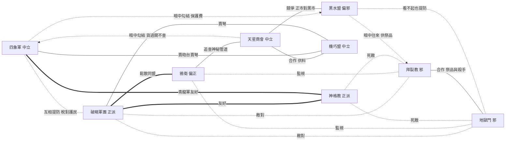
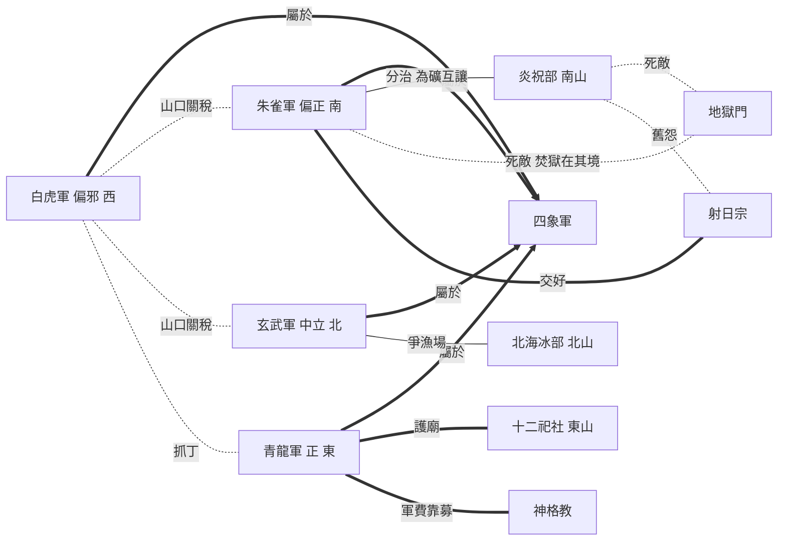
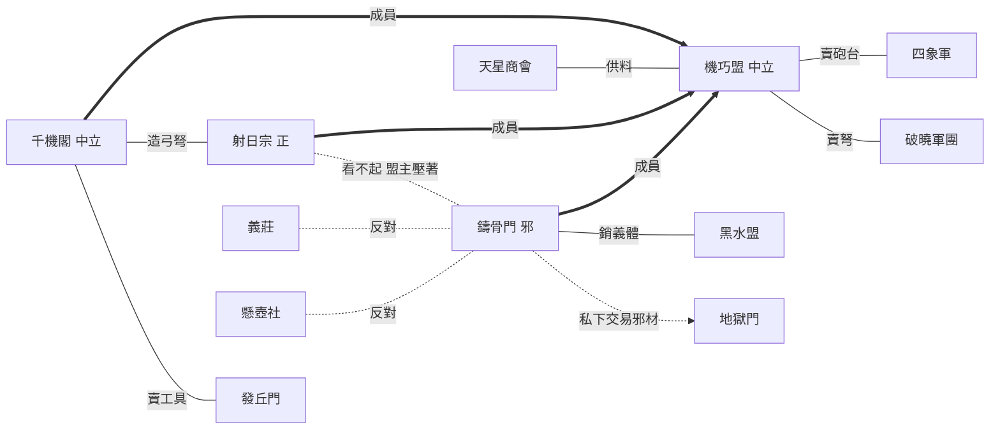
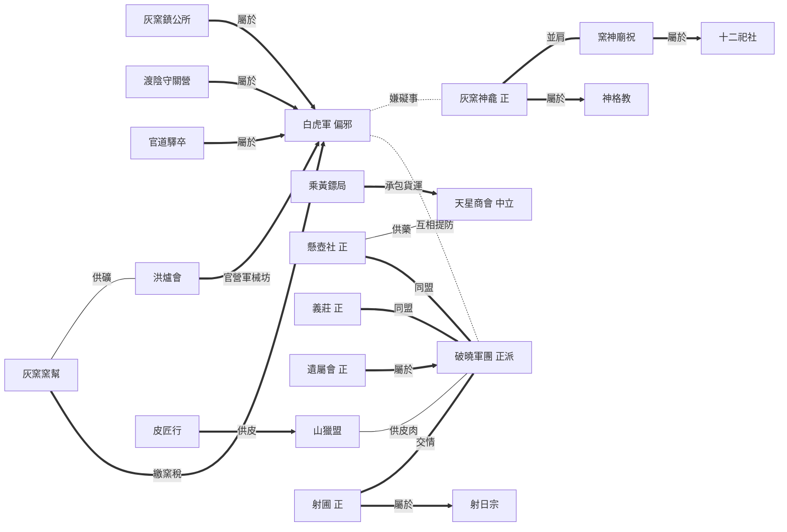

> ⚠️ **已作廢／已被取代**：已由 design/world-blueprint-v0.3.md（定稿）取代（2026-11-28）。本檔只留作歷史對照，不再修改。

# 《山海錄》世界藍圖 v0.2

> 狀態：**藍圖提案，待 mumi 認可**。只寫「這個世界長什麼樣、誰在哪裡、靠什麼活、有什麼規矩」。**不談分期、MVP、系統數值、實作**；那些是第二段，等藍圖認可後才寫。
> 日期 2026-11-28｜提案人：遊戲製作人｜基準：[v0.3 分冊](../../design/gdd-v0.3-sections/index.md)（`Shiroyashatw/shanhailu` `dd3843b`）＋ 舊世界觀 `dpoe-remaining-final-1126/docs/世界觀.md`
> 標記：**〔既有〕** 來自 v0.3 分冊或舊世界觀｜**〔提議〕** 本案新增｜**〔暫名〕** 名稱先用，之後交本地化編輯潤飾。**本文所有新名字、人物名、地名都是暫名。**
> 用詞：一律用「祭祀」，不用「上香」。v0.3 分冊現有的「上香」「線香」字樣本案不改，之後由本地化統一。
> A-01～A-07 未決，維持原狀，藍圖不依賴、不引用成定案。
> 前版：`world-blueprint-v0.1.md` 及其 Page 保留不動；`living-world-v0.1.md`、`v0.2.md` 保留當歷史。

---

## 與 v0.1 的差異

mumi 回饋：勢力方向不錯，要寫得更具體。以下是這一版改了什麼（v0.1 的善惡值、死刑與押前線、黑市、大中小三層、地域性全部沿用，只在受影響處微調）。

| # | v0.1 | v0.2 |
| --- | --- | --- |
| 1 | 「四鎮盟＋四座將軍府」 | 改成大勢力「**四象軍**」，由**四個軍**組成：白虎軍（偏邪）、朱雀軍（偏正）、玄武軍（中立）、青龍軍（正）。原「鎮西將軍府」＝白虎軍的官署名（對應表見 4.1） |
| 2 | 千機閣是大勢力 | 降為**中勢力**，併入機巧盟 |
| 3 | 無 | 新增大勢力「**機巧盟**」（中立）：射日宗（正）＋千機閣（中立）＋鑄骨門（邪，原「人體機關派」）三個中勢力聯合 |
| 4 | 無 | 新增大勢力「**神格教**」（正）：信奉各路神明，在亂世帶來希望。與十二祀社、祭祀、「點不著」伏筆的關係見 3.8 |
| 5 | 牙行屬黑水盟 | 新增大勢力「**地獄門**」（邪），與拜裂教合作；跟黑水盟的差別在「更邪惡、部分成員已與怪物融合」。牙行改屬地獄門 |
| 6 | 邪派中勢力只有鎮西系與少數 | 新增 5 個邪魔歪道中勢力：屍傀門、蠱母堂、合獸門、血霧宗、窮奇寨（再加鑄骨門共 6 個邪派／偏邪新中勢力） |
| 7 | 調性只在字裡行間 | 開頭新增「調性：俠客遊加魔法門」，以此校準勢力的味道 |
| 8 | 勢力只有營生、立場、後台 | 大中勢力每個寫滿 7 項：立場／地盤或據點／營生／首領或代表人物／招牌手段或技藝／跟其他勢力的關係／玩家怎麼往來。小勢力 7 項各一句 |
| 9 | 大 7／中 13／小 25＝45 | **大 9／中 21／小 33＝63** |
| 10 | 6 題拍板 | 重整為 4 題（第 12 節） |

| 變動的名字 | v0.1 | v0.2 |
| --- | --- | --- |
| 軍閥 | 四鎮盟、鎮西／南／北／東將軍府 | 四象軍；白虎軍、朱雀軍、玄武軍、青龍軍 |
| 邪派生意 | 牙行、沉淵巫祝等散在黑水盟與拜裂教下 | 人口與邪物集中到地獄門；黑水盟專心做「規矩內的黑」 |
| 東山 | 鎮東將軍府向祭祀社收廟產稅 | 青龍軍是正派軍，護廟不收稅；軍費靠向商會與神格教募 |

---

## 調性：俠客遊加魔法門

用兩個詞校準味道：

- **俠客遊（武俠江湖）**：勢力是「門派」——宗、門、會、閣、幫；每個門派有掌門、招牌武藝、師門恩怨；江湖有名聲（義名、惡名）、有奇遇（古塚秘笈、隱世高人、失傳的招式）。
- **魔法門（奇幻冒險）**：世界有怪物、有地城、有各方勢力可以選邊站，每種人有「職業感」——弓手、機關師、醫者、死靈師、馴獸師。冒險隊是主體，破曉軍團就像冒險者公會。

落在世界觀上的做法：

| 面向 | 怎麼落 |
| --- | --- |
| 門派 | 中勢力盡量做成「門派」：有掌門、有招牌絕活、有一段恩怨（例：射日宗 vs 炎祝部、射日宗 vs 鑄骨門） |
| 怪物 | 山海經異獸＋「人與怪物結合」：屍傀（死人）、蠱（蟲）、獸魂（獸）、霧身（血霧）、焚獄之火（地獄門）。邪派的味道就是「為了力量把自己交給怪物」 |
| 地城 | 每個邪派的巢穴就是一座地城：殃宅、蠱巢、百獸窟、霧宮、寨洞、焚獄、換骨工坊、沉淵祭窟。這裡只定位置與主人，不寫關卡 |
| 職業感 | 每個門派的「招牌手段或技藝」對應一種職業印象（下表），只是味道，不是系統 |
| 各方勢力 | 立場分五檔，會互相拉攏與對立，玩家能選邊、也能兩邊吃 |
| 奇遇 | 每個勢力的首領與地盤都藏著一段可以被發現的故事，細節留到第二段 |

| 勢力 | 職業印象 | 地城／巢穴〔暫名〕 |
| --- | --- | --- |
| 破曉軍團 | 戰士、冒險者公會 | 酉神裂口（既有） |
| 射日宗 | 弓手、獵人 | 射日崖（南山甘淵） |
| 千機閣 | 機關師、工匠 | 奇肱國總閣、赤石廢礦分閣 |
| 鑄骨門 | 改造者（賽博朋克味的義體醫師） | 三身國換骨工坊 |
| 懸壺社、義莊 | 醫者、殮葬師 | 無（正派據點） |
| 神格教 | 牧者、聖職者 | 萬神堂（東山扶桑坡） |
| 十二祀社 | 祭司 | 東山廢寺群 |
| 屍傀門 | 死靈師 | 殃宅（瘴澤）、無名古塚 |
| 蠱母堂 | 毒師、召喚者 | 蠱巢（瘴澤毒沼） |
| 合獸門 | 馴獸師、狂戰士 | 百獸窟（西山深處） |
| 血霧宗 | 刺客、血法師 | 霧宮（崑崙丘血霧中） |
| 窮奇寨 | 山賊、與怪物結盟的綠林 | 寨洞（瘴澤北） |
| 地獄門 | 邪魔、契約術士 | 焚獄（南山火山腹地） |
| 拜裂教 | 邪教祭司 | 沉淵祭窟（既有）、各裂口 |
| 炎祝部 | 火術士 | 火山祝壇 |

---

## 1. 大陸總覽：山海經為骨

### 1.1 骨架

以山海經「五藏山經（南西北東中）→ 海外 → 海內 → 大荒」為骨〔既有，舊世界觀 §7〕。山名與區塊名都是暫名。

| 大區 | 山海經 | 舊世界觀的設定〔既有〕 | 本藍圖補的樣貌〔提議〕 | 十二裂口與神〔提議〕 |
| --- | --- | --- | --- | --- |
| **中山** | 中山經 | 天下之中；地層與冥門在此；十二神鎮守；撿骨師在地層出口 | 封閉。沒有任何勢力能進；地面上只有環繞的荒原與血霧 | 十二神鎮守的原位 |
| **南山** | 南山經／大荒南經 | 火與岩漿；祝融在南方 | 火山帶與赤銅礦；青丘（九尾狐）傳說；**甘淵**（傳說羲和浴日之處）上有射日宗；火山腹地「焚獄」是地獄門總壇；炎祝部與朱雀軍分治 | 巳午未（蛇、馬、羊） |
| **西山** | 西山經 | 毒沼古墓；灰窯原在此；西方對應申酉戌〔既有，v0.3〕 | 見 1.2：東麓灰窯原（既有）、中段「瘴澤」（屍傀門、蠱母堂、窮奇寨）、深處「崑崙丘」（血霧最濃；合獸門、血霧宗） | 申酉戌（猴、雞、狗）；酉神裂口〔既有〕 |
| **北山** | 北山經 | 冰雪洞窟；北海神禺彊 | 凍原與冰窟；凍魚漁場；北海冰部與玄武軍對峙 | 亥子丑（豬、鼠、牛） |
| **東山** | 東山經 | 廢棄廟宇；更多神的線索（v0.3 待拍板項 5） | 荒廢祠廟成群；十二祀社總壇；**扶桑坡**上有神格教總壇「萬神堂」；青龍軍護廟 | 寅卯辰（虎、兔、龍） |
| **海內** | 海內四經 | 異國與異人 | 水路與渡口；黑水盟總壇「黑水渡」 | — |
| **海外** | 海外四經 | 奇肱國、三身國這類，人間勢力手伸不到 | 奇肱國＝千機閣總閣；**三身國**＝鑄骨門（一首三身，正好拿來當「換身子」的傳說） | — |
| **大荒** | 大荒四經 | 四凶（饕餮、窮奇、檮杌、混沌）、燭龍 | 無人勢力；只有朝聖的拜裂教徒和傳說。窮奇寨只借「窮奇」之名 | — |
| **裂縫外** | — | 留給最終章，誰劈開天空刻意留白〔既有〕 | 不寫 | — |

十二生肖分到四山（每山三神）是本藍圖的提議，只有「西＝申酉戌」是 v0.3 既有。十二個裂口散在四山之間〔既有〕，所以每一山都有裂口與血霧，只是濃淡不同。

### 1.2 西山內部與灰窯原的位置

灰窯原＝**西山東麓**〔既有〕，是大陸最西邊人煙還能撐住的一格。往西是血霧濃的方向（酉神裂口），往東是官道與外面的世界（獸群也往東逃〔既有，見聞〈獸群東逃〉〕）。

| 西山的區段 | 樣貌 | 狀態 |
| --- | --- | --- |
| **灰窯原（東麓）** | 15 個地點、6 個聚落〔既有〕 | v0.3 已有 |
| 西山中段「瘴澤」〔暫名〕 | 毒沼古墓主體；白虎軍治所「鎮西城」在其邊緣；屍傀門「殃宅」、蠱母堂「蠱巢」、窮奇寨「寨洞」 | 暫定 |
| 西山深處「崑崙丘」〔暫名〕 | 申戌裂口群；三危（三青鳥）；血霧最濃；破曉最前線；合獸門「百獸窟」、血霧宗「霧宮」 | 暫定 |

---

## 2. 各區的歷史與現狀

### 2.1 全大陸共通的歷史〔既有〕

太平千年 → 天裂之夜 → 十二神墜落、血雨血霧 → 遠征軍全滅 → 逃難與護民 → 當年護民的人三年後成了軍閥各自割據。現在是天裂後第三年。

### 2.2 西山東麓（灰窯原）

| 區塊〔暫名〕 | 地點（v0.3 的 15 個） | 歷史與現狀 |
| --- | --- | --- |
| **官道帶** | 灰窯鎮、官道驛站、渡陰關、破曉營 | 灰窯鎮是礦窯小鎮，煤灰落在每片屋瓦上〔既有〕。渡陰關是邊關，牆外就是血霧起的方向〔既有〕。官道是唯一「幾乎安全」的路〔既有〕，也是白虎軍收「十抽其二」的地方〔既有，見聞〈軍閥與世族〉〕。破曉營的旗是三面舊旗縫成〔既有〕。關後的小巷是各路黑生意的落腳處（暫定） |
| **野徑藥林** | 野徑岔口、青霧藥林、鴉巢（隱） | 官府手伸不到的地方。逃兵的蹤跡在岔口〔既有〕；鴉衛的暗樁藏在枯樹上〔既有〕；藥林靠採藥人與止血草撐著；劫匪也在這裡等人 |
| **窯礦坡** | 亂葬古窯、赤石廢礦 | 天裂那年死的人太多，灰窯鎮把舊窯當墳〔既有〕；廢礦有粗鐵、赤銅、玄石〔既有〕，礦脈是各方都想要的 |
| **腐沼塚地** | 腐骨沼、無名古塚（隱）、沉淵祭窟 | 沼底的骨頭比天裂更早〔既有〕；古塚的墓誌名字被鑿掉〔既有〕；祭窟的供桌是新木頭、火盆一直有人添炭〔既有〕。沼邊常有「拾屍人」與蠱婆出沒（暫定） |
| **獸徑裂口** | 枯骨獸徑、撿骨師營地、酉神裂口 | 獸群沿獸徑往東逃〔既有〕；撿骨師在出口撿了三年骨頭，不屬於任何勢力〔既有，刻意留白〕；酉神裂口斷面第四層「像是砌過的」〔既有〕。獸徑邊緣有人在養「縫了獸魂的獸」（暫定） |

### 2.3 其他區（暫定，只寫輪廓）

| 區塊〔暫名〕 | 所屬 | 歷史與現狀〔提議〕 |
| --- | --- | --- |
| 西山中段「瘴澤與鎮西城」 | 西山 | 遠征軍出發前的集結地之一；鎮西將軍當年開倉放糧〔既有，見聞〕，後來把糧倉變成稅卡。瘴澤古墓比天裂更古老，也是邪派的老窩 |
| 西山深處「崑崙丘」 | 西山 | 傳說西王母之居、三青鳥使者所出；天裂後成了申、戌兩神墜落的血霧地帶，破曉在此設最前線 |
| 南山「招搖、炎州與甘淵」 | 南山 | 祝融後裔自稱火神遺族，守火山與赤銅；甘淵崖上的射日宗自稱后羿弟子之後；火山下的焚獄是地獄門的總壇。青丘傳說讓化形的狐商在此做買賣 |
| 北山「單狐與寒淵」 | 北山 | 禺彊所在的北海冰原；天星貨單上的「北山凍魚」〔既有〕就出在這裡；玄武軍守冰牆，與冰部爭漁場 |
| 東山「廢寺群與扶桑坡」 | 東山 | 神廟一座接一座荒廢，十二祀社守著最後的祭祀傳統；天星貨單上的「東山線香」〔既有〕＝祭品；扶桑坡上神格教的萬神堂收留各地逃難的人 |
| 中山「冥門之上」 | 中山 | 不寫勢力。地層、冥門、十二神原位〔既有，暗線〕 |
| 海內「黑水渡」 | 海內 | 黑水盟的總壇；水路通往各山 |
| 海外「奇肱國」「三身國」 | 海外 | 奇肱國是千機閣總閣；三身國是鑄骨門的換骨工坊（山海經〈海外西經〉〈大荒南經〉） |
| 大荒 | 大荒 | 四凶與燭龍；無人勢力 |

大城（暫定）：每山一座「鎮城」＝該軍治所（鎮西城、鎮南城、鎮北城、鎮東城）；中山無城。大城是一山的政治與商業中心，不是灰窯原要有的東西。

---

## 3. 大勢力（9）

**三層定義**
- **大勢力**：影響跨越多山、或牽動整片大陸；玩家無法獨自改變它。
- **中勢力**：一山之內的霸主、一個門派，或跨山但單一行業的行會；通常有附庸的小勢力。
- **小勢力**：一個聚落、一個區塊、一種營生；玩家能直接往來、幫忙、得罪。最多，因為它們是日常接觸的對象。

**立場五檔**：正派｜偏正｜中立｜偏邪｜邪。立場決定誰跟誰天然對立，不鎖玩家（見 9.3）。
**範圍四種**：領土型（有地盤）｜據點型（一處巢穴或總部，像地城）｜網絡型（據點散在各山，不佔領土）｜無地域（沒有固定地盤，到處都有人）。

| 大勢力〔暫名〕 | 立場 | 範圍 | 一句話 |
| --- | --- | --- | --- |
| 四象軍 | 中立（四軍各異） | 領土型 | 四座軍、四種脾氣，名義上同盟，實際各據一山 |
| 破曉軍團〔既有〕 | 正派 | 網絡型 | 收留亡國殘兵的護民軍，像冒險者公會 |
| 天星商會〔既有〕 | 中立 | 無地域 | 一張貨單走遍天下，神秘管道留白 |
| 鴉衛〔既有〕 | 偏正 | 無地域 | 賣情報、查異象的暗樁網 |
| 拜裂教〔既有〕 | 邪 | 網絡型 | 不拜十二神，拜裂口 |
| 黑水盟 | 偏邪 | 網絡型 | 守規矩的黑市：銷贓、走私、地下錢莊 |
| 機巧盟 | 中立 | 網絡型 | 射日宗、千機閣、鑄骨門三個機關門派的聯盟 |
| 神格教 | 正派 | 網絡型 | 信奉各路神明，在亂世替人立起希望 |
| 地獄門 | 邪 | 據點型＋網絡 | 沒有規矩的黑：人口、邪物、與怪物融合 |

### 3.1 四象軍〔暫名；備選：四方軍、鎮邊四軍〕

**來歷**〔提議〕：遠征軍之後「軍閥各自割據」〔既有〕的集合名。當年各山護民的將領互相承認，各分得一角「四象印」，但誰都不聽誰的。四個軍的細項見 4.1。

- **立場**：整體中立；四軍各異——白虎軍偏邪、朱雀軍偏正、玄武軍中立、青龍軍正派。
- **地盤或據點**：領土型。四山各一軍、各一座鎮城（鎮西城、鎮南城、鎮北城、鎮東城）。灰窯原的官道帶屬白虎軍。
- **營生**：收稅、養兵、屯田、守關；各軍各有側重。
- **首領或代表人物**：無盟主。四軍軍議由四個統帥輪流主持，記錄官「**秦守拙**」是唯一四軍都肯見的人——老參軍，嘴很緊，只信寫下來的東西。
- **招牌手段或技藝**：「軍帖」（過關憑證，四軍只互認一半）；屯田兵制；軍議時四人各拿一角四象印才能蓋章。
- **跟其他勢力的關係**：四軍互相不服，主要摩擦是山口關稅與流民。與破曉互相提防（稅對護民）；與天星暗中勾結（貨過關不查）；與黑水暗通保護費；向機巧盟買砲台與弩；青龍軍與神格教、十二祀社友好；朱雀軍與地獄門死敵。
- **玩家怎麼往來**：領軍帖過關、接軍中差事、投軍（各軍好感不同）；犯法時被該軍通緝（軍法，見 9.4）。

### 3.2 破曉軍團〔既有〕

**來歷**〔既有〕：亡國殘兵、傭兵、冒險者拼成的護民軍，旗是三面舊旗縫成。

- **立場**：正派。
- **地盤或據點**：灰窯原的破曉營〔既有〕；崑崙丘最前線〔提議〕；各山有據點，渡陰關有募兵處〔既有〕。
- **營生**：護民、清窟、接賞金；軍牌換糧〔既有〕。
- **首領或代表人物**：總領「**顧長風**」〔提議〕——亡國殘兵出身的老將，說話慢，認軍牌不認官階。灰窯原現場：教頭**霍青**（校場，帶兵嚴）、百夫長**韓厲**（募兵處，嘴硬心軟）、軍需官**算盤**、醫官**溫姑**〔皆既有，人設為提議〕。
- **招牌手段或技藝**：〈破陣〉〔既有，校場教〕；軍牌制〔既有〕；結隊清窟。
- **跟其他勢力的關係**：與白虎軍互相提防（稅對護民）；與朱雀軍、青龍軍友好；與鴉衛鬆散同盟；與懸壺社、義莊同盟；與射日宗友好；向機巧盟買弩；敵對拜裂教、地獄門、血霧宗；對黑水盟睜一隻眼閉一隻眼，但不收贓。
- **玩家怎麼往來**：校場操練、募兵處接賞金、軍牌換糧〔既有〕、依聲望得好處〔既有〕；惡名者不收，兇名者拒見（見 9.3）。

### 3.3 天星商會〔既有〕

**來歷**〔既有〕：天裂前就壟斷經濟，貨單上寫著「北山凍魚」「東山線香」，沒寫經過哪一道關。

- **立場**：中立。
- **地盤或據點**：無地域。灰窯鎮天星分號、渡陰關天星關市、官道驛站行商〔既有〕；各城有分號。
- **營生**：壟斷流通、放貸、貨運；承包鏢局押貨。
- **首領或代表人物**：總櫃「**晏星河**」〔提議〕——從不露面，只簽貨單，據說人在神秘管道的另一頭。灰窯原現場：分號掌櫃**錢四海**、大掌櫃**賈掌櫃**、行商**馬六**〔皆既有，人設為提議：錢四海笑臉、賈掌櫃賬本不離手、馬六耳朵靈〕。
- **招牌手段或技藝**：一張貨單走遍天下（神秘管道）；「天星票」匯兌；放貸。
- **跟其他勢力的關係**：與白虎軍暗中勾結；與黑水盟競爭又借道；與機巧盟合作供料；鴉衛追查它的管道；乘黃鏢局是它的承包夥伴。
- **玩家怎麼往來**：買賣、貨單委託、依聲望得好處〔既有〕；只收洗過的貨（見 10）。

### 3.4 鴉衛〔既有〕

**來歷**〔既有〕：買賣情報、查異象；〔提議〕自稱「三青鳥」使者之後。

- **立場**：偏正。
- **地盤或據點**：無地域。灰窯原鴉巢（野徑藥林，隱）〔既有〕；各地暗樁。
- **營生**：買賣情報、查異象、辨別傳聞。
- **首領或代表人物**：總領「**青羽**」〔提議〕——蒙面女子，鴉衛都叫她「主上」，沒人見過臉。灰窯原現場：**赤鴉**〔既有〕，話少，眼睛尖。
- **招牌手段或技藝**：〈鴉影〉〔既有，鴉巢學〕；暗樁網；用見聞換錢與聲望〔既有〕。
- **跟其他勢力的關係**：與破曉鬆散同盟；追查天星的神秘管道；監視拜裂教與地獄門；向百衲會買消息；與說書行往來。
- **玩家怎麼往來**：鴉巢回報見聞換錢與聲望、辨別傳聞、學〈鴉影〉〔既有〕。

### 3.5 拜裂教〔既有〕

**來歷**〔既有〕：不拜十二神，拜裂口；沉淵祭窟的火盆一直有炭。

- **立場**：邪。
- **地盤或據點**：網絡型。灰窯原沉淵祭窟（腐沼塚地）〔既有〕；崑崙丘與各裂口是聖地〔提議〕。
- **營生**：供奉、血祭、賣「裂口賜福」；買祭品。
- **首領或代表人物**：教主「**虞九淵**」〔提議〕——自稱聽過裂口裡的聲音，說話溫和，從不提高音量。灰窯原現場：沉淵巫祝「**烏婆**」〔提議〕。
- **招牌手段或技藝**：血祭；裂口賜福（代價由受賜者付）；長明火盆。
- **跟其他勢力的關係**：與地獄門合作（見 3.9）；與黑水盟暗中往來（供祭品）；敵對破曉、鴉衛、十二祀社、神格教（死敵）、炎祝部。
- **玩家怎麼往來**：可對抗祭窟（地城）；可接教內髒活或買賜福（重惡）；沼民夾在中間。

### 3.6 黑水盟〔暫名〕

**來歷**〔提議〕：天裂前就有的地下暗流，官府失能後坐大；名取山海經「黑水」。

- **立場**：偏邪。
- **地盤或據點**：網絡型。總壇海內黑水渡；各地鬼市（灰窯原：渡陰關鬼市）。
- **營生**：銷贓、黑市、地下錢莊、走私道；抽成。**不碰人口、不碰邪物**（這是它跟地獄門的差別）。
- **首領或代表人物**：渡主「**崔黑水**」〔提議〕——黑水規矩的立法者，講信用比官府還重。灰窯原現場：渡陰關鬼市管事「**瘸七**」〔提議〕。
- **招牌手段或技藝**：「黑水規矩」（一單一認，錢貨兩清）；洗貨；「水票」地下錢莊。
- **跟其他勢力的關係**：與白虎軍暗中勾結（保護費）；與天星競爭又借道；與拜裂教有供貨往來；對地獄門又看不起又提防；破曉敵對；機巧盟的鑄骨門向它銷義體。
- **玩家怎麼往來**：銷贓、買違禁品、接黑單；壞規矩（報官、黑吃黑）被追殺（見 10）。

### 3.7 機巧盟〔暫名；備選：天工盟、墨機會、百巧盟、公輸盟〕

**來歷**〔提議〕：三個機關門派聯合而成，各出一技：弓（射日宗）、機（千機閣）、身（鑄骨門）。三派道不同，因為「造東西的人要互相有個交代」才結盟。

- **立場**：中立（成員：射日宗正、千機閣中立、鑄骨門邪）。
- **地盤或據點**：網絡型，不佔領土。各派據點：射日宗在南山甘淵、千機閣總閣在海外奇肱國、鑄骨門在海外三身國；灰窯原有射圃、赤石廢礦分閣、換骨暗診（見第 5 節）。
- **營生**：賣軍械與機關、承包城防、修遺跡機關；共同接大單。
- **首領或代表人物**：盟主「**公輸衡**」〔提議〕——公輸之後，只信圖紙，規定三派可以吵、不可以火併。
- **招牌手段或技藝**：「巧工契」（買機關不問用途，但賣給誰一定記帳）；三脈同源——弓、機、身。
- **跟其他勢力的關係**：對外賣砲台給四象軍、賣弩給破曉、賣工具給盜墓的；與天星合作供料；內部射日宗（正）看不起鑄骨門（邪），盟主壓著；鑄骨門私下與地獄門、黑水盟有交易。
- **玩家怎麼往來**：買弩、機關、修遺跡機關；可在盟內站隊（幫射日宗或鑄骨門）；見 4.4。

### 3.8 神格教〔暫名；備選：萬神教、立格會、眾神堂〕

**來歷**〔提議〕：天裂後出現的新教。不專拜十二神，而是「信奉各路神明」：山川之神、四方之神（句芒、祝融、蓐收、玄冥）、民間小神，連十二神也在其中。核心教義是「**立格**」：神明是靠人心一分一分立起來的「格」，人做一件扶人的事，就替神明立了一分格。

- **立場**：正派。
- **地盤或據點**：網絡型。總壇「萬神堂」在東山扶桑坡；各地有「神龕」與施粥棚（灰窯原：窯神廟旁的灰窯神龕）；「救苦隊」四處巡迴。
- **營生**：施粥、義診、收留孤兒與難民、宣講；信眾的「願金」維持運作。
- **首領或代表人物**：教宗「**明夷**」〔提議〕——自稱不是神的使者，只是第一個肯扶人的人。灰窯原現場：救苦使「**阿芷**」〔提議〕——剛從東山來的少女，總帶著一鍋粥。
- **招牌手段或技藝**：「立格」儀式（說出神名、做一件扶人的事）；萬神壇（一壇供各路神明牌位）；救苦隊。
- **跟其他勢力的關係**：與十二祀社競合（見下）；與青龍軍、破曉、懸壺社、義莊友好；與拜裂教死敵；與地獄門死敵；天星偶爾捐糧。
- **玩家怎麼往來**：領救助（窮時）、幫施粥或護送救苦隊（善行）、捐願金、到神龕「祈願」（結果不保證，見下）；兇名者不被收容。

**神格教與十二祀社、祭祀、「點不著」伏筆的關係**

| 項目 | 十二祀社 | 神格教 |
| --- | --- | --- |
| 定位 | 守舊的祭祀傳統，主持祭祀、記功過簿 | 新興的救助運動，重行善不重儀式 |
| 信奉對象 | 十二神 | 各路神明（含十二神） |
| 怎麼面對「祭祀點不著」 | 還是天天供奉，說「心要再誠」；記功過簿，勸人銷過 | 說「神明不在乎煙，在乎人」，鼓勵用扶人代替祭品 |
| 彼此 | 看不慣神格教「不守規矩」 | 敬重祭祀社，但不依賴祭祀 |
| 共同點 | 都是正派；都對拜裂教不以為然；都沒辦法解釋「為什麼點不著」 | 同左 |

**守則：神格教不能解掉「祭祀點不著」的伏筆**〔提議，全文適用〕

1. 神格教的神龕、祭壇，只要玩家祭祀，**照樣點不著**〔既有〕。神格教因此不用香火，改用「立格」，但沒有人說得出為什麼。
2. 神格教的「神蹟」只有人的作為（救人、施粥、診病），**沒有可驗證的神力**。
3. 神格教的任何教義（「神明不在乎煙」）都只是**教義，不是真相**；它與十二祀社說法互相矛盾也無妨，兩邊都不是答案。
4. 世界不出現「神已死」或「神還在」的明確說法；玩家「祈願」的結果不保證，也沒辦法驗證。
5. 拜裂教火盆長明仍是對照〔既有〕，不給解釋。
6. 暗線（人心的罪弄髒了供奉，見 9.3 的可選伏筆）完全不動，神格教不替它背書也不反駁。

### 3.9 地獄門〔暫名；備選：無間門、九幽殿、閻羅獄〕

**來歷**〔提議〕：天裂後從南山火山底下冒出來的邪門，總壇「焚獄」。它做各種邪惡生意；成員有的已與怪物融合，有的與怪物簽契合作。與拜裂教合作：拜裂教出祭品與裂口通路，地獄門出殺手、邪物與融合術。

- **立場**：邪。
- **地盤或據點**：據點型＋網絡。總壇「焚獄」在南山火山腹地；灰窯原：牙行、寄魂鋪（渡陰關後巷，見第 5 節）；與拜裂教共用人路（見 10）。
- **營生**：人口買賣；邪物（魔血、寄魂瓶、結怪契）；融合手術；殺手與刑求外包。
- **首領或代表人物**：獄主「**厲千重**」〔提議〕——半邊身子已是黑岩，據說從不睡覺。灰窯原現場：牙婆「**金嫂**」〔提議〕——笑瞇瞇，賬本上寫的都是人名。
- **招牌手段或技藝**：「結怪契」（與怪物簽契約，換力量，代價由對方付）；「融骨」（把怪物的一部分接進身體）；獄火。
- **跟其他勢力的關係**：與拜裂教合作；與鑄骨門私下交易邪材；與黑水盟互相看不起又互相提防；敵對朱雀軍（焚獄在其境）、炎祝部、破曉、神格教、懸壺社、義莊。
- **玩家怎麼往來**：對抗、偵察、救人。人口與融合術絕不開放；其餘往來的範圍看拍板題 2，一律是重惡。

### 3.10 地獄門 vs 黑水盟：差別

| 項目 | 黑水盟 | 地獄門 |
| --- | --- | --- |
| 立場 | 偏邪 | 邪 |
| 生意 | 銷贓、走私、地下錢莊（人造的黑市） | 人口、邪物、結怪契、融合手術、殺手與刑求外包 |
| 規矩 | 有「黑水規矩」，守信，錢貨兩清 | 沒有規矩，只有「契」，代價由對方付 |
| 成員 | 都是人 | 部分已與怪物融合（半獸、半傀、帶獄火），或與怪物合作 |
| 對官府 | 買通、不正面衝突 | 不買通，直接殺或吞 |
| 對玩家 | 可有限往來，惡行輕到中 | 預設只能對抗與偵察（往來範圍看拍板題 2）；往來即重惡 |
| 彼此 | 看不起地獄門「不守規矩」 | 瞧不起黑水盟「只會賺錢」 |

---

## 4. 中勢力（21）

| 中勢力〔暫名〕 | 立場 | 範圍 | 隸屬或類型 |
| --- | --- | --- | --- |
| 白虎軍（西） | 偏邪 | 領土型 | 四象軍 |
| 朱雀軍（南） | 偏正 | 領土型 | 四象軍 |
| 玄武軍（北） | 中立 | 領土型 | 四象軍 |
| 青龍軍（東） | 正派 | 領土型 | 四象軍 |
| 炎祝部 | 中立 | 領土型 | 山域遺族 |
| 北海冰部 | 中立 | 領土型 | 山域遺族 |
| 十二祀社 | 偏正 | 網絡型 | 祭祀 |
| 乘黃鏢局 | 偏正 | 無地域 | 行會 |
| 百衲會 | 中立 | 無地域 | 行會 |
| 無旗營 | 中立 | 無地域 | 行會 |
| 懸壺社 | 正派 | 網絡型 | 行會 |
| 洪爐會 | 中立 | 網絡型 | 行會 |
| 義莊 | 正派 | 網絡型 | 行會 |
| 射日宗 | 正派 | 據點型 | 機巧盟 |
| 千機閣 | 中立 | 據點型 | 機巧盟 |
| 鑄骨門 | 邪 | 據點型 | 機巧盟 |
| 屍傀門 | 邪 | 據點型 | 邪魔歪道 |
| 蠱母堂 | 邪 | 據點型 | 邪魔歪道 |
| 合獸門 | 邪 | 據點型 | 邪魔歪道 |
| 血霧宗 | 邪 | 據點型 | 邪魔歪道 |
| 窮奇寨 | 偏邪 | 據點型 | 邪魔歪道 |

立場分布：正 4（青龍軍、懸壺社、義莊、射日宗）｜偏正 3（朱雀軍、十二祀社、乘黃鏢局）｜中立 7｜偏邪 2（白虎軍、窮奇寨）｜邪 5（鑄骨門、屍傀門、蠱母堂、合獸門、血霧宗）。邪與偏邪合計 7 個，其中 6 個是「與怪物結合或走邪魔歪道」。

### 4.1 四象軍的四個軍

四個軍用四象命名，方位、顏色、脾氣都不同，好記：

| 軍 | 方位／山 | 立場 | 治所 | 統帥〔暫名〕 | 一句話 |
| --- | --- | --- | --- | --- | --- |
| **白虎軍** | 西山 | 偏邪 | 鎮西城 | 白敬亭 | 重甲、重稅、抓丁；當年開倉放糧，如今把糧倉改成稅卡 |
| **朱雀軍** | 南山 | 偏正 | 鎮南城 | 朱凝霜 | 紅甲女將，立過「不抓丁」的軍令，被別軍笑天真 |
| **玄武軍** | 北山 | 中立 | 鎮北城 | 冉玄策 | 只守不攻，守著冰牆；誰的事都不管 |
| **青龍軍** | 東山 | 正派 | 鎮東城 | 葉蒼梧 | 軍紀嚴到被叫「和尚軍」，把每座廢寺當城守 |

**原「鎮西將軍府」怎麼對應：白虎軍＝軍，鎮西將軍府＝白虎軍的官署名。** 軍是武裝與稅卡，府是衙門與文書；既有的名字不丟，之後要不要改顯示名由本地化與 mumi 決定。

| 灰窯原既有內容〔既有〕 | 在新結構裡是 |
| --- | --- |
| 勢力「鎮西將軍府」（見聞〈軍閥與世族〉揭露，`perks` 為空，「下一版開放」） | 白虎軍的官署；勢力條目維持，內容之後以白虎軍填入 |
| 官道「十抽其二」的過路稅（見聞） | 白虎軍的稅，由渡陰守關營與官道驛卒執行 |
| 灰窯鎮公所、周里正（管委託板） | 白虎軍在灰窯鎮的地方行政 |
| 渡陰關關樓、丁老七（守關老卒） | 渡陰守關營（白虎軍的關卡） |
| 渡陰關軍械坊、嚴鐵娘 | 洪爐會的官營軍械坊，供白虎軍 |
| 官道驛站、茶攤駝背張 | 官道驛卒的驛站，白虎軍管 |
| 破曉營 | **不屬白虎軍**，自治，與白虎軍互相提防 |
| 鎮西將軍「開倉放糧」的見聞 | 白虎軍統帥白敬亭的過去 |

#### 4.1.1 白虎軍〔暫名〕（偏邪）

- **立場**：偏邪。不是殘暴，是「養兵要錢，錢從路上收」。
- **地盤或據點**：領土型。西山；治所鎮西城；灰窯原的灰窯鎮、官道驛站、渡陰關、官道（官道帶）。
- **營生**：過路稅（十抽其二）〔既有〕、關稅、屯田、緝私、抓丁；暗收黑水盟保護費。
- **首領或代表人物**：統帥「**白敬亭**」——鎮西將軍，當年開倉放糧的人，如今把糧倉改成稅卡，自己認為這叫「養兵護民」。灰窯原現場：周里正、丁老七〔既有〕。
- **招牌手段或技藝**：虎符稅牌；白虎營重甲衝鋒；抓丁入伍。
- **跟其他勢力的關係**：與破曉互相提防；與天星、黑水暗中勾結；與牙行暗通（兵源）；與朱雀軍、玄武軍爭山口關稅；與青龍軍因抓丁互相看不順眼；與無旗營敵對（收逃兵）；向洪爐會買軍械、向機巧盟買砲台。
- **玩家怎麼往來**：過關繳稅、賄賂守關、領軍中差事、投軍；被通緝時走王法（見 9.4）。

#### 4.1.2 朱雀軍〔暫名〕（偏正）

- **立場**：偏正。講規矩，但守著火山口，缺糧缺錢。
- **地盤或據點**：領土型。南山；治所鎮南城；火山口外圍關卡。與炎祝部分治。
- **營生**：守火山口與焚獄的出口、輕稅收赤銅、護商、屯田。
- **首領或代表人物**：統帥「**朱凝霜**」——紅甲女將，立過「不抓丁」的軍令，被別軍笑天真，硬是撐下來了。
- **招牌手段或技藝**：火矢陣；「朱雀令」（護商令牌，持令商隊不收稅）。
- **跟其他勢力的關係**：與炎祝部分治，為礦互相禮讓又互相防；與射日宗交好；與地獄門死敵（焚獄在其境）；與破曉友好；與白虎軍爭山口。
- **玩家怎麼往來**：護送商隊、討伐地獄門手下、補給差事、投軍（正向）。

#### 4.1.3 玄武軍〔暫名〕（中立）

- **立場**：中立。只守冰牆，不管閒事。
- **地盤或據點**：領土型。北山；治所鎮北城；冰牆沿線。與北海冰部分治。
- **營生**：築冰牆、守冰線、收漁稅。
- **首領或代表人物**：統帥「**冉玄策**」——據說三年沒離開過城牆，只守不攻；有人罵他縮頭，他說「活著的牆才是牆」。
- **招牌手段或技藝**：冰牆堅守；玄武盾陣。
- **跟其他勢力的關係**：與北海冰部爭漁場，長期僵持；不插手他山事；與天星買糧；與白虎軍爭山口。
- **玩家怎麼往來**：守城差事、租糧、通關；中立，對善惡值不敏感。

#### 4.1.4 青龍軍〔暫名〕（正派）

- **立場**：正派。軍紀嚴，軍費缺。
- **地盤或據點**：領土型。東山；治所鎮東城；廢寺群外圍。
- **營生**：護廟、護祭祀、修路、屯田；軍費靠向商會與神格教募。
- **首領或代表人物**：統帥「**葉蒼梧**」——儒將，把每座廢寺當作要守的城，軍紀嚴到被叫「和尚軍」。
- **招牌手段或技藝**：青龍陣騎射；護廟令；軍紀律令。
- **跟其他勢力的關係**：與十二祀社、神格教友好；與破曉友好；因軍費缺被他軍看不起；與拜裂教敵對；與白虎軍因抓丁互看不順眼。
- **玩家怎麼往來**：護廟差事、護送救苦隊、投軍（正派）；惡名者不收。

### 4.2 山域遺族與祭祀

#### 4.2.1 炎祝部〔暫名〕

- **立場**：中立。
- **地盤或據點**：領土型。南山火山與赤銅礦；火山祝壇。與朱雀軍分治。
- **營生**：守火山、煉赤銅、冶火器。
- **首領或代表人物**：祝長「**赤嬰**」〔提議〕——自稱祝融後裔的老者，火碰到他不燙。
- **招牌手段或技藝**：祝火（控火的術）；火器；赤銅鍛造。
- **跟其他勢力的關係**：與射日宗有舊怨（炎祝部說十日是火神之子，后羿殺了它們）；與地獄門死敵；與朱雀軍分治；附庸：赤銅坊。
- **玩家怎麼往來**：買火器、守火山口委託；在炎祝部與射日宗之間站隊（見 4.4.1）。

#### 4.2.2 北海冰部〔暫名〕

- **立場**：中立。
- **地盤或據點**：領土型。北山冰窟與漁場。與玄武軍分治。
- **營生**：捕凍魚、採冰、守冰窟。
- **首領或代表人物**：冰長「**禺姜**」〔提議〕——自稱禺彊後裔，說話像冰裂，一句是一句。
- **招牌手段或技藝**：冰釣；凍魚祕法；「冰語」（冰窟裡傳話的暗號）。
- **跟其他勢力的關係**：與玄武軍爭漁場；賣凍魚給天星；附庸：凍魚行、寒淵祀者。
- **玩家怎麼往來**：買凍魚、冰窟探險委託。

#### 4.2.3 十二祀社〔暫名；舊稱十二香社〕

- **立場**：偏正。
- **地盤或據點**：網絡型。總壇在東山廢寺群；各山有祠（灰窯原：窯神廟、岔口小祠）。
- **營生**：主持祭祀、修廟、記功過簿、賣祭品。
- **首領或代表人物**：社主「**悟虛**」〔提議〕——守舊的老祭司，堅持天天供奉，即使點不著。灰窯原現場：啞伯（窯神廟守廟人）〔既有〕。
- **招牌手段或技藝**：功過簿；銷過（贖罪儀式）；十二時祭。
- **跟其他勢力的關係**：與神格教競合（見 3.8）；與青龍軍友好；與拜裂教死敵；四象軍偶爾來要廟地。
- **玩家怎麼往來**：祭祀處對簿、銷過、買祭品、修廟差事（見 9.3）；祭祀仍點不著〔既有〕。

### 4.3 行會

#### 4.3.1 乘黃鏢局〔暫名〕

- **立場**：偏正。
- **地盤或據點**：無地域。官道與各山驛路；灰窯原驛站有站。
- **營生**：押送貨物、護送行人。
- **首領或代表人物**：總鏢頭「**趙乘風**」〔提議〕——一生只丟過一次鏢，那次賠了整份家產。
- **招牌手段或技藝**：「飛黃旗」（插旗不劫的江湖規矩）；押鏢路線圖。
- **跟其他勢力的關係**：承包天星的貨運；與斷路幫、窮奇寨結過樑子；與破曉友好。
- **玩家怎麼往來**：雇鏢、當趟子手（護送差事）。

#### 4.3.2 百衲會〔暫名〕

- **立場**：中立。
- **地盤或據點**：無地域。各城街頭；灰窯鎮的乞兒阿滿〔既有〕屬此。
- **營生**：討飯、跑腿、賣消息。
- **首領或代表人物**：百衲頭「**破碗翁**」〔提議〕——據說從不說話，只敲碗。
- **招牌手段或技藝**：丐語（暗號）；一個晚上傳遍全城的消息網。
- **跟其他勢力的關係**：消息同時賣鴉衛與黑水；酒肆行是常客。
- **玩家怎麼往來**：買便宜消息；施捨結善緣。

#### 4.3.3 無旗營〔暫名〕

- **立場**：中立。
- **地盤或據點**：無地域。流動，據點在野徑。
- **營生**：傭兵、接賞金榜、收留逃兵。
- **首領或代表人物**：營頭「**鄧三刀**」〔提議〕——前遠征軍逃兵，獨臂，收留逃兵是為了贖自己那一次。
- **招牌手段或技藝**：傭兵契約；野戰。
- **跟其他勢力的關係**：與白虎軍敵對（收逃兵）；與破曉井水不犯河水；向斷路幫劫過道。
- **玩家怎麼往來**：接榜、僱傭、被通緝時求庇護（有條件）。

#### 4.3.4 懸壺社〔暫名〕

- **立場**：正派。
- **地盤或據點**：網絡型。西山為主；灰窯鎮回春藥鋪、渡陰關藥攤、破曉營傷兵帳〔既有〕。
- **營生**：採藥、煉藥、行醫、解毒。
- **首領或代表人物**：社長「**孟杏**」〔提議〕；灰窯原現場：老藥師**白朮**（回春藥鋪）、郎中**苦參**（渡陰關藥攤）、醫官**溫姑**（傷兵帳）〔既有〕。
- **招牌手段或技藝**：解沼毒；止血草；藥方。
- **跟其他勢力的關係**：與破曉同盟；與蠱母堂對立；供藥給天星；與神格教義診合作。
- **玩家怎麼往來**：買藥、診療、採藥差事。

#### 4.3.5 洪爐會〔暫名〕

- **立場**：中立。
- **地盤或據點**：網絡型。西山為主；灰窯鎮石記鐵鋪（石敢）、渡陰關軍械坊（嚴鐵娘）〔既有〕。
- **營生**：打鐵、鍛造、修裝。
- **首領或代表人物**：會首「**洪山**」〔提議〕——據說打了一輩子鐵，只認火候不認人。
- **招牌手段或技藝**：百煉；修裝。
- **跟其他勢力的關係**：軍械坊為白虎軍官營；向灰窯窯幫買礦；與千機閣搶玄石。
- **玩家怎麼往來**：打造、修裝。

#### 4.3.6 義莊〔暫名〕

- **立場**：正派。
- **地盤或據點**：網絡型。各山各城邊；灰窯原：古窯墳場一帶。
- **營生**：收屍、殮葬、送屍還鄉、防屍變。
- **首領或代表人物**：莊主「**殮九**」〔提議〕——收過三百具屍，不信鬼，只信規矩。
- **招牌手段或技藝**：殮葬；驅屍變的符；驗屍。
- **跟其他勢力的關係**：與破曉同盟；與屍傀門、發丘門死敵；與神格教友好。
- **玩家怎麼往來**：送屍還鄉、收屍（善行）、驗屍（解傷人線索）。

### 4.4 機巧三派

#### 4.4.1 射日宗〔暫名〕

- **立場**：正派。
- **地盤或據點**：據點型。南山甘淵崖「射日崖」；灰窯原有射圃（見第 5 節）。
- **營生**：授箭、收徒、獵大獸、護邊、造弓。
- **首領或代表人物**：宗主「**羿清和**」〔提議〕——自稱后羿記名弟子的後人，每年只收三個徒弟，箭上從不刻字。
- **招牌手段或技藝**：射日十式（遠射、連射、獵怪）；「一箭一獸」的規矩。取后羿射日的意象。
- **跟其他勢力的關係**：與炎祝部有舊怨；與朱雀軍、破曉友好；盟內看不起鑄骨門；與千機閣合作造弓弩。
- **玩家怎麼往來**：拜師學箭、試射、獵怪委託；炎祝部與射日宗的恩怨可站隊。

#### 4.4.2 千機閣〔暫名〕

- **立場**：中立。
- **地盤或據點**：據點型。總閣在海外奇肱國；灰窯原赤石廢礦旁分閣。
- **營生**：賣弩與機關、承包城防、修遺跡機關、造飛車。
- **首領或代表人物**：閣主「**肱七巧**」〔提議〕——雙手各六指，據說能閉著眼拆一整座弩機。
- **招牌手段或技藝**：連弩；砲台；遺跡機關修復；飛車（山海經：奇肱國能為飛車）。
- **跟其他勢力的關係**：誰付錢替誰做；賣給四象軍、破曉、發丘門；與窯幫爭玄石；與天星合作。
- **玩家怎麼往來**：買弩與機關、修機關、零件委託。

#### 4.4.3 鑄骨門〔暫名；原稱人體機關派；備選：換骨坊、骸機門、血肉機關派、無相機樓〕

- **立場**：邪。
- **地盤或據點**：據點型。總壇在海外三身國「換骨工坊」；灰窯原渡陰關後巷有「換骨暗診」。
- **營生**：替人換骨裝機關（義體）、接私活、向黑水盟銷義體。
- **首領或代表人物**：門主「**三身子**」〔提議〕——據說有三具身體輪流上場，沒人確定眼前這個是哪一具。
- **招牌手段或技藝**：換骨（鋼骨、機關臂、齒輪眼、血管導管）——賽博朋克味：把機關裝進活人。
- **跟其他勢力的關係**：機巧盟成員，但射日宗瞧不起它；私下與地獄門交易邪材；與黑水盟有銷貨關係；義莊、懸壺社、神格教反對。
- **玩家怎麼往來**：偵察、阻止；可有限接受換骨（重代價，惡名，見 12 拍板題 2）。

### 4.5 邪魔歪道

#### 4.5.1 屍傀門〔暫名〕

- **立場**：邪。
- **地盤或據點**：據點型。西山中段「殃宅」；灰窯原無名古塚一帶。
- **營生**：盜屍煉傀、賣屍傀當打手、「趕屍」運貨。
- **首領或代表人物**：傀師「**殃婆**」〔提議〕——老嫗，臉上是紙糊的面具，說話像兩個人在說。
- **招牌手段或技藝**：屍傀（把死人煉成聽話的怪）；趕屍；牽魂線。
- **跟其他勢力的關係**：與義莊死敵；向發丘門買屍；與拜裂教合作；破曉敵對。
- **玩家怎麼往來**：對抗屍傀（地城）、阻止盜屍、護送義莊；接傀師黑單（重惡）。

#### 4.5.2 蠱母堂〔暫名〕

- **立場**：邪。
- **地盤或據點**：據點型。西山中段毒沼「蠱巢」；灰窯原腐骨沼深處。
- **營生**：養蠱、賣毒、替人種蠱（控人）。
- **首領或代表人物**：蠱母「**青娘**」〔提議〕——看起來年輕，袖子裡總有蟲在爬。
- **招牌手段或技藝**：蠱蟲；毒瘴；「共生蠱」（人與蟲共生，人漸漸變成半個蟲）。
- **跟其他勢力的關係**：欺壓沼民；與懸壺社對立；與拜裂教合作。
- **玩家怎麼往來**：幫沼民解蠱、討伐蠱巢；買毒（重惡）。

#### 4.5.3 合獸門〔暫名〕

- **立場**：邪。
- **地盤或據點**：據點型。西山深處「百獸窟」；灰窯原獸徑邊緣有馴獸棚。
- **營生**：馴養、買賣與融合異獸、替人當打手。
- **首領或代表人物**：門主「**豸山君**」〔提議〕——半邊臉長著鱗，能與獸對話。
- **招牌手段或技藝**：獸魂縫（把獸魂縫進人或獸身）；馴獸；驅趕局部獸群（只是挑撥一小群，獸潮的原因另當別論，不在此解釋）。
- **跟其他勢力的關係**：與山獵盟死敵；與窮奇寨為盟；與破曉敵對（清窟）。
- **玩家怎麼往來**：獵殺融合獸、救被縫的人；接獸倌黑單（重惡）。

#### 4.5.4 血霧宗〔暫名〕

- **立場**：邪。
- **地盤或據點**：據點型。崑崙丘血霧最濃處「霧宮」；酉神裂口邊緣有霧客出沒。
- **營生**：吸血霧修煉、賣「霧丹」、採血。
- **首領或代表人物**：霧尊「**絳雲**」〔提議〕——看起來十五歲的紅衣少年，在血霧裡不老。
- **招牌手段或技藝**：霧身（化霧遁走）；飲霧功；血霧丹。
- **跟其他勢力的關係**：與拜裂教又競爭又同流；破曉最前線的對手；鴉衛查之。
- **玩家怎麼往來**：對抗；買霧丹（重惡）。

#### 4.5.5 窮奇寨〔暫名〕

- **立場**：偏邪。
- **地盤或據點**：據點型。西山中段瘴澤北的「寨洞」；灰窯原的斷路幫是其下線。
- **營生**：劫道、收買路錢、綁票；與一頭「像窮奇的怪物」結盟，怪物專吃不交買路錢的人。
- **首領或代表人物**：大寨主「**韓禿子**」〔提議〕——外號禿子其實滿頭長髮，說自己只是替怪物看門。
- **招牌手段或技藝**：怪物坐鎮；喚獸哨；劫營。
- **跟其他勢力的關係**：與合獸門為盟；與乘黃鏢局結樑子；向黑水盟銷贓；與白虎軍有「買路錢分成」的默契。
- **玩家怎麼往來**：剿寨（善行）、繳買路錢、投靠（惡行）。

---

## 5. 小勢力（33）

灰窯原 26 個、其他區 7 個。每個 7 項各一句。〔既有〕標示用到的 v0.3 NPC 與地點；其餘人名皆為暫名〔提議〕。

### 5.1 灰窯原 26 個

**官道帶（14）**

| 勢力 | 立場 | 地盤或據點 | 營生 | 代表人物 | 招牌 | 跟其他勢力 | 玩家往來 |
| --- | --- | --- | --- | --- | --- | --- | --- |
| 灰窯鎮公所 | 中立 | 灰窯鎮鎮公所 | 地方行政、委託板 | 周里正〔既有〕：凡事先問上頭，怕白虎軍來收糧 | 委託板 | 屬白虎軍 | 接委託、聽鎮上事 |
| 渡陰守關營 | 偏邪 | 渡陰關關樓 | 盤查、關稅 | 丁老七〔既有〕：守關老卒，認錢不認人 | 查貨哨 | 屬白虎軍；與黑水鬼市互相默許 | 過關繳稅、賄賂、揭發走私 |
| 官道驛卒 | 中立 | 官道驛站 | 傳公文、管驛馬 | 駝背張〔既有〕：茶攤老闆，什麼人都見過 | 快馬傳驛 | 屬白虎軍；與天星行商馬六同站 | 喝茶打聽、托送信 |
| 酒肆行 | 中立 | 老窯客棧、關下酒肆 | 住店、酒食、傳聞 | 柳三娘、老葛〔既有〕：一個消息靈通、一個獨眼前伙夫 | 酒後消息 | 消息賣百衲會 | 住店、打聽傳聞 |
| 說書行 | 偏正 | 灰窯鎮街頭 | 說書、傳天下大勢 | 說書人〔既有，無名〕：暫名「鐵嘴」，嘴比腿快 | 說大勢 | 與鴉衛往來 | 聽書得見聞 |
| 皮匠行 | 中立 | 灰窯鎮 | 硝皮、做皮具 | 皮三：手上全是獸腥，認皮不認人 | 硝皮 | 向山獵盟收皮 | 賣皮、訂皮甲 |
| 遺屬會 | 正派 | 渡陰關難民聚處 | 找遠征軍親人與軍牌 | 難民婦人〔既有〕：託你找丈夫的軍牌 | 軍牌名冊 | 屬破曉 | 送還軍牌（善行） |
| 窯神廟祝 | 偏正 | 灰窯鎮窯神廟 | 守廟、祭祀 | 啞伯〔既有〕：守廟人，不說話 | 窯神祭 | 屬十二祀社；與灰窯神龕和睦 | 祭祀、對簿 |
| 牙行 | 邪 | 渡陰關後巷 | 買賣難民 | 牙婆金嫂：笑瞇瞇，賬本上寫的全是人名 | 買契 | 屬地獄門；暗通白虎軍（兵源）、拜裂教（祭品） | 只能揭發、阻止、救人 |
| 鬼市骰坊 | 偏邪 | 渡陰關後巷 | 賭坊、高利貸 | 骰爺賴三：灌鉛骰的老手 | 驢打滾 | 屬黑水盟 | 賭錢、借錢（還不起有代價） |
| 灰窯神龕 | 正派 | 窯神廟旁空屋 | 施粥、義診、收留孤兒 | 救苦使阿芷：剛從東山來的少女 | 施粥棚 | 屬神格教；白虎軍嫌礙事 | 領粥、幫忙（善行） |
| 射圃 | 正派 | 破曉營旁空地 | 教箭、收徒、獵獸 | 箭師弓三：左耳聾，專練遠射 | 一箭一獸 | 屬射日宗（機巧盟）；與教頭霍青有交情 | 學射、獵怪委託 |
| 換骨暗診 | 邪 | 渡陰關後巷地下室 | 換骨裝機關 | 診師鐵針：開刀時哼小調 | 換骨 | 屬鑄骨門（機巧盟）；與寄魂鋪鄰居 | 偵察、阻止；有限接受（重代價） |
| 寄魂鋪 | 邪 | 渡陰關後巷 | 賣魔血、寄魂瓶、結怪契 | 掌櫃「空」：面無表情的少年 | 結怪契 | 屬地獄門；與牙行同夥 | 只能偵察與查封 |

**野徑藥林（4）**

| 勢力 | 立場 | 地盤或據點 | 營生 | 代表人物 | 招牌 | 跟其他勢力 | 玩家往來 |
| --- | --- | --- | --- | --- | --- | --- | --- |
| 青霧藥農 | 偏正 | 青霧藥林 | 採藥、種藥 | 老蓑：披一身蓑衣的老藥農 | 識草 | 屬懸壺社；被斷路幫勒索 | 買藥材、護送藥農 |
| 斷路幫 | 偏邪 | 野徑岔口 | 劫道、收買路錢 | 幫主獨眼牛：出手快、嘴上客氣 | 路障 | 向黑水銷贓；窮奇寨的下線 | 繳錢、剿匪（善）、投靠（惡） |
| 私鹽幫 | 偏邪 | 野徑、官道旁 | 販私鹽 | 鹽頭白七：趕著十幾頭鹽驢 | 鹽驢隊 | 屬黑水盟；與守關營貓捉老鼠 | 買私鹽、護鹽、緝私 |
| 岔口小祠 | 偏正 | 野徑岔口 | 小廟祭祀 | 祠婆：守岔口山神小廟〔既有〕 | 山神祭 | 屬十二祀社 | 祭祀 |

**窯礦坡（1）、腐沼塚地（5）、獸徑裂口（2）**

| 勢力 | 立場 | 地盤或據點 | 營生 | 代表人物 | 招牌 | 跟其他勢力 | 玩家往來 |
| --- | --- | --- | --- | --- | --- | --- | --- |
| 灰窯窯幫 | 中立 | 窯礦坡 | 採礦、燒窯、私礦 | 老礦工〔既有〕：窯下三十年，什麼坑都熟 | 土法探礦 | 繳窯稅給白虎軍；暗通黑水；與千機閣分閣搶玄石 | 接礦坑委託、買礦料 |
| 沉淵巫祝 | 邪 | 沉淵祭窟 | 巫術、血祭 | 烏婆：給火盆添炭的老婦 | 血祭 | 屬拜裂教；與地獄門接引人往來 | 對抗祭窟（地城） |
| 發丘門 | 偏邪 | 無名古塚、腐骨沼 | 盜墓、拆機關 | 摸金頭土爺：貼著地聽聲音 | 聽土 | 向黑水銷贓；向千機閣買工具；賣屍給屍傀門 | 買古物、僱其拆機關、阻止盜墓 |
| 沼民 | 中立 | 腐骨沼 | 向導、撐船、捕沼蛭、採毒藤 | 撐篙阿柳：沼裡的路全在腦子裡 | 沼路 | 夾在拜裂教與祭祀社之間；被蠱母堂欺壓 | 雇向導、幫解蠱 |
| 殃宅拾屍人 | 邪 | 無名古塚 | 替屍傀門拾屍 | 拾屍老麻：夜裡出沒的駝背 | 拾屍 | 屬屍傀門；與義莊對頭 | 阻止、偵察 |
| 沼蠱婆 | 邪 | 腐骨沼深處 | 養蠱、賣毒 | 蠱婆青蛉：不說話，只笑 | 養蠱 | 屬蠱母堂 | 對抗；買毒（重惡） |
| 山獵盟 | 偏正 | 枯骨獸徑 | 獵異獸、賣皮丹 | 獵頭老熊：背上全是爪痕 | 設陷 | 賣破曉軍需；供皮匠行；與合獸門死敵 | 接獵獸委託、賣皮丹 |
| 馴獸棚 | 邪 | 獸徑邊緣 | 馴獸、縫獸魂 | 獸倌缺耳：與獸一起吃一起睡 | 獸魂縫 | 屬合獸門 | 阻止、救被縫的人 |

### 5.2 其他區 7 個（暫定）

| 勢力 | 立場 | 地盤或據點 | 營生 | 代表人物 | 招牌 | 跟其他勢力 | 玩家往來 |
| --- | --- | --- | --- | --- | --- | --- | --- |
| 青丘狐市 | 中立 | 南山 | 買賣奇物 | 九尾掌櫃胡九：笑起來像狐狸 | 化形 | 無 | 買奇物 |
| 赤銅坊 | 中立 | 南山 | 冶煉赤銅 | 爐頭赤老：眉毛被燒光 | 赤銅 | 屬炎祝部 | 買赤銅 |
| 凍魚行 | 中立 | 北山 | 捕魚、醃凍魚 | 魚頭冰叔：手指凍成了黑色 | 凍魚 | 屬北海冰部；供天星 | 買凍魚 |
| 寒淵祀者 | 偏正 | 北山 | 祭北海神 | 祀者寒鴉：穿薄衣，不覺得冷 | 寒淵祭 | 屬十二祀社 | 祭祀 |
| 東山祭品坊 | 偏正 | 東山 | 製祭品（舊稱線香） | 坊主老桑：鼻子最靈 | 祭品 | 屬十二祀社 | 買祭品 |
| 扶桑施粥棚 | 正派 | 東山扶桑坡 | 施粥、收留難民 | 粥婆阿嬤：一鍋粥煮了三年沒停 | 施粥 | 屬神格教 | 領粥、幫忙 |
| 奇肱工坊 | 中立 | 海外奇肱國 | 造飛車與機關 | 匠頭肱二：兩隻手拿不同工具 | 飛車 | 屬千機閣 | 買機關 |

撿骨師**不是**勢力：他不屬於任何一方，是刻意留白的個人〔既有〕。

---

## 6. 跨區勢力

| 類型 | 勢力 | 說明 |
| --- | --- | --- |
| **無地域**（到處有人，沒有地盤） | 天星商會、鴉衛、乘黃鏢局、百衲會、無旗營 | 商會有分號、鴉衛有暗樁、鏢局靠線、乞兒在街頭、傭兵流動；爭的是「路」「消息」「人」 |
| **網絡型**（據點散在各山） | 破曉軍團、拜裂教、黑水盟、機巧盟、神格教、十二祀社、懸壺社、洪爐會、義莊 | 地盤表裡只算「有人」，不算「掌控」 |
| **據點型**（一處巢穴＝地城） | 射日宗、千機閣、鑄骨門、屍傀門、蠱母堂、合獸門、血霧宗、窮奇寨；地獄門（總壇焚獄＋網絡） | 巢穴有地城；灰窯原內只有少數分支（射圃、換骨暗診、寄魂鋪、拾屍人、沼蠱婆、馴獸棚等） |
| **領土型** | 四象軍與四個軍、炎祝部、北海冰部；所有小勢力 | 邊界衝突主要出在這類之間 |

---

## 7. 地盤：區塊對勢力

「掌控」＝誰說了算；「有人」＝在此有據點或營生。

### 7.1 灰窯原五個區塊

| 區塊 | 掌控 | 大勢力有人 | 中勢力 | 小勢力（數量） | 邊界衝突 |
| --- | --- | --- | --- | --- | --- |
| **官道帶**（灰窯鎮、驛站、渡陰關、破曉營） | 白虎軍（鎮、驛站、關）；破曉營自治；後巷無主 | 破曉、四象軍、天星、黑水、鴉衛、神格教、機巧盟（射日宗射圃、鑄骨門暗診）、地獄門（牙行、寄魂鋪） | 白虎軍、洪爐會、懸壺社、十二祀社、義莊、射日宗、鑄骨門（＋跨區乘黃、百衲、無旗營） | **14**：鎮公所、守關營、驛卒、酒肆行、說書行、皮匠行、遺屬會、窯神廟祝、牙行、鬼市骰坊、灰窯神龕、射圃、換骨暗診、寄魂鋪 | ①渡陰關—破曉營官道段：白虎軍稅卡 vs 破曉護民 ②渡陰關：守關營緝私 vs 黑水鬼市（互相默許）③渡陰關後巷：地獄門牙行與寄魂鋪 vs 黑水（規矩不同）vs 遺屬會與破曉 ④射圃 vs 換骨暗診：機巧盟內正邪兩派同在一鎮 |
| **野徑藥林**（岔口、藥林、鴉巢） | 無（官府手伸不到） | 鴉衛、黑水 | 懸壺社、無旗營、窮奇寨（下線斷路幫） | **4**：青霧藥農、斷路幫、私鹽幫、岔口小祠 | ⑤藥農 vs 斷路幫（買路錢）⑥無旗營收逃兵 vs 白虎軍 |
| **窯礦坡**（亂葬古窯、赤石廢礦） | 名義上白虎軍（窯稅）；實際窯幫 | 機巧盟（千機閣分閣）、黑水 | 洪爐會、義莊、千機閣 | **1**：灰窯窯幫 | ⑦窯幫私礦 vs 白虎軍窯稅 ⑧千機閣分閣 vs 窯幫（搶玄石） |
| **腐沼塚地**（腐骨沼、古塚、祭窟） | 拜裂教（祭窟）；沼地無主 | 拜裂教、黑水、地獄門（與巫祝往來） | 義莊、屍傀門、蠱母堂 | **5**：沉淵巫祝、發丘門、沼民、殃宅拾屍人、沼蠱婆 | ⑨拜裂教 vs 十二祀社與神格教（祭窟與廟）⑩發丘門與屍傀門 vs 義莊（盜墓與盜屍）⑪蠱母堂 vs 沼民與懸壺社 |
| **獸徑裂口**（獸徑、撿骨師營地、酉神裂口） | 無（血霧） | 破曉（清窟）、鴉衛（赤鴉）、拜裂教（覬覦裂口） | 合獸門、血霧宗（邊緣） | **2**：山獵盟、馴獸棚（＋撿骨師，個人） | ⑫破曉清窟 vs 拜裂教與血霧宗 ⑬山獵盟 vs 合獸門與獸潮 |

### 7.2 六個聚落

| 聚落 | 所在區塊 | 有人的勢力 |
| --- | --- | --- |
| 灰窯鎮 | 官道帶 | 白虎軍、鎮公所、天星分號、洪爐會（石記鐵鋪）、懸壺社（回春藥鋪）、酒肆行、說書行、皮匠行、窯神廟祝、灰窯神龕、灰窯窯幫 |
| 官道驛站 | 官道帶 | 驛卒、天星行商、乘黃鏢局 |
| 渡陰關 | 官道帶 | 白虎軍、守關營、天星關市、洪爐會（軍械坊）、懸壺社（藥攤）、遺屬會、酒肆行、破曉募兵處、黑水鬼市、骰坊、地獄門（牙行、寄魂鋪）、鑄骨門（換骨暗診） |
| 破曉營 | 官道帶 | 破曉軍團、懸壺社（傷兵帳）、射日宗（射圃，營旁） |
| 撿骨師營地 | 獸徑裂口 | 撿骨師（無派）；黑水與破曉各有人來收貨 |
| 鴉巢 | 野徑藥林 | 鴉衛 |

### 7.3 其他區塊（暫定）

| 區塊 | 掌控 | 大勢力有人 | 中勢力 | 小勢力 | 邊界衝突 |
| --- | --- | --- | --- | --- | --- |
| 西山中段「瘴澤與鎮西城」 | 白虎軍（鎮西城）；瘴澤邊緣各邪派自成一方 | 四象軍、天星、黑水、破曉、地獄門、拜裂教 | 白虎軍、懸壺社總社、洪爐會、義莊、屍傀門、蠱母堂、窮奇寨 | 暫不列 | 向北與玄武軍、向南與朱雀軍爭山口關稅；邪派與義莊、懸壺社 |
| 西山深處「崑崙丘」 | 無 | 破曉（最前線）、鴉衛（三危祖地）、拜裂教（裂口聖地） | 合獸門、血霧宗 | — | 破曉 vs 拜裂教與血霧宗 |
| 南山「招搖、炎州與甘淵」 | 炎祝部與朱雀軍分治；甘淵崖屬射日宗；火山腹地屬地獄門 | 地獄門（焚獄）、機巧盟（射日宗）、黑水 | 炎祝部、朱雀軍、射日宗 | 青丘狐市、赤銅坊 | 朱雀軍與炎祝部 vs 地獄門；炎祝部 vs 射日宗 |
| 北山「單狐與寒淵」 | 北海冰部與玄武軍分治 | 天星（收凍魚） | 北海冰部、玄武軍 | 凍魚行、寒淵祀者 | 漁場與冰窟 |
| 東山「廢寺群與扶桑坡」 | 十二祀社（廟）、神格教（扶桑坡）；青龍軍護衛 | 神格教（總壇）、拜裂教（滲透廢寺） | 十二祀社、青龍軍 | 東山祭品坊、扶桑施粥棚 | 祭祀社與神格教（競合）；拜裂教滲透 |
| 海內「黑水渡」 | 黑水盟 | 黑水盟（總壇）、天星 | — | — | 與天星爭水路 |
| 海外「奇肱國」「三身國」 | 千機閣（奇肱國）、鑄骨門（三身國） | 機巧盟 | 千機閣、鑄骨門 | 奇肱工坊 | 盟內正邪不合 |

### 7.4 山與山之間的衝突

| 衝突 | 內容 |
| --- | --- |
| 四象軍名存實亡 | 四軍互相不服，山口關稅與流民是主要摩擦；白虎軍抓丁最招人恨 |
| 祭祀社 vs 神格教 | 都是正派，路線不同：守舊儀式 vs 扶人行善（競合，非敵對） |
| 神明系 vs 拜裂教與地獄門 | 全大陸的信仰與善惡之爭：一邊守著不靈的祭祀與扶人，一邊改拜裂口與魔契 |
| 射日宗 vs 炎祝部 | 日與火的舊怨 |
| 機巧盟內部 | 射日宗（正）與鑄骨門（邪）互相看不起，盟主勉強壓著 |
| 商會 vs 黑水盟 | 正市對黑市，在水路與關市互相擠壓，檯面下又互相借道 |
| 黑水盟 vs 地獄門 | 規矩的黑對沒規矩的黑，爭的是誰說了算 |
| 鴉衛追查商會 | 追查「神秘管道」是怎麼把貨送到的〔既有伏筆〕 |

---

## 8. 關係網與立場

圖例：`==>` 附庸（小→大）｜`===` 同盟或友好｜`-.-` 敵對或互相提防｜`-.->` 暗中勾結｜`---` 合作或競爭（看標籤）。立場寫在名字後。

### 8.1 大勢力總圖



### 8.2 四象軍與山域



### 8.3 機巧盟的內與外



### 8.4 灰窯原：官府與民生



### 8.5 灰窯原：灰黑兩道

```mermaid
graph LR
  HS[黑水盟 偏邪]
  BL[拜裂教 邪]
  DY[地獄門 邪]
  BH[白虎軍]
  SY[私鹽幫 偏邪]
  DL[斷路幫 偏邪]
  FQ[發丘門 偏邪]
  YH[牙行 邪]
  JP[寄魂鋪 邪]
  GT[鬼市骰坊 偏邪]
  WJ[沉淵巫祝 邪]
  YY[灰窯窯幫]
  MZ[沼民]
  WQ[無旗營]
  BN[百衲會]
  YW[鴉衛]
  XS[十二祀社]
  YZ[義莊]
  QJ[千機閣]
  ZG[鑄骨門 邪]
  HD[換骨暗診 邪]
  SH[屍傀門 邪]
  SB[殃宅拾屍人 邪]
  GM[蠱母堂 邪]
  GP[沼蠱婆 邪]
  HM[合獸門 邪]
  XC[馴獸棚 邪]
  QQ[窮奇寨 偏邪]
  SY ==>|屬於| HS
  FQ ==>|銷贓| HS
  GT ==>|屬於| HS
  DL ==>|銷贓| HS
  DL ==>|下線| QQ
  YH ==>|屬於| DY
  JP ==>|屬於| DY
  WJ ==>|屬於| BL
  HD ==>|屬於| ZG
  SB ==>|屬於| SH
  GP ==>|屬於| GM
  XC ==>|屬於| HM
  BL ---|合作| DY
  HM ===|為盟| QQ
  SY -.-|緝私| BH
  WQ -.-|收逃兵| BH
  YH -.->|暗中勾結 兵源| BH
  YH -.->|暗中勾結 祭品| BL
  YY -.->|暗中勾結 私礦| HS
  FQ ---|買工具| QJ
  FQ ---|賣屍| SH
  FQ -.-|敵對| YZ
  SH -.-|死敵| YZ
  GM -.-|欺壓| MZ
  XS -.-|敵對| BL
  MZ ---|夾在中間| BL
  BN ---|賣消息| YW
  BN ---|賣消息| HS
  HS -.-|看不起也提防| DY
  ZG -.->|私下交易| DY

### 8.6 關係重點

1. **四軍不是一個脾氣**：白虎軍抓丁收稅，朱雀軍護商守火山，玄武軍閉門守牆，青龍軍護廟。玩家對四軍的選擇不一樣，不必都得罪或都討好。
2. **兩個黑，兩種黑**：黑水盟守規矩、不碰人口與邪物；地獄門沒有規矩，人口、邪物、融合都做。地獄門與拜裂教合作，黑水盟只與拜裂教有供貨往來。
3. **機巧盟是一個吵架的家**：射日宗、千機閣、鑄骨門道不同，靠「巧工契」綁在一起；鑄骨門私下把邪材賣給地獄門，是盟裡最大的雷。
4. **神明系的對立面**：神格教與十二祀社都是正派、互相競合，共同對手是拜裂教與地獄門；兩家都解釋不了「祭祀點不著」（見 3.8）。
5. **白道不乾淨**：白虎軍放天星的貨過關不查（對上〔既有〕貨單「沒有寫經過哪一道關」），向黑水收保護費，又暗通牙行取兵源。破曉在這件事上與白虎軍站不到一起。
6. **附庸牽連**：幫了附庸，宗主略有好感；得罪附庸，宗主也記一筆。

---

## 9. 世界規矩

只寫「這個世界怎麼看人、怎麼處置人」，不寫數值。

### 9.1 三套規矩

| 規矩 | 誰訂 | 管什麼 | 怎麼罰 |
| --- | --- | --- | --- |
| **善惡**（人心） | 沒人訂；所有人都在看 | 你做過的事，在別人眼裡是什麼人 | 不罰，只改變別人怎麼對你 |
| **法**（官府） | 四象軍各軍（王法；灰窯原是白虎軍）、破曉軍團（軍規） | 偷、劫、殺、走私、通邪、販人 | 通緝、罰金、牢、勞役、死刑（9.4～9.5） |
| **規**（幫派） | 黑水盟（黑水規矩）、拜裂教（教規） | 黑吃黑、報官、叛教 | 追殺、沉江、獻祭 |
| **契**（地獄門） | 地獄門（沒有規矩，只有契） | 毀約、背叛 | 契約反噬、被融合、被當成材料 |

善惡是底，法與規是各方用來處置「做壞事的人」的手段。**通緝是法對惡行的反應**，不是善惡本身。

### 9.2 善惡值：怎麼看人

**五段**（暫名）：

| 段 | 世人怎麼稱呼 | 大意 |
| --- | --- | --- |
| 義名 | 大俠、恩人 | 做過許多好事，且為人所知 |
| 良善 | 好人、熱心人 | 幫過人，沒害過人 |
| 常人 | 客官 | 沒好沒壞，過日子 |
| 惡名 | 惡徒、不可靠的人 | 害過人，或常做不乾淨的事 |
| 兇名 | 煞星、殺人魔 | 殺良、販人、血祭的人 |

**怎麼增減**（只寫規則）：

- 行為、對象、輕重、有沒有人知道，四件事一起看。救一個無依的人比給乞兒一文錢重；殺一個守衛比打一個醉漢重。
- **惡行落得快，善行積得慢。** 一次殺良可以一口氣掉兩段；小善要日積月累，而且每天能累積的有限，不能靠刷小善洗白。
- **沒人看見的惡行也算，只是輕一半**：天知，地知，十二祀社的功過簿不知道，但你自己知道（影響祭祀處的對簿，見 9.3）。
- 向勢力的敵人出手，不等於作惡：殺斷路幫、剿匪是善；殺破曉的人是惡。善惡看的是「傷害了誰」，不是「得罪了誰」；得罪勢力走勢力自己的敵意，不走善惡。

| 方向 | 例子（輕→重） |
| --- | --- |
| 善 | 輕：施捨、送藥、歸還撿到的東西 ｜ 中：護送、剿匪、收屍、揭發牙行 ｜ 重：救下被賣的人、替遺屬找回軍牌、冒險擋獸潮 |
| 惡 | 輕：扒竊、逃稅、走私 ｜ 中：劫道、盜墓、傷人、收贓 ｜ 重：殺良、替牙行運人、血祭、屠殺 |

### 9.3 善惡怎麼影響 NPC、勢力、祭祀

**NPC**

| 層面 | 規矩 |
| --- | --- |
| 稱呼 | 依段改變（見上表） |
| 服務與價格 | 義名者受優待；惡名者被抬價；兇名者許多店不賣、客棧不留 |
| 路人 | 兇名者走過，乞兒避開、孩子躲進屋裡 |
| 傳聞 | 善名會有人來求助；惡名會被人拿來嚇小孩、也會被賞金獵人聽見 |
| 委託 | 良善以上多見「救援、護送」類；惡名以下多見「髒活」類 |

**勢力（陣營門檻）**

| 勢力立場 | 對善惡的態度 |
| --- | --- |
| 正派 | 不收兇名者；惡名者只能談交易，不給好處 |
| 偏正 | 惡名者要價更高；兇名者拒見 |
| 中立 | 不在乎善惡，只在乎錢與路數（天星、百衲會、千機閣、洪爐會、玄武軍） |
| 偏邪 | 義名者不被信任；良善者進不了核心 |
| 邪 | 只對惡名以下開放核心；義名者被視為敵人。與怪物融合或簽契的人（地獄門、邪魔歪道）一律是兇名 |

聲望數字本身仍只增不減〔既有，A-01～A-07 與此無關〕；善惡只決定「這個勢力願不願意給你好處」。

**祭祀**

| 層面 | 規矩 |
| --- | --- |
| 祭祀不靈 | 天裂後祭祀還是點不著〔既有，見聞〈廟香〉〕；這個伏筆不動。祭祀仍是人的習俗與儀式，由十二祀社主持 |
| 功過簿〔提議〕 | 十二祀社的祭司替人記功過簿。到祭祀處對簿，可以看到自己現在是哪一段。世界裡的「看穿」靠的是人記的帳，不是神 |
| 贖罪 | 在祭祀處「銷過」：要祭品、要時間、要做義舉，慢，且有上限。殺良與販人這種重罪，祭祀社不替人銷（只能靠義舉慢慢補） |
| 兇名者 | 祭祀社不接待；窯神廟祝（啞伯那種個人）仍會讓人進廟，但不會替他記功 |
| 神格教 | 不記功過簿、不辦銷過；收容任何人（兇名者除外）；玩家到神龕「祈願」，結果不保證、也無從驗證。祭祀在神龕前同樣點不著（守則見 3.8） |
| 〔可選伏筆〕 | 暗線說「人心的罪弄髒了獻給神的供奉」〔既有，心魔劫〕。世上惡行越多，祭祀越點不著；拜裂教的火盆卻一直有炭〔既有〕。要不要把善惡與這條暗線掛鉤，留給 mumi 於第二段決定；本版不問，也不掛鉤 |

### 9.4 法：通緝（保留，接到善惡值上）

通緝規則沿用（v0.1 已接到善惡值上）：**犯法被發現 → 通緝；通緝只管法，善惡值照樣算。**

**三套法的管轄**〔提議〕

| 法 | 地盤 | 誰執法 | 特色 |
| --- | --- | --- | --- |
| 王法 | 灰窯鎮、驛站、渡陰關、官道 | 白虎軍守軍與巡邏（灰窯原） | 罰最重、有牢；賄賂有效 |
| 軍規 | 破曉營與據點 | 破曉軍團 | 只辦傷人、殺良、通邪、販人；不辦走私與逃稅；可以功抵過 |
| 黑水規矩 | 鬼市、私鹽道、斷路幫據點 | 黑水盟 | 不管官府的罪，只罰黑吃黑、報官；犯了被追殺，錢消不掉 |
| 無管轄 | 撿骨師營地、鴉巢、荒野深處 | — | 只看有沒有活口 |

各軍王法寬嚴不同：白虎軍最重（抓丁、重稅）、朱雀軍偏寬（護商）、玄武軍只管冰牆內、青龍軍重軍紀且可功抵過。

**罪種**：偷竊、走私、劫道、傷人、殺良、通邪、壞規矩（黑水）。**只有被人發現才通緝**；發現得了的程度取決於當地治安與駐軍。

**通緝的四檔**：嫌疑（被盤查）→ 通緝（城鎮出入受限、服務受限、告示榜貼懸賞令，寫著玩家自己取的名字）→ 重犯（拒入城門、賞金獵人上路）→ 死罪（見 9.5）。

**消除**：繳罰金｜坐牢｜以功抵過（破曉、剿匪、護送）｜找勢力疏通（破曉、天星、鴉衛、黑水，各有條件與後患）｜躲｜黑水追殺只能賠錢或替黑水辦事。

**善惡與通緝的關係**

| 情況 | 規矩 |
| --- | --- |
| 惡行沒被發現 | 不通緝，善惡照扣（輕一半） |
| 犯法但算善行 | 例：為救人闖關被通緝；善惡不降反升，通緝仍在。這種人破曉與祭祀社願意伸手 |
| 通緝已消除 | 善惡不跟著恢復；罰金買得回通行，買不回名聲 |
| 兇名者被通緝 | 疏通的門變窄（正派與偏正勢力不願意幫），只剩黑水盟與有錢可使鬼推磨的天星 |

### 9.5 重罪：死刑或押前線

**重罪**＝殺良、販人、通邪血祭、屠殺、多次劫道殺傷、傷官等。被抓之後，**法官（各軍；灰窯原是白虎軍）有兩條路：死刑，或押去前線。**

**兩種結局**

| 結局 | 是什麼 | 世界裡的理由 |
| --- | --- | --- |
| **死刑** | 判決即結束此生，留下墓誌銘（寫「伏法」）。等同永久死亡 | 殺雞儆猴；對最惡的人 |
| **押前線** | 被押去血霧邊界：強制勞役（築牆、搬屍、守關）或戰役（擋一波獸潮、清一座窟）。**活下來才放人**，並免去這一罪 | 邊關缺人，血霧前線什麼人都要；官府與破曉都樂見「用罪人擋怪」 |

**怎麼判**（誰、什麼條件）

| 判什麼 | 條件 |
| --- | --- |
| 偏死刑 | 兇名；罪行多重（殺良＋販人、血祭、屠村）；被害人是官員或大戶；無人保 |
| 偏前線 | 惡名而非兇名；罪行是劫道殺傷、走私重貨、傷官、盜墓；有人保或能打（邊關缺戰力）；自首 |
| 軍規下 | 殺同袍、臨陣脫逃判斬；其他一律發往最前線，戴罪立功 |
| 黑水規矩下 | 不走官府：黑吃黑沉江、報官者追殺，沒有「前線」這條路 |

**判決到執行之間有一段「待決」日子**：玩家能在這段日子做事（下列）。**世界不會無預警處死你：** 通緝一路升級到死罪，每一步都有告示、盤查與賞金獵人上門的預兆。

**玩家怎麼避開**

| 方式 | 說明 | 代價與限制 |
| --- | --- | --- |
| **逃獄** | 自己越獄，或買通獄卒；無旗營、黑水盟可劫囚 | 逃了就是通緝再升級；勢力要的人情債 |
| **贖罪** | 大額罰金＋祭祀銷過＋義舉 | 只對非兇名、非屠殺級的罪有效；兇名者贖不了 |
| **勢力撈人** | 破曉：改判去前線（它缺人）｜天星：買命（錢）｜黑水：劫囚（欠人情）｜鴉衛：換你替它辦一件事｜十二祀社：神前請命（只對非兇名者）｜無旗營：收編 | 每一條都要還；兇名＋屠村無人願撈 |
| **自首** | 主動投案，罪減一等 | 惡行仍要受罰，但有機會判前線而不是死刑 |
| **前線求生** | 被押去前線後，活下來就放人 | 前線死了就是真死（永久死亡） |

### 9.6 這跟永久死亡設計的關係

- v0.3 的永久死亡〔既有〕：生命歸零即結束此生，留下墓誌銘，存檔刪除。**不變。**
- **死刑＝永久死亡的「制度版」**：不是打不贏而死，是做了最壞的事、又沒人救而死。墓誌銘寫「伏法」。
- **押前線＝把死亡風險交回戰鬥**：沒有直接判死，但前線的戰鬥可能讓你死；這是給惡人的最後一次機會。
- **兩條路都有退路**：除了「兇名＋屠村＋無人保」這種最極端的情況，死刑之前一定有人能伸手，只是要付代價。這讓永久死亡有「可預見、可避免」的味道，而不是無預警。
- 玩家取的名字會出現在墓誌銘、懸賞令與判決書上（取名見 `living-world-v0.2.md` 第 6 節，這裡不展開）。

---

---

## 10. 黑市與銷贓

### 10.1 黑暗商品線

| 類別 | 是什麼 | 哪裡來 | 例（〔既有〕物品） |
| --- | --- | --- | --- |
| **贓物** | 偷、劫、盜來的東西，帶有「原主」記號 | 偷竊、劫道、劫鏢、盜墓 | 被劫的天星貨、官物、鏢貨、古塚陪葬、遺屬的軍牌 |
| **違禁品** | 官府管制的東西 | 私製、走私 | 私鹽（灰窯 3 兩、渡陰關 9 兩〔既有價差〕）、軍械與弩、淬毒油、神骨碎片 |
| **來路不明物** | 沒標記但沒人敢問 | 撿骨、裂口 | 撿骨師的未鑑定裝備〔既有〕、軍牌、神骨碎片、血苔 |
| **人口** | 被買賣的人 | 牙行（地獄門） | 難民；**玩家不能做這門生意，只能對抗** |
| **邪物** | 與怪物有關的東西 | 地獄門、邪魔歪道 | 魔血、寄魂瓶、結怪契、霧丹、蠱、屍傀；**黑水盟不碰**；玩家往來即重惡 |
| **義體** | 裝進人身體的機關 | 鑄骨門 | 鋼骨、機關臂、齒輪眼；黑水盟代銷；玩家有限接受，惡名（見拍板題 2） |
| **禁書與禁物** | 與拜裂教、暗線有關的東西 | 祭窟、古塚 | 邪教供品、墓中機關 |

### 10.2 規矩

- **贓物標記**：贓物帶著原主的記號（白虎軍官物、天星貨、鏢貨、古塚陪葬、遺屬軍牌）。被原主認出，會被追索、查扣，持贓者被當成嫌疑。
- **洗貨**：把標記洗掉，要過黑水盟的手（抽成、折價）。洗過的貨天星才肯收。
- **查扣**：官道關卡與渡陰守關營會查；查到違禁品與贓物，貨沒收、人通緝。
- **銷贓折價**：渠道越黑、越快，折價越狠；越正規，越要標記乾淨。
- **歸還**：破曉與遺屬會願意收回軍牌送還遺屬；歸還贓物算善行。
- **揭發**：向官府或鴉衛舉報黑市，算善行，但黑水盟會追殺。
- **善惡與黑市**：買賣贓物與違禁品算輕到中的惡；人口買賣算重惡。

### 10.3 收贓點（各地盤收的東西與價格差異）

| 收贓點 | 掌控 | 收什麼 | 差異 |
| --- | --- | --- | --- |
| **渡陰關鬼市** | 黑水盟 | 幾乎全收：贓物、違禁品、古物、軍牌 | 出價最好，但抽成最高、被守關營盯得最緊 |
| 野徑岔口黑攤 | 斷路幫、私鹽幫、無旗營 | 劫來的貨、私鹽 | 折價最狠，但沒人查 |
| 撿骨師營地 | 撿骨師（個人） | 只收軍牌與神骨碎片〔既有〕，不問來路 | 價公道；不收標記明顯的官物 |
| 沼地渡口 | 沼民撐船、發丘門 | 古物、墓中物 | 只收這一類；出手前要經沼民帶路 |
| 窯礦私礦口 | 灰窯窯幫 | 私礦、玄石、赤銅 | 賣給黑水或千機閣分閣 |
| 官道驛站行商 | 天星 | **只收洗過的貨** | 價正常，標記未洗的拒收 |
| 破曉軍需帳 | 破曉軍團 | 軍牌（正規收購）〔既有〕 | 贓軍牌會被認出、送還遺屬，收的人反而得名聲 |
| 灰窯鎮 | 白虎軍 | 幾乎沒有收贓點 | 官府眼線最多，最難出手 |
| 牙行（地獄門） | 地獄門 | 人口 | 不對玩家開放 |
| 寄魂鋪（地獄門） | 地獄門 | 邪物（魔血、寄魂瓶、結怪契） | 不對玩家開放買賣，只能偵察與查封 |
| 換骨暗診（鑄骨門） | 鑄骨門 | 義體 | 暗中看診，代價高；玩家有限接受 |

### 10.4 流通路線（暗路）

| 路線 | 走法 | 貨 | 誰經手 |
| --- | --- | --- | --- |
| **私鹽道** | 灰窯鎮 ↔ 野徑岔口 ↔ 渡陰關，繞開官道關卡 | 私鹽、鐵 | 私鹽幫；官道驛卒偶爾放行 |
| **骨路** | 腐骨沼／無名古塚 → 沼地渡口 → 渡陰關鬼市 → 黑水渡（水路）→ 各山 | 古物、墓中機關；另有一支屍體流向屍傀門 | 發丘門、沼民、黑水盟；屍傀門 |
| **軍牌路** | 酉神裂口／撿骨師營地 → 渡陰關（破曉軍需或鬼市） | 軍牌、神骨碎片 | 撿骨師、破曉、遺屬會 |
| **礦路** | 赤石廢礦／窯礦 → 窯幫 → 黑水或千機閣分閣 | 私礦、玄石 | 窯幫、黑水、千機閣 |
| **人路** | 難民 → 渡陰關 → 白虎軍兵營或沉淵祭窟 | 人 | 牙行（地獄門）；暗通白虎軍與拜裂教（祭窟）。黑水盟不碰這條路。玩家只能阻斷 |
| **長路** | 渡陰關鬼市 → 黑水渡 → 其他山的鬼市 | 洗過的贓物與違禁品 | 黑水盟 |

### 10.5 各勢力在這條線上的角色

| 勢力 | 角色 |
| --- | --- |
| 黑水盟 | 定價、洗貨、抽成；各山鬼市的總管 |
| 私鹽幫 | 私鹽與鐵的運輸 |
| 斷路幫 | 贓物的來源（劫貨）與野徑黑攤 |
| 發丘門 | 古物來源；向千機閣買工具 |
| 牙行、寄魂鋪（地獄門） | 人口與邪物；最黑的一條，也是正派勢力聯手要打的；黑水盟明確不碰 |
| 灰窯窯幫 | 私礦 |
| 鬼市骰坊 | 洗錢與放高利貸 |
| 天星商會 | 官方不收贓，但收洗過的貨；與黑水既競爭又借道 |
| 白虎軍（鎮西將軍府）、守關營 | 一面緝私、一面收黑水的保護費；兩面人 |
| 破曉軍團、遺屬會 | 收回軍牌、剿匪 |
| 鴉衛 | 追查黑貨與商會管道的關係 |
| 義莊、十二祀社 | 反盜墓、反血祭 |
| 千機閣、機巧盟 | 軍械違禁與機關買賣的灰色地帶 |
| 鑄骨門 | 義體；經黑水盟代銷，邪材與地獄門私下交易 |
| 屍傀門、發丘門 | 屍體與古物的來源；義莊要查的對象 |

---

---

## 11. 各區的營生與勾當

### 11.1 灰窯原

| 區塊 | 白道生計 | 灰色 | 黑道勾當 |
| --- | --- | --- | --- |
| 官道帶 | 鎮公所行政、鐵匠、藥鋪、客棧、說書、皮匠、鏢局押貨、破曉募兵、天星買賣、神格教施粥、射圃教箭 | 酒肆賣消息、窯幫私礦、關卡收錢放行、百衲會傳話 | 鬼市銷贓、骰坊高利貸、牙行販人與寄魂鋪賣邪物（地獄門）、換骨暗診、白虎軍與黑水的保護費 |
| 野徑藥林 | 採藥、種藥、祭祀小廟 | 逃兵避禍、無旗營接榜、鴉衛暗樁買情報 | 劫道、私鹽 |
| 窯礦坡 | 採礦、燒窯、收屍 | 私礦、搶玄石 | 黑水收私礦、千機閣分閣搶料 |
| 腐沼塚地 | 沼地向導、捕沼蛭、採毒藤 | 替人撐船過沼 | 盜墓、盜屍煉傀、養蠱、血祭、拜裂教傳教 |
| 獸徑裂口 | 獵異獸、撿骨、破曉清窟 | 撿骨師收來歷不明的軍牌與神骨 | 黑水收神骨碎片、拜裂教覬覦裂口、馴獸棚縫獸魂 |

### 11.2 其他區（暫定概要）

| 區 | 白道 | 灰色 | 黑道 |
| --- | --- | --- | --- |
| 西山中段 | 鎮西城行政與商貿 | 白虎軍收稅、土客衝突 | 屍傀門殃宅、蠱母堂蠱巢、窮奇寨劫道、古墓盜墓、牙行轉運 |
| 西山深處 | 破曉前線守備 | 鴉衛查裂口 | 拜裂教朝聖、合獸門百獸窟、血霧宗霧宮 |
| 南山 | 煉赤銅、冶火器、青丘奇物、射日宗授箭 | 炎祝部與朱雀軍爭礦、炎祝部與射日宗舊怨 | 私銅走私、地獄門焚獄 |
| 北山 | 捕凍魚、採冰 | 玄武軍與冰部爭漁場 | 黑水走私凍魚 |
| 東山 | 祭祀、做祭品、修廟、神格教救助 | 青龍軍軍費缺、祭祀社與神格教競合 | 拜裂教滲透廢寺 |
| 海內 | 水運 | 商會與黑水爭水路 | 黑水渡總壇 |
| 海外 | 千機閣造飛車 | 盟內正邪不合 | 三身國換骨工坊（鑄骨門） |

---

---

## 12. 待 mumi 拍板（藍圖層級，4 題）

前一版的 6 題，依這次回饋重整：軍閥組織（原 1）、南北山誰當家（原 2）、勢力規模（原 3）與人口黑市（原 6）已有明確方向或併入新題；善惡與暗線掛鉤（原 4）本版不問、不掛鉤；死刑能否避免（原 5）沿用 v0.1 建議（有待決期與退路，只有「兇名＋屠村＋無人保」例外），不再問。

| # | 問題 | 選項 | 製作人建議與理由 |
| --- | --- | --- | --- |
| 1 | 四個軍怎麼對應既有的「鎮西將軍府」 | a. 白虎軍是軍名、鎮西將軍府是它的官署名，兩個名字並存（本案）　b. 以白虎軍取代，棄用「鎮西將軍府」　c. 保留「鎮西將軍府」為唯一軍閥名，其他三軍用普通名（鎮南／北／東將軍府） | **a**。既有名字不丟、新名好記又有四象味道；顯示名之後交本地化與 mumi 定 |
| 2 | 玩家能在邪魔歪道上走多遠（地獄門、鑄骨門與五個邪魔歪道中勢力） | a. 只能對抗與偵察，邪派全不開放　b. 有限往來：換骨義體、買少數邪物、接黑單，皆重惡有代價；人口與融合術不開放（本案）　c. 可完整加入邪派、走邪魔路線（含融合） | **b**。魔法門的味道需要「邪路也能走一段」，但人口與融合術太重，留在 NPC 手上 |
| 3 | 神格教的神龕點不點得著 | a. 照樣點不著，教義只是教義，伏筆不動（本案守則）　b. 神龕偶爾點得著（等於暗示神仍在，會動到伏筆）　c. 神格教不碰祭祀，只做救助 | **a**。兩家都解釋不了，伏筆才守得住；也讓十二祀社與神格教是不同路線而不是重複 |
| 4 | 勢力規模 | a. 大 9／中 21／小 33，共 63，其他山的勢力標暫定（本案）　b. 灰窯原與大勢力細寫，其他山的中小勢力只留名字與立場　c. 精簡到約 45 | **a**。門派多才有江湖味；其他山的都是暫定，之後可砍可補。若覺得太滿，退到 b |

### 補充

- 所有名稱（含人物名、地名、區塊名、軍名）都是暫名，之後交本地化編輯。
- 十二生肖分到四山是提議，只有「西＝申酉戌」是既有。
- 中山不寫勢力，是刻意留白（暗線）。
- 分期、MVP、系統（繁榮、稅、巡邏、NPC 移動、取名、數值）都在第二段，等藍圖認可後再寫。
- 神格教與「祭祀點不著」的六條守則（3.8）是本藍圖的底線，不隨選項改動。
