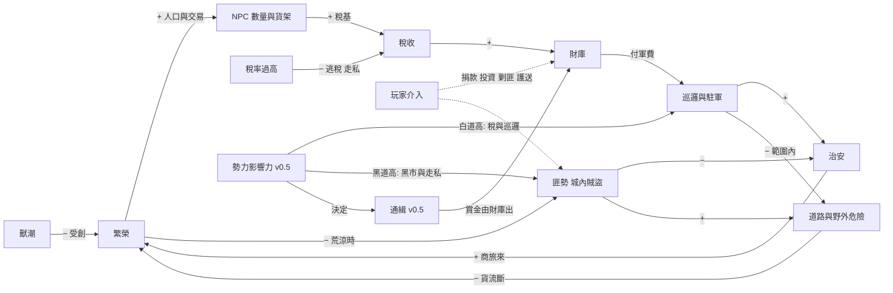
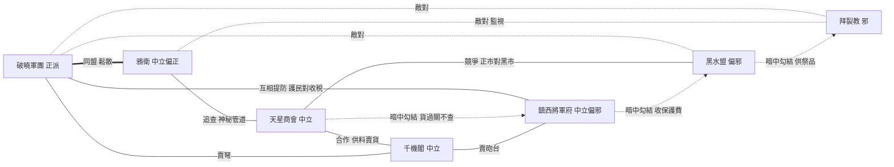
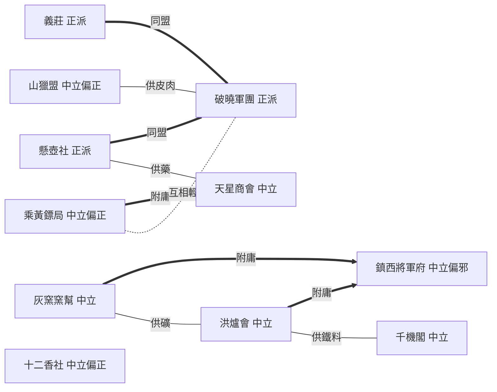
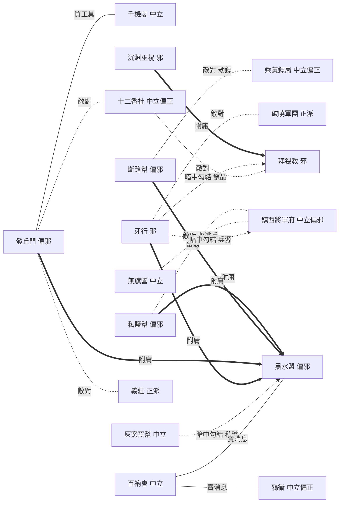

# 《山海錄》提案：讓世界活起來 v0.2

> 狀態：**提案，待 mumi 拍板**。未改分冊正文，未派工。v0.1（`living-world-v0.1.md` 與其 Page）保留不動，當歷史。
> 日期 2026-11-28｜提案人：遊戲製作人｜基準：[v0.3 分冊](gdd-v0.3-sections/index.md)（`Shiroyashatw/shanhailu` `dd3843b`）
> 相關分冊：[02 世界觀與勢力](gdd-v0.3-sections/02-worldview-factions.md)、[03 世界地圖](gdd-v0.3-sections/03-world-map.md)、[05 城鎮與 NPC](gdd-v0.3-sections/05-towns-npcs.md)、[09 經濟](gdd-v0.3-sections/09-economy-recipes.md)、[10 委託與世界事件](gdd-v0.3-sections/10-quests-rumors-events.md)、[13 路線圖與待拍板](gdd-v0.3-sections/13-roadmap-open-questions.md)
> 標記：**〔既有〕** 來自 v0.3 或舊文件｜**〔提議〕** 本案新增｜⚠️ 數字暫定，待數值模擬。
> 出入清單 A-01～A-07 mumi 尚未決定，本案不依賴、不引用成定案。

---

## 相對 v0.1 的變更

| # | 變更 | 依據 |
| --- | --- | --- |
| 1 | 不用「世族」一詞，改成「**大勢力**」；謝、陸、沈三個暫名**作廢** | mumi 回饋 1 |
| 2 | 勢力從「現有 5＋新 5」改成 **7 個大勢力＋14 個小勢力，共 21 個**，從亂世的**生計**長出來（第 5 節） | 回饋 2、3 |
| 3 | 新增三張勢力關係圖（總圖＋白道分區＋灰黑分區），標同盟、敵對、附庸、暗中勾結、競爭與立場 | 回饋 3 |
| 4 | 全面套用山海經地理、異獸、神話（乘黃、三青鳥、奇肱國、靈山十巫、黑水、異獸譜…），全部標〔提議〕 | 回饋 4 |
| 5 | 查證 dpoe「每個昇華背後有一個勢力」：**找不到這份舊規劃**；找到的是 15 個昇華的名字與玩法，改寫成各勢力的「傳承」（第 5.6 節，附出處） | 回饋 4 |
| 6 | 新增「**玩家取名**」（第 6 節） | 回饋 5 |
| 7 | 通緝：管轄改成將軍府、破曉軍團、黑水盟三種「規矩」；賞金獵人改由無旗營接榜；疏通管道改寫 | 配合新勢力 |
| 8 | v0.1 的「斷路幫」降為黑水盟底下的**小勢力**，就是 MVP 的盜匪團 | 配合新勢力 |
| 9 | 分期：MVP 不變；v0.5 開 5 個新勢力；新增 **v0.55「生計」**（灰窯原內再開 6 個小勢力，不開新區）；v0.6 第二區域與大城不變 | 先小後大 |
| 10 | 拍板題：#1、#4、#5、#6、#9 依新設計改寫；#2、#3、#7、#8、#10 原樣；新增 #11～#15 | 回饋 6 |

---

## 0. 結論（先看這裡）

1. **循環不變**：每座城鎮 4 個數字（繁榮、財庫、治安、駐軍），每天結算。主循環「繁榮 → 稅 → 財庫 → 巡邏 → 治安 → 繁榮」。
2. **勢力從生計長出來**：亂世要活下去，就有人採藥、打鐵、押鏢、打獵、燒窯、收屍、上香、討飯、當傭兵；也有人走私、盜墓、劫道、販人、拜裂口。一種生計一個勢力，共 **21 個**：**7 個大勢力**（跨區域、有附庸），**14 個小勢力**（地方性、一種營生）。
3. **現有 5 個勢力全部保留**，定位與 v0.3 一致：破曉軍團、天星商會、鴉衛（v0.3「三大勢力」）＋鎮西將軍府、拜裂教，都是大勢力；再加千機閣、黑水盟兩個大勢力。
4. **盤根錯節的核心**：白道靠將軍府收稅、天星流通、破曉護民；黑道靠黑水盟銷贓與走私。**兩道在檯面下互相勾結**：將軍府放天星的貨過關不查，將軍府向黑水抽保護費，牙行把人賣給拜裂教當祭品。
5. **dpoe 的昇華**：查不到「每個昇華背後一個勢力」的舊規劃。15 個昇華改寫成勢力的「傳承」：聲望到門檻就教一招，沿用 v0.3 校場〈破陣〉、鴉巢〈鴉影〉的做法。
6. **MVP 不變、仍克制**：灰窯鎮與渡陰關兩鎮活起來、1 個盜匪團（斷路幫）。不開新的聲望勢力。勢力分 3 期開。
7. **玩家取名**：開局選出身後取名，分姓、名兩欄，合計 2–4 個中文字，預設「沈衡」。名字出現在日誌、墓誌銘、懸賞令、NPC 稱呼和傳聞裡。
8. 拍板題 15 題（第 10 節）。

---

## 1. 系統循環（v0.1 為底，標出 v0.2 改動）

### 1.1 變數（每座城鎮一組，〔提議〕）

| 變數 | 範圍 | 意義 | MVP 起手值（灰窯／渡陰）⚠️ |
| --- | --- | --- | --- |
| 繁榮 P | 15–100 | 人氣與貨流；決定路人數、稅基、貨架。玩家看到 5 檔文字（荒涼／冷清／平常／熱鬧／繁華），點開看數字 | 50／45 |
| 財庫 T | 0 以上（兩） | 稅收進，軍費與維護出 | 200／300 |
| 治安 O | 0–100 | 城內犯案與被劫機率的反向 | 55／60 |
| 駐軍 G | 0–3 檔 | 無、自衛隊、巡邏隊、守備（第 3 檔 2026-11-28 16:10 由「駐軍」改「守備」） | 1／2 |
| 匪勢 B | 0–100 | 周邊盜匪壓力（區域值） | 30 |
| 路段危險 R | 係數 | 乘在現有遇險率 4%／22%／30% 上 | ×1 |
| **勢力影響力 I**（v0.5 起） | 每鎮每勢力 0–100 | 這座鎮誰說了算：決定委託種類、黑市有無、通緝管轄、稅率 | — |

### 1.2 循環圖

### 1.3 正向與負向循環

| 類型 | 循環 | 結果 |
| --- | --- | --- |
| 正 R1 稅養兵 | 繁榮↑ → 稅收↑ → 財庫↑ → 巡邏↑ → 治安↑ → 繁榮↑ | 滾雪球 |
| 正 R2 人氣 | 繁榮↑ → 路人↑ → 交易↑ → 稅收↑ | 同上 |
| 正 R3 路網 | 駐軍↑ → 危險↓ → 商隊安全 → 貨流↑ → 繁榮↑ | 同上 |
| 負 D1 欠餉 | 繁榮↓ → 稅↓ → 財庫空 → 降檔 → 治安↓ → 匪勢↑ → 危險↑ → 繁榮↓ | 死亡螺旋 |
| 負 D2 重稅 | 稅率↑ → 逃稅走私↑、繁榮↓ → 稅基↓ | 稅收反而少 |
| 負 D3 受創 | 獸潮未擊退 → 繁榮↓ → D1 | 一次事件拖垮 |
| **新 D4 黑白拉鋸**（v0.5） | 治安↓ → 黑水影響力↑ → 走私↑、稅↓ → 財庫↓ → 治安↓ | 黑道坐大 |
| **新 R4 黑道自律**（v0.5） | 黑水影響力過高 → 將軍府與破曉剿黑 → 黑水收斂；黑水也不殺金雞母（太亂沒油水） | 自動拉回 |

### 1.4 防失控（MVP 就做；v0.2 加兩條）

| 風險 | 作法 |
| --- | --- |
| 繁榮滾到頂 | 承載上限：鎮 80，投資建設可 +10，最高 95；超過 70 後每日增幅減半 ⚠️ |
| 財庫囤錢 | 超過 3 倍月支出的部分「上繳」，由鎮西將軍府抽走（呼應〔既有〕告示「過路貨物十抽其二」） |
| 越大越貴 | 軍費非線性：1 檔 15、2 檔 40、3 檔 90 兩／日 ⚠️ |
| 治安太好 | 治安 > 80 時，獸潮與盜匪的目標權重上升 |
| 死亡螺旋 | 繁榮底線 15；每日變化上限 ±3；每日向基準值回歸 10%；欠餉只降一檔；財庫見底觸發「求援」事件（破曉軍團或天星商會出手，要換聲望或抽成） |
| 玩家把世界玩壞 | 損害走同一組數字，被回歸與求援吸收；不設永久荒廢的城 |
| 看不懂因果 | 每日「城況簡報」 |
| **〔新〕某勢力獨大**（v0.5） | 每鎮影響力總和固定 100（此消彼長）；單一勢力 > 60 觸發對手勢力的「反制」事件 |
| **〔新〕勢力太多看不懂**（v0.5） | 每鎮只顯示影響力前 3 名；勢力靠「讀見聞才出現」〔既有機制〕逐步揭露 |

> 係數 ⚠️ 暫定。MVP 驗收：純 AI 跑 200 個 seed × 120 天不單向發散。

### 1.5 跟 v0.3 既有系統怎麼接

| 既有系統 | 怎麼接 |
| --- | --- |
| 獸潮 | 擊退 → 繁榮與治安 +；未擊退 → 繁榮 −，既有「貨架剩一半、客棧 ×2」照舊。駐軍 ≥ 2 檔受創縮為 1 天。v0.55 起山獵盟、義莊各有獸潮委託 |
| 委託 | 治安低 → 剿匪、護送；繁榮高 → 送貨變多。v0.5 起各勢力在自己地盤出專屬委託 |
| 傳聞 | 新題材「匪巢」「商隊出事」；「有人盤踞」對應到實際存在的斷路幫據點。v0.5 起傳聞會提到玩家的名字（第 6 節） |
| 聲望 | 〔既有〕只增不減，數字規則不改。勢力之間的對立用「敵意」另一條軸表達（第 10 節 #4） |
| 勢力 | 〔既有〕5 個勢力的功能、門檻、好處不改；鎮西將軍府與拜裂教的「下一版開放」在 v0.5 補上 |
| 出身〔既有 6 種〕 | 每個出身對一個小勢力有起手好感（第 5.5 節），讓開局就有人脈 |
| 旅途劫匪事件 | 出現率 × 路段危險 R；劫匪就是斷路幫的人 |
| 城鎮受創 `world.hurt` | 擴成每鎮 {P,T,O,G}（v0.5 再加 I），`newDay()` 結算 |

---

## 2. 玩家怎麼介入

| 做法 | 怎麼做 | 代價 | 回報 | 對世界 | 相關勢力 | 期別 |
| --- | --- | --- | --- | --- | --- | --- |
| 繳稅 | 買賣自動扣 5% ⚠️ | 每筆小額 | 無（基準） | 進財庫 | 將軍府 | MVP |
| 資助巡邏 | 捐銀兩給財庫指定軍費 | 100 兩約撐一檔 2–4 天 | 治安↑、破曉聲望 | O↑ R↓ | 破曉 | MVP |
| 投資建設 | 巡邏所／市集／糧倉／城牆／砲台，各 3 級，100–600 兩 ⚠️ | 大額不退 | 折扣、分紅、聲望 | 治安、繁榮上限、獸潮減傷 | 天星、千機閣 | MVP 只做巡邏所 |
| 剿匪 | 委託或追傳聞到斷路幫據點 | 戰鬥、耗時、埋伏 | 賞金、破曉聲望、掉落 | B↓ R↓ | 破曉、斷路幫 | MVP |
| 護送 | 跟乘黃鏢局押貨 | 時間、遇襲、貨損要賠 | 酬勞、鏢局與天星聲望 | 貨流↑ | 乘黃鏢局 | v0.5 |
| 走私／逃稅 | 私鹽道運鹽、黑市交易免稅 | 價差約 ×0.85、被查獲罰沒、通緝↑、將軍府敵意↑ | 省稅、禁售品、私鹽暴利（粗鹽〔既有〕灰窯 3 → 渡陰 9） | 稅收↓、黑水影響力↑ | 私鹽幫、黑水盟 | v0.5 |
| 當盜賊 | 扒竊、劫道 | 通緝、好處凍結、賞金獵人 | 錢與贓物、斷路幫門路 | O↓ B↑ | 斷路幫 | v0.5 |
| 賄賂／疏通 | 花錢或人情 | 貴、留把柄 | 消通緝、過關 | 財庫↑ | 天星、黑水、破曉、鴉衛 | v0.5 |
| 收屍、修廟、贖人 | 義莊、十二香社、對抗牙行的委託 | 時間、錢 | 繁榮↑、口碑 | P↑、屍變↓ | 義莊、十二香社 | v0.55／之後 |
| 盜墓 | 跟發丘門下古塚 | 褻瀆、義莊與香社敵意 | 古物、墓中機關 | — | 發丘門 | 之後 |

原則：每個介入都看得到結果；玩家完全不介入，世界也要自己走下去。

---

## 3. 通緝與犯罪（v0.5；承接 GDD 第十一節的「偷竊與通緝」）

### 3.1 三種「規矩」（管轄，v0.2 改寫）

| 管轄 | 地盤〔提議〕 | 誰執法 | 特色 |
| --- | --- | --- | --- |
| **將軍府的王法** | 灰窯鎮、官道驛站、渡陰關、官道 | 將軍府守軍與巡邏 | 罰金最重、有牢、懸賞最高；賄賂有效 |
| **破曉軍規** | 破曉營與其據點 | 破曉軍團 | 只辦傷人、殺良、通邪、販人；**不辦走私與逃稅**；可以「以功抵過」 |
| **黑水的規矩** | 黑市、私鹽道、斷路幫據點、無名古塚一帶 | 黑水盟 | 不管官府的罪；只罰「壞規矩」：黑吃黑、報官、劫自己人。犯了就被黑水追殺，不能用錢官方消 |
| 無管轄 | 撿骨師營地、鴉巢、荒野深處 | — | 只看有沒有活口 |

v0.3 只有驛站牆上的將軍令（見聞〈軍閥與世族〉），管轄劃分全是提議。

### 3.2 犯罪種類

| 罪 | 做法 | 通緝值 | 誰管 | 回報 |
| --- | --- | --- | --- | --- |
| 偷竊 | 扒路人、摸店（身法檢定） | +5～10 | 王法 | 少量銀兩、雜物 |
| 走私 | 帶違禁品（私鹽、軍牌、神骨碎片等）過關被查出 | +10～15 | 王法 | 價差 |
| 劫道 | 劫行商、商隊、鏢車 | +20 | 王法、乘黃鏢局記仇 | 貨與銀兩 |
| 傷人 | 城內打居民、守衛 | +15～30 | 王法、軍規 | 無 |
| 殺良 | 殺命名 NPC 或守衛 | +40 | 王法、軍規 | 劇情後果 |
| 通邪 | 公開與拜裂教往來 | +15 | 王法、軍規、十二香社敵意 | 教派門路 |
| 壞規矩 | 黑吃黑、報官、劫黑水的貨 | 黑水追殺值 +30 | 黑水 | — |

只有被目擊才加值。治安越高、駐軍越強，被目擊機率越高。懸賞由當地財庫支付（W 20 約 40 兩、50 約 250、80 約 640 ⚠️）。

### 3.3 分檔與追捕

| 檔 | W | 城鎮出入 | 服務 | 追捕 |
| --- | --- | --- | --- | --- |
| 0 清白 | 0 | 自由 | 正常 | 無 |
| 1 嫌疑 | 1–19 | 守衛盤查行囊，可說服或賄賂 | 正常 | 巡邏偶爾攔路 |
| 2 通緝 | 20–49 | 補罰金（賞金 20%）才讓進 | 商號加價 10%、客棧拒住 | 巡邏盤查、官道攔檢；**懸賞令貼上告示榜，寫著玩家的名字** |
| 3 重犯 | 50–79 | 城門拒入，只能潛入 | 官方服務全拒；剩行商、撿骨師、黑市 | **賞金獵人**：無旗營接榜上路（3–4 個命名獵人），可談判、收買、擊退 |
| 4 死刑 | 80 以上 | 見面即捕 | 全拒 | 被捕入牢，不直接格殺（#7）；拒捕才入戰 |

聲望影響：通緝 2 檔以上，該管轄勢力的門檻好處暫停，不扣聲望數字；同時該勢力的「敵意」上升（#4）。

### 3.4 連動

| 連動 | 說明 |
| --- | --- |
| 治安低、巡邏少 | 好得手但油水少；城內賊盜（斷路幫眼線）也會偷玩家 |
| 駐軍高 | 目擊率高、追捕強、通緝衰減慢 |
| 繁榮高 | 回報大；通緝擴散到相鄰管轄（百衲會的乞兒會傳話） |
| 黑水影響力高 | 黑市開門、私鹽便宜、銷贓容易；王法執行變弱（守衛被收買） |
| 賞金與罰金 | 賞金由財庫出，罰金回財庫 |

### 3.5 消除通緝

| 方式 | 條件與代價 | 效果 |
| --- | --- | --- |
| 繳罰金 | 通緝 ≤ 2 檔且進得了城；付賞金 50% | 王法 W 歸 0 |
| 坐牢 | 被捕或自首；沒收贓物與部分行囊、耗數天 | W 降到 10 以下 |
| 以功抵過 | 破曉剿匪、護送委託 | 軍規 W 歸 0；王法 W 每張 −10 |
| 疏通：破曉軍團 | 聲望 10 | 王法降 1 檔 |
| 疏通：天星商會 | 花錢買路條，聲望 25 半價 | 王法降 1 檔 |
| 疏通：鴉衛 | 拿見聞換 | 洗掉擴散到別管轄的部分 |
| 疏通：黑水盟 | 聲望 10、花錢、欠一份人情（之後一定會派一件髒活） | 王法降 2 檔；最便宜但有後患 |
| 躲 | 離開管轄每天 −2，留在內 −1；無旗營可收留 | 慢 |
| 黑水追殺 | 只能賠錢或替黑水辦事；殺追殺者只會更糟 | — |

---

## 4. 聚落規模分級

| 級 | 既有或提議地點 | 建築 | 模擬居民 | 同屏路人上限 | 武力 | 功能差異 | 常駐勢力 |
| --- | --- | --- | --- | --- | --- | --- | --- |
| 村／營地 | 撿骨師營地〔既有〕；〔提議〕赤石礦屯、枯骨獵寨、渡陰義莊 | 1–4 | 8–20 | 6 | 自衛 0–2 | 一種專長、無委託板；獸潮與匪最先打到 | 一個小勢力的大本營 |
| 驛站 | 官道驛站〔既有〕 | 1–3 | 流動 5–12 | 5 | 哨 0–2 | 歇腳、行商、情報、可設關卡 | 天星、乘黃鏢局 |
| 鎮 | 灰窯鎮、渡陰關〔既有〕 | 6–8 | 30–60 | 10 | 巡邏 2–6＋駐軍 0–10 | 完整服務、委託板、稅與治安循環 | 3–6 個勢力在此有人 |
| 據點／關寨 | 破曉營、渡陰關（兼） | 4–6 | 40–80（多為兵） | 10 | 駐軍 20–60 | 軍事服務、關稅、通緝盤查 | 破曉、將軍府 |
| 大城 | 第二區域〔提議〕 | 12–20，分 3–4 坊 | 150–400（抽象） | 每坊 ≤ 8 活動 NPC＋背景人群 | 巡邏 10–20＋駐軍 50–200 | 拍賣錢莊、監牢、賞金榜、大勢力總舵 | 大勢力的總舵各據一坊 |

- NPC 數量 = 命名 NPC（既有 26 人，固定）＋匿名居民（隨繁榮增減）。灰窯鎮路人：繁榮 20 約 2 人、50 約 5、80 約 8。
- **大城放進 1280×720**：不加欄、不改 240／796／220。中欄先是「城總覽圖」，分 3–4 坊，每坊標籤顯示繁榮、治安和支配勢力；點坊進「坊平面圖」，規格同現在的城鎮平面圖。人群是不可點的背景剪影。城況放中欄上緣一行，切坊最多一次點擊，有麵包屑。
- **v0.2 新增**：村是小勢力的大本營（礦屯＝灰窯窯幫、獵寨＝山獵盟、義莊＝義莊），所以「村」有了存在理由，不只是縮小版的鎮。

---

## 5. 勢力：從生計長出來（v0.2 重寫）

### 5.1 推導：亂世的工作與勾當

| 生計 | 白道或黑道 | 長出的勢力 | 層級 |
| --- | --- | --- | --- |
| 護民、守城、打妖魔 | 白 | 破曉軍團〔既有〕 | 大 |
| 統治、收稅、養兵 | 灰 | 鎮西將軍府〔既有〕 | 大 |
| 買賣、放貸、貨運 | 白 | 天星商會〔既有〕 | 大 |
| 情報、查異象 | 白 | 鴉衛〔既有〕 | 大 |
| 拜裂口、獻祭 | 黑 | 拜裂教〔既有〕 | 大 |
| 機關、弩、陷阱、砲台 | 中 | 千機閣〔mumi 提議〕 | 大 |
| 銷贓、黑市、地下錢莊 | 黑 | 黑水盟〔提議〕 | 大 |
| 採藥、煉藥、行醫 | 白 | 懸壺社 | 小 |
| 打鐵、鍛造裝備 | 白 | 洪爐會 | 小 |
| 押送貨物 | 白 | 乘黃鏢局 | 小 |
| 狩獵異獸、賣皮丹 | 白 | 山獵盟 | 小 |
| 採礦、燒窯 | 灰 | 灰窯窯幫 | 小 |
| 收屍、殮葬、防屍變 | 白 | 義莊 | 小 |
| 守廟、上香 | 白 | 十二香社 | 小 |
| 討飯、跑腿、賣消息 | 灰 | 百衲會 | 小 |
| 傭兵、賞金 | 灰 | 無旗營 | 小 |
| 販私鹽 | 黑 | 私鹽幫 | 小 |
| 劫道 | 黑 | 斷路幫 | 小 |
| 盜墓 | 黑 | 發丘門 | 小 |
| 販人 | 黑 | 牙行 | 小 |
| 巫祝、血祭 | 黑 | 沉淵巫祝 | 小 |

不另開勢力的生計：撿骨〔既有撿骨師是一個人，不是勢力，刻意留白〕、驛傳行商（屬天星）、軍醫（屬破曉傷兵帳）。

### 5.2 立場

五檔：**正派**、**中立偏正**、**中立**、**偏邪**、**邪**。立場只影響「誰跟誰敵對」與 NPC 的態度，不鎖玩家：玩家可以同時跟正派和邪派打交道，代價是敵意。

### 5.3 大勢力（7）

| 勢力 | 立場 | 定位 | 靠什麼營生 | 地盤 | 跟玩家互動（委託／門檻好處／敵對） | 山海經元素〔提議〕 |
| --- | --- | --- | --- | --- | --- | --- |
| **破曉軍團**〔既有〕 | 正派 | 冒險者、傭兵、亡國殘兵的聯合武裝，各地建據點護民 | 各地捐輸、委託賞金、軍牌換糧 | 破曉營、渡陰關募兵處 | 〔既有〕委託、獸潮、清窟、上繳軍牌；10〈破陣〉、20 委託報酬 +15%。〔提議〕25 通緝降 1 檔；傳承〈破陣者〉。敵對：殺良、通邪、販人 | 軍旗三國舊旗、「天亮以前不卸甲」〔既有〕；不另套神話，刻意保持「人的勢力」 |
| **天星商會**〔既有〕 | 中立 | 天裂前就壟斷經濟的金融帝國，神秘管道維持物資流通 | 商號、行商、放貸、日後的馬車 | 天星分號、天星關市、驛站行商 | 〔既有〕買賣、送貨、鑑定；10 九五折、25 精工大囊與鑑定半價。〔提議〕40 錢莊（存錢、借貸）。敵對：劫天星的貨、賴帳 | 貨單「南山硫磺、北山凍魚、東山線香」〔既有〕；管道留白〔既有〕 |
| **鴉衛**〔既有〕 | 中立偏正 | 人數極少的情報組織，調查異象 | 不靠營生，靠來路不明的經費；買見聞 | 鴉巢（隱）、各地暗樁 | 〔既有〕回報見聞、查證傳聞；6 辨傳聞、14〈鴉影〉。〔提議〕傳承〈影舞者〉（〈鴉影〉的延伸）；20 洗掉跨管轄通緝。敵對：出賣鴉衛暗樁 | 〔提議〕自稱「三青鳥」（《西山經》三危之山，西王母的使者）的後人；「鴉不在，總要有人看著」〔既有〕 |
| **鎮西將軍府**〔既有〕 | 中立偏邪 | 西山東麓的軍閥，當年開倉放糧的人，如今十抽其二 | 過路稅、關稅、上繳、屯田 | 灰窯鎮、驛站、渡陰關（治所） | 〔既有〕讀〈軍閥與世族〉後出現、v0.3 無好處。〔提議〕委託：剿匪、緝私、押糧；10 過路稅減半；20 可出入關樓與牢房（贖人）；傳承〈統治君王〉（統兵：帶親兵上陣）。敵對：走私被抓、殺守軍、包庇逃兵 | 〔提議〕「鎮西」鎮的是《西山經》的西方 |
| **拜裂教**〔既有〕 | 邪 | 不拜十二神，拜裂口：「上面的不要我們了，底下的還要」〔既有〕 | 信眾供奉、血祭、賣「裂口賜福」 | 沉淵祭窟、腐骨沼 | 〔既有〕讀〈邪教〉後出現、v0.3 無好處。〔提議〕委託：送祭品（玩家可拒絕、可反過來救人）、取神骨；10 抵抗侵蝕；20 用侵蝕換力量（接待拍板項 3 雙面刃）；傳承〈血魔〉。敵對：毀祭壇、救祭品 | 每月抬一個人進洞、面朝西〔既有〕；冥門伏筆〔既有〕 |
| **千機閣**〔mumi 提議〕 | 中立 | 機關匠人門派，專精弩、陷阱、砲台，誰付錢就替誰做 | 賣弩與機關、承包城防、修遺跡機關 | 〔提議〕赤石廢礦旁的工坊；大城有分閣 | 委託：試做機關、運零件、拆遺跡機關。10 野營設陷（降夜警）、買得到弩；25 訂製弩與陷阱；40 替城鎮投資砲台（獸潮擊退更快）；傳承〈千機〉。敵對：偷圖紙、拆千機閣的機關 | 〔提議〕自稱《海外西經》「奇肱國，能為飛車」的匠人一脈，日後馬車、飛車都從這裡來 |
| **黑水盟**〔提議〕 | 偏邪 | 地下世界的總盟：銷贓、黑市、地下錢莊、走私道 | 抽成：所有黑道勾當都要過它的手 | 〔提議〕渡陰關後巷的鬼市、私鹽道、斷路幫據點 | 委託：運黑貨、討債、替盟裡「教訓人」。10 贓物可賣、開黑市；20 疏通王法降 2 檔（欠人情）；30 地下錢莊借錢不問來路；傳承〈賭徒〉（盟裡賭坊）。敵對：報官、黑吃黑 → 黑水追殺 | 〔提議〕名取《山海經》多處出現的「黑水」，喻地下的暗流 |

### 5.4 小勢力（14）

| 勢力 | 立場 | 附屬 | 營生 | 地盤〔提議〕 | 獨特玩法 | 跟玩家互動（委託／門檻好處／敵對） |
| --- | --- | --- | --- | --- | --- | --- |
| **懸壺社** | 正派 | 獨立；同盟破曉（供傷兵帳） | 採藥、煉藥、行醫 | 回春藥鋪〔白朮〕、渡陰藥攤〔苦參〕、青霧藥林 | 山海經藥方：〔提議〕「食之已」系列藥（例：〈西山經〉薰草「佩之可以已癘」）；冬季藥荒 | 委託：採特定藥、試藥、送藥。10 藥爐配方 +2；20 收藥價 +10%；傳承〈追獵者〉（藥劑技）。敵對：劫藥、賣假藥 |
| **洪爐會** | 中立 | 附庸將軍府（軍械坊是官營） | 打鐵、鍛造、修裝 | 石記鐵鋪〔石敢〕、軍械坊〔嚴鐵娘〕、赤石廢礦 | 訂製與重鍛：交礦石與底材，指定一條詞綴 | 委託：送礦、找稀有礦（玄石、沼鐵〔既有〕）。10 修裝半價；20 重鍛一條詞綴；敵對：偷礦、賣劣鐵 |
| **乘黃鏢局** | 中立偏正 | 附庸天星（承包天星貨運） | 押送貨物、護送行人 | 官道、驛站 | 鏢車：沿官道走、可被劫；鏢旗一插，斷路幫要先掂量 | 委託：押鏢、護人。10 運費折扣、可託運貨物；20 雇鏢師同行一段；傳承〈鐵金剛〉（盾陣護鏢）。敵對：劫鏢（永遠記仇） |
| **山獵盟** | 中立偏正 | 獨立；賣給破曉軍需帳 | 獵異獸、賣皮丹 | 〔提議〕枯骨獵寨、枯骨獸徑、青霧藥林 | **異獸譜**：照《山海經》列異獸（猙、蠱雕、九尾狐、畢方等，舊世界觀已定方向），獵到登譜、換獵盟賞金 | 委託：指定異獸、獸潮前清獸。10 獸跡多 1；20 異獸部位加價；傳承〈風行神射〉（弓與獵鷹）。敵對：濫捕、搶別人的獵物 |
| **灰窯窯幫** | 中立 | 附庸將軍府（繳窯稅）；暗中勾結黑水（私礦） | 採礦、燒窯 | 灰窯鎮、〔提議〕赤石礦屯、亂葬古窯（舊窯當墳〔既有〕） | 窯火：燒窯產磚與陶，驅屍（燒過的土東西爬不出來〔既有〕） | 委託：清礦坑、運煤、封窯。10 礦脈產量 +1；20 窯神廟線香自給；傳承〈地獄火〉改寫為「窯火入體」。敵對：在礦坑殺人、報私礦 |
| **義莊** | 正派 | 同盟破曉、撿骨師友好 | 收屍、殮葬、送屍還鄉、防屍變 | 〔提議〕渡陰關外義莊、亂葬古窯 | **屍變**：獸潮或戰後沒人收屍，幾天後野外出屍怪、繁榮下降；收屍就壓得住 | 委託：收屍、送軍牌回鄉（接〔既有〕軍牌）。10 戰後收屍得軍牌；20 死後保留一件遺物給下一個角色（接永久死亡）。敵對：盜墓、褻瀆屍首 |
| **十二香社** | 中立偏正 | 敵對拜裂教 | 守廟、上香、賣線香、修廟 | 窯神廟〔啞伯〕、岔口山神小廟 | 修廟：捐修小廟 → 繁榮 +、七情發作率 −（伏筆：〈七情〉「日日上廟的人發作最凶」〔既有〕，真相由 mumi 決定）；傳承〈神裔〉（十二神選四） | 委託：送香、找神像碎片。10 上香效果加倍；20 神像碎片換祝福。敵對：通邪、毀廟 |
| **百衲會** | 中立 | 獨立；兩邊都賣 | 討飯、跑腿、賣消息 | 灰窯街上〔乞兒阿滿〕、渡陰關 | 街頭耳目：傳聞便宜但常過時〔既有〕；玩家通緝的消息靠它擴散，也靠它壓下 | 委託：送信、盯人。10 傳聞準度提升；20 可請乞兒壓下通緝擴散。敵對：打乞兒（全城都知道） |
| **無旗營** | 中立 | 獨立；敵對將軍府（收逃兵） | 傭兵、接賞金 | 野徑岔口（逃兵的蹤跡〔既有〕） | 接懸賞榜：通緝玩家時，賞金獵人從這裡出；玩家也能接榜抓 NPC 逃犯 | 委託：當打手、抓逃犯。10 雇傭兵同行；20 收留通緝犯（躲通緝）；傳承〈角鬥士〉。敵對：殺營裡的人 |
| **私鹽幫** | 偏邪 | 附庸黑水；敵對將軍府 | 販私鹽 | 灰窯↔渡陰的野徑（粗鹽〔既有〕3 → 9） | 私鹽道：避開官道的鹽車，最直接的「逃稅」玩法 | 委託：運鹽、引開巡邏。10 鹽價成本價；20 私鹽道地圖（避巡邏路線）。敵對：緝私、報官 |
| **斷路幫** | 偏邪 | 附庸黑水 | 劫道、收買路錢 | 野徑一帶據點（MVP 的盜匪團） | 就是〔既有〕旅途事件「劫匪攔路」的那群人；據點可剿、會重生 | MVP：敵對（剿匪）。v0.5：10 買路錢免收；20 入幫劫道（盜賊路線）。敵對：剿匪、劫自己人 |
| **發丘門** | 偏邪 | 附庸黑水（銷贓）；向千機閣買工具 | 盜墓 | 無名古塚、腐骨沼（比天裂更早的骨頭〔既有〕） | 古塚機關：拆墓中機關、驅墓俑（守墓俑〔既有〕敵人） | 委託：下墓、找陪葬。10 古塚多一層；20 古物鑑定；傳承〈詭雷師〉（拆了墓裡的機關改用）。敵對：義莊、十二香社 |
| **牙行** | 邪 | 附庸黑水；暗中勾結將軍府（兵源）與拜裂教（祭品） | 販人（買賣難民、拐賣） | 渡陰關難民〔既有難民婦人〕 | **玩家只能對抗**（#12）：贖人、救人、端掉牙行 → 居民回流、繁榮 + | 不給玩家門檻好處。委託只來自對手（破曉、義莊）。敵對：救人就是敵對 |
| **沉淵巫祝** | 邪 | 附庸拜裂教 | 巫術、血祭、替拜裂教主持 | 沉淵祭窟〔既有巫祝敵人〕 | 用紅霧改造人：侵蝕換力量 | 委託：找祭品、守祭窟。10 侵蝕上限 +5；傳承〈異變者〉（突變有代價）。敵對：清窟 |

〔提議〕沉淵巫祝自稱《大荒西經》「靈山十巫」一脈（靈山「十巫從此升降，百藥爰在」）：與懸壺社「同出一源，一個救人，一個用人」。

### 5.5 出身與起手人脈（接〔既有〕6 出身）

| 出身〔既有〕 | 起手好感〔提議〕 |
| --- | --- |
| 獵戶 hunter | 山獵盟 +5 |
| 藥童 herbalist | 懸壺社 +5 |
| 礦工 miner | 灰窯窯幫 +5 |
| 逃兵 deserter | 無旗營 +5；將軍府起手嫌疑 W 5 |
| 行商 peddler | 天星商會 +3、乘黃鏢局 +3 |
| 流民 drifter | 百衲會 +5 |

### 5.6 dpoe 昇華的查證與改寫

**查證結果：找不到「每個昇華背後有一個勢力」的舊規劃。** 查過的範圍：

| 查了哪裡 | 結果 |
| --- | --- |
| `/workspace/dpoe-remaining-final-1126/docs/`（rg「昇華」「勢力」「門派」「組織」「背後」） | 無昇華與勢力的對應 |
| `docs/世界觀.md:92-98`（§6 勢力） | 只有破曉軍團、鴉衛、天星商會三股（2026-11-06 定案，細節留白） |
| `docs/世界觀.md:17` | 「邪教、獵人組織……軍閥與世族，各自割據（不寫死）」 |
| `docs/企劃書.md:1583`（§7.4 昇華）及其下 | 15 個昇華的機制，無勢力或背景 |
| `js/data.js:5700-6650`（`ASC`） | 每個昇華只有名字 `n` 與一句玩法說明 `d`，無勢力欄位 |
| dpoe repo 歷史（本機完整 clone，1319 個 commit，到 `d026e0b5` 2026-11-27），`git log -G` 搜「千機閣」「昇華…背後／組織／門派」「背後的勢力」 | 無 |
| `docs/討論清單.md:53-61`（已於 `1da63628` 2026-11-20 刪除） | 只有「據點、勢力、交易」暫緩：「勢力用現有的破曉軍團、鴉衛、天星商會加敵對方」 |
| GitHub code search `repo:Shiroyashatw/dpoe 勢力 昇華` | 0 筆（中文索引可能不完整，以本機 clone 為準） |
| bot 記憶 | 無 |

**找到的素材**：15 個昇華的名字與玩法說明（`dpoe-remaining-final-1126` `062ec4ad` 的 `js/data.js`）。以下對應全是本案**提議**，不是舊設定。山海錄沒有昇華系統，所以改寫成「**傳承**」：勢力聲望到門檻，教 1 個招式或技能，跟 v0.3 校場〈破陣〉、鴉巢〈鴉影〉同一套做法（#13）。

| 昇華（出處） | dpoe 玩法 `d` 摘要 | 改寫成哪個勢力的傳承 | 怎麼改 |
| --- | --- | --- | --- |
| 風行神射（`data.js:5702`） | 投射物、身法、獵鷹印記 | 山獵盟 | 弓＋獵鷹標記異獸 |
| 鐵金剛（`5767`） | 盾與錘、格擋值 | 乘黃鏢局 | 盾陣護鏢：守住鏢車 |
| 地獄火（`5845`） | 以地獄火取代魔力，滿了自爆 | 灰窯窯幫 | 「窯火入體」：疲累換火傷，過頭自傷 |
| 影舞者（`5904`） | 完美閃避與暴擊 | 鴉衛 | 〈鴉影〉〔既有〕的進階 |
| 血魔（`5978`） | 以生命換傷害、流血 | 拜裂教 | 血祭：扣生命上限換流血 |
| 角鬥士（`6022`） | 盛怒、撲殺、偷取 | 無旗營 | 傭兵的狂怒（接〔既有〕狀態「狂怒」） |
| 千機（`6077`；`6074` 註：十字弓彈藥＋榴彈） | 彈藥、榴彈、翻滾裝填 | 千機閣 | 弩與擲雷 |
| 統治君王（`6151`） | 指揮魔像 | 鎮西將軍府 | 統兵：帶親兵上陣 |
| 詭雷師（`6181`） | 陷阱與地雷 | 發丘門 | 把古塚機關拆來用（千機閣做新機關，發丘門用舊機關，兩者不重複） |
| 破陣者（`6234`） | 戰吼與衝鋒 | 破曉軍團 | 〈破陣〉〔既有〕的進階 |
| 潮汐（`6294`） | 冰冷與閃電 | **暫不指派**：留給北山或海外的區域勢力（《山海經》北海神禺彊） | 第二區域再定 |
| 賭徒（`6371`） | 運氣、輪盤籌碼 | 黑水盟 | 盟裡賭坊 |
| 異變者（`6425`） | 突變改造、腐化物品 | 沉淵巫祝 | 紅霧改造（接侵蝕） |
| 追獵者（`6492`） | 藥劑技能、毒霧 | 懸壺社 | 藥劑與毒霧 |
| 神裔（`6640`；`GODSON` 在 `6548`） | 供奉十二生肖神，選四位組神殿 | 十二香社 | 十二神選四的祝福 |

另：dpoe `data.js:7269` 有一組機關名「機關匣、捕獸器、火藥匣、符咒匣、千機匣、天工匣」，可當千機閣的貨品名。dpoe 的昇華「千機」與 mumi 提的「千機閣」同名，山海錄是獨立專案，照 mumi 的提議沿用。

### 5.7 關係圖

圖例：`==>` 附庸（小 → 大）｜`===` 同盟｜`-.-` 敵對｜`-.->` 暗中勾結｜`---` 競爭或合作（看標籤）。立場寫在名字後。

**總圖（7 大勢力）**

**分區圖 A：白道與生計**

**分區圖 B：灰黑兩道**

**關係重點**

1. **白道裡面不乾淨**：將軍府放天星的貨過關不查，對上〔既有〕貨單「沒寫經過哪一道關」；將軍府也向黑水收保護費。
2. **最黑的一條鏈**：牙行把難民賣給拜裂教當祭品，對上〔既有〕「每個月抬一個人進洞」。這是破曉、義莊、十二香社聯手的理由，也是 v0.5 之後可以做的主線事件。
3. **兩頭賣的中立勢力**：千機閣賣砲台給將軍府、賣弩給破曉、賣工具給盜墓的；百衲會的消息同時賣給鴉衛和黑水。玩家在中立勢力身上最不容易樹敵，也最難得到信任。
4. **附庸＝牽連**：幫了附庸，宗主也略喜歡你；得罪附庸，宗主也記一筆（敵意或聲望各打五折傳給宗主）。
5. **破曉軍團和將軍府不是一夥**：一個護民，一個收稅。玩家被通緝時，破曉是最可能拉你一把的白道。

### 5.8 開放順序

| 期 | 勢力 | 理由 |
| --- | --- | --- |
| MVP | 不開新的聲望勢力。斷路幫只當盜匪團（敵對）；鎮西將軍府當治所（不開好處） | 先驗證循環 |
| v0.5「亂世」 | 補開將軍府、拜裂教的好處〔既有預留〕；新開**黑水盟、斷路幫、私鹽幫、千機閣、乘黃鏢局** | 剛好對應通緝、走私、劫道、護送、砲台投資 |
| v0.55「生計」 | **懸壺社、洪爐會、山獵盟、灰窯窯幫、百衲會、無旗營**（灰窯原內，不開新區） | 都是現有建築與 NPC 的延伸，成本低 |
| v0.6 及之後 | **義莊、十二香社、發丘門、牙行、沉淵巫祝**；第二區域的區域勢力（潮汐的那一個等） | 要屍變、修廟、古塚擴層、暗線事件 |

介面：勢力欄〔既有〕可捲動、支援任意數量，21 個不用改欄位。勢力總覽改成「大勢力為章、附庸縮排在下」；仍靠讀見聞才出現。

---

## 6. 玩家取名（〔提議〕，建議放 MVP）

**現況**：主角名字寫死成「沈衡」：`game.js:227`（`name: '沈衡'`）、`game.js:265`（開局日誌）、`game.js:464`（死亡日誌）、`ui.js:760`（墓誌銘標題「沈衡之墓」）。頭像 `icons_npc.js:799` 是 6 出身的臉，跟名字無關，不用改圖。

**流程**：開局選完出身 → 取名畫面（姓、名兩欄＋「隨機」鈕）→ 確定 → 醒來。預設帶「沈衡」，直接按確定也行。

**規則**：

| 項目 | 建議 |
| --- | --- |
| 欄位 | 姓 1–2 字、名 1–2 字，合計 2–4 字 |
| 字元 | 只收中文字（CJK 統一漢字）；不收空白、符號、英數 |
| 隨機 | 從出身對應的姓名池抽（獵戶多單字名、流民可抽小名） |
| 禁用 | 不能和命名 NPC 同名（避免「錢四海殺了錢四海」）；基本禁字表 |
| 存檔 | 存 `S.name = {sur, given}`；舊檔沒有就當「沈衡」 |

**名字出現在哪裡**：

| 位置 | 例 | 期別 |
| --- | --- | --- |
| 右欄頭像旁 | 「沈衡・獵戶」 | MVP |
| 日誌 | 「沈衡在灰窯鎮醒來」「沈衡死於酉神裂口」 | MVP |
| 墓誌銘 | 「沈衡之墓」 | MVP |
| NPC 稱呼 | 陌生叫「客官」；熟了叫「沈客官」；聲望高叫「沈大俠」；鴉衛叫全名（稱呼一律不分性別） | MVP 只做「姓＋客官」一種，v0.5 依聲望分稱呼 |
| 懸賞令 | 告示榜：「緝拿 沈衡，賞銀 250 兩，死活不論」 | v0.5 |
| 傳聞 | 口碑或通緝高時：「聽說有個叫沈衡的，一個人清了古窯」 | v0.5 |
| 義莊遺物（下一個角色） | 「沈衡的遺物」 | 之後 |

不做性別選擇（現況頭像沒有分），稱呼用不分性別的版本。

---

## 7. NPC 移動（不變）

| 層 | 內容 | 期別 |
| --- | --- | --- |
| L1 城內走動 | 路人與巡邏按時段在 2–3 點間走；數量隨繁榮；離屏不模擬 | MVP |
| L2 巡邏路線 | 巡邏繞街，通緝目擊判定會用到 | MVP（併入 L1） |
| L3 盜匪團 | 斷路幫據點與活動半徑，影響路段 R；是數值不是會跑的實體 | MVP |
| L4 鏢車與商隊 | 乘黃鏢局鏢車、天星商隊沿官道前進，可被劫可護送 | v0.5 |
| L5 逃犯、賞金獵人、私鹽車 | 跟通緝和走私一起 | v0.5 |
| L6 NPC 生活 | 工程大、價值不確定 | 之後再評估 |

同屏活動 NPC 上限：鎮 10、坊 8；超過用背景剪影。最大風險是單屏可讀性，不是效能（需原型實測）。v0.2 新增：路人身上可以有勢力標記（例：百衲會乞兒、無旗營傭兵），點了才看得到，不佔畫面。

---

## 8. 分期與驗收

### MVP「活起來」（範圍不變＋取名）

1. 灰窯鎮、渡陰關：繁榮、財庫、治安、駐軍，每日結算，含防失控。
2. 交易稅固定 5%。
3. 路人走動（L1），數量隨繁榮；巡邏在街上走。
4. 道路危險 = 現有遇險率 × 治安修正。
5. 1 個盜匪團＝**斷路幫**，據點在野徑一帶〔提議〕，可追傳聞發現、可剿、會重生。
6. 玩家介入：資助巡邏、投資巡邏所、剿匪委託。
7. 獸潮連動。
8. 城況簡報。
9. **玩家取名**（第 6 節的 MVP 部分）。
10. 存檔預留 `wanted`、`jurisdiction`、`influence`、`hostility` 欄位（不做介面）。

不做：通緝、新的聲望勢力、走私、鏢車、村與驛站模擬、大城。

驗收：
- 200 個 seed × 120 天：繁榮在 20–90 的比例 ≥ 95%；沒有一鎮連續 30 天停在底線或上限。
- 資助巡邏 100 兩，3 天內治安可見上升；不介入也有起伏。
- 繁榮 20 與 80 時路人數差 ≥ 2 倍；同屏活動 NPC ≤ 10，不遮擋建築與命名 NPC。
- 取名：輸入 2–4 個中文字可開局；非法輸入有提示；日誌、右欄、墓誌銘都顯示自訂名字；舊存檔讀成「沈衡」。
- 原有 `node tests/e2e.js` 全過；10 個活動 NPC 同屏影格不低於現況。
- mumi 玩 20–30 分鐘能說出「這鎮今天比昨天冷清或熱鬧，是因為什麼」（是否試玩由 mumi 決定）。

### v0.5「亂世」

範圍：通緝與犯罪（三種規矩、4 檔、賞金獵人、消除方式）、口碑、勢力影響力（每鎮前 3 名）、敵意軸（#4）、走私與私鹽道、護送與鏢車、5 個新勢力＋將軍府與拜裂教好處、懸賞令與傳聞帶玩家名字、市集日與節慶、流民遷徙。

驗收：
- 扒竊被目擊 → W 上升；三檔各有肉眼可見差異；每種消除管道有 e2e 腳本走得通。
- 黑水影響力 > 60 → 觸發反制事件；120 天模擬沒有勢力長期獨佔一鎮。
- 每個新開的勢力至少 1 張專屬委託、2 個門檻好處、1 種敵對觸發，且營生不重複。
- 劫鏢 → 乘黃鏢局記仇、天星聲望不漲、該鎮貨價上升。

### v0.55「生計」

範圍：懸壺社、洪爐會、山獵盟、灰窯窯幫、百衲會、無旗營；異獸譜、重鍛、窯火、街頭耳目、接懸賞榜；出身起手人脈；傳承第一批（各勢力 1 招）。

驗收：6 個出身各自在前 30 分鐘遇到自己的起手勢力；每個小勢力的委託只能從它的營生裡長出來（不能是通用獵殺）。

### v0.6 及之後

第二區域＋第一座大城（分坊）；義莊、十二香社、發丘門、牙行、沉淵巫祝；屍變、修廟、牙行與拜裂教的祭品鏈主線；區域勢力（潮汐）；馬車（千機閣飛車一脈〔提議〕）。

---

## 9. 另外 6 個點子（v0.1 原樣，標出新勢力接點）

| 點子 | 內容 | 跟循環與勢力的連動 | 建議 |
| --- | --- | --- | --- |
| A 城況簡報與告示榜 | 每天 1–3 行世界變化；告示榜貼懸賞、徵兵 | 因果寫成人話；懸賞令貼這裡 | MVP |
| B 口碑（鎮級） | 每鎮對玩家的好感，可增可減 | 補「聲望只增不減」裝不下的負面；百衲會傳播 | v0.5 |
| C 市集日與節慶 | 市集日人多稅多；窯神廟祭 | 繁榮夠才辦；十二香社主辦、百衲會與斷路幫趁亂 | v0.5 |
| D 流民遷徙 | 居民流向相鄰的鎮；全區人口守恆 | 防死亡螺旋；牙行盯上流民 | v0.5 |
| E 糧倉與饑荒 | 每鎮糧存量 | 將軍府屯田、私鹽與私糧 | 之後 |
| F 勢力地盤與邊境事件 | 每個地點的支配勢力 | v0.2 已把「勢力影響力」提前到 v0.5 的精簡版；完整拉鋸之後 | 精簡版 v0.5，完整版之後 |

---

## 10. 待 mumi 拍板

> #2、#3、#7、#8、#10 與 v0.1 相同，原樣保留；#1、#4、#5、#6、#9 依新設計改寫；#11～#15 是新題。

| # | 問題 | 選項 | 建議與理由 |
| --- | --- | --- | --- |
| 1（改） | 勢力架構 | a. 7 大＋14 小，共 21（本案）　b. 只留 v0.3 三大＋將軍府、拜裂教為大，其餘都小（5 大 16 小）　c. 再精簡到 12 個左右 | **a**。千機閣與黑水盟撐得起跨區域（技術、地下錢莊），黑白兩道各有一個總盟才盤根錯節；數量靠分 3 期開放消化 |
| 2 | MVP 切面 | a. 兩鎮活起來（本案）　b. 再加通緝精簡版　c. 一次全包 | **a**。先證明循環好玩 |
| 3 | 稅制 | a. 固定 5%　b. 各治所稅率不同　c. 玩家當領主調稅 | **MVP 用 a，v0.5 升 b；c 不做** |
| 4（改） | 勢力對立怎麼表達 | a. 聲望只增不減＋通緝凍結好處＋口碑（v0.1）　b. 開放扣聲望（幫黑水，破曉降）　c. 聲望照舊只增不減，**另加每勢力一條「敵意」**：幫它的敵人或附庸被你打，敵意上升；敵意高 → 好處暫停、派人找麻煩 | **c**。21 個勢力有敵對與附庸，沒有負面軸就盤不起來；c 不動 v0.3 既有規則，也能回答 GDD 待拍板項 2 |
| 5（改） | 玩家當盜賊走多遠 | a. 不做　b. 偷竊與劫道有代價　c. b＋入斷路幫、黑水盟的聲望路線（黑道也有門檻好處） | **v0.5 做 c**。有了黑水盟與斷路幫，黑道路線只是兩個勢力的聲望表，不是另開系統 |
| 6（改） | 通緝管轄 | a. 全世界一個值　b. 按治所（v0.1）　c. 三種規矩：將軍府王法、破曉軍規、黑水規矩，各自一個值 | **c**。三種規矩罰的東西不一樣，玩家才會選「在誰的地盤做什麼事」 |
| 7 | 通緝最高檔 | a. 守軍格殺，可能觸發永久死亡　b. 被捕入牢，拒捕才入戰 | **b** |
| 8 | 大城放哪 | a. 灰窯原內擴　b. 第二區域　c. 先只在大陸圖預告 | **b（v0.6）**，v0.5 在大陸圖預告 |
| 9（改） | 新勢力開放順序 | a. 依本案三期：v0.5 黑道與護送 5 個、v0.55 生計 6 個、v0.6 後 5 個　b. 先開生計 6 個（白道），黑道延後　c. 一次全開 | **a**。v0.5 的通緝、走私、護送正好需要黑水、斷路幫、私鹽幫、鏢局；生計勢力是現有 NPC 延伸，放 v0.55 低風險 |
| 10 | 路線圖調整 | a. 活世界 MVP 排在原 v0.4 之前，通緝併入 v0.5，第二區域順延　b. 照原路線並行　c. 延後 | **a** |
| 11（新） | 取名規則 | a. 姓、名兩欄，合計 2–4 個中文字　b. 單欄 2–6 字，只收中文　c. 單欄 1–8 字，含英數 | **a**。NPC 能叫「沈客官」「沈大俠」，懸賞令與墓誌銘排版固定；英數會破壞亂世語感 |
| 12（新） | 販人的尺度 | a. 牙行存在，玩家只能對抗（贖人、救人、端掉）　b. 玩家也能跟牙行交易　c. 拿掉牙行 | **a**。保留亂世的黑，但不讓玩家做這件事；救人有正向回饋（居民回流、繁榮 +） |
| 13（新） | dpoe 昇華怎麼用 | a. 改寫成勢力「傳承」：門檻教 1 招（同〈破陣〉〈鴉影〉）　b. 做完整的昇華樹　c. 不用 | **a**。沿用 v0.3 既有做法，不加新系統；完整樹偏離「無等級、過什麼日子長什麼本事」 |
| 14（新） | 生計勢力的位置 | a. 加一期 v0.55，在灰窯原內開　b. 跟第二區域一起在 v0.6 開　c. 併進 v0.5 | **a**。先小後大：先把一區的生態做滿，再開新區；v0.25 已有小版號先例 |
| 15（新） | 出身起手人脈 | a. 每個出身對一個小勢力起手好感（逃兵另帶嫌疑）　b. 不做 | **a**。成本小，讓 6 出身的開局分得出差異，也讓小勢力有人帶路 |

### 補充

- 所有勢力名字（含黑水盟、懸壺社等 16 個新名字）與山海經對應都是**提議**，mumi 可整批換。
- 「三大世族」查無舊設定這件事 v0.1 已報；v0.2 照 mumi 指示改叫大勢力，不再追。
- dpoe「每個昇華背後有一個勢力」查無原文；若 mumi 記得在哪裡（例如某次對話或 Page），給我位置，我再對一次。
- 本案不需要 mumi 先決定 A-01～A-07。
