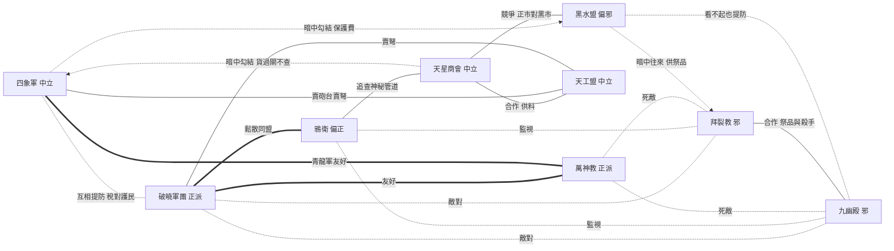
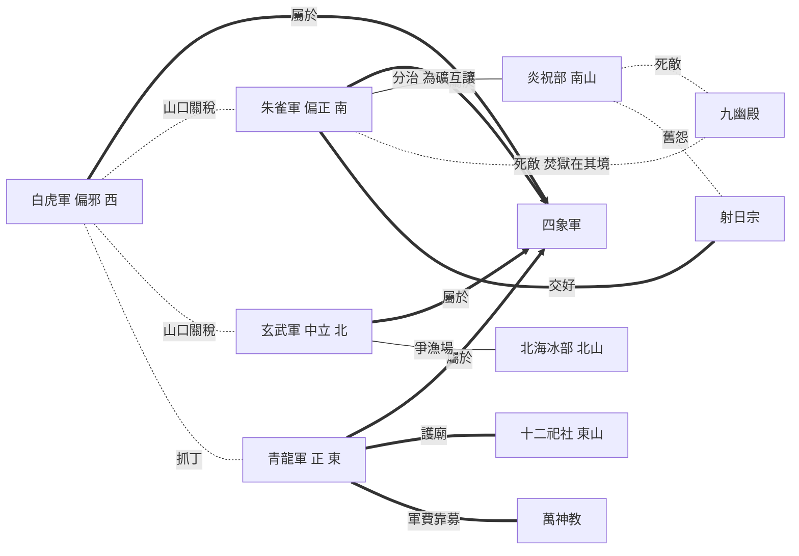
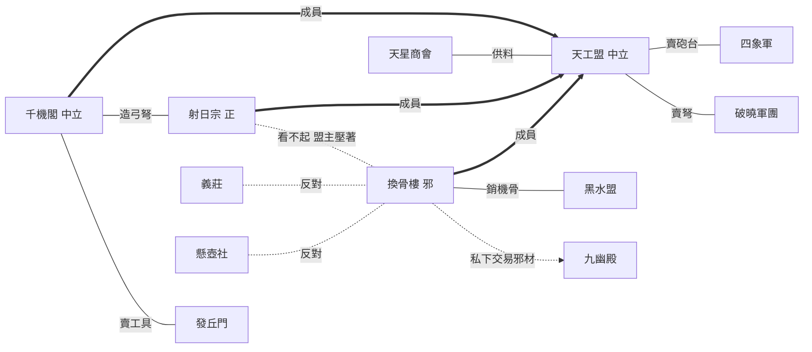
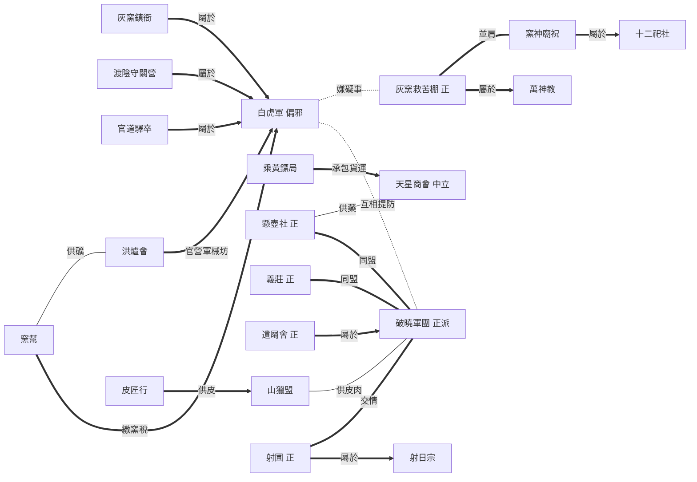
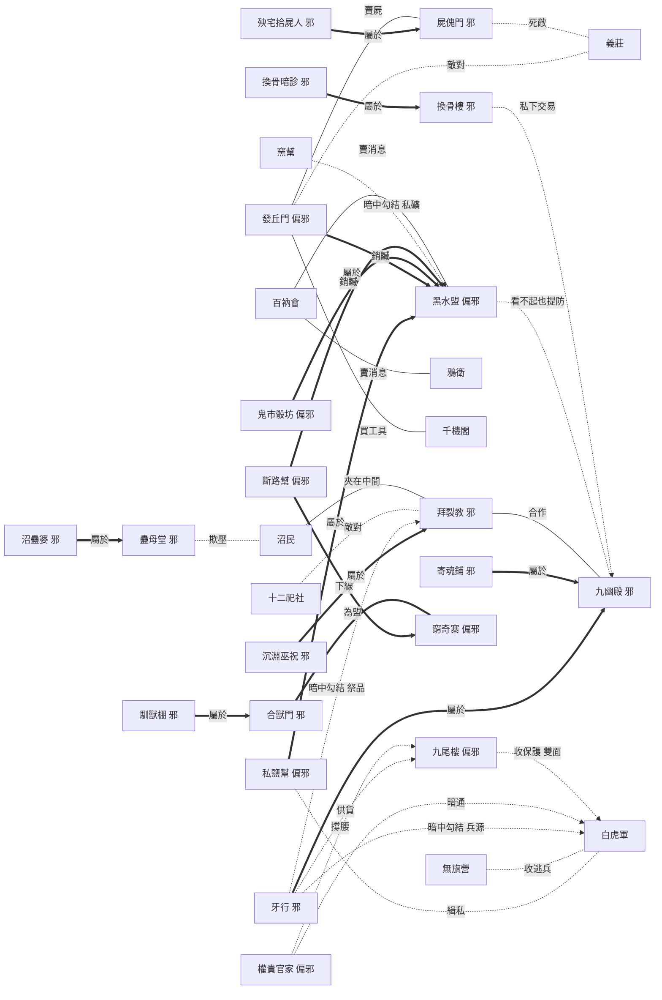

# 《山海錄》世界藍圖 v0.3（定稿）

> 狀態：**藍圖全部定稿**。mumi 已拍板 v0.2 的主要項目，並於 2026-11-28 拍板邪路各題（見「mumi 已拍板」）。2026-11-28 15:02 起新增「NPC 生成化」方向（11.7、拍板第 25–31 項），並**推翻**原「玩家不能取代邪派首領」（拍板第 11 項、12.2）；其細則（玩家當首領、定時換人事件、人口與存檔）已於 15:19 全部照建議拍板，寫入 11.7。同時拍板開局只有「平民」與路線框架（11.8，拍板第 33–42 項）。評估見 `npc-generated-identity-v0.2.md`、`start-and-routes-v0.1.md`。只寫「這個世界長什麼樣、誰在哪裡、靠什麼活、有什麼規矩」。**不談分期、MVP、系統數值、實作**；「怎麼放進遊戲」是第二段，不在這份。　2026-11-28 16:10 補：盜墓 11 題已拍板（11.9、拍板第 43 項）；數值待決 12 題、駐軍第 3 檔改「守備」、赤鴉哨不改、第一批開發先不派（拍板第 44–47 項）。2026-11-28 18:45 補：青樓事業 v0.3 定案，新增勢力「九尾樓」「權貴官家」，附錄 A 63→65；12.5.1 買主加青樓為第三頭；渡陰關聚落列入青樓、茶樓、戲樓、當鋪（拍板第 48 項）。只寫世界，不談分期實作。
> 日期 2026-11-28｜提案人：遊戲製作人｜基準：[GDD v0.3 分冊](gdd-v0.3-sections/index.md)（`Shiroyashatw/shanhailu` `dd3843b`；注意這是遊戲企劃書的版本，跟本藍圖的 v0.3 是兩回事）＋ 舊世界觀 `dpoe-remaining-final-1126/docs/世界觀.md`
> 人物名：本文所有人名都是「設計代號」，遊戲內不出現（11.7.2）；三位劇情固定角色除外。
> 標記：**〔既有〕** 來自 GDD v0.3 分冊或舊世界觀｜**〔提議〕** 本案新增｜**〔暫名〕** 名稱先用，之後交本地化編輯潤飾｜**〔草案〕** 我的建議寫法，mumi 尚未決定。**本文所有新名字、人物名、地名都是暫名。**
> 用詞：一律用「祭祀」，不用「上香」。GDD v0.3 分冊現有的「上香」「線香」字樣本案不改，之後由本地化統一。
> A-01～A-07 未決，維持原狀，藍圖不依賴、不引用成定案。
> 前版：`world-blueprint-v0.1.md`、`world-blueprint-v0.2.md` 及其 Page 保留不動；`living-world-v0.1.md`、`v0.2.md` 保留當歷史。

---

## 與 v0.2 的差異

| # | v0.2 | v0.3 |
| --- | --- | --- |
| 1 | 邪派只能對抗、偵察，往來有限 | 新增專節 **12「邪路：完整加入邪派」**：9 個邪派各有加入路線（引薦、入門考驗、門檻、階級、招牌技藝、代價），並寫清與正派、通緝、善惡值、死刑、永久死亡與墓誌銘的關係 |
| 2 | 人口買賣「不能做」、融合「不開放」，寫成方向 | 兩項**改成待 mumi 決定**（12.5、第 13 節），路線不依賴答案 |
| 3 | 4 題拍板 | 已拍板的題目拿掉，只留邪路完整加入後新冒出來的 4 題（第 13 節） |
| 4 | 大勢力與中勢力的「玩家怎麼往來」把邪派寫成「只能對抗」 | 拜裂教、黑水盟、九幽殿、換骨樓、屍傀門、蠱母堂、合獸門、飲霧宗、窮奇寨的往來欄改成「可加入（見 12）」 |
| 5 | 黑市：邪物「往來即重惡」、機骨「有限接受」 | 加入對應邪派的人可買賣邪物與機骨（仍是重惡）；人口維持待定 |
| 6 | 無 | 新增**附錄 A「勢力名稱總表」**：63 個勢力、地名、備選名與官署名、專有名詞、人物名，供本地化整批潤飾 |
| 7 | 63 個勢力 | 不變，全部保留；灰窯原以外的勢力標為「區域暫定」（見附錄 A） |
| 8 | 萬神教、善惡值、死刑條文 | 不變；第 9 節的條文只改與邪路有關的引用 |
| 9 | （修訂，2026-11-28） | **邪路定案**：mumi 拍板原第 13 節 4 題——販人完整開放、融合完整開放可怪化、撈人看派別、臥底只由鴉衛派；不能取代首領、正式身分只屬一派，照草案。第 12 節改寫為已定條文，全文相關「待定」已改。新冒出的題改掛第 13 節 |
| 10 | （修訂，2026-11-28） | **怪化兩題定案**：終融後是否仍是門人，看派別（合獸門、九幽殿、拜裂教仍認，其餘看門功）；獵令由破曉與山獵盟追遍整座山，荒野也追。第 13 節改為「目前無待決題，藍圖全部定稿」 |
| 11 | （修訂，2026-11-28） | **名稱套用**：按 `names-final-v0.1.csv`（109 筆）整批替換，含附錄 A。階段名寫「終融」以免與路線總稱「怪化」相混。另處理四處置：殃婆頭銜改「傀母」〔待本地化潤飾〕；祠婆統一標為藍圖新 NPC；分清墓誌銘「獸化／怪化」；「十二時祭」改「十二神祭」〔待本地化潤飾〕。 |
| 12 | （修訂，2026-11-28） | **十二神祭與同伴離隊定案**：十二神祭改為按季舉行；同伴在初融或兇名、以及終融後的離隊規則已定（見 4.2.3、12.4、拍板第 15–16 項）。時間、丟棄等系統決定寫在工作包拆分，不改附錄 A 與點位清單。 |
| 13 | （修訂，2026-11-28） | **動態地點**：新增 11.5。地方層（Z2）預留空位上臨時生成 8 類地點（流寇營、獸巢／獸潮源頭、遊方市集、遺跡／裂隙、災後廢墟、季節祭壇、要犯藏處、怪化者巢，皆暫名），與活世界循環雙向連動。不改附錄 A 與點位清單。 |
| 14 | （修訂，2026-11-28 14:06） | **第一批拍板用詞與獄將**：階段名改「終融」（路線總稱與墓誌銘仍用「怪化」）；「十二祭」定名「十二神祭」，四場寫作十二神祭・春／夏／秋／冬，並寫入四季三神對應。12.3.2 獄將改看派系功績與服役時間，不再要求結怪契。只改名詞與上述條文，附錄 A 無這兩詞須改。 |
| 15 | （修訂，2026-11-28 14:08） | **動態地點與地城定案**：11.5 三題已拍板（先有傳聞再標圖；祭壇優先掛既有祠；規則全大陸、實作先灰窯原）。新增 11.6，採用地城方案 B。 |
| 16 | （修訂，2026-11-28 15:02） | **NPC 生成化與職位個人分離**：新增 11.7。NPC 不再用固定名字，名字與臉每局生成；職位（鎮衙主事、店主、勢力頭目）與個人分開，人會被換；只留虞九淵、明夷、撿骨師（無名）三位劇情固定；職位帶前史與性情；所有 NPC 永久存在，不分層，路人也被記住。**推翻**第 9 行與拍板第 11 項「不能取代首領」：玩家也能當上首領，門檻與條件高（12.2 階級列、12.3 各派階級、12.5.1 牙行段已改）。藍圖所有人名降為「設計代號」，遊戲內不出現（附錄 A.5 加註）。 |
| 17 | （修訂，2026-11-28 15:19） | **NPC 細則與開局平民化**：11.7 待決處全部照建議填上（永久存在的解讀、玩家當首領 P1–P6、定時換人事件 T1–T4、人口與存檔 PP1–PP4）；新增 11.8：開局只有平民，並寫入身分與階級框架（平民入門、一人一個正式身分的範圍、正派中立正式加入、從軍、終融後日常）。9.3「啞伯那種個人」與 12.3 各派入口改成職位。藍圖原本就沒有多種開局出身或路線卡，所以沒有需要刪的條文。 |
| 18 | （修訂，2026-11-28 16:10） | **盜墓與數值待決拍板**：盜墓建議 11 題全照 ★（新增 11.9，只寫已拍板摘要）；數值設計師待決 12 題全照建議、第 13 題獄將門檻等 SPEC-04（只記摘要，見拍板第 44 項）；駐軍第 3 檔改名「守備」（列名仍「駐軍」）；地名「赤鴉哨」不改；第一批開發先不派。正文其他條文不動。 |
| 19 | （修訂，2026-11-28 18:45） | **青樓事業定案**：新增小勢力「九尾樓」（經營方；與南山青丘狐市同脈、分地；不當怪物、不列獵令）與「權貴官家」（撐腰；〔暫名〕，備選蘭陵邸、朱門司）。勢力 63→65，灰窯原小勢力 26→28，官道帶 14→16。12.5.1 人路買主加青樓為第三頭。7.2 渡陰關列入青樓、茶樓、戲樓、當鋪與兩勢力現場位。分期、網頁切法、客人規則見 `brothel-business-v0.3.md`，不寫進本藍圖。 |

第 2、3、5 行是定稿當日相對 v0.2 的寫法，已被第 9、10 行的修訂取代；第 9 行「不能取代首領」一句已被第 16 行取代。

---

## mumi 已拍板

| # | 項目 | 內容 | 狀態 |
| --- | --- | --- | --- |
| 1 | 四個軍與既有的「鎮西將軍府」 | 白虎軍是軍名，鎮西將軍府是它的官署名，兩個名字並存（見 4.1） | mumi 已選定 |
| 2 | 玩家能走多遠的邪路 | 玩家可以**「完整加入」邪派**。mumi 沒有採用「有限往來」的建議 | mumi 已選定 |
| 3 | 萬神教的神龕 | 照樣點不著，伏筆不動（六條守則見 3.8） | mumi 已選定 |
| 4 | 勢力規模 | 63 個勢力全部保留；灰窯原以外的勢力標為暫定 | mumi 已選定 |
| 5 | 善惡值與祭祀暗線 | 善惡值不跟「祭祀越來越點不著」的暗線掛鉤 | **照現稿**（mumi 沒有反對，不是明確挑選） |
| 6 | 死刑 | 死刑留有待決期與退路，只有「兇名＋屠村＋無人保」沒退路 | **照現稿**（mumi 沒有反對，不是明確挑選） |
| 7 | 人口買賣 | 完整開放，玩家可以經營牙行。mumi 沒有採用「只開放最低層間接參與」的建議 | mumi 已選定 |
| 8 | 跟怪物融合 | 完整開放，玩家可以變成怪物；之後正派把玩家當怪物處置。mumi 沒有採用「融合但人形不變」的建議 | mumi 已選定 |
| 9 | 邪派撈不撈屠村級的罪 | 看派別：拜裂教、九幽殿撈；黑水盟、窮奇寨不撈；其餘看門功 | mumi 已選定 |
| 10 | 臥底 | 只有鴉衛可以派玩家臥底；破曉不派 | mumi 已選定 |
| 11 | 玩家能不能當首領 | **能，門檻與條件高**（2026-11-28 15:02 mumi 拍板，推翻原草案「不能。首領是世界裡的人，不是玩家能取代的位置」）。劇情固定的虞九淵（拜裂教教主）、明夷（萬神教教宗）除外。可當哪些位子、怎麼取得、門檻、責任與失位等細則 15:19 已拍板（見 11.7.7） | mumi 已選定（原草案作廢） |
| 12 | 正式身分 | 外圍可以同時給好幾派跑腿；正式（第二階）起，一個人的正式身分只能屬於一個派別。互為死敵的派不能同時掛名 | 照草案（mumi 未反對） |
| 13 | 終融後還是不是門人 | 看派別。合獸門、九幽殿、拜裂教還認；其他派看你在門內的名聲（見 12.5.2） | mumi 已選定 |
| 14 | 獵令的追捕範圍 | 由破曉與山獵盟追遍整座山，荒野也追（見 12.5.2） | mumi 已選定 |
| 15 | 十二神祭 | 由十二祀社按季舉行，一年四場，寫作十二神祭・春／夏／秋／冬；每季三神對準四山（見 4.2.3、拍板第 17 項） | mumi 已選定 |
| 16 | 同伴因邪路或怪化離開 | 正派取向的同伴在初融或兇名時可能離開；終融後，一般人同伴離開，只有仍認你的派（合獸門、九幽殿、拜裂教）相關同伴可能留下 | mumi 已選定 |
| 17 | 第一批 61 題（14:06） | 雲端驗算 25 項放行；獄將改看派系功績與服役時間，不強制結怪契（12.3.2）；遇險率上限統一 0.85；sleepToMorning 在第一批開發時修；十二神祭每季三神（春寅卯辰東、夏巳午未南、秋申酉戌西、冬亥子丑北）；階段名定為終融（路線總稱與墓誌銘仍用怪化）。其餘照建議，含 ART-02 D1–D5 全 A。細節見 batch1-decisions-v0.1.md | mumi 已選定 |
| 18 | 動態地點是否直接可見 | 先有傳聞或跡象，探查或靠近後才在地方層標上地圖（11.5.7） | mumi 已選定 |
| 19 | 十二神祭祭壇掛點 | 優先掛既有的祠，空位再少量生野壇（11.5.7） | mumi 已選定 |
| 20 | 動態地點實作範圍 | 規則全大陸通用，實作先做灰窯原（11.5.7） | mumi 已選定 |
| 21 | 現有 4 座地城 | 維持現制（3–4 層、日重置），只修手感（11.6） | mumi 已選定 |
| 22 | 動態地點長成臨時地城 | 遺跡／裂隙、災後廢墟、怪化者巢可長成有時限的 1–2 層（或單場）小地城（11.6） | mumi 已選定 |
| 23 | 邪派巢穴怎麼開 | 灰窯原能進的入口做成固定小型地城；遠地總壇要接任務或加入才開，不先做完整樓層（11.6） | mumi 已選定 |
| 24 | 地城工作包 | 現在就把 SPEC-DUN、DEV-DUN 加進拆分；不另開 ART-DUN／UI-DUN（入口接 ART-04，發現提示接 UI-DYN） | mumi 已選定 |
| 25 | NPC 全面生成化（2026-11-28 15:02） | NPC 不再用固定名字，參考 Kenshi 全部生成，隨時可能被取代或替換；職位與個人分開（11.7） | mumi 已選定 |
| 26 | 劇情固定角色 | 只留虞九淵（拜裂教教主）、明夷（萬神教教宗）、撿骨師（無名）三位；殃婆、祠婆、啞伯、白承岳等其餘全改職位（11.7.3） | mumi 已選定 |
| 27 | 職位帶前史與性情 | 職位帶前史與性情；人的名字和臉每局不同（11.7.4） | mumi 已選定 |
| 28 | 所有 NPC 永久存在 | 不分層，路人也被記住。15:19 補：「永久存在」＝一旦出現就是同一個人，直到死亡或遷出，不每天模擬所有人；人口上限、路人實體化、封存與簡化模擬已照建議拍板（11.7.5） | mumi 已選定 |
| 29 | 玩家介入與當首領 | 玩家可殺、揭發、賄賂、舉薦；**也能當上首領，門檻與條件高**。**推翻第 11 項原草案**（11.7.7、12.2）。細則 15:19 已拍板 | mumi 已選定 |
| 30 | 換人頻率與定時換人事件 | 頻率中等，依職位高低：越高越難換；另有定時換人事件，例如拔擢、比支持度、比武。細則 15:19 已拍板（11.7.6） | mumi 已選定 |
| 31 | 換人可見度 | 到店才發現；日誌和告示榜補充（11.7.8） | mumi 已選定 |
| 32 | NPC 生成化的其他規則 | 稱呼不分性別（傀母、蠱母保留）；藍圖人名降為設計代號，遊戲內不出現；第一批約 15 處規格改詞等方向定了再一次改（現在不改 specs）；SPEC-NPC、LOC-NPC、ART-NPC、DEV-NPC 加進拆分但不派 | mumi 已選定 |
| 33 | 「永久存在」的意思（15:19） | 照解讀：NPC 一旦出現就是同一個人，直到死亡或遷出；不每天模擬所有人（11.7.5） | mumi 已選定 |
| 34 | NPC 新題 14 題（15:19） | P1–P6 玩家當首領、T1–T4 定時換人事件、PP1–PP4 人口與存檔，全部照建議（11.7.5–11.7.7） | mumi 已選定 |
| 35 | 開局只有平民（15:19） | 玩家開局沒有多種出身可選，只有一張「平民」卡：沿用現有「流民」數值（素質全 10、無熟練度、鏽刃＋布袍、60 兩）。開局頁保留當標題頁，只有一張卡，點了進取名，「改選出身」改「返回標題」。60 組姓名併成一個池整池抽。「出身」欄改「身分」欄：開局寫平民，加入勢力後隨之改，墓誌銘寫最後身分並註「平民出身」（11.8.1） | mumi 已選定 |
| 36 | 平民怎麼遇到第一個勢力 | 不設起手好感（living-world 的起手人脈作廢）；由 SPEC-FAC 寫「平民入門差事」，讓玩家自己走到各勢力（11.8.2） | mumi 已選定 |
| 37 | 一人一個正式身分管到哪 | 軍與大勢力（四象軍、破曉、天星、邪派）一個；行會與小勢力可兼任（11.8.3） | mumi 已選定 |
| 38 | 正派與中立要不要正式加入 | 要，與邪路同一套框架（外圍／正式／核心）一次做；先破曉、天星、萬神教（11.8.4） | mumi 已選定 |
| 39 | 從軍 | 立 SPEC-MIL，涵蓋四象軍與破曉，同一套軍階，四軍只差在味道（抓丁、護商、守牆、護廟）；實作先灰窯原（11.8.5） | mumi 已選定 |
| 40 | 路線規格的時機 | 路線規格 SPEC-ROUTE、SPEC-FAC、SPEC-MIL 要寫，SPEC-04 拆 04A／04B；15:22 mumi 重排分期：身分與路線放第 6 期（日常生活與世界地圖之後），規格可提早寫、不佔開發（11.8.7） | mumi 已選定，期別 15:22 改 |
| 41 | 終融後要不要能長期玩 | 要。終融是另一種玩法，不是等死；SPEC-04B 寫「終融後日常循環」（野外據點、補給、獵令追殺的節奏、結局）（11.8.6） | mumi 已選定 |
| 42 | 開局平民化的改詞時機 | 不另開包；折進 UI-01、DEV-01、LOC-01、SPEC-02，與 NPC 第一批改詞同批、方向定了一次改 | mumi 已選定 |
| 43 | 盜墓 11 題（16:10） | 全照 ★：第一版只做灰窯原窯外墳場＋無名古塚（含盜洞入口）；挖墳四步選擇；只有鏟；NPC 墳隨 DEV-NPC 第二批（義莊或家屬收葬才有墳）；不跨局；依對象四級善惡（無主古塚 −2、平民墳 −8、有名者或新墳 −12、義塚孩童墓 −16）；被目擊或持贓才走通緝；義莊守墓人是職位；不連到怪化；新增古物與 `tomb` 記號；規格可排、實作接在善惡通緝黑市之後（11.9） | mumi 已選定 |
| 44 | 數值待決 12 題（16:10） | 全照數值設計師建議（K2c 接受、S4c 接受賞金 24／36、K1 改中位數門檻、K6 傷人不算重罪、T3a 只看輕裝、T5 以主腳本為準、T7 加 13 小時上限、渡陰 S_pub 1.21 接受、人力池上限 3 維持、0.85 不含獵人與黑水刺客、兇名食物驗收句只列野外烤肉、初值照用）；第 13 題獄將門檻等 SPEC-04。每題結論見數值報告 Page「山海錄第一批規格 v0.3：25 項雲端驗算結果與待決」與 `batch1-decisions-v0.1.md` 第 12 節 | mumi 已選定 |
| 45 | 駐軍第 3 檔改名（16:10） | 第 3 檔叫「守備」（原「駐軍」，與列名重複）；列名仍「駐軍」，機制不變 | mumi 已選定 |
| 46 | 地名「赤鴉哨」（16:10） | 不改（職位稱呼已改為鴉首，地名保留） | mumi 已選定 |
| 47 | 第一批開發（16:10） | DEV-01～05、DEV-DROP 先不派，等 UI 草稿改好、mumi 說 OK | mumi 已選定 |
| 48 | 青樓事業（18:45） | 經營方是九尾樓（與青丘狐市同脈、分地；不當怪物、不列獵令）；撐腰是權貴官家（定名暫用此稱，備選蘭陵邸、朱門司）；第一版只在渡陰關，加茶樓、戲樓、當鋪；牙行買主加青樓為第三頭，賣人一律重惡；性內容只切斷、跳過時間，年齡下限 18；玩家可以客人消費，只限自願賣藝的成年藝人，只淡出，被賣入者一律不可作為消費對象。分期與網頁切法見提案 v0.3 與工作包拆分，不在本藍圖。勢力 63→65 | mumi 已選定 |

邪路各題已定，條文見第 12 節。十二神祭、終融、獄將條件與第一批 61 題已寫入。動態地點與地城已拍板，見 11.5、11.6。NPC 生成化已拍板，見 11.7，細則 15:19 全部照建議拍板；開局平民化與路線框架見 11.8。青樓事業 18:45 已定案並入藍圖。本表無新的藍圖待決題；權貴官家定名、客人消費善惡見 `brothel-business-v0.3.md` 第 9 節。

---
## 調性：俠客遊加魔法門

用兩個詞校準味道：

- **俠客遊（武俠江湖）**：勢力是「門派」——宗、門、會、閣、幫；每個門派有掌門、招牌武藝、師門恩怨；江湖有名聲（義名、惡名）、有奇遇（古塚秘笈、隱世高人、失傳的招式）。
- **魔法門（奇幻冒險）**：世界有怪物、有地城、有各方勢力可以選邊站，每種人有「職業感」——弓手、機關師、醫者、死靈師、馴獸師。冒險隊是主體，破曉軍團就像冒險者公會。

落在世界觀上的做法：

| 面向 | 怎麼落 |
| --- | --- |
| 門派 | 中勢力盡量做成「門派」：有掌門、有招牌絕活、有一段恩怨（例：射日宗 vs 炎祝部、射日宗 vs 換骨樓） |
| 怪物 | 山海經異獸＋「人與怪物結合」：屍傀（死人）、蠱（蟲）、獸魂（獸）、霧身（紅霧）、焚獄之火（九幽殿）。邪派的味道就是「為了力量把自己交給怪物」 |
| 地城 | 每個邪派的巢穴就是一座地城：殃宅、蠱巢、百獸窟、霧宮、窮奇洞、焚獄、換骨工坊、沉淵祭窟。這裡只定位置與主人，不寫關卡 |
| 職業感 | 每個門派的「招牌手段或技藝」對應一種職業印象（下表），只是味道，不是系統 |
| 各方勢力 | 立場分五檔，會互相拉攏與對立，玩家能選邊、也能兩邊吃 |
| 奇遇 | 每個勢力的首領與地盤都藏著一段可以被發現的故事，細節留到第二段 |

| 勢力 | 職業印象 | 地城／巢穴〔暫名〕 |
| --- | --- | --- |
| 破曉軍團 | 戰士、冒險者公會 | 酉神裂口（既有） |
| 射日宗 | 弓手、獵人 | 射日崖（南山甘淵） |
| 千機閣 | 機關師、工匠 | 奇肱國總閣、赤石廢礦分閣 |
| 換骨樓 | 改造者（賽博朋克味的機骨醫師） | 三身國換骨工坊 |
| 懸壺社、義莊 | 醫者、殮葬師 | 無（正派據點） |
| 萬神教 | 牧者、聖職者 | 萬神堂（東山扶桑坡） |
| 十二祀社 | 祭司 | 東山廢廟群 |
| 屍傀門 | 死靈師 | 殃宅（瘴澤）、無名古塚 |
| 蠱母堂 | 毒師、召喚者 | 蠱巢（瘴澤毒沼） |
| 合獸門 | 馴獸師、狂戰士 | 百獸窟（西山深處） |
| 飲霧宗 | 刺客、血法師 | 霧宮（崑崙丘紅霧中） |
| 窮奇寨 | 山賊、與怪物結盟的綠林 | 窮奇洞（瘴澤北） |
| 九幽殿 | 邪魔、契約術士 | 焚獄（南山火山腹地） |
| 拜裂教 | 邪教祭司 | 沉淵祭窟（既有）、各裂口 |
| 炎祝部 | 火術士 | 火山祝壇 |

---

## 1. 大陸總覽：山海經為骨

### 1.1 骨架

以山海經「五藏山經（南西北東中）→ 海外 → 海內 → 大荒」為骨〔既有，舊世界觀 §7〕。山名與區塊名都是暫名。

| 大區 | 山海經 | 舊世界觀的設定〔既有〕 | 本藍圖補的樣貌〔提議〕 | 十二裂口與神〔提議〕 |
| --- | --- | --- | --- | --- |
| **中山** | 中山經 | 天下之中；地層與冥門在此；十二神鎮守；撿骨師在地層出口 | 封閉。沒有任何勢力能進；地面上只有環繞的荒原與紅霧 | 十二神鎮守的原位 |
| **南山** | 南山經／大荒南經 | 火與岩漿；祝融在南方 | 火山帶與赤銅礦；青丘（九尾狐）傳說；**甘淵**（傳說羲和浴日之處）上有射日宗；火山腹地「焚獄」是九幽殿總壇；炎祝部與朱雀軍分治 | 巳午未（蛇、馬、羊） |
| **西山** | 西山經 | 毒沼古墓；灰窯原在此；西方對應申酉戌〔既有，GDD v0.3〕 | 見 1.2：東麓灰窯原（既有）、中段「瘴澤」（屍傀門、蠱母堂、窮奇寨）、深處「崑崙丘」（紅霧最濃；合獸門、飲霧宗） | 申酉戌（猴、雞、狗）；酉神裂口〔既有〕 |
| **北山** | 北山經 | 冰雪洞窟；北海神禺彊 | 凍原與冰窟；凍魚漁場；北海冰部與玄武軍對峙 | 亥子丑（豬、鼠、牛） |
| **東山** | 東山經 | 廢棄廟宇；更多神的線索（GDD v0.3 待拍板項 5） | 荒廢祠廟成群；十二祀社總壇；**扶桑坡**上有萬神教總壇「萬神堂」；青龍軍護廟 | 寅卯辰（虎、兔、龍） |
| **海內** | 海內四經 | 異國與異人 | 水路與渡口；黑水盟總壇「黑水渡」 | — |
| **海外** | 海外四經 | 奇肱國、三身國這類，人間勢力手伸不到 | 奇肱國＝千機總閣；**三身國**＝換骨樓（一首三身，正好拿來當「換身子」的傳說） | — |
| **大荒** | 大荒四經 | 四凶（饕餮、窮奇、檮杌、混沌）、燭龍 | 無人勢力；只有朝聖的拜裂教徒和傳說。窮奇寨只借「窮奇」之名 | — |
| **裂縫外** | — | 留給最終章，誰劈開天空刻意留白〔既有〕 | 不寫 | — |

十二生肖分到四山（每山三神）：「西＝申酉戌」是 GDD v0.3 既有；其餘三山（東寅卯辰、南巳午未、北亥子丑）已與十二神祭四季對應一併拍板（見 4.2.3）。十二個裂口散在四山之間〔既有〕，所以每一山都有裂口與紅霧，只是濃淡不同。

### 1.2 西山內部與灰窯原的位置

灰窯原＝**西山東麓**〔既有〕，是大陸最西邊人煙還能撐住的一格。往西是紅霧濃的方向（酉神裂口），往東是官道與外面的世界（獸群也往東逃〔既有，見聞〈獸群東逃〉〕）。

| 西山的區段 | 樣貌 | 狀態 |
| --- | --- | --- |
| **灰窯原（東麓）** | 15 個地點、6 個聚落〔既有〕 | GDD v0.3 已有 |
| 西山中段「瘴澤」〔暫名〕 | 毒沼古墓主體；白虎軍治所「鎮西城」在其邊緣；屍傀門「殃宅」、蠱母堂「蠱巢」、窮奇寨「窮奇洞」 | 暫定 |
| 西山深處「崑崙丘」〔暫名〕 | 申戌裂口群；三危（三青鳥）；紅霧最濃；破曉最前線；合獸門「百獸窟」、飲霧宗「霧宮」 | 暫定 |

---

## 2. 各區的歷史與現狀

### 2.1 全大陸共通的歷史〔既有〕

太平千年 → 天裂之夜 → 十二神墜落、血雨紅霧 → 遠征軍全滅 → 逃難與護民 → 當年護民的人三年後成了軍閥各自割據。現在是天裂後第三年。

### 2.2 西山東麓（灰窯原）

| 區塊〔暫名〕 | 地點（GDD v0.3 的 15 個） | 歷史與現狀 |
| --- | --- | --- |
| **官道帶** | 灰窯鎮、官道驛站、渡陰關、破曉營 | 灰窯鎮是礦窯小鎮，煤灰落在每片屋瓦上〔既有〕。渡陰關是邊關，牆外就是紅霧起的方向〔既有〕。官道是唯一「幾乎安全」的路〔既有〕，也是白虎軍收「十抽其二」的地方〔既有，見聞〈軍閥與世族〉〕。破曉營的旗是三面舊旗縫成〔既有〕。關後的小巷是各路黑生意的落腳處（暫定） |
| **野徑藥林** | 野徑岔口、青霧藥林、鴉巢（隱） | 官府手伸不到的地方。逃兵的蹤跡在岔口〔既有〕；鴉衛的暗樁藏在枯樹上〔既有〕；藥林靠採藥人與止血草撐著；劫匪也在這裡等人 |
| **窯礦坡** | 亂葬古窯、赤石廢礦 | 天裂那年死的人太多，灰窯鎮把舊窯當墳〔既有〕；廢礦有粗鐵、赤銅、玄石〔既有〕，礦脈是各方都想要的 |
| **腐沼塚地** | 腐骨沼、無名古塚（隱）、沉淵祭窟 | 沼底的骨頭比天裂更早〔既有〕；古塚的墓誌名字被鑿掉〔既有〕；祭窟的供桌是新木頭、火盆一直有人添炭〔既有〕。沼邊常有「拾屍人」與蠱婆出沒（暫定） |
| **獸徑裂口** | 枯骨獸徑、撿骨師營地、酉神裂口 | 獸群沿獸徑往東逃〔既有〕；撿骨師在出口撿了三年骨頭，不屬於任何勢力〔既有，刻意留白〕；酉神裂口斷面第四層「像是砌過的」〔既有〕。獸徑邊緣有人在養「縫了獸魂的獸」（暫定） |

### 2.3 其他區（暫定，只寫輪廓）

| 區塊〔暫名〕 | 所屬 | 歷史與現狀〔提議〕 |
| --- | --- | --- |
| 西山中段「瘴澤與鎮西城」 | 西山 | 遠征軍出發前的集結地之一；鎮西將軍當年開倉放糧〔既有，見聞〕，後來把糧倉變成稅卡。瘴澤古墓比天裂更古老，也是邪派的老窩 |
| 西山深處「崑崙丘」 | 西山 | 傳說西王母之居、三青鳥使者所出；天裂後成了申、戌兩神墜落的紅霧地帶，破曉在此設最前線 |
| 南山「招搖鎮、炎州與甘淵」 | 南山 | 祝融後裔自稱火神遺族，守火山與赤銅；甘淵崖上的射日宗自稱后羿弟子之後；火山下的焚獄是九幽殿的總壇。青丘傳說讓化形的狐商在此做買賣 |
| 北山「單狐與寒淵」 | 北山 | 禺彊所在的北海冰原；天星貨單上的「北山凍魚」〔既有〕就出在這裡；玄武軍守冰牆，與冰部爭漁場 |
| 東山「廢廟群與扶桑坡」 | 東山 | 神廟一座接一座荒廢，十二祀社守著最後的祭祀傳統；天星貨單上的「東山線香」〔既有〕＝祭品；扶桑坡上萬神教的萬神堂收留各地逃難的人 |
| 中山「冥門之上」 | 中山 | 不寫勢力。地層、冥門、十二神座〔既有，暗線〕 |
| 海內「黑水渡」 | 海內 | 黑水盟的總壇；水路通往各山 |
| 海外「奇肱國」「三身國」 | 海外 | 奇肱國是千機總閣；三身國是換骨樓的換骨工坊（山海經〈海外西經〉〈大荒南經〉） |
| 大荒 | 大荒 | 四凶與燭龍；無人勢力 |

大城（暫定）：每山一座「鎮城」＝該軍治所（鎮西城、鎮南城、鎮北城、鎮東城）；中山無城。大城是一山的政治與商業中心，不是灰窯原要有的東西。

---

## 3. 大勢力（9）

**三層定義**
- **大勢力**：影響跨越多山、或牽動整片大陸；玩家無法獨自改變它。
- **中勢力**：一山之內的霸主、一個門派，或跨山但單一行業的行會；通常有附庸的小勢力。
- **小勢力**：一個聚落、一個區塊、一種營生；玩家能直接往來、幫忙、得罪。最多，因為它們是日常接觸的對象。

**立場五檔**：正派｜偏正｜中立｜偏邪｜邪。立場決定誰跟誰天然對立，不鎖玩家（見 9.3）。
**範圍四種**：領土型（有地盤）｜據點型（一處巢穴或總部，像地城）｜網絡型（據點散在各山，不佔領土）｜無地域（沒有固定地盤，到處都有人）。

| 大勢力〔暫名〕 | 立場 | 範圍 | 一句話 |
| --- | --- | --- | --- |
| 四象軍 | 中立（四軍各異） | 領土型 | 四座軍、四種脾氣，名義上同盟，實際各據一山 |
| 破曉軍團〔既有〕 | 正派 | 網絡型 | 收留亡國殘兵的護民軍，像冒險者公會 |
| 天星商會〔既有〕 | 中立 | 無地域 | 一張貨單走遍天下，神秘管道留白 |
| 鴉衛〔既有〕 | 偏正 | 無地域 | 賣情報、查異象的暗樁網 |
| 拜裂教〔既有〕 | 邪 | 網絡型 | 不拜十二神，拜裂口 |
| 黑水盟 | 偏邪 | 網絡型 | 守規矩的黑市：銷贓、走私、地下錢莊 |
| 天工盟 | 中立 | 網絡型 | 射日宗、千機閣、換骨樓三個機關門派的聯盟 |
| 萬神教 | 正派 | 網絡型 | 信奉各路神明，在亂世替人立起希望 |
| 九幽殿 | 邪 | 據點型＋網絡 | 沒有規矩的黑：人口、邪物、與怪物融合 |

### 3.1 四象軍〔暫名；備選：四方軍、鎮邊四軍〕

**來歷**〔提議〕：遠征軍之後「軍閥各自割據」〔既有〕的集合名。當年各山護民的將領互相承認，各分得一角「四象印」，但誰都不聽誰的。四個軍的細項見 4.1。

- **立場**：整體中立；四軍各異——白虎軍偏邪、朱雀軍偏正、玄武軍中立、青龍軍正派。
- **地盤或據點**：領土型。四山各一軍、各一座鎮城（鎮西城、鎮南城、鎮北城、鎮東城）。灰窯原的官道帶屬白虎軍。
- **營生**：收稅、養兵、屯田、守關；各軍各有側重。
- **首領或代表人物**：無盟主。四軍軍議由四個統帥輪流主持，記錄官「**秦守拙**」是唯一四軍都肯見的人——老參軍，嘴很緊，只信寫下來的東西。
- **招牌手段或技藝**：「軍帖」（過關憑證，四軍只互認一半）；屯田兵制；軍議時四人各拿一角四象印才能蓋章。
- **跟其他勢力的關係**：四軍互相不服，主要摩擦是山口關稅與流民。與破曉互相提防（稅對護民）；與天星暗中勾結（貨過關不查）；與黑水暗通保護費；向天工盟買砲台與弩；青龍軍與萬神教、十二祀社友好；朱雀軍與九幽殿死敵。
- **玩家怎麼往來**：領軍帖過關、接軍中差事、投軍（各軍好感不同）；犯法時被該軍通緝（軍法，見 9.4）。

### 3.2 破曉軍團〔既有〕

**來歷**〔既有〕：亡國殘兵、傭兵、冒險者拼成的護民軍，旗是三面舊旗縫成。

- **立場**：正派。
- **地盤或據點**：灰窯原的破曉營〔既有〕；崑崙丘最前線〔提議〕；各山有據點，渡陰關有募兵處〔既有〕。
- **營生**：護民、清窟、接賞金；軍牌換糧〔既有〕。
- **首領或代表人物**：總領「**顧長風**」〔提議〕——亡國殘兵出身的老將，說話慢，認軍牌不認官階。灰窯原現場：教頭**霍青**（校場，帶兵嚴）、百夫長**韓厲**（募兵處，嘴硬心軟）、軍需官**算盤**、醫官**溫姑**〔皆既有，人設為提議〕。
- **招牌手段或技藝**：〈破陣〉〔既有，校場教〕；軍牌制〔既有〕；結隊清窟。
- **跟其他勢力的關係**：與白虎軍互相提防（稅對護民）；與朱雀軍、青龍軍友好；與鴉衛鬆散同盟；與懸壺社、義莊同盟；與射日宗友好；向天工盟買弩；敵對拜裂教、九幽殿、飲霧宗；對黑水盟睜一隻眼閉一隻眼，但不收贓。
- **玩家怎麼往來**：校場操練、募兵處接賞金、軍牌換糧〔既有〕、依聲望得好處〔既有〕；惡名者不收，兇名者拒見（見 9.3）。

### 3.3 天星商會〔既有〕

**來歷**〔既有〕：天裂前就壟斷經濟，貨單上寫著「北山凍魚」「東山線香」，沒寫經過哪一道關。

- **立場**：中立。
- **地盤或據點**：無地域。灰窯鎮天星分號、渡陰關天星關市、官道驛站行商〔既有〕；各城有分號。
- **營生**：壟斷流通、放貸、貨運；承包鏢局押貨。
- **首領或代表人物**：總櫃「**晏星河**」〔提議〕——從不露面，只簽貨單，據說人在神秘管道的另一頭。灰窯原現場：分號掌櫃**錢四海**、大掌櫃**賈掌櫃**、行商**馬六**〔皆既有，人設為提議：錢四海笑臉、賈掌櫃賬本不離手、馬六耳朵靈〕。
- **招牌手段或技藝**：一張貨單走遍天下（神秘管道）；「天星票」匯兌；放貸。
- **跟其他勢力的關係**：與白虎軍暗中勾結；與黑水盟競爭又借道；與天工盟合作供料；鴉衛追查它的管道；乘黃鏢局是它的承包夥伴。
- **玩家怎麼往來**：買賣、貨單委託、依聲望得好處〔既有〕；只收洗過的貨（見 10）。

### 3.4 鴉衛〔既有〕

**來歷**〔既有〕：買賣情報、查異象；〔提議〕自稱「三青鳥」使者之後。

- **立場**：偏正。
- **地盤或據點**：無地域。灰窯原鴉巢（野徑藥林，隱）〔既有〕；各地暗樁。
- **營生**：買賣情報、查異象、辨別傳聞。
- **首領或代表人物**：總領「**青羽**」〔提議〕——蒙面女子，鴉衛都叫她「主上」，沒人見過臉。灰窯原現場：**鴉首**（職位；設計代號赤鴉）〔既有〕，話少，眼睛尖。
- **招牌手段或技藝**：〈鴉影〉〔既有，鴉巢學〕；暗樁網；用見聞換錢與聲望〔既有〕。
- **跟其他勢力的關係**：與破曉鬆散同盟；追查天星的神秘管道；監視拜裂教與九幽殿；向百衲會買消息；與說書行往來。
- **玩家怎麼往來**：鴉巢回報見聞換錢與聲望、辨別傳聞、學〈鴉影〉〔既有〕。

### 3.5 拜裂教〔既有〕

**來歷**〔既有〕：不拜十二神，拜裂口；沉淵祭窟的火盆一直有炭。

- **立場**：邪。
- **地盤或據點**：網絡型。灰窯原沉淵祭窟（腐沼塚地）〔既有〕；崑崙丘與各裂口是聖地〔提議〕。
- **營生**：供奉、血祭、賣「裂口賜福」；買祭品。
- **首領或代表人物**：教主「**虞九淵**」〔提議〕——自稱聽過裂口裡的聲音，說話溫和，從不提高音量。灰窯原現場：沉淵巫祝（設計代號烏婆）〔提議〕。
- **招牌手段或技藝**：血祭；裂口賜福（代價由受賜者付）；長明火盆。
- **跟其他勢力的關係**：與九幽殿合作（見 3.9）；與黑水盟暗中往來（供祭品）；敵對破曉、鴉衛、十二祀社、萬神教（死敵）、炎祝部。
- **玩家怎麼往來**：可對抗祭窟（地城）；也可加入（見 12.3.1）；沼民夾在中間。

### 3.6 黑水盟〔暫名〕

**來歷**〔提議〕：天裂前就有的地下暗流，官府失能後坐大；名取山海經「黑水」。

- **立場**：偏邪。
- **地盤或據點**：網絡型。總壇海內黑水渡；各地鬼市（灰窯原：渡陰關鬼市）。
- **營生**：銷贓、黑市、地下錢莊、走私道；抽成。**不碰人口、不碰邪物**（這是它跟九幽殿的差別）。
- **首領或代表人物**：渡主「**崔一諾**」〔提議〕——黑水規矩的立法者，講信用比官府還重。灰窯原現場：渡陰關鬼市管事「**瘸七**」〔提議〕。
- **招牌手段或技藝**：「黑水規矩」（一單一認，錢貨兩清）；洗貨；「水票」地下錢莊。
- **跟其他勢力的關係**：與白虎軍暗中勾結（保護費）；與天星競爭又借道；與拜裂教有供貨往來；對九幽殿又看不起又提防；破曉敵對；天工盟的換骨樓向它銷機骨。
- **玩家怎麼往來**：銷贓、買違禁品、接黑單；壞規矩（報官、黑吃黑）被追殺（見 10）；也可加入（見 12.3.3）。

### 3.7 天工盟〔暫名；備選：天工盟、墨機會、百巧盟、公輸盟〕

**來歷**〔提議〕：三個機關門派聯合而成，各出一技：弓（射日宗）、機（千機閣）、身（換骨樓）。三派道不同，因為「造東西的人要互相有個交代」才結盟。

- **立場**：中立（成員：射日宗正、千機閣中立、換骨樓邪）。
- **地盤或據點**：網絡型，不佔領土。各派據點：射日宗在南山甘淵、千機總閣在海外奇肱國、換骨樓在海外三身國；灰窯原有射圃、赤石廢礦分閣、換骨暗診（見第 5 節）。
- **營生**：賣軍械與機關、承包城防、修遺跡機關；共同接大單。
- **首領或代表人物**：盟主「**公輸衡**」〔提議〕——公輸之後，只信圖紙，規定三派可以吵、不可以火併。
- **招牌手段或技藝**：「巧工契」（買機關不問用途，但賣給誰一定記帳）；三脈同源——弓、機、身。
- **跟其他勢力的關係**：對外賣砲台給四象軍、賣弩給破曉、賣工具給盜墓的；與天星合作供料；內部射日宗（正）看不起換骨樓（邪），盟主壓著；換骨樓私下與九幽殿、黑水盟有交易。
- **玩家怎麼往來**：買弩、機關、修遺跡機關；可在盟內站隊（幫射日宗或換骨樓）；見 4.4。

### 3.8 萬神教〔暫名；備選：萬神教、立格會、眾神堂〕

**來歷**〔提議〕：天裂後出現的新教。不專拜十二神，而是「信奉各路神明」：山川之神、四方之神（句芒、祝融、蓐收、玄冥）、民間小神，連十二神也在其中。核心教義是「**立格**」：神明是靠人心一分一分立起來的「格」，人做一件扶人的事，就替神明立了一分格。

- **立場**：正派。
- **地盤或據點**：網絡型。總壇「萬神堂」在東山扶桑坡；各地有「神龕」與施粥棚（灰窯原：窯神廟旁的灰窯救苦棚）；「救苦隊」四處巡迴。
- **營生**：施粥、義診、收留孤兒與難民、宣講；信眾的「願金」維持運作。
- **首領或代表人物**：教宗「**明夷**」〔提議〕——自稱不是神的使者，只是第一個肯扶人的人。灰窯原現場：救苦使「**阿芷**」〔提議〕——剛從東山來的少女，總帶著一鍋粥。
- **招牌手段或技藝**：「立格」儀式（說出神名、做一件扶人的事）；萬神壇（一壇供各路神明牌位）；救苦隊。
- **跟其他勢力的關係**：與十二祀社競合（見下）；與青龍軍、破曉、懸壺社、義莊友好；與拜裂教死敵；與九幽殿死敵；天星偶爾捐糧。
- **玩家怎麼往來**：領救助（窮時）、幫施粥或護送救苦隊（善行）、捐願金、到神龕「祈願」（結果不保證，見下）；兇名者不被收容。

**萬神教與十二祀社、祭祀、「點不著」伏筆的關係**

| 項目 | 十二祀社 | 萬神教 |
| --- | --- | --- |
| 定位 | 守舊的祭祀傳統，主持祭祀、記功過簿 | 新興的救助運動，重行善不重儀式 |
| 信奉對象 | 十二神 | 各路神明（含十二神） |
| 怎麼面對「祭祀點不著」 | 還是天天供奉，說「心要再誠」；記功過簿，勸人銷過 | 說「神明不在乎煙，在乎人」，鼓勵用扶人代替祭品 |
| 彼此 | 看不慣萬神教「不守規矩」 | 敬重祭祀社，但不依賴祭祀 |
| 共同點 | 都是正派；都對拜裂教不以為然；都沒辦法解釋「為什麼點不著」 | 同左 |

**守則：萬神教不能解掉「祭祀點不著」的伏筆**〔提議，全文適用〕

1. 萬神教的神龕、祭壇，只要玩家祭祀，**照樣點不著**〔既有〕。萬神教因此不用香火，改用「立格」，但沒有人說得出為什麼。
2. 萬神教的「神蹟」只有人的作為（救人、施粥、診病），**沒有可驗證的神力**。
3. 萬神教的任何教義（「神明不在乎煙」）都只是**教義，不是真相**；它與十二祀社說法互相矛盾也無妨，兩邊都不是答案。
4. 世界不出現「神已死」或「神還在」的明確說法；玩家「祈願」的結果不保證，也沒辦法驗證。
5. 拜裂教火盆長明仍是對照〔既有〕，不給解釋。
6. 暗線（人心的罪弄髒了供奉，見 9.3 的可選伏筆）完全不動，萬神教不替它背書也不反駁。

### 3.9 九幽殿〔暫名；備選：無間門、九幽殿、閻羅獄〕

**來歷**〔提議〕：天裂後從南山火山底下冒出來的邪門，總壇「焚獄」。它做各種邪惡生意；成員有的已與怪物融合，有的與怪物簽契合作。與拜裂教合作：拜裂教出祭品與裂口通路，九幽殿出殺手、邪物與融合術。

- **立場**：邪。
- **地盤或據點**：據點型＋網絡。總壇「焚獄」在南山火山腹地；灰窯原：牙行、寄魂鋪（渡陰關後巷，見第 5 節）；與拜裂教共用人路（見 10）。
- **營生**：人口買賣；邪物（魔血、寄魂瓶、結怪契）；融合手術；殺手與刑求外包。
- **首領或代表人物**：獄主「**閻千重**」〔提議〕——半邊身子已是黑岩，據說從不睡覺。灰窯原現場：牙婆「**金嫂**」〔提議〕——笑瞇瞇，賬本上寫的都是人名。
- **招牌手段或技藝**：「結怪契」（與怪物簽契約，換力量，代價由對方付）；「融骨」（把怪物的一部分接進身體）；獄火。
- **跟其他勢力的關係**：與拜裂教合作；與換骨樓私下交易邪材；與黑水盟互相看不起又互相提防；敵對朱雀軍（焚獄在其境）、炎祝部、破曉、萬神教、懸壺社、義莊。
- **玩家怎麼往來**：對抗、偵察、救人，也可加入（見 12.3.2）。人口買賣與融合術都已開放（見 12.5），一律是重惡；不走這兩條線的人，仍有殺手與邪物的走法。

### 3.10 九幽殿 vs 黑水盟：差別

| 項目 | 黑水盟 | 九幽殿 |
| --- | --- | --- |
| 立場 | 偏邪 | 邪 |
| 生意 | 銷贓、走私、地下錢莊（人造的黑市） | 人口、邪物、結怪契、融合手術、殺手與刑求外包 |
| 規矩 | 有「黑水規矩」，守信，錢貨兩清 | 沒有規矩，只有「契」，代價由對方付 |
| 成員 | 都是人 | 部分已與怪物融合（半獸、半傀、帶獄火），或與怪物合作 |
| 對官府 | 買通、不正面衝突 | 不買通，直接殺或吞 |
| 對玩家 | 可加入（12.3.3），惡行輕到中 | 可加入（12.3.2），往來即重惡；人口與融合都已開放（12.5） |
| 彼此 | 看不起九幽殿「不守規矩」 | 瞧不起黑水盟「只會賺錢」 |

---

## 4. 中勢力（21）

| 中勢力〔暫名〕 | 立場 | 範圍 | 隸屬或類型 |
| --- | --- | --- | --- |
| 白虎軍（西） | 偏邪 | 領土型 | 四象軍 |
| 朱雀軍（南） | 偏正 | 領土型 | 四象軍 |
| 玄武軍（北） | 中立 | 領土型 | 四象軍 |
| 青龍軍（東） | 正派 | 領土型 | 四象軍 |
| 炎祝部 | 中立 | 領土型 | 山域遺族 |
| 北海冰部 | 中立 | 領土型 | 山域遺族 |
| 十二祀社 | 偏正 | 網絡型 | 祭祀 |
| 乘黃鏢局 | 偏正 | 無地域 | 行會 |
| 百衲會 | 中立 | 無地域 | 行會 |
| 無旗營 | 中立 | 無地域 | 行會 |
| 懸壺社 | 正派 | 網絡型 | 行會 |
| 洪爐會 | 中立 | 網絡型 | 行會 |
| 義莊 | 正派 | 網絡型 | 行會 |
| 射日宗 | 正派 | 據點型 | 天工盟 |
| 千機閣 | 中立 | 據點型 | 天工盟 |
| 換骨樓 | 邪 | 據點型 | 天工盟 |
| 屍傀門 | 邪 | 據點型 | 邪魔歪道 |
| 蠱母堂 | 邪 | 據點型 | 邪魔歪道 |
| 合獸門 | 邪 | 據點型 | 邪魔歪道 |
| 飲霧宗 | 邪 | 據點型 | 邪魔歪道 |
| 窮奇寨 | 偏邪 | 據點型 | 邪魔歪道 |

立場分布：正 4（青龍軍、懸壺社、義莊、射日宗）｜偏正 3（朱雀軍、十二祀社、乘黃鏢局）｜中立 7｜偏邪 2（白虎軍、窮奇寨）｜邪 5（換骨樓、屍傀門、蠱母堂、合獸門、飲霧宗）。邪與偏邪合計 7 個，其中 6 個是「與怪物結合或走邪魔歪道」。

### 4.1 四象軍的四個軍

四個軍用四象命名，方位、顏色、脾氣都不同，好記：

| 軍 | 方位／山 | 立場 | 治所 | 統帥〔暫名〕 | 一句話 |
| --- | --- | --- | --- | --- | --- |
| **白虎軍** | 西山 | 偏邪 | 鎮西城 | 白承岳 | 重甲、重稅、抓丁；當年開倉放糧，如今把糧倉改成稅卡 |
| **朱雀軍** | 南山 | 偏正 | 鎮南城 | 朱凝霜 | 紅甲女將，立過「不抓丁」的軍令，被別軍笑天真 |
| **玄武軍** | 北山 | 中立 | 鎮北城 | 冉玄策 | 只守不攻，守著冰牆；誰的事都不管 |
| **青龍軍** | 東山 | 正派 | 鎮東城 | 葉蒼梧 | 軍紀嚴到被叫「和尚軍」，把每座廢寺當城守 |

**原「鎮西將軍府」怎麼對應：白虎軍＝軍，鎮西將軍府＝白虎軍的官署名。** 軍是武裝與稅卡，府是衙門與文書；既有的名字不丟；mumi 已拍板兩個名字並存，之後的顯示名由本地化決定。

| 灰窯原既有內容〔既有〕 | 在新結構裡是 |
| --- | --- |
| 勢力「鎮西將軍府」（見聞〈軍閥與世族〉揭露，`perks` 為空，「下一版開放」） | 白虎軍的官署；勢力條目維持，內容之後以白虎軍填入 |
| 官道「十抽其二」的過路稅（見聞） | 白虎軍的稅，由渡陰守關營與官道驛卒執行 |
| 灰窯鎮衙、里正（管委託板） | 白虎軍在灰窯鎮的地方行政 |
| 渡陰關關樓、丁老七（守關老卒） | 渡陰守關營（白虎軍的關卡） |
| 渡陰關軍械坊、嚴鐵娘 | 洪爐會的官營軍械坊，供白虎軍 |
| 官道驛站、茶攤駝背張 | 官道驛卒的驛站，白虎軍管 |
| 破曉營 | **不屬白虎軍**，自治，與白虎軍互相提防 |
| 鎮西將軍「開倉放糧」的見聞 | 白虎軍統帥白承岳的過去 |

#### 4.1.1 白虎軍〔暫名〕（偏邪）

- **立場**：偏邪。不是殘暴，是「養兵要錢，錢從路上收」。
- **地盤或據點**：領土型。西山；治所鎮西城；灰窯原的灰窯鎮、官道驛站、渡陰關、官道（官道帶）。
- **營生**：過路稅（十抽其二）〔既有〕、關稅、屯田、緝私、抓丁；暗收黑水盟保護費。
- **首領或代表人物**：統帥「**白承岳**」——鎮西將軍，當年開倉放糧的人，如今把糧倉改成稅卡，自己認為這叫「養兵護民」。灰窯原現場：里正（設計代號周里正）、守關老卒（設計代號丁老七）〔既有〕。
- **招牌手段或技藝**：虎符稅牌；白虎營重甲衝鋒；抓丁入伍。
- **跟其他勢力的關係**：與破曉互相提防；與天星、黑水暗中勾結；與牙行暗通（兵源）；與朱雀軍、玄武軍爭山口關稅；與青龍軍因抓丁互相看不順眼；與無旗營敵對（收逃兵）；向洪爐會買軍械、向天工盟買砲台。
- **玩家怎麼往來**：過關繳稅、賄賂守關、領軍中差事、投軍；被通緝時走王法（見 9.4）。

#### 4.1.2 朱雀軍〔暫名〕（偏正）

- **立場**：偏正。講規矩，但守著火山口，缺糧缺錢。
- **地盤或據點**：領土型。南山；治所鎮南城；火山口外圍關卡。與炎祝部分治。
- **營生**：守火山口與焚獄的出口、輕稅收赤銅、護商、屯田。
- **首領或代表人物**：統帥「**朱凝霜**」——紅甲女將，立過「不抓丁」的軍令，被別軍笑天真，硬是撐下來了。
- **招牌手段或技藝**：火矢陣；「朱雀令」（護商令牌，持令商隊不收稅）。
- **跟其他勢力的關係**：與炎祝部分治，為礦互相禮讓又互相防；與射日宗交好；與九幽殿死敵（焚獄在其境）；與破曉友好；與白虎軍爭山口。
- **玩家怎麼往來**：護送商隊、討伐九幽殿手下、補給差事、投軍（正向）。

#### 4.1.3 玄武軍〔暫名〕（中立）

- **立場**：中立。只守冰牆，不管閒事。
- **地盤或據點**：領土型。北山；治所鎮北城；冰牆沿線。與北海冰部分治。
- **營生**：築冰牆、守冰線、收漁稅。
- **首領或代表人物**：統帥「**冉玄策**」——據說三年沒離開過城牆，只守不攻；有人罵他縮頭，他說「活著的牆才是牆」。
- **招牌手段或技藝**：冰牆堅守；玄武盾陣。
- **跟其他勢力的關係**：與北海冰部爭漁場，長期僵持；不插手他山事；與天星買糧；與白虎軍爭山口。
- **玩家怎麼往來**：守城差事、租糧、通關；中立，對善惡值不敏感。

#### 4.1.4 青龍軍〔暫名〕（正派）

- **立場**：正派。軍紀嚴，軍費缺。
- **地盤或據點**：領土型。東山；治所鎮東城；廢廟群外圍。
- **營生**：護廟、護祭祀、修路、屯田；軍費靠向商會與萬神教募。
- **首領或代表人物**：統帥「**葉蒼梧**」——儒將，把每座廢寺當作要守的城，軍紀嚴到被叫「和尚軍」。
- **招牌手段或技藝**：青龍陣騎射；護廟令；軍紀律令。
- **跟其他勢力的關係**：與十二祀社、萬神教友好；與破曉友好；因軍費缺被他軍看不起；與拜裂教敵對；與白虎軍因抓丁互看不順眼。
- **玩家怎麼往來**：護廟差事、護送救苦隊、投軍（正派）；惡名者不收。

### 4.2 山域遺族與祭祀

#### 4.2.1 炎祝部〔暫名〕

- **立場**：中立。
- **地盤或據點**：領土型。南山火山與赤銅礦；火山祝壇。與朱雀軍分治。
- **營生**：守火山、煉赤銅、冶火器。
- **首領或代表人物**：祝長「**赤嬰**」〔提議〕——自稱祝融後裔的老者，火碰到他不燙。
- **招牌手段或技藝**：祝火（控火的術）；火器；赤銅鍛造。
- **跟其他勢力的關係**：與射日宗有舊怨（炎祝部說十日是火神之子，后羿殺了它們）；與九幽殿死敵；與朱雀軍分治；附庸：赤銅坊。
- **玩家怎麼往來**：買火器、守火山口委託；在炎祝部與射日宗之間站隊（見 4.4.1）。

#### 4.2.2 北海冰部〔暫名〕

- **立場**：中立。
- **地盤或據點**：領土型。北山冰窟與漁場。與玄武軍分治。
- **營生**：捕凍魚、採冰、守冰窟。
- **首領或代表人物**：冰長「**禺姜**」〔提議〕——自稱禺彊後裔，說話像冰裂，一句是一句。
- **招牌手段或技藝**：冰釣；凍魚祕法；「冰語」（冰窟裡傳話的暗號）。
- **跟其他勢力的關係**：與玄武軍爭漁場；賣凍魚給天星；附庸：凍魚行、寒淵祀者。
- **玩家怎麼往來**：買凍魚、冰窟探險委託。

#### 4.2.3 十二祀社〔暫名；舊稱十二香社〕

- **立場**：偏正。
- **地盤或據點**：網絡型。總壇在東山廢廟群；各山有祠（灰窯原：窯神廟、岔口小祠）。
- **營生**：主持祭祀、修廟、記功過簿、賣祭品。
- **首領或代表人物**：社主「**虔叟**」〔提議〕——守舊的老祭司，堅持天天供奉，即使點不著。灰窯原現場：窯神廟祝（設計代號啞伯；守廟人）〔既有〕。
- **招牌手段或技藝**：功過簿；銷過（贖罪儀式）；十二神祭（已定名）。原稱「十二時祭」，後曾暫稱「十二祭」。**已定**：由十二祀社按季舉行，一年四場，寫作「十二神祭・春／夏／秋／冬」。每季三神，對準四山：春寅卯辰（東山）、夏巳午未（南山）、秋申酉戌（西山，既有；主神可偏酉）、冬亥子丑（北山）。場次細節（日期、時長、效果）見時間系統規格（SPEC-SEASON）。窯神祭、山神祭、寒淵祭仍是各祠小祭，不併進這四場。
- **跟其他勢力的關係**：與萬神教競合（見 3.8）；與青龍軍友好；與拜裂教死敵；四象軍偶爾來要廟地。
- **玩家怎麼往來**：祭祀處對簿、銷過、買祭品、修廟差事（見 9.3）；祭祀仍點不著〔既有〕。

### 4.3 行會

#### 4.3.1 乘黃鏢局〔暫名〕

- **立場**：偏正。
- **地盤或據點**：無地域。官道與各山驛路；灰窯原驛站有站。
- **營生**：押送貨物、護送行人。
- **首領或代表人物**：總鏢頭「**趙千里**」〔提議〕——一生只丟過一次鏢，那次賠了整份家產。
- **招牌手段或技藝**：「乘黃旗」（插旗不劫的江湖規矩）；押鏢路線圖。
- **跟其他勢力的關係**：承包天星的貨運；與斷路幫、窮奇寨結過樑子；與破曉友好。
- **玩家怎麼往來**：雇鏢、當趟子手（護送差事）。

#### 4.3.2 百衲會〔暫名〕

- **立場**：中立。
- **地盤或據點**：無地域。各城街頭；灰窯鎮的乞兒阿滿〔既有〕屬此。
- **營生**：討飯、跑腿、賣消息。
- **首領或代表人物**：百衲頭「**破碗翁**」〔提議〕——據說從不說話，只敲碗。
- **招牌手段或技藝**：丐語（暗號）；一個晚上傳遍全城的消息網。
- **跟其他勢力的關係**：消息同時賣鴉衛與黑水；酒肆行是常客。
- **玩家怎麼往來**：買便宜消息；施捨結善緣。

#### 4.3.3 無旗營〔暫名〕

- **立場**：中立。
- **地盤或據點**：無地域。流動，據點在野徑。
- **營生**：傭兵、接賞金榜、收留逃兵。
- **首領或代表人物**：營頭「**鄧三刀**」〔提議〕——前遠征軍逃兵，獨臂，收留逃兵是為了贖自己那一次。
- **招牌手段或技藝**：傭兵契約；野戰。
- **跟其他勢力的關係**：與白虎軍敵對（收逃兵）；與破曉井水不犯河水；向斷路幫劫過道。
- **玩家怎麼往來**：接榜、僱傭、被通緝時求庇護（有條件）。

#### 4.3.4 懸壺社〔暫名〕

- **立場**：正派。
- **地盤或據點**：網絡型。西山為主；灰窯鎮回春藥鋪、渡陰關藥攤、破曉營傷兵帳〔既有〕。
- **營生**：採藥、煉藥、行醫、解毒。
- **首領或代表人物**：社長「**孟杏**」〔提議〕；灰窯原現場：老藥師**白朮**（回春藥鋪）、郎中**苦參**（渡陰關藥攤）、醫官**溫姑**（傷兵帳）〔既有〕。
- **招牌手段或技藝**：解沼毒；止血草；藥方。
- **跟其他勢力的關係**：與破曉同盟；與蠱母堂對立；供藥給天星；與萬神教義診合作。
- **玩家怎麼往來**：買藥、診療、採藥差事。

#### 4.3.5 洪爐會〔暫名〕

- **立場**：中立。
- **地盤或據點**：網絡型。西山為主；灰窯鎮石記鐵鋪（石敢）、渡陰關軍械坊（嚴鐵娘）〔既有〕。
- **營生**：打鐵、鍛造、修裝。
- **首領或代表人物**：會首「**洪山**」〔提議〕——據說打了一輩子鐵，只認火候不認人。
- **招牌手段或技藝**：百煉；修裝。
- **跟其他勢力的關係**：軍械坊為白虎軍官營；向窯幫買礦；與千機閣搶玄石。
- **玩家怎麼往來**：打造、修裝。

#### 4.3.6 義莊〔暫名〕

- **立場**：正派。
- **地盤或據點**：網絡型。各山各城邊；灰窯原：窯外墳場一帶。
- **營生**：收屍、殮葬、送屍還鄉、防屍變。
- **首領或代表人物**：莊主「**殮公**」〔提議〕——收過三百具屍，不信鬼，只信規矩。
- **招牌手段或技藝**：殮葬；驅屍變的符；驗屍。
- **跟其他勢力的關係**：與破曉同盟；與屍傀門、發丘門死敵；與萬神教友好。
- **玩家怎麼往來**：送屍還鄉、收屍（善行）、驗屍（解傷人線索）。

### 4.4 機巧三派

#### 4.4.1 射日宗〔暫名〕

- **立場**：正派。
- **地盤或據點**：據點型。南山甘淵崖「射日崖」；灰窯原有射圃（見第 5 節）。
- **營生**：授箭、收徒、獵大獸、護邊、造弓。
- **首領或代表人物**：宗主「**羿清和**」〔提議〕——自稱后羿記名弟子的後人，每年只收三個徒弟，箭上從不刻字。
- **招牌手段或技藝**：射日十式（遠射、連射、獵怪）；「一箭一獸」的規矩。取后羿射日的意象。
- **跟其他勢力的關係**：與炎祝部有舊怨；與朱雀軍、破曉友好；盟內看不起換骨樓；與千機閣合作造弓弩。
- **玩家怎麼往來**：拜師學箭、試射、獵怪委託；炎祝部與射日宗的恩怨可站隊。

#### 4.4.2 千機閣〔暫名〕

- **立場**：中立。
- **地盤或據點**：據點型。總閣在海外奇肱國；灰窯原赤石廢礦旁分閣。
- **營生**：賣弩與機關、承包城防、修遺跡機關、造飛車。
- **首領或代表人物**：閣主「**肱七巧**」〔提議〕——雙手各六指，據說能閉著眼拆一整座弩機。
- **招牌手段或技藝**：連弩；砲台；遺跡機關修復；飛車（山海經：奇肱國能為飛車）。
- **跟其他勢力的關係**：誰付錢替誰做；賣給四象軍、破曉、發丘門；與窯幫爭玄石；與天星合作。
- **玩家怎麼往來**：買弩與機關、修機關、零件委託。

#### 4.4.3 換骨樓〔暫名；原稱人體機關派；備選：換骨坊、骸機門、血肉機關派、無相機樓〕

- **立場**：邪。
- **地盤或據點**：據點型。總壇在海外三身國「換骨工坊」；灰窯原渡陰關後巷有「換骨暗診」。
- **營生**：替人換骨裝機關（機骨）、接私活、向黑水盟銷機骨。
- **首領或代表人物**：門主「**三身子**」〔提議〕——據說有三具身體輪流上場，沒人確定眼前這個是哪一具。
- **招牌手段或技藝**：換骨（鋼骨、機關臂、齒輪眼、血管導管）——賽博朋克味：把機關裝進活人。
- **跟其他勢力的關係**：天工盟成員，但射日宗瞧不起它；私下與九幽殿交易邪材；與黑水盟有銷貨關係；義莊、懸壺社、萬神教反對。
- **玩家怎麼往來**：偵察、阻止；也可加入（見 12.3.4），重代價、惡名。

### 4.5 邪魔歪道

#### 4.5.1 屍傀門〔暫名〕

- **立場**：邪。
- **地盤或據點**：據點型。西山中段「殃宅」；灰窯原無名古塚一帶。
- **營生**：盜屍煉傀、賣屍傀當打手、「趕屍」運貨。
- **首領或代表人物**：職位傀母（設計代號：殃婆）〔暫名，待本地化潤飾〕——老嫗，臉上是紙糊的面具，說話像兩個人在說。首領頭銜與階級「傀師」分開，階級名保留。
- **招牌手段或技藝**：屍傀（把死人煉成聽話的怪）；趕屍；牽魂線。
- **跟其他勢力的關係**：與義莊死敵；向發丘門買屍；與拜裂教合作；破曉敵對。
- **玩家怎麼往來**：對抗屍傀（地城）、阻止盜屍、護送義莊；也可加入（見 12.3.5）。

#### 4.5.2 蠱母堂〔暫名〕

- **立場**：邪。
- **地盤或據點**：據點型。西山中段毒沼「蠱巢」；灰窯原腐骨沼深處。
- **營生**：養蠱、賣毒、替人種蠱（控人）。
- **首領或代表人物**：職位蠱母（設計代號：青娘）〔提議〕——看起來年輕，袖子裡總有蟲在爬。
- **招牌手段或技藝**：蠱蟲；毒瘴；「共生蠱」（人與蟲共生，人漸漸變成半個蟲）。
- **跟其他勢力的關係**：欺壓沼民；與懸壺社對立；與拜裂教合作。
- **玩家怎麼往來**：幫沼民解蠱、討伐蠱巢；也可加入（見 12.3.6）。

#### 4.5.3 合獸門〔暫名〕

- **立場**：邪。
- **地盤或據點**：據點型。西山深處「百獸窟」；灰窯原獸徑邊緣有馴獸棚。
- **營生**：馴養、買賣與融合異獸、替人當打手。
- **首領或代表人物**：門主「**鱗山君**」〔提議〕——半邊臉長著鱗，能與獸對話。
- **招牌手段或技藝**：縫獸魂（把縫獸魂進人或獸身）；馴獸；驅趕局部獸群（只是挑撥一小群，獸潮的原因另當別論，不在此解釋）。
- **跟其他勢力的關係**：與山獵盟死敵；與窮奇寨為盟；與破曉敵對（清窟）。
- **玩家怎麼往來**：獵殺融合獸、救被縫的人；也可加入（見 12.3.7）。

#### 4.5.4 飲霧宗〔暫名〕

- **立場**：邪。
- **地盤或據點**：據點型。崑崙丘紅霧最濃處「霧宮」；酉神裂口邊緣有霧客出沒。
- **營生**：吸紅霧修煉、賣「霧丹」、採血。
- **首領或代表人物**：霧尊「**絳雲**」〔提議〕——看起來十五歲的紅衣少年，在紅霧裡不老。
- **招牌手段或技藝**：霧身（化霧遁走）；飲霧功；霧丹。
- **跟其他勢力的關係**：與拜裂教又競爭又同流；破曉最前線的對手；鴉衛查之。
- **玩家怎麼往來**：對抗；也可加入（見 12.3.8）。

#### 4.5.5 窮奇寨〔暫名〕

- **立場**：偏邪。
- **地盤或據點**：據點型。西山中段瘴澤北的「窮奇洞」；灰窯原的斷路幫是其下線。
- **營生**：劫道、收買路錢、綁票；與一頭「像窮奇的怪物」結盟，怪物專吃不交買路錢的人。
- **首領或代表人物**：大寨主「**雷禿子**」〔提議〕——外號禿子其實滿頭長髮，說自己只是替怪物看門。
- **招牌手段或技藝**：怪物坐鎮；喚獸哨；劫營。
- **跟其他勢力的關係**：與合獸門為盟；與乘黃鏢局結樑子；向黑水盟銷贓；與白虎軍有「買路錢分成」的默契。
- **玩家怎麼往來**：剿寨（善行）、繳買路錢；也可加入（見 12.3.9）。

---

## 5. 小勢力（35）

灰窯原 28 個、其他區 7 個。每個 7 項各一句。〔既有〕標示用到的 GDD v0.3 NPC 與地點；其餘人名皆為暫名〔提議〕。

### 5.1 灰窯原 28 個

**官道帶（16）**

| 勢力 | 立場 | 地盤或據點 | 營生 | 代表人物 | 招牌 | 跟其他勢力 | 玩家往來 |
| --- | --- | --- | --- | --- | --- | --- | --- |
| 灰窯鎮衙 | 中立 | 灰窯鎮衙 | 地方行政、委託板 | 里正（設計代號周里正）〔既有〕：凡事先問上頭，怕白虎軍來收糧 | 委託板 | 屬白虎軍 | 接委託、聽鎮上事 |
| 渡陰守關營 | 偏邪 | 渡陰關關樓 | 盤查、關稅 | 丁老七〔既有〕：守關老卒，認錢不認人 | 查貨哨 | 屬白虎軍；與黑水鬼市互相默許 | 過關繳稅、賄賂、揭發走私 |
| 官道驛卒 | 中立 | 官道驛站 | 傳公文、管驛馬 | 駝背張〔既有〕：茶攤老闆，什麼人都見過 | 快馬傳驛 | 屬白虎軍；與天星行商馬六同站 | 喝茶打聽、托送信 |
| 酒肆行 | 中立 | 老窯客棧、關下酒肆 | 住店、酒食、傳聞 | 柳三娘、老葛〔既有〕：一個消息靈通、一個獨眼前伙夫 | 酒後消息 | 消息賣百衲會 | 住店、打聽傳聞 |
| 說書行 | 偏正 | 灰窯鎮街頭 | 說書、傳天下大勢 | 說書人〔既有，無名〕：暫名「鐵嘴」，嘴比腿快 | 說大勢 | 與鴉衛往來 | 聽書得見聞 |
| 皮匠行 | 中立 | 灰窯鎮 | 硝皮、做皮具 | 硝皮劉：手上全是獸腥，認皮不認人 | 硝皮 | 向山獵盟收皮 | 賣皮、訂皮甲 |
| 遺屬會 | 正派 | 關內難民棚 | 找遠征軍親人與軍牌 | 難民婦人〔既有〕：託你找丈夫的軍牌 | 軍牌名冊 | 屬破曉 | 送還軍牌（善行） |
| 窯神廟祝 | 偏正 | 灰窯鎮窯神廟 | 守廟、祭祀 | 窯神廟祝（設計代號啞伯）〔既有〕：守廟人，不說話 | 窯神祭 | 屬十二祀社；與灰窯救苦棚和睦 | 祭祀、對簿 |
| 牙行 | 邪 | 渡陰關後巷 | 買賣難民 | 牙婆金嫂：笑瞇瞇，賬本上寫的全是人名 | 買契 | 屬九幽殿；暗通白虎軍（兵源）、拜裂教（祭品）；亦可供貨九尾樓（第三買主，見 12.5.1） | 揭發、阻止、救人；也可加入，從把風做到經營牙行（見 12.5.1） |
| 鬼市骰坊 | 偏邪 | 渡陰關後巷 | 賭坊、高利貸 | 骰爺賴三：灌鉛骰的老手 | 驢打滾 | 屬黑水盟 | 賭錢、借錢（還不起有代價） |
| 灰窯救苦棚 | 正派 | 窯神廟旁空屋 | 施粥、義診、收留孤兒 | 救苦使阿芷：剛從東山來的少女 | 施粥棚 | 屬萬神教；白虎軍嫌礙事 | 領粥、幫忙（善行） |
| 射圃 | 正派 | 破曉營旁空地 | 教箭、收徒、獵獸 | 箭師莫遠：左耳聾，專練遠射 | 一箭一獸 | 屬射日宗（天工盟）；與教頭霍青有交情 | 學射、獵怪委託 |
| 換骨暗診 | 邪 | 渡陰關後巷地下室 | 換骨裝機關 | 診師銀針：開刀時哼小調 | 換骨 | 屬換骨樓（天工盟）；與寄魂鋪鄰居 | 偵察、阻止；換骨樓的入口（12.3.4） |
| 寄魂鋪 | 邪 | 渡陰關後巷 | 賣魔血、寄魂瓶、結怪契 | 掌櫃「空兒」：面無表情的少年 | 結怪契 | 屬九幽殿；與牙行同夥 | 偵察、查封；九幽殿的入口（12.3.2） |
| 九尾樓 | 偏邪 | 渡陰關後巷（青樓） | 交際場、消息市；賬本上記人情與人口 | 職位「九尾樓掌櫃」（生成，不另定設計代號） | 宴與曲 | 與南山青丘狐市同脈但分地，不合併；權貴官家撐腰；牙行可向其供貨（12.5.1）；白虎軍收保護、被揭發則切割；不當怪物、不列獵令 | 打聽、交際、委託、救助；可作客人，只限自願賣藝的成年藝人（淡出）；被賣入者不得作為消費對象；經營與賣人見 12.5.1 |
| 權貴官家〔暫名；備選：蘭陵邸、朱門司〕 | 偏邪 | 渡陰關 | 給眼開眼閉與稅卡方便 | 職位「邸主」（生成，不另定設計代號） | 關照 | 撐腰九尾樓；暗通白虎軍，但不是白虎軍、也不等於鎮西將軍府 | 辦宴拉攏、求關照；揭發後與白虎軍切割規則同 12.5.1 |

**野徑藥林（4）**

| 勢力 | 立場 | 地盤或據點 | 營生 | 代表人物 | 招牌 | 跟其他勢力 | 玩家往來 |
| --- | --- | --- | --- | --- | --- | --- | --- |
| 青霧藥農 | 偏正 | 青霧藥林 | 採藥、種藥 | 老蓑：披一身蓑衣的老藥農 | 識草 | 屬懸壺社；被斷路幫勒索 | 買藥材、護送藥農 |
| 斷路幫 | 偏邪 | 野徑岔口 | 劫道、收買路錢 | 幫主獨眼牛：出手快、嘴上客氣 | 路障 | 向黑水銷贓；窮奇寨的下線 | 繳錢、剿匪（善）；窮奇寨的入口（12.3.9） |
| 私鹽幫 | 偏邪 | 野徑、官道旁 | 販私鹽 | 鹽頭秤砣：趕著十幾頭鹽驢 | 鹽驢隊 | 屬黑水盟；與守關營貓捉老鼠 | 買私鹽、護鹽、緝私；黑水盟的入口（12.3.3） |
| 岔口小祠 | 偏正 | 野徑岔口 | 小廟祭祀 | 岔口小祠祠祝（設計代號祠婆；藍圖新 NPC）：守岔口山神小廟。GDD v0.3 名單未收，見工作包 DOC-01 | 山神祭 | 屬十二祀社 | 祭祀 |

**窯礦坡（1）、腐沼塚地（5）、獸徑裂口（2）**

| 勢力 | 立場 | 地盤或據點 | 營生 | 代表人物 | 招牌 | 跟其他勢力 | 玩家往來 |
| --- | --- | --- | --- | --- | --- | --- | --- |
| 窯幫 | 中立 | 窯礦坡 | 採礦、燒窯、私礦 | 老礦工〔既有〕：窯下三十年，什麼坑都熟 | 土法探礦 | 繳窯稅給白虎軍；暗通黑水；與千機閣分閣搶玄石 | 接礦坑委託、買礦料 |
| 沉淵巫祝 | 邪 | 沉淵祭窟 | 巫術、血祭 | 沉淵巫祝（設計代號烏婆）：給火盆添炭的老婦 | 血祭 | 屬拜裂教；與九幽殿接引人往來 | 對抗祭窟（地城）；拜裂教的入口（12.3.1） |
| 發丘門 | 偏邪 | 無名古塚、腐骨沼 | 盜墓、拆機關 | 摸金頭土爺：貼著地聽聲音 | 聽土 | 向黑水銷贓；向千機閣買工具；賣屍給屍傀門 | 買古物、僱其拆機關、阻止盜墓 |
| 沼民 | 中立 | 腐骨沼 | 向導、撐船、捕沼蛭、採毒藤 | 撐篙阿柳：沼裡的路全在腦子裡 | 沼路 | 夾在拜裂教與祭祀社之間；被蠱母堂欺壓 | 雇向導、幫解蠱 |
| 殃宅拾屍人 | 邪 | 無名古塚 | 替屍傀門拾屍 | 拾屍老麻：夜裡出沒的駝背 | 拾屍 | 屬屍傀門；與義莊對頭 | 阻止、偵察；屍傀門的入口（12.3.5） |
| 沼蠱婆 | 邪 | 腐骨沼深處 | 養蠱、賣毒 | 沼蠱師（設計代號紫蛉）：不說話，只笑 | 養蠱 | 屬蠱母堂 | 對抗；蠱母堂的入口（12.3.6） |
| 山獵盟 | 偏正 | 枯骨獸徑 | 獵異獸、賣皮丹 | 獵頭老熊：背上全是爪痕 | 設陷 | 賣破曉軍需；供皮匠行；與合獸門死敵 | 接獵獸委託、賣皮丹 |
| 馴獸棚 | 邪 | 獸徑邊緣 | 馴獸、縫獸魂 | 獸倌缺耳：與獸一起吃一起睡 | 縫獸魂 | 屬合獸門 | 阻止、救被縫的人；合獸門的入口（12.3.7） |

### 5.2 其他區 7 個（暫定）

| 勢力 | 立場 | 地盤或據點 | 營生 | 代表人物 | 招牌 | 跟其他勢力 | 玩家往來 |
| --- | --- | --- | --- | --- | --- | --- | --- |
| 青丘狐市 | 中立 | 南山 | 買賣奇物 | 九尾掌櫃胡九：笑起來像狐狸 | 化形 | 與渡陰關九尾樓同脈但分地，不合併、不是同一家 | 買奇物 |
| 赤銅坊 | 中立 | 南山 | 冶煉赤銅 | 爐頭焦眉：眉毛被燒光 | 赤銅 | 屬炎祝部 | 買赤銅 |
| 凍魚行 | 中立 | 北山 | 捕魚、醃凍魚 | 魚頭冰叔：手指凍成了黑色 | 凍魚 | 屬北海冰部；供天星 | 買凍魚 |
| 寒淵祀者 | 偏正 | 北山 | 祭北海神 | 祀者寒衣：穿薄衣，不覺得冷 | 寒淵祭 | 屬十二祀社 | 祭祀 |
| 東山祭品坊 | 偏正 | 東山 | 製祭品（舊稱線香） | 坊主老桑：鼻子最靈 | 祭品 | 屬十二祀社 | 買祭品 |
| 扶桑施粥棚 | 正派 | 東山扶桑坡 | 施粥、收留難民 | 粥婆阿嬤：一鍋粥煮了三年沒停 | 施粥 | 屬萬神教 | 領粥、幫忙 |
| 奇肱工坊 | 中立 | 海外奇肱國 | 造飛車與機關 | 匠頭阿雙：兩隻手拿不同工具 | 飛車 | 屬千機閣 | 買機關 |

撿骨師**不是**勢力：他不屬於任何一方，是刻意留白的個人〔既有〕。

---

## 6. 跨區勢力

| 類型 | 勢力 | 說明 |
| --- | --- | --- |
| **無地域**（到處有人，沒有地盤） | 天星商會、鴉衛、乘黃鏢局、百衲會、無旗營 | 商會有分號、鴉衛有暗樁、鏢局靠線、乞兒在街頭、傭兵流動；爭的是「路」「消息」「人」 |
| **網絡型**（據點散在各山） | 破曉軍團、拜裂教、黑水盟、天工盟、萬神教、十二祀社、懸壺社、洪爐會、義莊 | 地盤表裡只算「有人」，不算「掌控」 |
| **據點型**（一處巢穴＝地城） | 射日宗、千機閣、換骨樓、屍傀門、蠱母堂、合獸門、飲霧宗、窮奇寨；九幽殿（總壇焚獄＋網絡） | 巢穴有地城；灰窯原內只有少數分支（射圃、換骨暗診、寄魂鋪、拾屍人、沼蠱婆、馴獸棚等） |
| **領土型** | 四象軍與四個軍、炎祝部、北海冰部；所有小勢力 | 邊界衝突主要出在這類之間 |

---

## 7. 地盤：區塊對勢力

「掌控」＝誰說了算；「有人」＝在此有據點或營生。臨時出現、也會消失的地點見 11.5 動態地點，不佔本節固定地盤。

### 7.1 灰窯原五個區塊

| 區塊 | 掌控 | 大勢力有人 | 中勢力 | 小勢力（數量） | 邊界衝突 |
| --- | --- | --- | --- | --- | --- |
| **官道帶**（灰窯鎮、驛站、渡陰關、破曉營） | 白虎軍（鎮、驛站、關）；破曉營自治；後巷無主 | 破曉、四象軍、天星、黑水、鴉衛、萬神教、天工盟（射日宗射圃、換骨樓暗診）、九幽殿（牙行、寄魂鋪） | 白虎軍、洪爐會、懸壺社、十二祀社、義莊、射日宗、換骨樓（＋跨區乘黃、百衲、無旗營） | **16**：鎮衙、守關營、驛卒、酒肆行、說書行、皮匠行、遺屬會、窯神廟祝、牙行、鬼市骰坊、灰窯救苦棚、射圃、換骨暗診、寄魂鋪、九尾樓、權貴官家 | ①渡陰關—破曉營官道段：白虎軍稅卡 vs 破曉護民 ②渡陰關：守關營緝私 vs 黑水鬼市（互相默許）③渡陰關後巷：九幽殿牙行與寄魂鋪 vs 黑水（規矩不同）vs 遺屬會與破曉；九尾樓由權貴官家撐腰，牙行可向其供貨 ④射圃 vs 換骨暗診：天工盟內正邪兩派同在一鎮 |
| **野徑藥林**（岔口、藥林、鴉巢） | 無（官府手伸不到） | 鴉衛、黑水 | 懸壺社、無旗營、窮奇寨（下線斷路幫） | **4**：青霧藥農、斷路幫、私鹽幫、岔口小祠 | ⑤藥農 vs 斷路幫（買路錢）⑥無旗營收逃兵 vs 白虎軍 |
| **窯礦坡**（亂葬古窯、赤石廢礦） | 名義上白虎軍（窯稅）；實際窯幫 | 天工盟（千機閣分閣）、黑水 | 洪爐會、義莊、千機閣 | **1**：窯幫 | ⑦窯幫私礦 vs 白虎軍窯稅 ⑧千機閣分閣 vs 窯幫（搶玄石） |
| **腐沼塚地**（腐骨沼、古塚、祭窟） | 拜裂教（祭窟）；沼地無主 | 拜裂教、黑水、九幽殿（與巫祝往來） | 義莊、屍傀門、蠱母堂 | **5**：沉淵巫祝、發丘門、沼民、殃宅拾屍人、沼蠱婆 | ⑨拜裂教 vs 十二祀社與萬神教（祭窟與廟）⑩發丘門與屍傀門 vs 義莊（盜墓與盜屍）⑪蠱母堂 vs 沼民與懸壺社 |
| **獸徑裂口**（獸徑、撿骨師營地、酉神裂口） | 無（紅霧） | 破曉（清窟）、鴉衛（鴉首）、拜裂教（覬覦裂口） | 合獸門、飲霧宗（邊緣） | **2**：山獵盟、馴獸棚（＋撿骨師，個人） | ⑫破曉清窟 vs 拜裂教與飲霧宗 ⑬山獵盟 vs 合獸門與獸潮 |

### 7.2 六個聚落

| 聚落 | 所在區塊 | 有人的勢力 |
| --- | --- | --- |
| 灰窯鎮 | 官道帶 | 白虎軍、鎮衙、天星分號、洪爐會（石記鐵鋪）、懸壺社（回春藥鋪）、酒肆行、說書行、皮匠行、窯神廟祝、灰窯救苦棚、窯幫 |
| 官道驛站 | 官道帶 | 驛卒、天星行商、乘黃鏢局 |
| 渡陰關 | 官道帶 | 白虎軍、守關營、天星關市、洪爐會（軍械坊）、懸壺社（藥攤）、遺屬會、酒肆行、破曉募兵處、黑水鬼市、骰坊、九幽殿（牙行、寄魂鋪）、換骨樓（換骨暗診）、九尾樓（青樓）、權貴官家；設施另有茶樓、戲樓、當鋪（獨立店職，不另開勢力） |
| 破曉營 | 官道帶 | 破曉軍團、懸壺社（傷兵帳）、射日宗（射圃，營旁） |
| 撿骨師營地 | 獸徑裂口 | 撿骨師（無派）；黑水與破曉各有人來收貨 |
| 鴉巢 | 野徑藥林 | 鴉衛 |

### 7.3 其他區塊（暫定）

| 區塊 | 掌控 | 大勢力有人 | 中勢力 | 小勢力 | 邊界衝突 |
| --- | --- | --- | --- | --- | --- |
| 西山中段「瘴澤與鎮西城」 | 白虎軍（鎮西城）；瘴澤邊緣各邪派自成一方 | 四象軍、天星、黑水、破曉、九幽殿、拜裂教 | 白虎軍、懸壺總社、洪爐會、義莊、屍傀門、蠱母堂、窮奇寨 | 暫不列 | 向北與玄武軍、向南與朱雀軍爭山口關稅；邪派與義莊、懸壺社 |
| 西山深處「崑崙丘」 | 無 | 破曉（最前線）、鴉衛（三危祖地）、拜裂教（裂口聖地） | 合獸門、飲霧宗 | — | 破曉 vs 拜裂教與飲霧宗 |
| 南山「招搖鎮、炎州與甘淵」 | 炎祝部與朱雀軍分治；甘淵崖屬射日宗；火山腹地屬九幽殿 | 九幽殿（焚獄）、天工盟（射日宗）、黑水 | 炎祝部、朱雀軍、射日宗 | 青丘狐市、赤銅坊 | 朱雀軍與炎祝部 vs 九幽殿；炎祝部 vs 射日宗 |
| 北山「單狐與寒淵」 | 北海冰部與玄武軍分治 | 天星（收凍魚） | 北海冰部、玄武軍 | 凍魚行、寒淵祀者 | 漁場與冰窟 |
| 東山「廢廟群與扶桑坡」 | 十二祀社（廟）、萬神教（扶桑坡）；青龍軍護衛 | 萬神教（總壇）、拜裂教（滲透廢寺） | 十二祀社、青龍軍 | 東山祭品坊、扶桑施粥棚 | 祭祀社與萬神教（競合）；拜裂教滲透 |
| 海內「黑水渡」 | 黑水盟 | 黑水盟（總壇）、天星 | — | — | 與天星爭水路 |
| 海外「奇肱國」「三身國」 | 千機閣（奇肱國）、換骨樓（三身國） | 天工盟 | 千機閣、換骨樓 | 奇肱工坊 | 盟內正邪不合 |

### 7.4 山與山之間的衝突

| 衝突 | 內容 |
| --- | --- |
| 四象軍名存實亡 | 四軍互相不服，山口關稅與流民是主要摩擦；白虎軍抓丁最招人恨 |
| 祭祀社 vs 萬神教 | 都是正派，路線不同：守舊儀式 vs 扶人行善（競合，非敵對） |
| 神明系 vs 拜裂教與九幽殿 | 全大陸的信仰與善惡之爭：一邊守著不靈的祭祀與扶人，一邊改拜裂口與魔契 |
| 射日宗 vs 炎祝部 | 日與火的舊怨 |
| 天工盟內部 | 射日宗（正）與換骨樓（邪）互相看不起，盟主勉強壓著 |
| 商會 vs 黑水盟 | 正市對黑市，在水路與關市互相擠壓，檯面下又互相借道 |
| 黑水盟 vs 九幽殿 | 規矩的黑對沒規矩的黑，爭的是誰說了算 |
| 鴉衛追查商會 | 追查「神秘管道」是怎麼把貨送到的〔既有伏筆〕 |

---

## 8. 關係網與立場

圖例：`==>` 附庸（小→大）｜`===` 同盟或友好｜`-.-` 敵對或互相提防｜`-.->` 暗中勾結｜`---` 合作或競爭（看標籤）。立場寫在名字後。

### 8.1 大勢力總圖

### 8.2 四象軍與山域

### 8.3 天工盟的內與外

### 8.4 灰窯原：官府與民生

### 8.5 灰窯原：灰黑兩道

### 8.6 關係重點

1. **四軍不是一個脾氣**：白虎軍抓丁收稅，朱雀軍護商守火山，玄武軍閉門守牆，青龍軍護廟。玩家對四軍的選擇不一樣，不必都得罪或都討好。
2. **兩個黑，兩種黑**：黑水盟守規矩、不碰人口與邪物；九幽殿沒有規矩，人口、邪物、融合都做。九幽殿與拜裂教合作，黑水盟只與拜裂教有供貨往來。
3. **天工盟是一個吵架的家**：射日宗、千機閣、換骨樓道不同，靠「巧工契」綁在一起；換骨樓私下把邪材賣給九幽殿，是盟裡最大的雷。
4. **神明系的對立面**：萬神教與十二祀社都是正派、互相競合，共同對手是拜裂教與九幽殿；兩家都解釋不了「祭祀點不著」（見 3.8）。
5. **白道不乾淨**：白虎軍放天星的貨過關不查（對上〔既有〕貨單「沒有寫經過哪一道關」），向黑水收保護費，又暗通牙行取兵源。破曉在這件事上與白虎軍站不到一起。
6. **附庸牽連**：幫了附庸，宗主略有好感；得罪附庸，宗主也記一筆。
7. **九尾樓與權貴官家**：九尾樓在渡陰關後巷辦交際場與消息市，與南山青丘狐市同脈但分地，不當怪物、不列獵令。權貴官家替它撐腰、給關城眼開眼閉，暗通白虎軍但不是白虎軍。牙行可把人供到青樓（第三買主，見 12.5.1）；被賣入者可被尋、贖、揭發，不能當成可消費的對象。

---

## 9. 世界規矩

只寫「這個世界怎麼看人、怎麼處置人」，不寫數值。

### 9.1 三套規矩

| 規矩 | 誰訂 | 管什麼 | 怎麼罰 |
| --- | --- | --- | --- |
| **善惡**（人心） | 沒人訂；所有人都在看 | 你做過的事，在別人眼裡是什麼人 | 不罰，只改變別人怎麼對你 |
| **法**（官府） | 四象軍各軍（王法；灰窯原是白虎軍）、破曉軍團（軍規） | 偷、劫、殺、走私、通邪、販人 | 通緝、罰金、牢、勞役、死刑（9.4～9.5） |
| **規**（幫派） | 黑水盟（黑水規矩）、拜裂教（教規） | 黑吃黑、報官、叛教 | 追殺、沉江、獻祭 |
| **契**（九幽殿） | 九幽殿（沒有規矩，只有契） | 毀約、背叛 | 契約反噬、被融合、被當成材料 |

善惡是底，法與規是各方用來處置「做壞事的人」的手段。**通緝是法對惡行的反應**，不是善惡本身。

### 9.2 善惡值：怎麼看人

**五段**（暫名）：

| 段 | 世人怎麼稱呼 | 大意 |
| --- | --- | --- |
| 義名 | 大俠、恩人 | 做過許多好事，且為人所知 |
| 良善 | 好人、熱心人 | 幫過人，沒害過人 |
| 常人 | 客官 | 沒好沒壞，過日子 |
| 惡名 | 惡徒、不可靠的人 | 害過人，或常做不乾淨的事 |
| 兇名 | 煞星、殺人魔 | 殺良、販人、血祭的人 |

**怎麼增減**（只寫規則）：

- 行為、對象、輕重、有沒有人知道，四件事一起看。救一個無依的人比給乞兒一文錢重；殺一個守衛比打一個醉漢重。
- **惡行落得快，善行積得慢。** 一次殺良可以一口氣掉兩段；小善要日積月累，而且每天能累積的有限，不能靠刷小善洗白。
- **沒人看見的惡行也算，只是輕一半**：天知，地知，十二祀社的功過簿不知道，但你自己知道（影響祭祀處的對簿，見 9.3）。
- 向勢力的敵人出手，不等於作惡：殺斷路幫、剿匪是善；殺破曉的人是惡。善惡看的是「傷害了誰」，不是「得罪了誰」；得罪勢力走勢力自己的敵意，不走善惡。

| 方向 | 例子（輕→重） |
| --- | --- |
| 善 | 輕：施捨、送藥、歸還撿到的東西 ｜ 中：護送、剿匪、收屍、揭發牙行 ｜ 重：救下被賣的人、替遺屬找回軍牌、冒險擋獸潮 |
| 惡 | 輕：扒竊、逃稅、走私 ｜ 中：劫道、盜墓、傷人、收贓 ｜ 重：殺良、替牙行運人、血祭、屠殺 |

### 9.3 善惡怎麼影響 NPC、勢力、祭祀

**NPC**

| 層面 | 規矩 |
| --- | --- |
| 稱呼 | 依段改變（見上表） |
| 服務與價格 | 義名者受優待；惡名者被抬價；兇名者許多店不賣、客棧不留 |
| 路人 | 兇名者走過，乞兒避開、孩子躲進屋裡 |
| 傳聞 | 義名、良善會有人來求助；惡名會被人拿來嚇小孩、也會被賞金獵人聽見 |
| 委託 | 良善以上多見「救援、護送」類；惡名以下多見「髒活」類 |

**勢力（陣營門檻）**

| 勢力立場 | 對善惡的態度 |
| --- | --- |
| 正派 | 不收兇名者；惡名者只能談交易，不給好處 |
| 偏正 | 惡名者要價更高；兇名者拒見 |
| 中立 | 不在乎善惡，只在乎錢與路數（天星、百衲會、千機閣、洪爐會、玄武軍） |
| 偏邪 | 義名者不被信任；良善者進不了核心 |
| 邪 | 只對惡名以下開放核心；義名者被視為敵人。與怪物融合或簽契的人（九幽殿、邪魔歪道）一律是兇名 |

聲望數字本身仍只增不減〔既有，A-01～A-07 與此無關〕；善惡只決定「這個勢力願不願意給你好處」。

**祭祀**

| 層面 | 規矩 |
| --- | --- |
| 祭祀不靈 | 天裂後祭祀還是點不著〔既有，見聞〈廟香〉〕；這個伏筆不動。祭祀仍是人的習俗與儀式，由十二祀社主持 |
| 功過簿〔提議〕 | 十二祀社的祭司替人記功過簿。到祭祀處對簿，可以看到自己現在是哪一段。世界裡的「看穿」靠的是人記的帳，不是神 |
| 贖罪 | 在祭祀處「銷過」：要祭品、要時間、要做義舉，慢，且有上限。殺良與販人這種重罪，祭祀社不替人銷（只能靠義舉慢慢補） |
| 兇名者 | 祭祀社不接待；窯神廟祝這種職位的人仍會讓人進廟，但不會替他記功 |
| 萬神教 | 不記功過簿、不辦銷過；收容任何人（兇名者除外）；玩家到神龕「祈願」，結果不保證、也無從驗證。祭祀在神龕前同樣點不著（守則見 3.8） |
| 〔可選伏筆〕 | 暗線說「人心的罪弄髒了獻給神的供奉」〔既有，心魔劫〕。世上惡行越多，祭祀越點不著；拜裂教的火盆卻一直有炭〔既有〕。善惡值**不與這條暗線掛鉤**（照現稿，mumi 沒有反對；不是明確挑選） |

### 9.4 法：通緝（保留，接到善惡值上）

通緝規則沿用（v0.1 已接到善惡值上）：**犯法被發現 → 通緝；通緝只管法，善惡值照樣算。**

**三套法的管轄**〔提議〕

| 法 | 地盤 | 誰執法 | 特色 |
| --- | --- | --- | --- |
| 王法 | 灰窯鎮、驛站、渡陰關、官道 | 白虎軍守軍與巡邏（灰窯原） | 罰最重、有牢；賄賂有效 |
| 軍規 | 破曉營與據點 | 破曉軍團 | 只辦傷人、殺良、通邪、販人；不辦走私與逃稅；可以功抵過 |
| 黑水規矩 | 鬼市、私鹽道、斷路幫據點 | 黑水盟 | 不管官府的罪，只罰黑吃黑、報官；犯了被追殺，錢消不掉 |
| 無管轄 | 撿骨師營地、鴉巢、荒野深處 | — | 只看有沒有活口 |

各軍王法寬嚴不同：白虎軍最重（抓丁、重稅）、朱雀軍偏寬（護商）、玄武軍只管冰牆內、青龍軍重軍紀且可功抵過。

**罪種**：偷竊、走私、劫道、傷人、殺良、通邪、壞規矩（黑水）。**只有被人發現才通緝**；發現得了的程度取決於當地治安與駐軍。

**通緝的四檔**：嫌疑（被盤查）→ 通緝（城鎮出入受限、服務受限、告示榜貼懸賞令，寫著玩家自己取的名字）→ 重犯（拒入城門、賞金獵人上路）→ 死罪（見 9.5）。

**消除**：繳罰金｜坐牢｜以功抵過（破曉、剿匪、護送）｜找勢力疏通（破曉、天星、鴉衛、黑水，各有條件與後患）｜躲｜黑水追殺只能賠錢或替黑水辦事。

**善惡與通緝的關係**

| 情況 | 規矩 |
| --- | --- |
| 惡行沒被發現 | 不通緝，善惡照扣（輕一半） |
| 犯法但算善行 | 例：為救人闖關被通緝；善惡不降反升，通緝仍在。這種人破曉與祭祀社願意伸手 |
| 通緝已消除 | 善惡不跟著恢復；罰金買得回通行，買不回名聲 |
| 兇名者被通緝 | 疏通的門變窄（正派與偏正勢力不願意幫），只剩黑水盟與有錢可使鬼推磨的天星 |

### 9.5 重罪：死刑或押前線

（mumi 沒有反對，照現稿：待決期與退路保留，只有「兇名＋屠村＋無人保」沒退路。邪路的影響見 12.8。）

**重罪**＝殺良、販人、通邪血祭、屠殺、多次劫道殺傷、傷官等。被抓之後，**法官（各軍；灰窯原是白虎軍）有兩條路：死刑，或押去前線。**

**兩種結局**

| 結局 | 是什麼 | 世界裡的理由 |
| --- | --- | --- |
| **死刑** | 判決即結束此生，留下墓誌銘（寫「伏法」）。等同永久死亡 | 殺雞儆猴；對最惡的人 |
| **押前線** | 被押去紅霧邊界：強制勞役（築牆、搬屍、守關）或戰役（擋一波獸潮、清一座窟）。**活下來才放人**，並免去這一罪 | 邊關缺人，紅霧前線什麼人都要；官府與破曉都樂見「用罪人擋怪」 |

**怎麼判**（誰、什麼條件）

| 判什麼 | 條件 |
| --- | --- |
| 偏死刑 | 兇名；罪行多重（殺良＋販人、血祭、屠村）；被害人是官員或大戶；無人保 |
| 偏前線 | 惡名而非兇名；罪行是劫道殺傷、走私重貨、傷官、盜墓；有人保或能打（邊關缺戰力）；自首 |
| 軍規下 | 殺同袍、臨陣脫逃判斬；其他一律發往最前線，戴罪立功 |
| 黑水規矩下 | 不走官府：黑吃黑沉江、報官者追殺，沒有「前線」這條路 |

**判決到執行之間有一段「待決」日子**：玩家能在這段日子做事（下列）。**世界不會無預警處死你：** 通緝一路升級到死罪，每一步都有告示、盤查與賞金獵人上門的預兆。

**玩家怎麼避開**

| 方式 | 說明 | 代價與限制 |
| --- | --- | --- |
| **逃獄** | 自己越獄，或買通獄卒；無旗營、黑水盟可劫囚 | 逃了就是通緝再升級；勢力要的人情債 |
| **贖罪** | 大額罰金＋祭祀銷過＋義舉 | 只對非兇名、非屠殺級的罪有效；兇名者贖不了 |
| **勢力撈人** | 破曉：改判去前線（它缺人）｜天星：買命（錢）｜黑水：劫囚（欠人情）｜鴉衛：換你替它辦一件事｜十二祀社：神前請命（只對非兇名者）｜無旗營：收編 | 每一條都要還；兇名＋屠村無人願撈 |
| **自首** | 主動投案，罪減一等 | 惡行仍要受罰，但有機會判前線而不是死刑 |
| **前線求生** | 被押去前線後，活下來就放人 | 前線死了就是真死（永久死亡） |

### 9.6 這跟永久死亡設計的關係

- GDD v0.3 的永久死亡〔既有〕：生命歸零即結束此生，留下墓誌銘，存檔刪除。**不變。**
- **死刑＝永久死亡的「制度版」**：不是打不贏而死，是做了最壞的事、又沒人救而死。墓誌銘寫「伏法」。
- **押前線＝把死亡風險交回戰鬥**：沒有直接判死，但前線的戰鬥可能讓你死；這是給惡人的最後一次機會。
- **兩條路都有退路**：除了「兇名＋屠村＋無人保」這種最極端的情況，死刑之前一定有人能伸手，只是要付代價。這讓永久死亡有「可預見、可避免」的味道，而不是無預警。
- 玩家取的名字會出現在墓誌銘、懸賞令與判決書上（取名見 `living-world-v0.2.md` 第 6 節，這裡不展開）。

---

---

## 10. 黑市與銷贓

### 10.1 黑暗商品線

| 類別 | 是什麼 | 哪裡來 | 例（〔既有〕物品） |
| --- | --- | --- | --- |
| **贓物** | 偷、劫、盜來的東西，帶有「原主」記號 | 偷竊、劫道、劫鏢、盜墓 | 被劫的天星貨、官物、鏢貨、古塚陪葬、遺屬的軍牌 |
| **違禁品** | 官府管制的東西 | 私製、走私 | 私鹽（灰窯 3 兩、渡陰關 9 兩〔既有價差〕）、軍械與弩、淬毒油、神骨碎片 |
| **來路不明物** | 沒標記但沒人敢問 | 撿骨、裂口 | 撿骨師的未鑑定裝備〔既有〕、軍牌、神骨碎片、血苔 |
| **人口** | 被買賣的人 | 牙行（九幽殿） | 難民；買主為白虎軍、拜裂教，以及九尾樓（青樓，第三頭）。玩家可以參與，做到經營牙行（見 12.5.1）；一律重惡。被賣入青樓的人仍可被尋、贖、揭發，不得作為消費對象 |
| **邪物** | 與怪物有關的東西 | 九幽殿、邪魔歪道 | 魔血、寄魂瓶、結怪契、霧丹、蠱、屍傀；**黑水盟不碰**；加入九幽殿或邪魔歪道者可買賣，一律重惡 |
| **機骨** | 裝進人身體的機關 | 換骨樓 | 鋼骨、機關臂、齒輪眼；黑水盟代銷；加入換骨樓者與付得起代價的人可換，惡名 |
| **禁書與禁物** | 與拜裂教、暗線有關的東西 | 祭窟、古塚 | 邪教供品、墓中機關 |

### 10.2 規矩

- **贓物標記**：贓物帶著原主的記號（白虎軍官物、天星貨、鏢貨、古塚陪葬、遺屬軍牌）。被原主認出，會被追索、查扣，持贓者被當成嫌疑。
- **洗貨**：把標記洗掉，要過黑水盟的手（抽成、折價）。洗過的貨天星才肯收。
- **查扣**：官道關卡與渡陰守關營會查；查到違禁品與贓物，貨沒收、人通緝。
- **銷贓折價**：渠道越黑、越快，折價越狠；越正規，越要標記乾淨。
- **歸還**：破曉與遺屬會願意收回軍牌送還遺屬；歸還贓物算善行。
- **揭發**：向官府或鴉衛舉報黑市，算善行，但黑水盟會追殺。
- **善惡與黑市**：買賣贓物與違禁品算輕到中的惡；人口買賣算重惡，玩家可以做（見 12.5.1）。

### 10.3 收贓點（各地盤收的東西與價格差異）

| 收贓點 | 掌控 | 收什麼 | 差異 |
| --- | --- | --- | --- |
| **渡陰關鬼市** | 黑水盟 | 幾乎全收：贓物、違禁品、古物、軍牌 | 出價最好，但抽成最高、被守關營盯得最緊 |
| 野徑岔口黑攤 | 斷路幫、私鹽幫、無旗營 | 劫來的貨、私鹽 | 折價最狠，但沒人查 |
| 撿骨師營地 | 撿骨師（個人） | 只收軍牌與神骨碎片〔既有〕，不問來路 | 價公道；不收標記明顯的官物 |
| 沼地渡口 | 沼民撐船、發丘門 | 古物、墓中物 | 只收這一類；出手前要經沼民帶路 |
| 私礦口 | 窯幫 | 私礦、玄石、赤銅 | 賣給黑水或千機閣分閣 |
| 官道驛站行商 | 天星 | **只收洗過的貨** | 價正常，標記未洗的拒收 |
| 破曉軍需帳 | 破曉軍團 | 軍牌（正規收購）〔既有〕 | 贓軍牌會被認出、送還遺屬，收的人反而得名聲 |
| 灰窯鎮 | 白虎軍 | 幾乎沒有收贓點 | 官府眼線最多，最難出手 |
| 牙行（九幽殿） | 九幽殿 | 人口 | 加入後可走把風到分櫃（見 12.5.1）；未加入者仍只能偵察與阻止 |
| 寄魂鋪（九幽殿） | 九幽殿 | 邪物（魔血、寄魂瓶、結怪契） | 加入九幽殿者可買賣；其餘人只能偵察與查封 |
| 換骨暗診（換骨樓） | 換骨樓 | 機骨 | 暗中看診，代價高；換骨樓成員與付得起代價的人可換 |

### 10.4 流通路線（暗路）

| 路線 | 走法 | 貨 | 誰經手 |
| --- | --- | --- | --- |
| **私鹽道** | 灰窯鎮 ↔ 野徑岔口 ↔ 渡陰關，繞開官道關卡 | 私鹽、鐵 | 私鹽幫；官道驛卒偶爾放行 |
| **骨路** | 腐骨沼／無名古塚 → 沼地渡口 → 渡陰關鬼市 → 黑水渡（水路）→ 各山 | 古物、墓中機關；另有一支屍體流向屍傀門 | 發丘門、沼民、黑水盟；屍傀門 |
| **軍牌路** | 酉神裂口／撿骨師營地 → 渡陰關（破曉軍需或鬼市） | 軍牌、神骨碎片 | 撿骨師、破曉、遺屬會 |
| **礦路** | 赤石廢礦／窯礦 → 窯幫 → 黑水或千機閣分閣 | 私礦、玄石 | 窯幫、黑水、千機閣 |
| **人路** | 難民 → 渡陰關 → 白虎軍兵營、沉淵祭窟或九尾樓（青樓） | 人 | 牙行（九幽殿）；暗通白虎軍與拜裂教（祭窟），亦可供貨九尾樓。黑水盟不碰這條路。玩家可以走這條線（見 12.5.1），也可以阻斷。賣入青樓一律重惡；受害者仍可被尋、贖、揭發 |
| **長路** | 渡陰關鬼市 → 黑水渡 → 其他山的鬼市 | 洗過的贓物與違禁品 | 黑水盟 |

### 10.5 各勢力在這條線上的角色

| 勢力 | 角色 |
| --- | --- |
| 黑水盟 | 定價、洗貨、抽成；各山鬼市的總管 |
| 私鹽幫 | 私鹽與鐵的運輸 |
| 斷路幫 | 贓物的來源（劫貨）與野徑黑攤 |
| 發丘門 | 古物來源；向千機閣買工具 |
| 牙行、寄魂鋪（九幽殿） | 人口與邪物；最黑的一條，也是正派勢力聯手要打的；黑水盟明確不碰 |
| 窯幫 | 私礦 |
| 鬼市骰坊 | 洗錢與放高利貸 |
| 天星商會 | 官方不收贓，但收洗過的貨；與黑水既競爭又借道 |
| 白虎軍（鎮西將軍府）、守關營 | 一面緝私、一面收黑水的保護費；兩面人 |
| 破曉軍團、遺屬會 | 收回軍牌、剿匪 |
| 鴉衛 | 追查黑貨與商會管道的關係 |
| 義莊、十二祀社 | 反盜墓、反血祭 |
| 千機閣、天工盟 | 軍械違禁與機關買賣的灰色地帶 |
| 換骨樓 | 機骨；經黑水盟代銷，邪材與九幽殿私下交易 |
| 屍傀門、發丘門 | 屍體與古物的來源；義莊要查的對象 |
| 九尾樓 | 人路的第三頭買主（青樓）；只寫經手、分帳、送達。被賣入者可被尋、贖、揭發，不得作為消費對象。不當怪物、不列獵令 |
| 權貴官家 | 給渡陰關眼開眼閉，不親自經手人路；被揭發則與白虎軍一樣切割 |

---

---

## 11. 各區的營生與勾當

### 11.1 灰窯原

| 區塊 | 白道生計 | 灰色 | 黑道勾當 |
| --- | --- | --- | --- |
| 官道帶 | 鎮衙行政、鐵匠、藥鋪、客棧、說書、皮匠、鏢局押貨、破曉募兵、天星買賣、萬神教施粥、射圃教箭；渡陰關另有茶樓清談、戲樓辦場 | 酒肆賣消息、茶樓門客消息、窯幫私礦、關卡收錢放行、百衲會傳話、當鋪押物與小額贖、權貴官家關照 | 鬼市銷贓、骰坊高利貸、牙行販人與寄魂鋪賣邪物（九幽殿）、換骨暗診、九尾樓青樓（人路第三頭）、白虎軍與黑水的保護費 |
| 野徑藥林 | 採藥、種藥、祭祀小廟 | 逃兵避禍、無旗營接榜、鴉衛暗樁買情報 | 劫道、私鹽 |
| 窯礦坡 | 採礦、燒窯、收屍 | 私礦、搶玄石 | 黑水收私礦、千機閣分閣搶料 |
| 腐沼塚地 | 沼地向導、捕沼蛭、採毒藤 | 替人撐船過沼 | 盜墓、盜屍煉傀、養蠱、血祭、拜裂教傳教 |
| 獸徑裂口 | 獵異獸、撿骨、破曉清窟 | 撿骨師收來歷不明的軍牌與神骨 | 黑水收神骨碎片、拜裂教覬覦裂口、馴獸棚縫獸魂 |

### 11.2 其他區（暫定概要）

| 區 | 白道 | 灰色 | 黑道 |
| --- | --- | --- | --- |
| 西山中段 | 鎮西城行政與商貿 | 白虎軍收稅、土客衝突 | 屍傀門殃宅、蠱母堂蠱巢、窮奇寨劫道、古墓盜墓、牙行轉運 |
| 西山深處 | 破曉前線守備 | 鴉衛查裂口 | 拜裂教朝聖、合獸門百獸窟、飲霧宗霧宮 |
| 南山 | 煉赤銅、冶火器、青丘奇物、射日宗授箭 | 炎祝部與朱雀軍爭礦、炎祝部與射日宗舊怨；青丘狐市與渡陰關九尾樓同脈分地，不是同一家 | 私銅走私、九幽殿焚獄 |
| 北山 | 捕凍魚、採冰 | 玄武軍與冰部爭漁場 | 黑水走私凍魚 |
| 東山 | 祭祀、做祭品、修廟、萬神教救助 | 青龍軍軍費缺、祭祀社與萬神教競合 | 拜裂教滲透廢寺 |
| 海內 | 水運 | 商會與黑水爭水路 | 黑水渡總壇 |
| 海外 | 千機閣造飛車 | 盟內正邪不合 | 三身國換骨工坊（換骨樓） |

---

## 11.5 動態地點〔種類名稱暫定，待本地化潤飾；下列規則已拍板〕

地方層（地圖 Z2）上會臨時出現、也會消失的地點。不上大陸層（Z0），不佔第 7 節的固定地盤。規則全大陸通用；實作先灰窯原。準確數值交數值設計師定（工作包 SPEC-DYN）。時段用清晨、白天、黃昏、黑夜；一季 30 天、一年 120 天。

### 11.5.1 種類（8 類，暫名）

| 類〔暫名〕 | 是什麼 | 主要觸發 | 誰會來 |
| --- | --- | --- | --- |
| 流寇營 | 盜匪臨時紮寨 | 匪勢 B 高、治安低 | 窮奇寨、無旗流匪；守關營／破曉清剿 |
| 獸巢／獸潮源頭 | 異獸聚處，或獸潮發起點 | 獸潮、秋季、荒野 | 破曉清窟、山獵盟、合獸門 |
| 遊方市集 | 行商或遊方攤集 | 繁榮偏高；多在白天；落點可隨機走官道／驛路 | 天星行商、酒肆消息 |
| 遺跡／裂隙 | 短暫露出的古遺或地裂 | 多為隨機；裂隙另受季節、天候、拜裂教活動影響 | 撿骨、拜裂教、鴉衛 |
| 災後廢墟 | 獸潮、戰事或災禍過後的殘場 | 獸潮結束、勢力衝突之後 | 拾荒、義莊收屍、遺屬會 |
| 季節祭壇 | 十二神祭按季舉行的臨時祭場 | 只按季節與十二神祭日程，不隨機 | 十二祀社、窯神廟祝、萬神教；拜裂教可能爭 |
| 要犯藏處 | 通緝要犯的臨時藏身處 | 有通緝對象、治安低；黑夜較易現 | 白虎軍、鴉衛、通緝（9.4） |
| 怪化者巢 | 終融者盤據之處 | 有獵令對象或合獸門活動；黑夜較易現 | 獵令、合獸門、破曉 |

### 11.5.2 生成位置與上限

- 只出現在地方層已預留的空位（美術 Z2；接續已留位置，不佔固定點、不上 Z0）。
- 每區同時 1–3 個（灰窯原以五區塊為單位，其他山依區塊）。同一空位同時只容一類。
- 準確上限、權重、同類是否互斥，交數值設計師定。

### 11.5.3 生成時機

- **由活世界數值觸發**（見上表）：匪勢 B、繁榮、治安、獸潮、季節、晝夜、天候、勢力活動（清剿、通緝、獵令、十二神祭、衝突）。
- **帶隨機**：遊方市集的落點、遺跡／裂隙是否露出。條件滿足後不是每次都必生，有機率（交數值定）。
- 季節祭壇只按十二神祭日程，不隨機刷。**已拍板**：祭壇優先掛在既有的祠（窯神廟、岔口小祠、十二祀社等），空位再少量生野壇。

### 11.5.4 存在多久、怎麼消失

- 量級：多數存在 3–10 天（遊戲日）。祭壇跟該季祭期走；遊方市集偏短；巢穴與藏處可偏長。準確值交數值定。
- 消失方式：時限到；被玩家或官府／破曉清除；被別的勢力佔走（例如流寇營改掛白虎軍哨或黑水據點；佔走後視同消失或轉成暫時據點，規則交 SPEC-DYN）；季節更替（祭壇）。
- 消失後空位釋出，冷卻一段時間才能再被占用（交數值定）。

### 11.5.5 與活世界循環的雙向連動

- 地點 → 城況：流寇營推高匪勢與路險、壓低繁榮；遊方市集短期抬行情與繁榮；獸巢提高獸潮壓力；災後廢墟短期壓繁榮、抬治安需求。
- 城況 → 地點：治安低、匪勢高較易生流寇營與藏處；繁榮高較易生市集、較不易生流寇；獸潮過後較易生廢墟。
- 幅度交數值定，只求方向對、玩家清剿或放任看得到城況變化。

### 11.5.6 與勢力、善惡、通緝、怪化

- **勢力**：生成可帶主人或爭奪標記，不改變第 7 節固定掌控。玩家可清剿、交易、佔用或協助某方接手。
- **善惡**：清剿流寇、護送市集、協助祭禮偏善；洗劫市集、與要犯勾結、利用怪化巢偏惡（接 9.2、9.3）。
- **通緝**：要犯藏處是 9.4 的野外接口；揭開或包庇影響通緝進度。不替代官府通緝流程。
- **怪化**：怪化者巢是獵令的野外接口，不是墳（終融仍無墓，見 12.9）。可有獸魂、初融或終融相關材料（掉落交數值，不在此定表）。合獸門可能護巢或收編。

### 11.5.7 已拍板（14:08）

1. 未被發現時，先有傳聞或跡象；探查或靠近後，才在地方層地圖標出。
2. 十二神祭的祭壇優先掛在既有的祠，空位再少量生野壇。
3. 規則全大陸通用，實作先做灰窯原。

遺跡／裂隙、災後廢墟、怪化者巢可長成臨時地城，見 11.6。

---

## 11.6 地城〔已定，方案 B〕

地城是沙盒主循環裡「進去打一趟」的壓力與獎勵點，不是主線關卡，也不取代趕路、活世界、城鎮循環。2026-11-28 14:08 拍板，採用建議方案 B。

- **現有 4 座**（亂葬古窯、沉淵祭窟、無名古塚各 3 層；酉神裂口 4 層；清空當天不能再進，隔天重置）維持現制，只修手感。
- **動態臨時地城**：11.5 裡的遺跡／裂隙、災後廢墟、怪化者巢可以長成有時限的 1–2 層（或單場）小地城。生成與消失跟 11.5 同一套時限；未被發現時先走傳聞或跡象，探查或靠近後才出現可進的入口；時限到或被清除，入口消失，未打完視同放棄。流寇營、遊方市集、季節祭壇、要犯藏處不以地城進層為主。
- **固定巢穴**：灰窯原能進的邪派巢穴入口做成固定小型地城（由該派把守，清剿或加入走 12.3）。遠地總壇（百獸窟、霧宮、焚獄、換骨工坊等）要接任務或加入時才開放，不先做完整樓層。
- **勢力**：動態裂隙、祭壇、廢墟可標誰在場；被別的勢力佔走則入口轉手或關閉，對齊 11.5.4。
- **怪化**：怪化者巢是獵令的野外接口，不是墳（終融仍無墓，見 12.9）。巢內可掉獸魂、初融或終融相關材料（掉落交數值）。合獸門可能護巢或收編。酉神裂口仍走紅霧侵蝕，不改成怪化教學關。

數值與關卡長度交 SPEC-DUN；實作交 DEV-DUN。發現提示接 UI-DYN，灰窯原入口外觀接 ART-04；內景沿用現有地城的程式繪製，不另開美術／UI 包，除非 SPEC-DUN 認定要新內景。

---

## 11.7 NPC 生成化：職位與個人分離〔已拍板，2026-11-28 15:02；細則 15:19 全部拍板〕

mumi 新方向：NPC 都不用固定名稱，參考 Kenshi，全部生成，隨時可能有人取代或替換原本的人。本節只寫已拍板內容；評估與設計草案見 `npc-generated-identity-v0.2.md`。數字都是量級、未模擬，正式值交 SPEC-NPC 驗算。

### 11.7.1 職位與人

- **職位**是世界固定的位子（鎮衙主事、店主、勢力頭目、獄將以外的各階職位、邪派入口），帶功能、前史與性情，不隨人走。
- **人**是擔任職位的個體，有名字、臉、簡歷；人會因死亡、被殺、遷徙、升遷、被取代而換。玩家介面以職位名為主、人名為輔。
- 藍圖現有首領頭銜（教主、獄主、渡主、傀母、蠱母、統帥等）本來就是職位名。

### 11.7.2 名字與稱呼

- 名字與臉全部生成，每局不同。生成規則由 LOC-NPC 定、本地化編輯確認。
- 稱呼不分性別（已定）：生成的稱呼不用婆、嫂、娘、叟、翁等帶性別字；已定名的「傀母」「蠱母」保留。
- **本藍圖所有人名（附錄 A.5 的 75 筆，以及正文各處）都降為「設計代號」**：只用來討論，遊戲內不出現。三位劇情固定角色除外。

### 11.7.3 劇情固定角色（只有三位）

- 虞九淵（拜裂教教主）、明夷（萬神教教宗）、撿骨師（無名，遊戲內只叫職稱）。他們的職位與人都不參與換人，直到劇情另有決定。
- 殃婆、祠婆、啞伯、白承岳等其餘具名者，全部改成職位；其人名只是設計代號。本地化已定的職位稱呼（15:26、15:29）：傀母殃婆→傀母；蠱母堂首領青娘→蠱母；祠婆→岔口小祠祠祝；烏婆→沉淵巫祝；沼蠱婆→沼蠱師；啞伯→窯神廟祝；周里正→里正；赤鴉→鴉首（顯示職稱）。另補「老礦工」（16:15）：灰窯鎮街頭角色（GDD v0.3 §5、程式 np_miner），本來就是職稱、沒有人名，也沒有設計代號；遊戲內顯示職稱「老礦工」，掛「神墜」見聞，見聞綁職位、換人照講（npc-generated-identity-v0.2.md §5.3）；附錄 A 窯幫列的「老礦工〔既有〕」是同一個街頭角色。

### 11.7.4 職位的前史與性情

- 每個職位帶前史與性情（例：白虎軍統帥的「開倉放糧，如今改稅卡」）。開局在任者依職位的前史與性情生成，名字與臉每局不同。
- 繼任者怎麼承襲前史與性情，交 SPEC-NPC。

### 11.7.5 所有 NPC 永久存在，與數量控制

- **所有 NPC 都是永久存在的個體，不分層；路人也會被記住。**「永久存在」的意思（15:19 拍板）：**一旦出現就是世界裡的同一個人（同名、同臉、同簡歷），直到死亡或遷出；死後留一行世間誌。** 不是每天模擬所有人，也不是每個人的完整檔案永遠留在存檔。
- **人口上限（PP1）：** 中。全局約 5,000–8,000，灰窯原約 500–800；正式數字待 DEV-NPC 假人壓測後由 SPEC-NPC 定。低於上限才補新人，高於不補。
- **路人何時生成（PP2）：** 居民由「世界種子＋鎮＋序號」決定，玩家第一次看到或互動時才實體化並存進存檔，之後永遠是同一個人。沒被見過的人不占存檔。
- **封存規則（PP3）：** 死亡、遷出、久未見的人搬進世間誌一行；與玩家有牽連者（殺過、舉薦過、賄賂過、同伴、被通緝者）完整保留；世間誌保留近 N 年，更早的壓成統計。
- **遠處怎麼模擬（PP4）：** 兩檔精度，這不是存在分層：玩家所在鎮逐日算，其他地方每季粗算，進場時補算。人人都存在、都被記住。
- 另有自然死亡、遷徙、記憶淡化（簡歷只留近 N 筆）作為共用的控制手段。量級評估見評估文件第 10 節；全部數字未模擬。

### 11.7.6 換人與定時換人事件

- 原因：死亡、被殺、遷徙、升遷、被取代。頻率**中等，且依職位高低：越高越難換**。量級（一遊戲年＝120 日，未模擬）：現場職位約 30–40%／年，中層頭目約 15–20%／年，勢力首領約 5–8%／年。
- **定時換人事件（T1–T4 拍板）：**
  - 類型：先做**拔擢**（軍、商會、官家，每年年末考績）與**比支持度**（十二祀社、百衲會、洪爐會等，每年一次，十二祀社可綁十二神祭），先灰窯原；**比武留後**，要等擂台場景與介面。
  - 頻率依層級：現場每年評定、中層每 2 年、首領約每 4 年，或有空缺、被挑戰才辦。
  - 玩家參與：可舉薦、拉票、賄賂、揭發，資格足夠時可親自參選；不能直接改判定。
  - 公告：事前約一季在告示榜預告，事後貼結果；個別店鋪換人仍到店才發現（11.7.8）。
  - 判定全用公式（功績／支持度／戰力＋職位性情＋玩家介入＋小幅隨機）。

### 11.7.7 玩家介入，以及玩家當首領

- 玩家可以介入換人：殺、揭發、賄賂、舉薦。
- **玩家也能當上首領，門檻與條件要高。** 這**推翻**原拍板第 11 項與 12.2、12.3 各派階級列的「首領不是玩家能取代的位置」。劇情固定的虞九淵、明夷除外。
- **開放哪些位子（P1）：** 現場小頭目，加邪派各派首領（劇情固定除外）。正派大勢力首領（四軍統帥、天星總櫃等）暫不開，日後再議。世襲／師徒位須先被收為同族或同門。
- **取得途徑（P2）：** 依位子類型有多條：奪位（邪派、幫會、寨）、推舉（社團）、拔擢（軍、商會、官家）、傳位（任何位子）、收養收徒（世襲位的前置）。
- **門檻（P3）：** 很高。現場小頭目：正式階以上、在派約 1 季、支持過半、一件指定功績。中型邪派首領：核心階、在派約 1–2 遊戲年、支持約三分之二、殺或勝現任（或現任讓位）、善惡值符合該派。數字是量級，待 SPEC-NPC 驗算。
- **責任與失位（P4）：** 中。每季一件派內事務、一道政策；支持度長期過低或被挑戰輸就失位，降回核心階，不死；被殺則照永久死亡。
- **影響深度（P5）：** 頭銜、派內服務與委託的變化、每季一道小政策、他派態度連動（對方對你的態度＝對該派的態度）。通緝等級加一檔，墓誌銘加「曾任○○首領」。不做完整經營。
- **第一版範圍（P6）：** 只做灰窯原小頭目 1–2 位（斷路幫幫主、牙行當家）當試點，接在 DEV-NPC 之後。
- 一人只有一個正式身分（12.2、11.8.3）不變：當了某派首領，就是那一派的核心。

### 11.7.8 玩家怎麼知道換人

- 到店才發現換人；日誌和告示榜補充。

---

## 11.8 開局平民化與路線框架〔已拍板，2026-11-28 15:19〕

依據：`start-and-routes-v0.1.md`（10 題全部照建議）。本節只寫已拍板內容；數字與機制交各 SPEC。藍圖原本沒有「選出身」或路線卡的條文，邪路門檻看善惡段、不看出身，所以不需要刪改既有條文，只在此補上。

### 11.8.1 開局只有「平民」

- 玩家開局沒有多種出身可選，只有一張「平民」卡：沿用現有「流民」數值（素質全 10、無熟練度、鏽刃＋布袍、60 兩，「什麼都不會，什麼都能學」）。
- 開局頁仍兼標題頁，只剩一張平民卡，點了進取名；原「改選出身」鈕改成「返回標題」。
- 60 組姓名併成一個開局池，整池抽，內容不動；原六種氣味檔（獵戶、藥童、礦工、逃兵、行商、流民）改當 NPC 生成的氣味庫（11.7.2）。
- 「出身」欄改「身分」欄：開局寫平民，加入勢力後隨之改（平民 → 外圍 → 正式 → 核心／首領）；墓誌銘寫最後身分，並註「平民出身」。
- 起手變弱、起手分化消失；玩家的分化靠後續加入的路線。
- 影響第一批：不動數字、公式與驗算；只有 SPEC-02 押前線「起手玩家勝率」基準要確認是平民數值（素質全 10、熟練 0）。UI-01、UI-02、SPEC-02 改詞，與 NPC 第一批約 15 處改詞同批、方向定了一次改，不另開包。

### 11.8.2 平民怎麼遇到第一個勢力

- 不設起手好感；living-world 的「起手人脈」「逃兵案底」提案作廢。
- 由 SPEC-FAC 寫「平民入門差事」，讓玩家自己走到各勢力。開局頭幾天不固定給機緣。

### 11.8.3 一人一個正式身分管到哪

- **軍與大勢力（四象軍、破曉、天星、邪派）：一人一個正式身分。**
- 行會與小勢力可以兼任，讓平民能用行會慢慢拼出技能，又不讓人同時掛兩支軍。
- 邪派維持 12.2 的規矩：外圍可同時給幾個邪派跑腿，正式起只屬一派，互為死敵的派不能同時掛名。

### 11.8.4 正派與中立也能正式加入

- 正派與中立採與邪路同一套框架：外圍、正式、核心三階，各勢力自己的稱呼。框架做一次，三邊共用。
- 先做破曉、天星、萬神教；其他勢力排後。灰窯原的小勢力生計路線（營生、委託、聲望好處、傳承技藝）由 SPEC-FAC 一併設計。
- 框架由 SPEC-ROUTE 定，各勢力內容由 SPEC-FAC 定，從軍由 SPEC-MIL 定。首領取得歸 11.7.7。

### 11.8.5 從軍

- 立 SPEC-MIL：涵蓋四象軍與破曉，同一套軍階。四軍只差在味道：白虎抓丁、朱雀護商、玄武守牆、青龍護廟。
- 內容：軍階、服役期、軍餉、差事、調防、退伍與逃兵的處理，以及與押前線（SPEC-02）、抓丁、獄將功績的界線。實作先灰窯原（破曉營、渡陰募兵處、白虎軍）。

### 11.8.6 終融後仍能長期玩

- 終融不是等死的末路，而是另一種玩法。SPEC-04B 寫「終融後日常循環」：野外據點、補給、獵令追殺的節奏、結局。
- 這與 12.5.2「終融後進不了城」的規定並存：進不了城，但有日常可過。12.5.2 的條文不改。

### 11.8.7 規格與期別（全部未派）

規格包：SPEC-ROUTE（身分與階級框架）、SPEC-FAC（正派與中立）、SPEC-MIL（從軍）；SPEC-04 拆成 04A（邪路加入）與 04B（融合與獵令，含終融後日常循環）。另有 LOC-ROUTE、UI-ROUTE、DEV-ROUTE（框架實作，邪路、正派、從軍共用）、DEV-FAC、DEV-MIL。全部**未派**。

期別（2026-11-28 15:22 mumi 重排，見 `rollout-plan-v0.1.md`）：先做完日常生活類（第 1–3 期），再接新世界地圖（第 4 期），然後亂世與法紀（第 5 期，我的排序判斷：它是路線的前置），身分與路線放第 6 期，分 6a（框架、正派中立、從軍、首領與定時換人事件）與 6b（邪路、販人、融合與獵令、地城）。路線規格可提早寫、不佔開發。人事資料層（11.7）放第 3 期，首領與定時換人事件（SPEC-NPC-B、DEV-NPC-B）放第 6 期。

---

## 11.9 盜墓〔已拍板，2026-11-28 16:10〕

依據：`grave-robbing-v0.1.md`（11 題全部照 ★）。本節只寫已拍板摘要；機制、數值與分工在該檔與 SPEC-GRAVE（未派）。

- **範圍（第一版）：** 灰窯原兩處：窯外墳場（亂墳）與無名古塚（含盜洞入口，發丘門收入場費）。NPC 死後的墳隨 DEV-NPC 第二批（義莊或家屬收葬的才有墳；兇名、棄屍、被拾走者無墳）；動態古墓與亂葬坑也在第二批。玩家死亡不跨局留墳。
- **玩法：** 挖墳是四步選擇（探、挖、開棺取、回填），用現有按鈕與進度條，沒有小遊戲；工具只有鏟（沒鏟可徒手，時間與疲累 ×2）。陪葬新增「古物」貨品，帶 `tomb` 記號，只能走鬼市、野徑岔口黑攤、沼地渡口出手，義莊可歸還換善行。
- **後果：** 善惡依挖誰的墳分四級（無主古塚 −2、平民墳 −8、有名者或新墳 −12、義塚或孩童墓 −16，沿用 9.2 公式加一張 T 表）；野外無管轄，只有被目擊或持贓才走現有通緝（王法，軍規不辦），義莊另有聲望扣減與拒絕服務。
- **守墓者與詛咒：** 義莊守墓人是職位（夜巡、可賄賂說服殺、會換人，見 11.7），古塚由發丘門與守墓怪守，遺屬掃墓是目擊源。詛咒只用機關、屍變、小量侵蝕與重置變強，**不連到結契與融合**，暗線（鑿名墓誌、十二只空香爐）只放見聞。
- **與既有條文：** 盜墓仍是 9.2 的中惡、9.5 偏前線的罪行之一；終融者世上無墳（12.9）不變；發丘門加入與傳承歸 SPEC-FAC，屍傀門盜屍歸 SPEC-04A。
- 期別見 `rollout-plan-v0.1.md`（不在藍圖排期）。

---

## 12. 邪路：完整加入邪派

### 12.1 什麼叫「完整加入」

mumi 拍板：玩家可以完整加入邪派。本節把它寫成世界裡的規矩：

- **完整＝能從外圍走到核心階**：被引薦、過入門考驗、升階、學到招牌技藝、接派內的差事、與派內的人往來，也承擔這個派的敵人與代價。
- **邪派＝立場為「邪」或「偏邪」、且不屬官府的勢力**，共 9 個：拜裂教、九幽殿、黑水盟（偏邪）、換骨樓、屍傀門、蠱母堂、合獸門、飲霧宗、窮奇寨（偏邪）。白虎軍（偏邪）是官家，走投軍（見 4.1.1），不在本節。
- **人口買賣與融合都已開放**（12.5）：玩家可以經營牙行，也可以走到終融。這兩條都不是任何邪派升階的必經之路，各派仍有不涉及它們的走法。
- 「結怪契」（與怪物簽契合作，可解約但有代價）和「融合」（身體改變）是兩回事。兩項都開放；分際與不可逆的分界見 12.5.2。

### 12.2 共通規矩

| 項目 | 規矩 |
| --- | --- |
| 引薦 | 邪派不收陌生人，要由派內的人或下線的小勢力引薦。灰窯原的「入口」見 12.3 各派第一條 |
| 投名狀 | 入門考驗一律是「做一件對不起別人的事」。所以入門本身就會拉低善惡值：輕的是偷、劫、毀物，重的是殺、種蠱、盜屍 |
| 門檻 | 看善惡段（見下表）。義名者邪派視為敵人；良善者進不了邪派、也進不了偏邪的核心；常人可以走偏邪、也可以試邪派外圍；惡名與兇名全部可入。多數邪派核心階的實際前提是兇名 |
| 階級 | 三階：外圍、正式、核心。各派有各自的稱呼（12.3）。首領（教主、獄主、門主、渡主、大寨主等）是**職位**，由世界裡的人擔任，人會被換（11.7）。**玩家也能當上首領，門檻與條件高**（2026-11-28 15:02 拍板，推翻原「不是玩家能取代的位置」；細則 15:19 已拍板，見 11.7.7）。劇情固定的拜裂教教主虞九淵、萬神教教宗明夷不在此列 |
| 一人一個正式身分 | 外圍可以同時給好幾個邪派跑腿；正式（第二階）起只能屬於一派。互為死敵的派（例：黑水盟 vs 九幽殿）不能同時掛名（已定，照草案）。全遊戲的範圍見 11.8.3：軍與大勢力（含邪派）一人一個，行會與小勢力可兼任 |
| 身分標記 | 每派有記號。**顯性**：拜裂教的火印、九幽殿的契印、換骨樓的機骨、蠱母堂的蠱痕、合獸門的獸徵、飲霧宗的霧色、窮奇寨的寨旗、屍傀門的屍氣；**隱性**：黑水盟的水票。顯性標記的人，正派一眼認出、直接拒絕；隱性的，被揭穿才拒絕 |
| 門功 | 邪派內有自己的名聲（門功），跟善惡值是兩回事：看你替派辦了什麼、有沒有壞規矩；跟聲望一樣只增不減〔既有的聲望規矩〕，但壞規矩會被追殺 |
| 脫派 | 脫離等於背叛，各派處置不同（追殺、沉江、獻祭、契約反噬）。回頭的路見 12.7 |

| 善惡段 | 邪（拜裂教、九幽殿、換骨樓、屍傀門、蠱母堂、合獸門、飲霧宗） | 偏邪（黑水盟、窮奇寨） |
| --- | --- | --- |
| 義名 | 視為敵人，不收 | 不被信任，不收 |
| 良善 | 不收 | 外圍可試，進不了核心 |
| 常人 | 外圍可試（先過投名狀） | 可入，可升到正式 |
| 惡名 | 可入，可升到正式 | 可入，核心要有人擔保 |
| 兇名 | 可入；核心階多半要求 | 可入，核心要有人擔保 |

### 12.3 九條路線

每條路線都寫六項：入口與引薦、入門考驗、門檻、階級、能學的招牌技藝、代價。技藝只寫世界裡是什麼，不寫效果數字。

**入口與引薦寫的都是「入口職位」（15:19 改）**：每派至少 2 個，一個出缺另一個仍能引薦，換了人要重新打好關係（11.7）。括號內的名字是設計代號，遊戲內不出現。

#### 12.3.1 拜裂教〔邪〕

- **入口與引薦**：灰窯原沉淵祭窟的巫祝（職位；設計代號烏婆）。沼民、牙行也能牽線。被帶來的人多半是祭品；玩家是自己走進來的人。
- **入門考驗**：替祭窟辦一次「供奉」，把指定的祭品送進火盆。不涉人的供奉（財物、古物、血、獸）是常規走法；**涉人的供奉屬販人**（見 12.5.1），開放，但不是入門或升階的必經之路。
- **門檻**：外圍常人可；正式（祭徒）要惡名以上；核心（裂使）要兇名，且供奉過多次。
- **階級**：供奉者 → 祭徒 → 裂使。教主是劇情固定人物（虞九淵，不參與換人），不是玩家能取得的位置。
- **招牌技藝**：血祭；裂口賜福（替人求賜福，代價由受賜者付）；長明火盆（守火不滅）。
- **代價**：破曉、鴉衛、十二祀社、萬神教從此是死敵；叛教者獻祭；要替人求賜福，自己得先受一次賜福；火印是顯性記號。

#### 12.3.2 九幽殿〔邪〕

- **入口與引薦**：渡陰關後巷的牙行當家（職位；設計代號金嫂）、寄魂鋪掌櫃（職位；設計代號空兒）；拜裂教的巫祝也會轉介（兩家合作）。
- **入門考驗**：替寄魂鋪辦一單：取一份邪物材料（魔血、寄魂瓶），或殺一個指定的人（殺手外包）。**涉人口的單開放**（見 12.5.1），但不是入門或升階的必經之路。
- **門檻**：外圍要惡名；正式（獄使）以上要兇名。與怪物融合或簽契的人一律是兇名〔既有，見 9.3〕。
- **階級**：雜役 → 獄使 → 獄將（看派系功績與服役時間達標，不強制結怪契；門功與帳期的準確值交 SPEC-04 對齊 SPEC-03 問題 4）。獄主是職位，玩家可在高門檻下取得（11.7.7）。
- **招牌技藝**：結怪契；獄火；殺手與刑求的手藝；融骨（見 12.5.2）。
- **代價**：「契」只認契不認人，毀約被當成材料；朱雀軍、炎祝部、破曉、萬神教、懸壺社、義莊都是敵人；黑水盟看不起也提防；契印是顯性記號。核心階可走人口（12.5.1）或融合（12.5.2），兩條都不是必經；不走的人，走殺手與邪物線。

#### 12.3.3 黑水盟〔偏邪〕

- **入口與引薦**：渡陰關鬼市管事（設計代號瘸七）、私鹽幫鹽頭（設計代號秤砣）、骰坊骰爺（設計代號賴三），都是職位。
- **入門考驗**：「一單一認」：接一單帶原主記號的貨，洗乾淨、送到，不吞、不報官（輕到中的惡）。
- **門檻**：常人起可入；正式常人即可；核心（水頭）要有人擔保。良善者進不了核心〔既有，見 9.3〕。
- **階級**：跑腿 → 水客 → 水頭（一個鬼市或一條暗路的管事）。渡主是職位，玩家可在高門檻下取得（11.7.7）。
- **招牌技藝**：洗貨；水票（地下錢莊）；鬼市議價與走暗路。
- **代價**：黑水規矩：報官與黑吃黑一定被追殺；要抽成給盟裡；**黑水盟明文不碰人口與邪物**，所以黑水人碰這兩樣就是壞規矩，與九幽殿為敵；記號是隱性的水票，最容易藏身，也最容易兼做臥底（見 12.6）。

#### 12.3.4 換骨樓〔邪，天工盟成員〕

- **入口與引薦**：渡陰關後巷換骨暗診的診師（職位；設計代號銀針）；黑水盟代為介紹；受傷時被「順手治了」。
- **入門考驗**：自己先換一處骨（小處，例如一根手指換成機關）；或交一份邪材（邪材來自九幽殿）。
- **門檻**：外圍常人可；正式要惡名；核心（匠師）要自己身上就是作品。
- **階級**：學徒 → 診師 → 匠師。門主是職位，玩家可在高門檻下取得（11.7.7）。
- **招牌技藝**：換骨（鋼骨、機關臂、齒輪眼、血管導管）；機關暗器；骨弩。
- **代價**：換掉的骨頭回不去；要定期回診維修（骨租），逃不開；機骨是顯性記號；天工盟裡射日宗看不起你；義莊、懸壺社、萬神教反對。機骨是機關，**不算怪物融合**。替人換骨若要「有人可換」，走的是人路（12.5.1），不是換骨樓升階的必經之路。

#### 12.3.5 屍傀門〔邪〕

- **入口與引薦**：無名古塚的殃宅拾屍人（職位；設計代號老麻）；發丘門牽線。
- **入門考驗**：夜裡拾一具屍帶回殃宅（盜屍）；最重的是屍來自剛下葬的人。
- **門檻**：外圍可常人；正式要惡名。
- **階級**：拾屍人 → 傀徒 → 傀師。首領傀母是職位，玩家可在高門檻下取得（11.7.7）。
- **招牌技藝**：屍傀（把死人煉成聽話的怪）；趕屍（運貨）；牽魂線。
- **代價**：義莊永遠是對頭；長期碰屍，活人氣漸弱——凡人店家不愛接待、孩子躲著走；屍氣是顯性記號；死在門內，屍體歸門。

#### 12.3.6 蠱母堂〔邪〕

- **入口與引薦**：腐骨沼深處的沼蠱師（職位；設計代號紫蛉）；被欺壓的沼民中「已被蠱控的人」也會傳話。
- **入門考驗**：兩條路：自飼一隻蠱（自己受苦，惡行輕，被視為「可疑」）；或替她把一隻蠱種進指定的人（重惡，被視為「可靠」）。
- **門檻**：外圍常人可（自飼）；正式要惡名。
- **階級**：飼蟲人 → 蠱使 → 蠱師。蠱母是職位，玩家可在高門檻下取得（11.7.7）。
- **招牌技藝**：養蠱；毒瘴；共生蠱（屬融合，見 12.5.2）。
- **代價**：身上有蠱，蠱要養，不餵就反噬；蠱痕是顯性記號；懸壺社對立、沼民憎恨。

#### 12.3.7 合獸門〔邪〕

- **入口與引薦**：灰窯原獸徑邊緣馴獸棚的獸倌（職位；設計代號缺耳）；窮奇寨牽線（兩家為盟）。
- **入門考驗**：替馴獸棚捕一頭活的異獸（在山獵盟的獵場，等於與山獵盟為敵），或馴服一頭。
- **門檻**：外圍常人可；正式要惡名。
- **階級**：獸倌 → 馴獸師 → 合獸師。門主是職位，玩家可在高門檻下取得（11.7.7）。
- **招牌技藝**：馴獸；縫獸魂（屬融合，見 12.5.2）；驅趕局部獸群（只能挑撥一小群，獸潮的成因不在此解釋）。
- **代價**：山獵盟、破曉是死敵；身上帶獸徵，獸怕或獸從；與獸同吃同睡，離不了獸。

#### 12.3.8 飲霧宗〔邪〕

- **入口與引薦**：酉神裂口邊緣的霧客（職位；設計代號蘇）；拜裂教牽線（兩家又競爭又同流）。
- **入門考驗**：帶一份血進霧宮，並在紅霧最濃處獨自待過一夜。血的來源是自己的，或是別人的（重惡）。
- **門檻**：外圍常人可；正式要惡名。
- **階級**：霧客 → 霧徒 → 霧使。霧尊是職位，玩家可在高門檻下取得（11.7.7）。
- **招牌技藝**：飲霧功；霧丹；霧身（化霧遁走的淺層是初融；入骨是終融，見 12.5.2）。
- **代價**：離了紅霧漸虛，所以走不遠；霧色是顯性記號；破曉最前線清窟的對象。

#### 12.3.9 窮奇寨〔偏邪〕

- **入口與引薦**：野徑岔口斷路幫幫主（職位；設計代號獨眼牛；斷路幫是窮奇寨的下線）。
- **入門考驗**：劫一趟過路的貨，把買路錢上交。重的做法是把一個不交錢的人「送給怪物」（殺人，重惡）；**劫人再賣人屬販人**（見 12.5.1），開放，但不是入門或升階的必經之路。
- **門檻**：常人起可入；核心（當家）要有人擔保。
- **階級**：嘍囉 → 小頭目 → 當家。大寨主是職位，玩家可在高門檻下取得（11.7.7）。
- **招牌技藝**：借怪物威勢（怪物是寨裡的人，不聽玩家的）；喚獸哨；劫營。
- **代價**：乘黃鏢局、破曉結下樑子；寨旗是顯性記號；寨裡的怪物也是「自己人」，得學會跟它同桌吃飯；與白虎軍有買路錢分成的默契，所以在白虎軍地界比別的邪派好疏通。

### 12.4 邪派帶來什麼

不是只有代價。完整加入的人在派內有：庇護與藏身（祭窟、窮奇洞、鬼市、換骨暗診）、銷贓與洗貨、同伴與地城的通行、被撈出來的機會（12.8）。邪派也有自己的恩怨與奇遇——這是「魔法門式的陣營選擇」的味道。

**同伴離隊（已定；同伴系統本身尚在規劃）**：正派取向的同伴在初融或兇名時可能離開；終融後，一般人同伴離開，只有仍認你是門人的派（合獸門、九幽殿、拜裂教）相關同伴可能留下。

### 12.5 人口買賣與跟怪物融合（已定）

mumi 拍板：兩項都**完整開放**。人口買賣玩家可以做到經營牙行（12.5.1）；融合玩家可以走到終融，之後正派把你當怪物處置（12.5.2）。這兩條都不是任何邪派升階的必經之路：不走的人，各派仍有不涉及它們的走法。寫法是亂世裡的黑道規矩——只寫誰經手、誰出面、誰分帳、誰負責，不寫過程的細節。

#### 12.5.1 販人路線：從最低層到經營牙行

牙行屬九幽殿，據點在渡陰關後巷。正式身分仍是九幽殿（一人一個正式身分，見 12.2）；牙行的階級是這門生意的位子，不是第二個派。牙行當家與九幽殿獄主都是職位，由世界裡的人擔任；分櫃是經營位子，不等於當家。玩家日後可在高門檻下取得當家或獄主之位（11.7.7），不是升階的必經之路。

**四階**〔階級稱呼為暫名〕：

| 階 | 稱呼〔暫名〕 | 做什麼 | 門檻 | 善惡 | 通緝與死刑 |
| --- | --- | --- | --- | --- | --- |
| 一 | 把風 | 替牙行看路口、放行、報信。不碰賬本，也不決定把人送去哪 | 已入九幽殿外圍（雜役）；惡名以上，常人做了投名狀也可以試 | 一入這條線就是重惡，往兇名走 | 被當場抓住，按「通邪＋販人」辦（王法與破曉軍規都管）。第一次多半還不到死刑，但通緝會掛上 |
| 二 | 押手 | 按賬本把人送到指定處（白虎軍兵營，或沉淵祭窟）。只負責送到，不經營買賣 | 九幽殿正式（獄使），或雜役做過把風；惡名以上 | 重惡，多半已是兇名 | 通緝升級；再犯或人贓並獲，偏向死刑或押前線 |
| 三 | 掌帳 | 管一本賬、議價、分帳，仍在金嫂手下 | 獄使；兇名；有人擔保（金嫂或獄將） | 已是兇名 | 販人成為慣犯，偏死刑；待決期與退路仍在，除非同時觸及「兇名＋屠村＋無人保」 |
| 四 | 分櫃 | 自己開一本賬、調度一截人路、抽成。買主可以自己選，但金嫂有優先分派權，九幽殿抽成。拒絕分派就是壞規矩 | 獄將級；兇名；掌帳做穩、金嫂點頭 | 鎖定兇名 | 王法與軍規都把你當人路的主事者；一旦被破曉或鴉衛揭發，白虎軍會立即切割並補辦通緝（見下） |

這四階都不是九幽殿升階的必經之路。不走牙行的人，九幽殿仍有殺手與邪物線（12.3.2）。

**買主有三頭，選了就結下那條線的關係**：

- 賣給白虎軍（兵源）：這是官家檯面下的生意。白虎軍在自己地界對你眼開眼閉，但不給官方庇護；一旦被破曉或鴉衛揭發，白虎軍立刻切割，並補辦通緝。
- 賣給拜裂教（祭品，送到沉淵祭窟）：這是通邪。破曉、十二祀社、萬神教會把你當死敵；拜裂教把你當成供貨的人，停供就翻臉。
- 賣給九尾樓（青樓，渡陰關後巷）：這是第三頭。一律重惡，往兇名走。九尾樓收貨、牙行與九幽殿抽成；權貴官家給眼開眼閉，被揭發時與白虎軍一樣切割。只寫經手、分帳、送達，不寫途中或入籍後的細節。被賣入者仍是可被尋、贖、揭發的生成 NPC，贖後回居民池，**一律不得作為客人消費對象**。金嫂優先分派權是否涵蓋這一頭，細則留規格，不擋本條。
- 換骨樓若要「有人可換」，也走這條人路，由九幽殿轉手；玩家可以接，性質同販人。

**正派怎麼針對你**（從把風就開始，越往上越緊）：

| 勢力 | 怎麼針對 |
| --- | --- |
| 破曉軍團 | 販人是軍規要辦的罪。會查人路、抓人、端掉後巷據點。被抓的人，一般偏押前線；主事者（掌帳、分櫃）偏死刑。在關內仍走軍規；只在邪派巢穴裡遇上，才視為敵對、不走審判（12.8） |
| 十二祀社 | 販人的罪不替人銷（12.7）。不接待，不讓進祠。會把名字記進功過簿的「過」側，並通報青龍軍與破曉 |
| 義莊 | 拒收屍、不送屍還鄉；不讓進莊。不會派人來打，但你死了也沒有義莊的墓 |
| 萬神教、懸壺社 | 兇名不收；顯性契印者拒診、拒入萬神堂 |
| 鴉衛 | 不收你，但會查人路；也可能因此派你臥底（12.6）——前提是你還沒走到分櫃，並且願意交帳 |

**白虎軍的雙面**：它是人路的買主之一，也是官道帶的王法。檯面上販人仍是要辦的罪；檯面下收貨、收保護。這不是庇護，是亂世裡的默契，隨時可以撕破。權貴官家給渡陰關眼開眼閉，暗通白虎軍，但不是白虎軍；被揭發時同樣切割。

**黑水盟**：明文不碰人口。你走這條線，黑水把你當成壞規矩的人、與九幽殿一夥，不讓你進鬼市的核心，也不給你撈人。

**經營牙行之後，跟九幽殿、拜裂教、九尾樓**：

- 九幽殿：你是這門生意的合夥人，不是當家。金嫂抽成、派貨，獄主的位子你碰不到。門內給你後巷與焚獄的通行、被撈的機會（12.8）；你要把帳分清楚。吞帳、把人路賣給黑水或報官，就是叛門，按契約反噬處置。
- 拜裂教：你是供貨的人。兩家合作還在：拜裂教出裂口通路，九幽殿出人。多供，教裡給你方便（藏進祭窟、賜福）；停供或把祭品中途改賣給別人，教裡翻臉，可能把你列入供奉。
- 九尾樓：你是供貨的人。停供或把說好要送進青樓的人改賣別處，就是壞契。九尾樓不當怪物、不列獵令；這不改變販人的重惡與通緝。

**能不能回頭**：

- 把風、押手：可以。條件是反水救人（放走還能放走的人）、向破曉或鴉衛交出人路（交帳；不強制賣出同伙的名字，正派會拿帳自己去查），然後走 12.7 的改邪歸正。販人的罪十二祀社不銷，只能靠義舉慢慢補；善惡從兇名往回走是長路。
- 掌帳：還可以，但更重。除了上面的條件，要交出自己管的那本帳、斷掉自己經手的那截人路。九幽殿視為叛門，契約反噬與追殺照走。
- 分櫃（經營牙行）：可以脫派，很難算「回頭」。硬條件同上，再加上公開切斷與白虎軍、拜裂教、九尾樓的供貨。即使做到，正派（尤其破曉與十二祀社）不再追打，但不給核心位置；義名幾乎走不到。金嫂與門裡不會放過交帳或吞帳的人。
- 回頭不是把做過的事一筆勾銷，只是不再做、並承擔後果。

#### 12.5.2 變成怪物的路線：從結契到終融

結怪契（與怪物簽契合作）和融合（身體改變）是兩回事。兩項都開放。機骨是機關，不算融合（12.3.4）。

**三階**：

| 階 | 稱呼〔暫名〕 | 是什麼 | 門檻 | 可不可逆 |
| --- | --- | --- | --- | --- |
| 一 | 結契 | 經九幽殿（寄魂鋪）或門內引介，與怪物簽契，換力量，代價按契走 | 九幽殿外圍以上，或合獸門、飲霧宗、拜裂教引介；一簽即是兇名〔既有，見 9.3〕 | **可逆**。解約有代價（契約反噬、傷、欠契），但身體沒改，解了就不是結契的人 |
| 二 | 初融 | 把怪物的一部分接進身體：融骨、縫獸魂、共生蠱、霧身入體。人形還在，只有徵（鱗、爪、霧色、蠱痕、獸徵） | 已結契，或直接走合獸門、蠱母堂、飲霧宗、九幽殿的融合術；要兇名；各派核心階常要求走到這裡 | **身體上不可逆**。這是第一條分界：改了的那一部分回不去。仍被當成「帶徵的人」，不是怪 |
| 三 | 終融 | 外形不再是人，被世人看成怪物 | 初融之後，再受一次融合（各派手法不同：融骨加深、獸魂吞沒、蠱共生到底、霧身入骨）；自願，或契上寫明「走到盡頭」 | **身分上不可逆**。這是第二條、也是更絕的分界：正派按怪處置，人世對你關上。不能回頭（見下） |

各派的融合術對應：九幽殿融骨；合獸門縫獸魂；蠱母堂共生蠱；飲霧宗霧身（化霧遁走的淺層仍算初融，入骨才是終融）。拜裂教本身不做融合術，但接受結契與怪化者作為「被賜福的人」或祭品。

**終融之後**

**進城**：

- 進不去：一切城鎮、關城、鎮城、破曉營、官道驛站的正面、萬神教的萬神堂與施粥棚、十二祀社的祠廟、義莊、官市（天星分號、關市）。渡陰關的正門與關樓也不讓進。
- 進得去：邪派據點與巢穴（焚獄、殃宅、蠱巢、百獸窟、霧宮、窮奇洞、沉淵祭窟、換骨工坊、寄魂鋪從暗路進）；收贓點裡不靠正面城門的（渡陰關鬼市從後巷暗路進、私礦口、沼地渡口、野徑岔口黑攤）；暗路本身；荒野、裂口、大荒朝聖點。
- 撿骨師營地：他不屬任何勢力，見了怪也不問，但只做他本來的交易（軍牌與神骨），不讓你住下。
- 鴉巢：不讓終融者進巢；鴉衛若還要用你的情報，只在野外交接。

**交易**：

- 官市與正派店鋪一律不交易。
- 鬼市、暗路、寄魂鋪、換骨暗診、牙行（從暗路進）：還能交易，但價對你不利——買貴、賣賤，店家拿「你無處可去」多抽一成。
- 黑水盟：原則上不跟怪做核心生意；暗路可以經手洗過的貨，抽成比對人更高，且不給你水票與撈人。
- 九幽殿、合獸門、拜裂教、蠱母堂、飲霧宗、窮奇寨：照常交易，對自己門裡的人（或合作的怪）不另外加價。
- 天星只收洗過的貨，且要人出面；怪化者必須經黑水或代理人，折價更狠。

**正派將你當怪物處置，跟通緝的差別**：

| | 通緝 | 獵令〔暫名〕 |
| --- | --- | --- |
| 針對 | 犯了王法或軍規的人 | 被看成怪物的存在（終融者） |
| 誰發 | 官府（白虎軍等地界）、破曉軍規 | 破曉、山獵盟；正派城鎮會張貼 |
| 過程 | 告示、盤查、賞金獵人；有待決期與退路 | 沒有審判、沒有待決期；遇見就驅離或獵殺 |
| 下場 | 贖罪、押前線、死刑（伏法） | 遭獵：被當成怪獵殺，或被驅入裂口、荒野 |
| 撈人 | 邪派可以疏通、劫囚（12.8） | 走不了王法這條；只能靠邪派藏身，或把你帶進巢穴 |

終融之後，身上若還有未了的通緝，改按獵令走，不再走審判。初融階段仍走通緝（你還是人），但顯性怪徵會讓盤查更緊、進城更難，還不到「當怪處置」。**獵令的追捕範圍（已定）**：由破曉與山獵盟執行，追遍整座山，荒野也追，不是只在城門口遇見才打。荒野仍走得進去，但不再安全；能躲的是認你的邪派巢穴，以及從暗路進去的據點。九尾樓的經營方是天生的妖魅異類，**不當怪物、不列獵令**；玩家不會只因與九尾樓往來就被列為獵令對象。終融者仍按本節走獵令，不因這條往來改判。

**死亡與墓誌銘**：

- 永久死亡不變：生命歸零即結束此生，留下墓誌銘，存檔刪除。
- 世上無墳只用於終融之後：義莊不收怪的屍，也不立碑。正派獵殺後不收葬——屍首或棄於荒野，或焚，或驅入裂口。墓誌銘只用「怪化」或「遭獵」，不再用派別終局（成傀、獸化、霧散等）取代這兩種。
- 初融之後、尚未到終融就死的人，世上還可以有墓。義莊對兇名者不送屍還鄉，但門人可以收葬。走縫獸魂、死於獸魂反噬的，墓誌銘寫「獸化」。其他邪派若先收走屍體，仍按各派終局書寫（成傀、霧散、獻祭、契滿等），那是墓誌銘上的寫法，不是復活。
- 墓誌銘仍寫：玩家取的名字、生前的所屬、善惡段、死因。終融者加註「怪化」；若死於正派或山獵盟的獵殺，死因寫「遭獵」。沒有義莊的墓，墓誌銘是這個世界的記錄，不進城鎮。

**能不能回頭**：

- 結契：可以，解約並走 12.7。
- 初融：身體回不去，但身分還是人，可以走 12.7。正派看得見徵、不再追打（若已脫派且惡行有贖），不給核心位置。
- 終融：**不能回頭**。正派不再把你當可以贖的人，改邪歸正這條路對你關閉。不是罰則寫得更重，是世界不再認你是人。

**跟合獸門、九幽殿、拜裂教**：

- 合獸門：把終融看成「合獸」走到了盡頭，歡迎你住進百獸窟、與獸同列；也可能再縫一次，把你更深地留在門裡。山獵盟與破曉清窟會把你和門裡的獸一起獵。
- 九幽殿：你是融骨的作品，也是還在契上的人。門裡照樣跟你做生意、給你焚獄通行；契還沒滿，就仍要付代價。契滿或毀約，會把你當材料。分櫃級的牙行生意，終融後不能再坐鎮渡陰關後巷（進不了關），只能經暗路或焚獄分帳，不能當掌櫃。
- 拜裂教：把你看成被裂口賜福的存在，或看成活的供奉。為教所用，就給你祭窟與裂口的路；不為所用，教裡可能把你列入供奉。

**還是不是門人（已定，看派別）**：

- 合獸門、九幽殿、拜裂教還認你是門人。藏身、從獵殺裡被接走、墓誌銘上的所屬，都還算這一派（一人一個正式身分仍只屬一派，見 12.2）。認你，不表示無條件護你：毀約、叛門、或拜裂教把你列入供奉，仍按各派自己的規矩。
- 其他邪派看門功。名夠、沒壞規矩、沒連累本門，就還認你是門人；不夠或不值，就不認，只把你當合作的怪。不被認的，墓誌銘只寫「曾屬」，不再寫作正式所屬。
- 黑水盟即使門功夠、仍認你，也還是不跟怪做核心生意，不給水票與撈人（見上「交易」）。

#### 12.5.3 這兩條線怎麼交在一起

可以兩條都走，也可以只走一條。終融之後，販人只能經暗路遙控分帳，不能再當分櫃。結契或初融的人仍可經營牙行，但顯性怪徵會讓後巷以外的路更難走。黑水盟兩條都不碰。

### 12.6 加入邪派後跟正派的關係

| 正派或偏正 | 對邪派成員的態度（依 9.3 的門檻） |
| --- | --- |
| 破曉軍團（正） | 不收兇名；邪派顯性標記者不能進營；清窟遇到邪派巢穴裡的人視為敵對。被抓時走軍規（12.8） |
| 萬神教（正） | 收容任何人，兇名者除外；邪派正式成員多半是兇名，所以進不了救苦隊與萬神堂；外圍的惡名者只能領救助、不能入隊 |
| 懸壺社、義莊（正） | 對兇名拒診、拒收屍；惡名者只談交易、加價；顯性標記者（蠱痕、屍氣、機骨）直接拒絕 |
| 青龍軍（正）、朱雀軍（偏正） | 兇名拒入城；惡名者被盤查加價；被通緝時走該軍王法 |
| 十二祀社（偏正） | 不接待兇名；殺良與販人的罪不替人銷 |
| 鴉衛（偏正） | 不收邪派成員，但會利用：見下「臥底」 |
| 乘黃鏢局（偏正） | 惡名加價；與窮奇寨、斷路幫有舊仇 |
| 個別好心人 | 窯神廟祝這種職位的人仍讓人進廟，但不替他記功〔既有〕 |

**正派從此拒之門外**：一般規矩如上；顯性標記者最難混進正派的地方，隱性標記（黑水票）者拖得最久。

**臥底**（已定：只有鴉衛可以派；破曉不派，軍規嚴，不玩雙面）：

- 臥底是鴉衛給的差事與聯絡，**不是第二個正式身分**。正式身分仍只有一個，在邪派那一側（12.2）。鴉衛在任務期間不收你為成員。
- 由鴉衛（灰窯原是鴉首）派人潛入指定的邪派；玩家可以接，兩邊都領差事。
- 在邪派裡該做的投名狀與差事照做，善惡值照降；鴉衛不替你洗，也不許你把「這是任務」拿來抵銷惡行。
- 暴露後：邪派按叛門追殺。鴉衛只在「你沒有把鴉衛的人或情報交給邪派」時才會設法撈你；否則當你是斷掉的線，不保。
- 最適合臥底的是黑水盟（隱性水票）。顯性記號的派（拜裂教、九幽殿、換骨樓、屍傀門、蠱母堂、合獸門、飲霧宗、窮奇寨）最難，進門就難以藏身。
- 終融者不能臥底（進不了城，也藏不住）。分櫃級經營牙行的人，鴉衛不派——帳已經在你手上，不是潛入。
- 結束：任務收束後，可以脫離邪派走 12.7，或以繼續替鴉衛辦事換庇護。墓誌銘可註「臥底」（兩個身分都寫），但世界規矩上正式身分仍只算一派。

### 12.7 改邪歸正的路

脫派本身有代價，之後還要走完下面的路。**善行積得慢**〔見 9.2〕，所以回頭是長路。

| 步驟 | 內容 |
| --- | --- |
| 脫派 | 各派處置不同：追殺（黑水盟）、獻祭（拜裂教）、契約反噬（九幽殿）、骨租追討（換骨樓）、蠱反噬（蠱母堂）、獸追（合獸門）、屍氣追（屍傀門）。可以靠「還債」「換主」「被正派保」減輕 |
| 贖 | 義舉與萬神教的立格（兇名者不收，惡名者可以從外圍做起）；十二祀社的銷過（殺良與販人的罪不銷，只能靠義舉慢慢補） |
| 破曉的戴罪立功 | 軍規下：被抓的人發往前線，活下來才放人，罪免一等（12.8） |
| 鴉衛的交換 | 以替鴉衛辦事（含臥底）換他們的庇護 |
| 結局 | 善惡可以從兇名慢慢回到惡名、常人，但「義名」要靠多年的義舉；顯性標記（火印、契印、機骨、蠱痕、獸徵、霧色、屍氣）永遠留著，只是留著不等於還是邪派的人。身體上不可逆的改變（機骨、初融）不會恢復，正派對這種人的態度是看得見、不再追打，但不給核心的位置。**終融不能走這條路**（見 12.5.2） |

### 12.8 邪路與通緝、善惡值、死刑

**善惡值**：邪派的投名狀與差事都是惡行，所以加入就是往兇名走；邪派不會替你「洗」善惡值，也不會因為你是自己人就當它沒發生。邪派裡不罰你做善事，但派內的人會看輕你、不給核心位置。

**通緝**：官府與軍規的管轄不因為你入了邪派而變；你在王法地界犯了法照樣被通緝。邪派提供的是「疏通與撈人」，見下表。

| 邪派 | 怎麼撈人 | 條件與代價 |
| --- | --- | --- |
| 黑水盟 | 劫囚、買通獄卒 | 為黑水辦過事、沒壞規矩；欠人情、被抽成 |
| 拜裂教 | 把人藏進祭窟（庇護，不撈出牢） | 要更多供奉、要入教更深 |
| 九幽殿 | 殺獄卒劫囚，或結契買命 | 契；已融合者再加一層契，或把人接進焚獄 |
| 換骨樓 | 換骨換面目，躲通緝 | 骨租；不可逆 |
| 屍傀門 | 屍傀替身頂罪（不適用最重的罪） | 欠傀師；屍氣 |
| 蠱母堂 | 在獄卒身上下蠱放人 | 蠱 |
| 合獸門 | 放獸衝獄 | 獸徵 |
| 飲霧宗 | 化霧遁走（霧身；淺層初融即可，終融者直接化霧） | 霧色 |
| 窮奇寨 | 窮奇洞藏身加劫囚 | 付買路錢分成、在寨裡當差 |

邪派**不撈**的情況：外圍的人；連累了派裡的人；暴露了派裡的祕密；叛派的人；最重的罪（見下）。

**破曉的軍規怎麼處置邪派成員**：
- 軍規只辦傷人、殺良、通邪、販人〔見 9.4〕。「通邪」＝加入拜裂教、九幽殿，以及與怪物融合或簽契的人。黑水盟、窮奇寨本身不算通邪（但劫道是傷人）。
- 被抓的邪派成員，一般偏押前線、戴罪立功；殺同袍、臨陣脫逃判斬〔見 9.5〕。
- 在邪派巢穴（地城）裡遇上，視為敵對，不走審判。
- 終融者按怪處置、不審判，走獵令（見 12.5.2）。

**屠村級的罪，誰撈、誰不撈**（已定，看派別）：

- **拜裂教、九幽殿：撈。** 這兩派不在乎這檔罪名，願把人藏進祭窟或劫出來，代價是更深的供奉或契。因此這兩派的正式成員有「派保」，「兇名＋屠村＋無人保」這條死刑例外對他們通常不成立——不是王法不管，是有人來撈。外圍、叛門、把派裡祕密賣了的人，仍不撈。
- **黑水盟、窮奇寨：不撈屠村級。** 黑水要守規矩、要在官道帶做生意，不為這種事跟整個正派對著幹；窮奇寨藏得了劫道的人，藏不了屠村的風聲。這兩派的人若走到「兇名＋屠村」，例外成立，待決期結束就沒有退路。
- **其餘邪派**（換骨樓、屍傀門、蠱母堂、合獸門、飲霧宗）：看門功。門功夠、沒壞規矩、沒連累本門，就撈；不夠或不值，不撈。
- 終融者走的是獵令，不是死刑：王法的待決期用不上。獵令由破曉與山獵盟追遍整座山，荒野也追。派能不能把你從獵殺裡接走進巢穴，看它還認不認你是門人（12.5.2）：合獸門、九幽殿、拜裂教還認，會接；其他派看門功。接走是藏進巢穴，不是劫法場。

其餘未到「兇名＋屠村＋無人保」的罪行，死刑前一樣有待決期與退路，邪派的撈人是其中一條。

### 12.9 邪路與永久死亡、墓誌銘

- 永久死亡規則不變〔既有〕：生命歸零即結束此生，留下墓誌銘，存檔刪除。邪路上死也一樣。
- 墓誌銘記下：玩家取的名字、生前的所屬（含臥底的兩個身分）、善惡段、死因。顯性標記的邪派身分必寫；回頭者加註「回頭」。終融後仍被認作門人的，所屬寫那一派；不被認的，只寫「曾屬」。
- 邪派身分帶來的是**終局的寫法**，不是續命：

| 派 | 墓誌銘用語〔暫名〕 | 意思 |
| --- | --- | --- |
| 拜裂教 | 獻祭 | 被教裡獻給裂口 |
| 黑水盟 | 沉江 | 壞了規矩、被沉江 |
| 九幽殿 | 契滿 | 契約到期、被收走 |
| 換骨樓 | 換盡 | 身子換光了，人沒了 |
| 屍傀門 | 成傀 | 死後被煉成傀 |
| 蠱母堂 | 蠱發 | 蠱反噬 |
| 合獸門 | 獸化 | 初融後、尚未終融即死於獸魂反噬；門人可收葬，仍有墓 |
| 飲霧宗 | 霧散 | 散在紅霧裡 |
| 窮奇寨 | 餵怪 | 被送給怪物 |
| 死刑 | 伏法〔既有〕 | 被判死刑 |
| 融合走到盡頭 | 怪化 | 終融之後的終局（見 12.5.2） |
| 被當成怪獵殺 | 遭獵 | 正派或山獵盟按獵令獵殺 |

- 「獸化」只用在初融後、尚未終融就死亡的人（走縫獸魂、死於獸魂反噬）；仍有墓，由門人收葬。終融之後沒有墓，墓誌銘只用「怪化」或「遭獵」。
- 其他尚未到終階、屍體被邪派收走（成傀、霧散等）只是墓誌銘上的終局；不是復活，也不是繼續玩。
- 義莊對兇名者不送屍還鄉；終融者世上無墳（義莊不收，正派獵殺後不立碑），墓誌銘仍留下，不進城鎮（見 12.5.2）。
- 墓誌銘上的名字仍是玩家自己取的，也會出現在懸賞令、判決書或獵令上〔取名見 `living-world-v0.2.md` 第 6 節〕。

---

### 12.10 待補進附錄 A 的新名詞

名稱已按 `names-final-v0.1.csv`（109 筆）套用，含附錄 A。下表是本修訂仍需單獨說明的寫法。

**給本地化的備註**：CSV 曾把階段名「完全怪化」收成「怪化」，與路線總稱「怪化」相混。階段名已定為「終融」，與「結契、初融」成對；路線總稱與墓誌銘仍用「怪化」。十二神祭已定名，由十二祀社按季舉行（十二神祭・春／夏／秋／冬）。「傀母」仍待潤飾。

| # | 名詞 | 類別 | 首次出現 |
| --- | --- | --- | --- |
| 1 | 把風 | 階級稱呼（牙行；已定名） | 12.5.1 |
| 2 | 押手 | 階級稱呼（牙行；已定名） | 12.5.1 |
| 3 | 掌帳 | 階級稱呼（牙行；已定名） | 12.5.1 |
| 4 | 分櫃 | 階級稱呼（牙行；經營牙行的位子；已定名） | 12.5.1 |
| 5 | 初融 | 融合階段 | 12.5.2 |
| 6 | 終融（已定名） | 融合階段（外形不再是人）；路線總稱與墓誌銘仍寫「怪化」 | 12.5.2 |
| 7 | 獵令 | 制度與物（正派對終融者，有別於通緝） | 12.5.2 |
| 8 | 遭獵 | 墓誌銘用語（被當成怪獵殺；已定名） | 12.5.2、12.9 |
| 9 | 傀母〔暫名，待本地化潤飾〕 | 屍傀門首領頭銜（殃婆）；階級「傀師」保留 | 4.5.1、12.3.5 |
| 10 | 十二神祭（已定名） | 十二祀社按季舉行的節慶（原「十二時祭」；場次寫十二神祭・春／夏／秋／冬） | 4.2.3 |
| 11 | 動態地點八類〔暫名，待本地化潤飾〕 | 流寇營、獸巢／獸潮源頭、遊方市集、遺跡／裂隙、災後廢墟、季節祭壇、要犯藏處、怪化者巢 | 11.5 |
| 12 | 九尾樓 | 勢力（青樓經營方；與青丘狐市同脈分地；不當怪物、不列獵令） | 5.1、12.5.1 |
| 13 | 權貴官家〔暫名〕 | 勢力（撐腰；備選蘭陵邸、朱門司） | 5.1 |
| 14 | 人契 | 被賣入或欠債入籍的標記；帶此標記者不得作為客人消費對象 | 12.5.1 |

## 13. 目前無阻擋定稿的待決題，藍圖全部定稿

邪路各題（含 2026-11-28 拍板的怪化 2 題）已全部寫入第 12 節與「mumi 已拍板」。終融、十二神祭與獄將條件已於 14:06 寫入。動態地點與地城已於 14:08 拍板，見 11.5、11.6。目前沒有阻擋既有定稿的待決題。NPC 生成化（11.7）已拍板；其細則（玩家當首領、定時換人事件、人口與存檔控制）另列待決題，見 `npc-generated-identity-v0.2.md`。

### 補充

- 2026-11-28 16:10：盜墓 11 題已拍板（11.9）；數值待決 12 題全照數值設計師建議、第 13 題獄將門檻等 SPEC-04（拍板第 44 項）；駐軍第 3 檔叫「守備」（拍板第 45 項）。
- 2026-11-28 18:45：青樓事業定案，新增九尾樓、權貴官家（63→65），12.5.1 買主改三頭，渡陰關列入四個新設施（拍板第 48 項）。權貴官家定名與客人消費善惡不擋藍圖，見 `brothel-business-v0.3.md`。
- 分期以 `rollout-plan-v0.1.md` 為準（2026-11-28 15:22 重排）：日常生活（第 1–3 期）→ 世界地圖換圖（第 4 期）→ 亂世與法紀（第 5 期）→ 身分與路線（第 6 期）→ 同伴（第 7 期）→ 之後（第 8 期）。動態地點空位表已定稿（238 格，`z2_dynamic_slots_final.csv`），SPEC-DYN、SPEC-DUN 以它為準。本藍圖不排期。
- 名稱已按 `names-final-v0.1.csv` 套用（含附錄 A）。階段名已定為「終融」（路線總稱與墓誌銘仍用「怪化」）；十二神祭已定名。「傀母」見 12.10，仍待本地化潤飾。動態地點八類暫名見 11.5、12.10。
- 動態地點機制已寫入 11.5（14:08 已拍板）。地城方案 B 已寫入 11.6。不改附錄 A 與點位清單。
- 十二生肖分到四山並作為十二神祭四季對應：西＝申酉戌為 GDD 既有，東寅卯辰、南巳午未、北亥子丑已於 14:06 拍板（見 4.2.3）。
- 中山不寫勢力，是刻意留白（暗線）。
- 第二段「怎麼放進遊戲」（分期、MVP、系統、數值）不在這份。
- 萬神教與「祭祀點不著」的六條守則（3.8）是底線，不隨選項改動。
- A-01～A-07 是 GDD v0.3 分冊未決項，不在本藍圖範圍，維持原狀。

---

## 附錄 A：勢力名稱總表（供本地化整批潤飾）

本附錄把藍圖用到的新名詞集中列出。標「既有名稱」的是 GDD v0.3 或舊世界觀已有，不必動；「暫名」是本藍圖新擬，請本地化編輯潤飾；「區域暫定」是主要地盤在灰窯原以外，勢力存在與位置都還是暫定（mumi 拍板：全部保留，其他山標暫定）。

### A.1 勢力名稱總表（65）

| # | 名稱 | 層級 | 立場 | 區域 | 是否暫定 |
| --- | --- | --- | --- | --- | --- |
| 1 | 四象軍 | 大 | 中立（四軍各異） | 西山灰窯原官道帶（白虎軍）；南、北、東山 | 暫名・區域暫定 |
| 2 | 破曉軍團 | 大 | 正派 | 西山灰窯原（破曉營）；各山據點 | 既有名稱 |
| 3 | 天星商會 | 大 | 中立 | 各地分號（灰窯鎮、渡陰關、驛站） | 既有名稱 |
| 4 | 鴉衛 | 大 | 偏正 | 各地暗樁（灰窯原鴉巢） | 既有名稱 |
| 5 | 拜裂教 | 大 | 邪 | 西山灰窯原（沉淵祭窟）；崑崙丘與各裂口 | 既有名稱 |
| 6 | 黑水盟 | 大 | 偏邪 | 海內黑水渡；灰窯原渡陰關鬼市 | 暫名・區域暫定 |
| 7 | 天工盟 | 大 | 中立 | 南山甘淵、海外；灰窯原有分支 | 暫名・區域暫定 |
| 8 | 萬神教 | 大 | 正派 | 東山扶桑坡；各地神龕；灰窯原灰窯救苦棚 | 暫名・區域暫定 |
| 9 | 九幽殿 | 大 | 邪 | 南山焚獄；灰窯原渡陰關後巷 | 暫名・區域暫定 |
| 10 | 白虎軍 | 中 | 偏邪 | 西山（灰窯原官道帶；鎮西城） | 暫名（官署名「鎮西將軍府」為既有） |
| 11 | 朱雀軍 | 中 | 偏正 | 南山（鎮南城） | 暫名・區域暫定 |
| 12 | 玄武軍 | 中 | 中立 | 北山（鎮北城） | 暫名・區域暫定 |
| 13 | 青龍軍 | 中 | 正派 | 東山（鎮東城） | 暫名・區域暫定 |
| 14 | 炎祝部 | 中 | 中立 | 南山火山與赤銅礦 | 暫名・區域暫定 |
| 15 | 北海冰部 | 中 | 中立 | 北山冰窟與漁場 | 暫名・區域暫定 |
| 16 | 十二祀社 | 中 | 偏正 | 東山廢廟群；灰窯原窯神廟、岔口小祠 | 暫名（舊稱十二香社）・區域暫定 |
| 17 | 乘黃鏢局 | 中 | 偏正 | 官道與各山驛路（無地域） | 暫名 |
| 18 | 百衲會 | 中 | 中立 | 各城街頭（無地域） | 暫名 |
| 19 | 無旗營 | 中 | 中立 | 野徑流動（無地域） | 暫名 |
| 20 | 懸壺社 | 中 | 正派 | 西山（灰窯鎮、渡陰關、破曉營） | 暫名 |
| 21 | 洪爐會 | 中 | 中立 | 西山（灰窯鎮、渡陰關） | 暫名 |
| 22 | 義莊 | 中 | 正派 | 各山各城邊；灰窯原窯外墳場 | 暫名 |
| 23 | 射日宗 | 中 | 正派 | 南山甘淵射日崖；灰窯原射圃 | 暫名・區域暫定 |
| 24 | 千機閣 | 中 | 中立 | 海外奇肱國；灰窯原赤石廢礦分閣 | 暫名・區域暫定 |
| 25 | 換骨樓 | 中 | 邪 | 海外三身國；灰窯原換骨暗診 | 暫名（原稱人體機關派）・區域暫定 |
| 26 | 屍傀門 | 中 | 邪 | 西山中段殃宅；灰窯原無名古塚 | 暫名・區域暫定 |
| 27 | 蠱母堂 | 中 | 邪 | 西山中段蠱巢；灰窯原腐骨沼深處 | 暫名・區域暫定 |
| 28 | 合獸門 | 中 | 邪 | 西山深處百獸窟；灰窯原獸徑邊緣 | 暫名・區域暫定 |
| 29 | 飲霧宗 | 中 | 邪 | 崑崙丘霧宮；酉神裂口邊緣 | 暫名・區域暫定 |
| 30 | 窮奇寨 | 中 | 偏邪 | 西山中段窮奇洞；灰窯原野徑岔口（斷路幫） | 暫名・區域暫定 |
| 31 | 灰窯鎮衙 | 小 | 中立 | 西山灰窯原（官道帶） | 暫名 |
| 32 | 渡陰守關營 | 小 | 偏邪 | 西山灰窯原（官道帶） | 暫名 |
| 33 | 官道驛卒 | 小 | 中立 | 西山灰窯原（官道帶） | 暫名 |
| 34 | 酒肆行 | 小 | 中立 | 西山灰窯原（官道帶） | 暫名 |
| 35 | 說書行 | 小 | 偏正 | 西山灰窯原（官道帶） | 暫名 |
| 36 | 皮匠行 | 小 | 中立 | 西山灰窯原（官道帶） | 暫名 |
| 37 | 遺屬會 | 小 | 正派 | 西山灰窯原（官道帶） | 暫名 |
| 38 | 窯神廟祝 | 小 | 偏正 | 西山灰窯原（官道帶） | 暫名 |
| 39 | 牙行 | 小 | 邪 | 西山灰窯原（官道帶） | 暫名 |
| 40 | 鬼市骰坊 | 小 | 偏邪 | 西山灰窯原（官道帶） | 暫名 |
| 41 | 灰窯救苦棚 | 小 | 正派 | 西山灰窯原（官道帶） | 暫名 |
| 42 | 射圃 | 小 | 正派 | 西山灰窯原（官道帶） | 暫名 |
| 43 | 換骨暗診 | 小 | 邪 | 西山灰窯原（官道帶） | 暫名 |
| 44 | 寄魂鋪 | 小 | 邪 | 西山灰窯原（官道帶） | 暫名 |
| 45 | 青霧藥農 | 小 | 偏正 | 西山灰窯原（野徑藥林） | 暫名 |
| 46 | 斷路幫 | 小 | 偏邪 | 西山灰窯原（野徑藥林） | 暫名 |
| 47 | 私鹽幫 | 小 | 偏邪 | 西山灰窯原（野徑藥林） | 暫名 |
| 48 | 岔口小祠 | 小 | 偏正 | 西山灰窯原（野徑藥林） | 暫名 |
| 49 | 窯幫 | 小 | 中立 | 西山灰窯原（窯礦坡） | 暫名 |
| 50 | 沉淵巫祝 | 小 | 邪 | 西山灰窯原（腐沼塚地） | 暫名 |
| 51 | 發丘門 | 小 | 偏邪 | 西山灰窯原（腐沼塚地） | 暫名 |
| 52 | 沼民 | 小 | 中立 | 西山灰窯原（腐沼塚地） | 暫名 |
| 53 | 殃宅拾屍人 | 小 | 邪 | 西山灰窯原（腐沼塚地） | 暫名 |
| 54 | 沼蠱婆 | 小 | 邪 | 西山灰窯原（腐沼塚地） | 暫名 |
| 55 | 山獵盟 | 小 | 偏正 | 西山灰窯原（獸徑裂口） | 暫名 |
| 56 | 馴獸棚 | 小 | 邪 | 西山灰窯原（獸徑裂口） | 暫名 |
| 57 | 青丘狐市 | 小 | 中立 | 南山 | 暫名・區域暫定 |
| 58 | 赤銅坊 | 小 | 中立 | 南山 | 暫名・區域暫定 |
| 59 | 凍魚行 | 小 | 中立 | 北山 | 暫名・區域暫定 |
| 60 | 寒淵祀者 | 小 | 偏正 | 北山 | 暫名・區域暫定 |
| 61 | 東山祭品坊 | 小 | 偏正 | 東山 | 暫名・區域暫定 |
| 62 | 扶桑施粥棚 | 小 | 正派 | 東山扶桑坡 | 暫名・區域暫定 |
| 63 | 奇肱工坊 | 小 | 中立 | 海外奇肱國（海外） | 暫名・區域暫定 |
| 64 | 九尾樓 | 小 | 偏邪 | 西山灰窯原（官道帶，渡陰關後巷） | 暫名 |
| 65 | 權貴官家 | 小 | 偏邪 | 西山灰窯原（官道帶，渡陰關） | 暫名（備選蘭陵邸、朱門司） |

### A.2 地名（43）

不含 GDD v0.3 已有的地名（灰窯原、灰窯鎮、渡陰關、破曉營等 15 個地點）。

| # | 地名 | 所屬或用途 | 來源 |
| --- | --- | --- | --- |
| 1 | 官道帶 | 灰窯原區塊 | 暫名 |
| 2 | 野徑藥林 | 灰窯原區塊 | 暫名 |
| 3 | 窯礦坡 | 灰窯原區塊 | 暫名 |
| 4 | 腐沼塚地 | 灰窯原區塊 | 暫名 |
| 5 | 獸徑裂口 | 灰窯原區塊 | 暫名 |
| 6 | 瘴澤 | 西山中段 | 暫名 |
| 7 | 崑崙丘 | 西山深處 | 暫名（崑崙取自山海經） |
| 8 | 鎮西城 | 白虎軍治所 | 暫名 |
| 9 | 鎮南城 | 朱雀軍治所 | 暫名 |
| 10 | 鎮北城 | 玄武軍治所 | 暫名 |
| 11 | 鎮東城 | 青龍軍治所 | 暫名 |
| 12 | 招搖鎮 | 南山 | 山海經地名 |
| 13 | 炎州 | 南山 | 山海經地名 |
| 14 | 甘淵 | 南山（羲和浴日） | 山海經地名 |
| 15 | 青丘 | 南山 | 山海經地名 |
| 16 | 射日崖 | 射日宗據點 | 暫名 |
| 17 | 焚獄 | 九幽殿總壇 | 暫名 |
| 18 | 火山祝壇 | 炎祝部據點 | 暫名 |
| 19 | 單狐 | 北山 | 山海經地名 |
| 20 | 寒淵 | 北山 | 山海經地名 |
| 21 | 冰牆 | 玄武軍防線 | 暫名 |
| 22 | 廢廟群 | 東山 | 暫名 |
| 23 | 扶桑坡 | 東山（扶桑取自山海經） | 暫名 |
| 24 | 萬神堂 | 萬神教總壇 | 暫名 |
| 25 | 黑水渡 | 海內（黑水取自山海經） | 暫名 |
| 26 | 奇肱國 | 海外 | 山海經地名 |
| 27 | 三身國 | 海外 | 山海經地名 |
| 28 | 三危 | 西山深處（三青鳥） | 山海經地名 |
| 29 | 殃宅 | 屍傀門巢穴 | 暫名 |
| 30 | 蠱巢 | 蠱母堂巢穴 | 暫名 |
| 31 | 百獸窟 | 合獸門巢穴 | 暫名 |
| 32 | 霧宮 | 飲霧宗巢穴 | 暫名 |
| 33 | 窮奇洞 | 窮奇寨巢穴 | 暫名 |
| 34 | 換骨工坊 | 換骨樓總壇 | 暫名 |
| 35 | 渡陰關鬼市 | 黑水盟 | 暫名 |
| 36 | 渡陰關後巷 | 灰窯原小區 | 暫名 |
| 37 | 野徑岔口黑攤 | 收贓點 | 暫名 |
| 38 | 私礦口 | 收贓點 | 暫名 |
| 39 | 沼地渡口 | 收贓點 | 暫名 |
| 40 | 青樓 | 渡陰關設施（屬九尾樓） | 暫名 |
| 41 | 茶樓 | 渡陰關設施（獨立店職） | 暫名 |
| 42 | 戲樓 | 渡陰關設施（獨立店職） | 暫名 |
| 43 | 當鋪 | 渡陰關設施（獨立店職） | 暫名 |

### A.3 備選名、官署名、舊稱（25）

| # | 名詞 | 類型 | 說明 |
| --- | --- | --- | --- |
| 1 | 四方軍 | 備選名 | → 四象軍 |
| 2 | 鎮邊四軍 | 備選名 | → 四象軍 |
| 3 | 天工盟 | 備選名 | → 天工盟 |
| 4 | 墨機會 | 備選名 | → 天工盟 |
| 5 | 百巧盟 | 備選名 | → 天工盟 |
| 6 | 公輸盟 | 備選名 | → 天工盟 |
| 7 | 萬神教 | 備選名 | → 萬神教 |
| 8 | 立格會 | 備選名 | → 萬神教 |
| 9 | 眾神堂 | 備選名 | → 萬神教 |
| 10 | 無間門 | 備選名 | → 九幽殿 |
| 11 | 九幽殿 | 備選名 | → 九幽殿 |
| 12 | 閻羅獄 | 備選名 | → 九幽殿 |
| 13 | 換骨坊 | 備選名 | → 換骨樓 |
| 14 | 骸機門 | 備選名 | → 換骨樓 |
| 15 | 血肉機關派 | 備選名 | → 換骨樓 |
| 16 | 無相機樓 | 備選名 | → 換骨樓 |
| 17 | 鎮西將軍府 | 官署名 | 白虎軍的官署名；既有名稱，與軍名並存 |
| 18 | 十二香社 | 舊稱 | → 十二祀社（避開「上香」） |
| 19 | 人體機關派 | 舊稱 | → 換骨樓 |
| 20 | 四鎮盟 | v0.1 舊名 | → 四象軍 |
| 21 | 鎮南將軍府 | v0.1 舊名 | → 朱雀軍 |
| 22 | 鎮北將軍府 | v0.1 舊名 | → 玄武軍 |
| 23 | 鎮東將軍府 | v0.1 舊名 | → 青龍軍 |
| 24 | 蘭陵邸 | 備選名 | → 權貴官家（尚未定名） |
| 25 | 朱門司 | 備選名 | → 權貴官家（尚未定名） |

### A.4 專有名詞（93）

| # | 名詞 | 類別 |
| --- | --- | --- |
| 1 | 四象印 | 制度與物 |
| 2 | 軍帖 | 制度與物 |
| 3 | 朱雀令 | 制度與物 |
| 4 | 乘黃旗 | 制度與物 |
| 5 | 巧工契 | 制度與物 |
| 6 | 水票 | 制度與物 |
| 7 | 願金 | 制度與物 |
| 8 | 功過簿 | 制度與物 |
| 9 | 銷過 | 制度與物 |
| 10 | 萬神壇 | 制度與物 |
| 11 | 救苦隊 | 制度與物 |
| 12 | 黑水規矩 | 制度與物 |
| 13 | 投名狀 | 制度與物 |
| 14 | 門功 | 制度與物 |
| 15 | 待決 | 制度與物 |
| 16 | 押前線 | 制度與物 |
| 17 | 結怪契 | 制度與物 |
| 18 | 射日十式 | 技藝與手段 |
| 19 | 火矢陣 | 技藝與手段 |
| 20 | 青龍陣 | 技藝與手段 |
| 21 | 玄武盾陣 | 技藝與手段 |
| 22 | 祝火 | 技藝與手段 |
| 23 | 冰語 | 技藝與手段 |
| 24 | 丐語 | 技藝與手段 |
| 25 | 屍傀 | 技藝與手段 |
| 26 | 趕屍 | 技藝與手段 |
| 27 | 牽魂線 | 技藝與手段 |
| 28 | 蠱 | 技藝與手段 |
| 29 | 共生蠱 | 技藝與手段 |
| 30 | 縫獸魂 | 技藝與手段 |
| 31 | 霧身 | 技藝與手段 |
| 32 | 飲霧功 | 技藝與手段 |
| 33 | 霧丹 | 技藝與手段 |
| 34 | 融骨 | 技藝與手段 |
| 35 | 獄火 | 技藝與手段 |
| 36 | 換骨 | 技藝與手段 |
| 37 | 骨租 | 技藝與手段 |
| 38 | 喚獸哨 | 技藝與手段 |
| 39 | 血祭 | 技藝與手段 |
| 40 | 裂口賜福 | 技藝與手段 |
| 41 | 長明火盆 | 技藝與手段 |
| 42 | 立格 | 技藝與手段 |
| 43 | 義名 | 善惡段 |
| 44 | 良善 | 善惡段 |
| 45 | 常人 | 善惡段 |
| 46 | 惡名 | 善惡段 |
| 47 | 兇名 | 善惡段 |
| 48 | 火印 | 身分標記 |
| 49 | 契印 | 身分標記 |
| 50 | 機骨 | 身分標記 |
| 51 | 蠱痕 | 身分標記 |
| 52 | 獸徵 | 身分標記 |
| 53 | 霧色 | 身分標記 |
| 54 | 寨旗 | 身分標記 |
| 55 | 屍氣 | 身分標記 |
| 56 | 供奉者 | 階級稱呼（拜裂教） |
| 57 | 祭徒 | 階級稱呼（拜裂教） |
| 58 | 裂使 | 階級稱呼（拜裂教） |
| 59 | 雜役 | 階級稱呼（九幽殿） |
| 60 | 獄使 | 階級稱呼（九幽殿） |
| 61 | 獄將 | 階級稱呼（九幽殿） |
| 62 | 跑腿 | 階級稱呼（黑水盟） |
| 63 | 水客 | 階級稱呼（黑水盟） |
| 64 | 水頭 | 階級稱呼（黑水盟） |
| 65 | 學徒 | 階級稱呼（換骨樓） |
| 66 | 診師 | 階級稱呼（換骨樓） |
| 67 | 匠師 | 階級稱呼（換骨樓） |
| 68 | 拾屍人 | 階級稱呼（屍傀門） |
| 69 | 傀徒 | 階級稱呼（屍傀門） |
| 70 | 傀師 | 階級稱呼（屍傀門） |
| 71 | 飼蟲人 | 階級稱呼（蠱母堂） |
| 72 | 蠱使 | 階級稱呼（蠱母堂） |
| 73 | 蠱師 | 階級稱呼（蠱母堂） |
| 74 | 獸倌 | 階級稱呼（合獸門） |
| 75 | 馴獸師 | 階級稱呼（合獸門） |
| 76 | 合獸師 | 階級稱呼（合獸門） |
| 77 | 霧客 | 階級稱呼（飲霧宗） |
| 78 | 霧徒 | 階級稱呼（飲霧宗） |
| 79 | 霧使 | 階級稱呼（飲霧宗） |
| 80 | 嘍囉 | 階級稱呼（窮奇寨） |
| 81 | 小頭目 | 階級稱呼（窮奇寨） |
| 82 | 當家 | 階級稱呼（窮奇寨） |
| 83 | 伏法 | 墓誌銘用語 |
| 84 | 獻祭 | 墓誌銘用語 |
| 85 | 沉江 | 墓誌銘用語 |
| 86 | 契滿 | 墓誌銘用語 |
| 87 | 換盡 | 墓誌銘用語 |
| 88 | 成傀 | 墓誌銘用語 |
| 89 | 蠱發 | 墓誌銘用語 |
| 90 | 獸化 | 墓誌銘用語 |
| 91 | 霧散 | 墓誌銘用語 |
| 92 | 餵怪 | 墓誌銘用語 |
| 93 | 怪化 | 墓誌銘用語 |

### A.5 人物名（75）

**本表所有人名都是「設計代號」**（2026-11-28 15:02 拍板，11.7.2）：只用於討論，遊戲內不出現；NPC 全部生成，職位與人分開。只有虞九淵、明夷、撿骨師（無名）三位是劇情固定。標「既有」的是 GDD v0.3 已有的 NPC；其餘為暫名。

| # | 名字 | 是否暫定 |
| --- | --- | --- |
| 1 | 秦守拙 | 暫名 |
| 2 | 顧長風 | 暫名 |
| 3 | 霍青 | 既有 |
| 4 | 韓厲 | 既有 |
| 5 | 算盤 | 既有 |
| 6 | 溫姑 | 既有 |
| 7 | 晏星河 | 暫名 |
| 8 | 錢四海 | 既有 |
| 9 | 賈掌櫃 | 既有 |
| 10 | 馬六 | 既有 |
| 11 | 青羽 | 暫名 |
| 12 | 赤鴉 | 既有 |
| 13 | 虞九淵 | 暫名 |
| 14 | 烏婆 | 暫名 |
| 15 | 崔一諾 | 暫名 |
| 16 | 瘸七 | 暫名 |
| 17 | 公輸衡 | 暫名 |
| 18 | 明夷 | 暫名 |
| 19 | 阿芷 | 暫名 |
| 20 | 閻千重 | 暫名 |
| 21 | 金嫂 | 暫名 |
| 22 | 白承岳 | 暫名 |
| 23 | 朱凝霜 | 暫名 |
| 24 | 冉玄策 | 暫名 |
| 25 | 葉蒼梧 | 暫名 |
| 26 | 赤嬰 | 暫名 |
| 27 | 禺姜 | 暫名 |
| 28 | 虔叟 | 暫名 |
| 29 | 趙千里 | 暫名 |
| 30 | 破碗翁 | 暫名 |
| 31 | 鄧三刀 | 暫名 |
| 32 | 孟杏 | 暫名 |
| 33 | 白朮 | 既有 |
| 34 | 苦參 | 既有 |
| 35 | 洪山 | 暫名 |
| 36 | 殮公 | 暫名 |
| 37 | 羿清和 | 暫名 |
| 38 | 肱七巧 | 暫名 |
| 39 | 三身子 | 暫名 |
| 40 | 殃婆 | 暫名 |
| 41 | 青娘 | 暫名 |
| 42 | 鱗山君 | 暫名 |
| 43 | 絳雲 | 暫名 |
| 44 | 雷禿子 | 暫名 |
| 45 | 周里正 | 既有 |
| 46 | 丁老七 | 既有 |
| 47 | 駝背張 | 既有 |
| 48 | 柳三娘 | 既有 |
| 49 | 老葛 | 既有 |
| 50 | 鐵嘴 | 暫名 |
| 51 | 硝皮劉 | 暫名 |
| 52 | 啞伯 | 既有 |
| 53 | 賴三 | 暫名 |
| 54 | 莫遠 | 暫名 |
| 55 | 銀針 | 暫名 |
| 56 | 空兒 | 暫名 |
| 57 | 老蓑 | 暫名 |
| 58 | 獨眼牛 | 暫名 |
| 59 | 秤砣 | 暫名 |
| 60 | 祠婆 | 暫名 |
| 61 | 土爺 | 暫名 |
| 62 | 阿柳 | 暫名 |
| 63 | 老麻 | 暫名 |
| 64 | 紫蛉 | 暫名 |
| 65 | 老熊 | 暫名 |
| 66 | 缺耳 | 暫名 |
| 67 | 胡九 | 暫名 |
| 68 | 焦眉 | 暫名 |
| 69 | 冰叔 | 暫名 |
| 70 | 寒衣 | 暫名 |
| 71 | 老桑 | 暫名 |
| 72 | 阿嬤 | 暫名 |
| 73 | 阿雙 | 暫名 |
| 74 | 石敢 | 既有 |
| 75 | 嚴鐵娘 | 既有 |

### A.6 計數

| 類別 | 數量 |
| --- | --- |
| 勢力 | 65 |
| 地名 | 43 |
| 備選名、官署名、舊稱 | 25 |
| 專有名詞 | 93 |
| 人物名 | 75 |
| 合計 | 301 |
